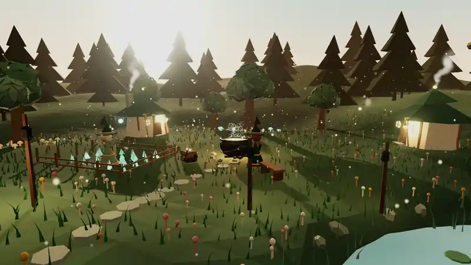
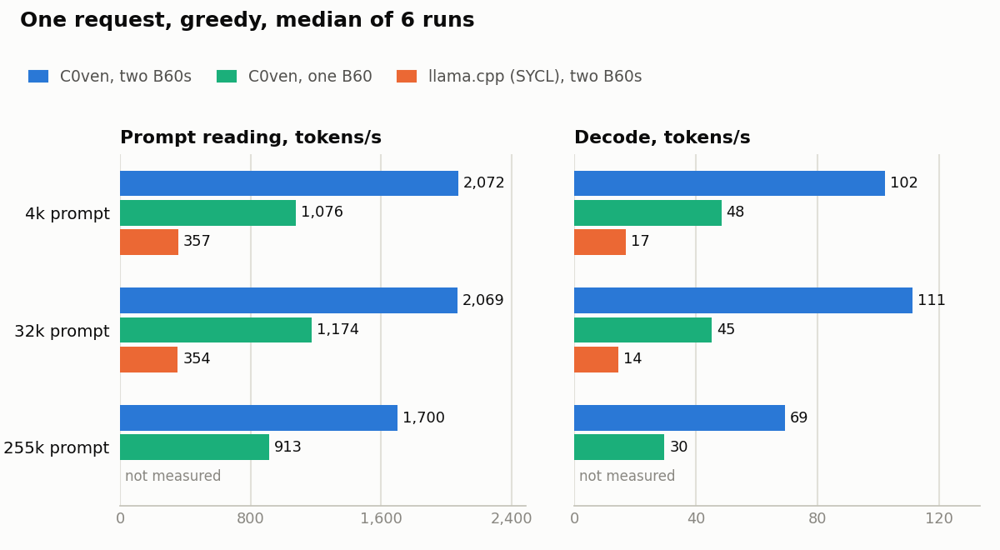
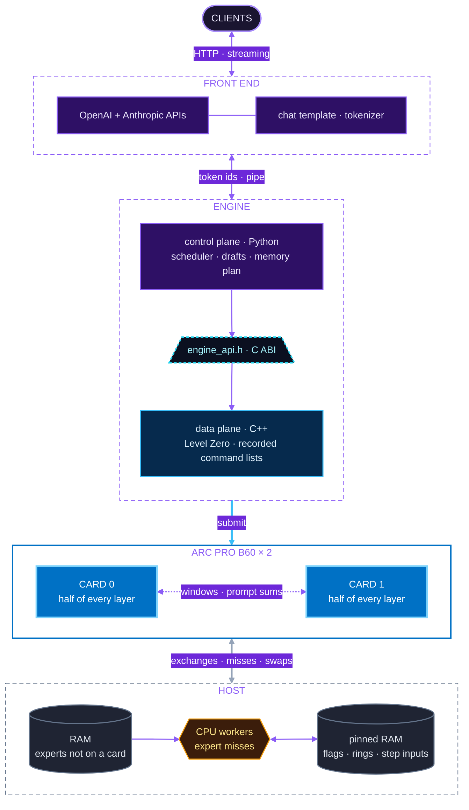

<p align="center"></p>

<p align="center"><a href="https://avra-m3.github.io/c0ven/docs/showcase/coven-hollow.html"></a><br>
<sub><em>Coven Hollow, built using c0ven, in one HTML file. <a href="https://avra-m3.github.io/c0ven/docs/showcase/coven-hollow.html">See it live</a>, or <a href="https://avra-m3.github.io/c0ven/docs/showcase/coven-hollow/#how-to-make-this">how to make this</a>.</em></sub></p>

<p align="center"><a href="https://github.com/avra-m3/c0ven/actions/workflows/ci.yml?query=branch%3Amain"></a> <a href="VERSION"></a></p>

A fast inference engine for one architecture, [Qwen3.8-Flash-Next](https://huggingface.co/Qwen/Qwen3.8-Flash-Next),
designed to run well on Intel Battlemage cards. It runs on one or two cards today, and support for more than two is
[planned](https://github.com/avra-m3/c0ven/issues/26). It is built for one user running a few threads on one machine, and it is fast for that case.

Just like witches, GPUs work better together in a coven. C0ven splits inference between the CPU and one or more
Battlemage GPUs through Intel's Level Zero API. It slots into your existing setup through its OpenAI and Anthropic
APIs.

## Is this for you?

Use C0ven if you have:

- one or two Intel Battlemage cards in one Linux machine, with the `xe` kernel driver. The engine is tested on Arc
  Pro B60 cards (24 GB each); other Battlemage cards likely work but are untested
  ([help test them](https://github.com/avra-m3/c0ven/issues?q=is%3Aissue+is%3Aopen+label%3A%22help+wanted%22)),
- a CPU with AVX-512 (VNNI, VBMI and BF16 among it), which computes the experts the cards do not hold,
- enough RAM to hold the model (the test machine has 96 GiB),
- one person, or a few requests at once, using the model.

C0ven is the wrong tool if you want to run other models, use other GPUs, or serve many users. Use llama.cpp or vLLM
for those.

C0ven owes a great deal to [Strata](https://github.com/mach10x/strata), which runs the same model on consumer
hardware and whose design C0ven borrows from ([docs/spec/](docs/spec/)). C0ven does not support NVIDIA or AMD cards;
if you have one, try Strata.

## Benchmarks

<picture>
  <source media="(prefers-color-scheme: dark)" srcset="docs/images/bench-dark.png">
  
</picture>

[How these were measured](docs/BENCHMARKS.md).

## Features

- Splits the work between both cards. The experts used most stay in VRAM, and the rest wait in RAM.
- Drafts up to 7 tokens a step with DFlash 2 (or 3 with the model's own MTP layer) and checks them in one step.
- Moves cached experts between RAM and VRAM as the routing of your requests changes.
- Contexts up to 262,144 tokens.
- Gives the cards back on request and takes them again in about 15 s, so llama-swap can run other models on them
  ([Sharing the cards](#sharing-the-cards-with-other-models)).
- OpenAI and Anthropic APIs, with streaming.
- Output checked against llama.cpp's CPU backend: teacher-forced greedy tokens agree on 98% of positions
  (1,044 of 1,063) for the reference prompts of up to 512 tokens ([record](docs/measurements/MEASUREMENTS.md#2026-10-14-decode-expert-kernels)).

## Quick start

You need Docker, the `xe` kernel driver, and the model files (see [Model files](#model-files)).

Find the render group's ID on your machine:

```bash
stat -c %g /dev/dri/renderD128
```

Start the server. Replace `993` with your group ID and `/path/to/models` with your model directory:

```bash
docker run --rm --device /dev/dri --group-add 993 --ulimit memlock=-1:-1 --read-only -p 127.0.0.1:8080:8080 -v /path/to/models:/models:ro -v c0ven-mtp:/cache -e ENGINE_MTP_CACHE_DIR=/cache/mtp ghcr.io/avra-m3/c0ven/serve:main --model /models/Qwen3.8-Flash-Next-GSQ-RCO-IQ3_S-00001-of-00002.gguf --slots 4 --context 262144 --host 0.0.0.0 --port 8080
```

What the `docker run` flags do:

| Flag | Why |
| --- | --- |
| `--device /dev/dri`, `--group-add 993` | the cards, and the render group that may open them |
| `--ulimit memlock=-1:-1` | lets the engine lock its expert arena in RAM; a load stops without it |
| `--read-only` | the image writes nothing to its root filesystem; it may be left out |
| `-p 127.0.0.1:8080:8080` | the API, on the host's loopback only. The server inside listens on `--host 0.0.0.0 --port 8080` |
| `-v /path/to/models:/models:ro` | the model files, read-only. `--model` names the GGUF's first shard inside the container |
| `-v c0ven-mtp:/cache`, `-e ENGINE_MTP_CACHE_DIR=/cache/mtp` | a named volume for the quantised draft layer |

The arguments after the image name are the server's [options](#options). To run it in the background, replace
`--rm` with `-d --name c0ven`; `docker logs -f c0ven` follows it, and `docker stop c0ven` stops it.

The `c0ven-mtp` volume keeps the quantised draft layer between runs. Without it, each start spends about 43 s
quantising it again ([record](docs/measurements/MEASUREMENTS.md#2026-10-16-load-phases); [DEVELOPING.md](docs/DEVELOPING.md)).

Send a request:

```bash
curl http://127.0.0.1:8080/v1/chat/completions -H 'Content-Type: application/json' -d '{"messages":[{"role":"user","content":"Hello"}],"stream":true}'
```

<!-- IMAGE: screenshot or GIF of a client streaming from C0ven, docs/images/demo.gif -->

## Model files

C0ven reads one model:

| File | Where from |
| --- | --- |
| The IQ3_S GGUF, 2 shards, 83.6 GB, or a smaller size ([below](#which-model-file-to-pick)) | [`ISTA-DASLab/Qwen3.8-Flash-Next-GSQ-RCO-GGUF`](https://huggingface.co/ISTA-DASLab/Qwen3.8-Flash-Next-GSQ-RCO-GGUF), folder `IQ3_S/` or the size's own |
| The MTP draft layer, in `mtp/` beside the GGUF | the 31 `mtp.*` tensors from [`Qwen/Qwen3.8-Flash-Next`](https://huggingface.co/Qwen/Qwen3.8-Flash-Next) |
| The image encoder, beside the GGUF (for images) | `mmproj-Qwen3.8-Flash-Next-BF16.gguf`, in the same ISTA-DASLab repository |

[MODEL_FILES.md](docs/MODEL_FILES.md) gives the pinned revisions and checksums, how to fetch the MTP tensors, how to
lay the files out and how to point the engine at them.

## Which model file to pick

The same repository has the model in four sizes. IQ3_S is the default; the smaller files are faster and need less
RAM, and give up some accuracy:

| File | Download | RAM the engine takes | Decode, 4k prompt (tokens/s) | Benchmarks, share of the original's |
| --- | ---: | ---: | ---: | ---: |
| IQ3_S | 83.6 GB | [22.6 GiB](docs/measurements/MEASUREMENTS.md#2026-10-19-other-quants) | [85.6](docs/measurements/MEASUREMENTS.md#2026-10-18-against-llama-cpp) | 100.2% |
| IQ3_XXS | 75.8 GB | [14.6 GiB](docs/measurements/MEASUREMENTS.md#2026-10-19-other-quants) | [98.3](docs/measurements/MEASUREMENTS.md#2026-10-19-other-quants) | 99.4% |
| IQ2_XS | 68.0 GB | [7.1 GiB](docs/measurements/MEASUREMENTS.md#2026-10-19-other-quants) | [100.8](docs/measurements/MEASUREMENTS.md#2026-10-19-other-quants) | 95.7% |
| Q2_0 | 66.4 GB | about 5.6 GiB (*estimate*) | [104.4](docs/measurements/MEASUREMENTS.md#2026-10-19-other-quants) | 95.7% |

On two cards, one slot, a 262,144-token context. The benchmark column is ISTA-DASLab's, from
[the files' model card](https://huggingface.co/ISTA-DASLab/Qwen3.8-Flash-Next-GSQ-RCO-GGUF): the mean of AIME25,
GPQA-Diamond and LiveCodeBench v6 against the original 16-bit model. [CHOOSING_A_MODEL.md](docs/CHOOSING_A_MODEL.md)
explains each column and helps you choose.

## Options

The server's flags:

| Flag | Default | What it does |
| --- | --- | --- |
| `--model` | | The GGUF file (any shard). |
| `--slots` | `1` | How many requests can run at once. |
| `--context` | `262144` | Context length in tokens. |
| `--default-max-tokens` | the rest of the context | What a request without `max_tokens` may write, in tokens (`32k` is 32,768). |
| `--kv-tokens` | slots x context | The KV cache the slots share, in tokens (`512k` is 524,288), at least `--context`. The tokens the requests do not hold lend their VRAM to the expert cache; with `--deterministic`, each token of it takes VRAM that would otherwise cache experts. See below. |
| `--host` | `127.0.0.1` | Address to listen on. |
| `--port` | `8080` | Port to listen on. |
| `--name` | | The model's name in the APIs. |
| `--engine-arg` | | Passed to the engine as is. Repeatable. |
| `--start` | `awake` | `asleep` waits for the first wake to load the model. |
| `--sleep-mode` | `keep` | `exit` has the engine exit on sleep: the RAM comes back too, and each wake is a full load. |
| `--admin-host` | `127.0.0.1` | Address for the admin routes. |
| `--admin-port` | | Serve `/admin/wake`, `/admin/sleep` and `/admin/lease` on this port. Without it there are none. |
| `--drain-timeout` | `30` | Seconds a sleep lets running requests go on before it cancels them. |
| `--log-level` | `INFO` | Log level. |
| `--metrics-log` | `0` | Seconds between log lines of the `/metrics` counters. Each request's record is logged too. `0`: none. |
| `--version` | | Print the version and exit. |

`--kv-tokens` sets the KV cache's size apart from `--slots`. With `--slots 4 --kv-tokens 512k`, four requests run
at once, and their prompts and answers together may hold up to 524,288 tokens. A request reserves its prompt plus
`max_tokens`, cut to the rest of the context, when it starts, and waits while the cache cannot hold that. A request without `max_tokens` reserves the
rest of the context, so with a shared cache set `--default-max-tokens` too: with `--kv-tokens 512k
--default-max-tokens 32k`, short requests without `max_tokens` run four at once. One that reaches the limit ends with
the finish reason `length`.

`ZE_AFFINITY_MASK` limits which cards the engine sees. Useful engine flags through `--engine-arg`: `--no-draft`,
`--no-vision`, `--deterministic` and `--checkpoints N` (`python -m engine --help` lists them all).

## API

| Endpoint | What it is |
| --- | --- |
| `POST /v1/chat/completions` | OpenAI Chat Completions |
| `POST /v1/messages`, `/v1/messages/count_tokens` | Anthropic Messages |
| `GET /v1/models` | The loaded model |
| `GET /health` | 200 and the engine's context when it is ready; 503 while it loads or sleeps |
| `GET /props` | Chat template, context, generation defaults |
| `GET /slots` | Slots and how many are busy |
| `GET /metrics` | Engine and front end counters, as JSON: requests, the core's steps, misses, drafts and swaps, and the ratios read from them |
| `POST /admin/wake`, `/admin/sleep`, `/admin/lease` | On `--admin-port` only: load the model, give the cards back, and hold it awake ([Sharing the cards](#sharing-the-cards-with-other-models)) |

## Sharing the cards with other models

C0ven can run as a service of its own that [llama-swap](https://github.com/mostlygeek/llama-swap) wakes and puts to
sleep, so that other models can have the cards in between ([ADR-0032](docs/adr/0032-sleep-the-front-end-stays-the-engine-keeps-the-arena.md)).
Asleep, the engine gives back the cards' memory and keeps its RAM, so a wake loads only the cards. A sleep took
0.38-0.72 s and a wake 14.2-20.7 s ([the record](docs/measurements/MEASUREMENTS.md#2026-10-17-sleep-and-wake)).
[The guide](docs/guides/share-the-cards.md) gives the steps.

## Known limits

- The expert arena, 10.85-20.5 GiB, counts against the engine's container memory limit: it is the engine's own
  memory, so that xe cannot move it under the host's reclaim and stall decode
  ([ADR-0035](docs/adr/0035-the-arena-in-the-engines-own-memory.md)).
- Asleep, the engine still holds its expert arena in RAM, about 20 GiB, the image encoder's 0.90 GB when it has
  one, and 0.32 GiB of VRAM a card
  ([Sharing the cards](#sharing-the-cards-with-other-models)).
  `--sleep-mode exit` gives the RAM back, and each wake is then a full load. Sleeping beside another model is not
  measured yet.
- Images and videos are read from `data:` URLs or base64 only, never fetched from a URL: `image_url` and
  `video_url` parts in the OpenAI API, `image` and `video` blocks in the Anthropic API. The designs,
  [ADR-0031](docs/adr/0031-images-through-the-prompt-path.md) for images and
  [ADR-0034](docs/adr/0034-video-as-pairs-of-frames.md) for video, are drafts, not yet accepted.

## How it works



The two cards share no link. A one-row decode step exchanges its partial sums through pinned host RAM; decode windows
and the prompt path write theirs straight into the other card's memory
([ADR-0030](docs/adr/0030-exchanges-into-the-other-card.md)). The CPU's expert misses go through flags in host RAM
that a kernel on the card spins on. The command lists are recorded in advance.

The front end handles text and starts the engine as its child process. Inside the engine, Python decides what to run
each step, and the C++ core runs it on both cards. The kernels are written for Battlemage's XMX units.
[DESIGN.md](docs/DESIGN.md) has the details.

## Building from source

<a id="the-image"></a>The engine is built, tested and run in one Docker image, defined by the
[`Dockerfile`](Dockerfile), with pinned versions ([ADR-0002](docs/adr/0002-pin-the-toolchain.md)).

```bash
docker build --target serve -t c0ven/serve .
```

Run it as in the [Quick start](#quick-start), with `c0ven/serve` in place of `ghcr.io/avra-m3/c0ven/serve:main`:

```bash
docker run --rm --device /dev/dri --group-add 993 --ulimit memlock=-1:-1 --read-only -p 127.0.0.1:8080:8080 -v /path/to/models:/models:ro -v c0ven-mtp:/cache -e ENGINE_MTP_CACHE_DIR=/cache/mtp c0ven/serve --model /models/Qwen3.8-Flash-Next-GSQ-RCO-IQ3_S-00001-of-00002.gguf --slots 4 --context 262144 --host 0.0.0.0 --port 8080
```

CI publishes only the serving image from `main`, as `ghcr.io/avra-m3/c0ven/serve:main` and under the version in
[`VERSION`](VERSION), such as `ghcr.io/avra-m3/c0ven/serve:0.0.1` ([ADR-0042](docs/adr/0042-version-numbers.md),
[ADR-0043](docs/adr/0043-publish-only-the-serving-image.md)). The development image, `--target engine`, is built
locally.

[DEVELOPING.md](docs/DEVELOPING.md) covers the development image, the build and the tests.

## Documentation

Each page is the one source of truth for its subject. Plans and work in progress are
[GitHub issues](https://github.com/avra-m3/c0ven/issues). The pages are also published as a site, with search:
<https://avra-m3.github.io/c0ven/> ([ADR-0047](docs/adr/0047-the-docs-site-built-by-zensical.md)).

For users:

- This README: running the server, its options, its API and its limits.
- [Guides](docs/guides/index.md): how to do one thing, step by step.
- [Showcase](docs/showcase/index.md): things coding agents have made, and how to make them.
- [MODEL_FILES.md](docs/MODEL_FILES.md): the model files: where to get them and how to lay them out for the engine.
- [CHOOSING_A_MODEL.md](docs/CHOOSING_A_MODEL.md): which of the four model files to pick, for your hardware and the
  speed and accuracy you want.
- [CACHING.md](docs/CACHING.md): how the server reuses the start of a prompt, and what load does to that.
- [BENCHMARKS.md](docs/BENCHMARKS.md): how the benchmarks above were measured.

For developers:

- [DEVELOPING.md](docs/DEVELOPING.md): building, running and the tests.
- [TESTING.md](docs/TESTING.md): the test levels, their references and tolerances.
- [DESIGN.md](docs/DESIGN.md): the architecture.
- [MEMORY_BUDGET.md](docs/measurements/MEMORY_BUDGET.md): what the model and its state take on each card and in RAM.
- [docs/spec/](docs/spec/): what the model computes, its quant formats, and Strata's design.
- [LEVEL_ZERO.md](docs/measurements/LEVEL_ZERO.md): Level Zero on the B60s, need by need.
- [REFERENCE_OUTPUTS.md](docs/measurements/REFERENCE_OUTPUTS.md): the llama.cpp outputs the engine is checked against.
- [MEASUREMENTS.md](docs/measurements/MEASUREMENTS.md): the measured numbers: Level Zero operations and kernels on the B60, the
  host, the engine, and the machine they were taken on.
- [The ADRs](docs/adr/README.md): the decisions, and why they were made.
- [AGENTS.md](AGENTS.md): the working rules for contributors, people and agents.

## License

C0ven is under the [MIT License](LICENSE). The model files are not part of it: each comes under its
publisher's own license, on its Hugging Face page ([MODEL_FILES.md](docs/MODEL_FILES.md)).
