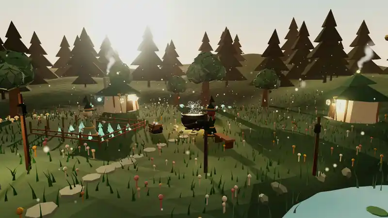
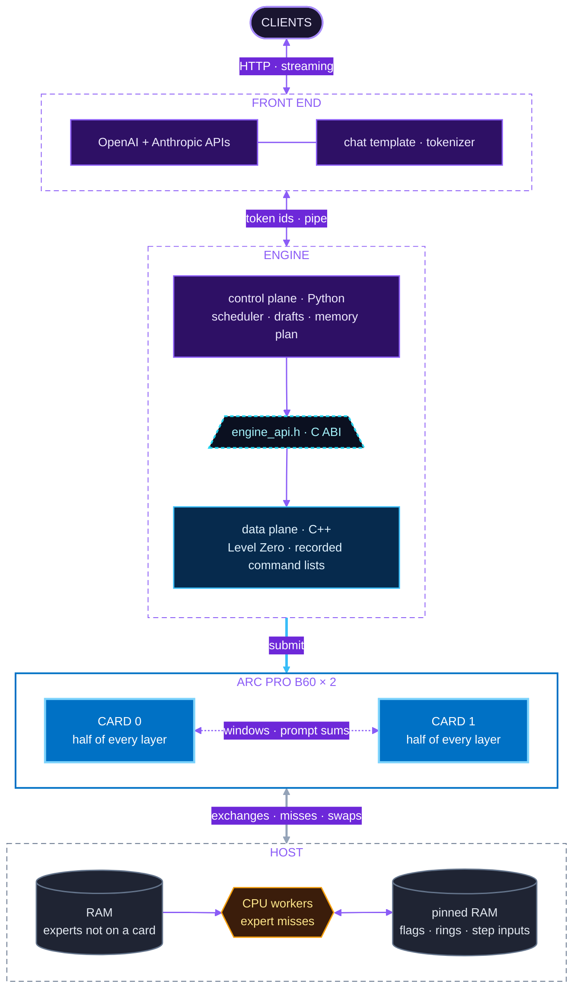

<p align="center"></p>

<p align="center"><a href="https://avra-m3.github.io/c0ven/docs/showcase/coven-hollow.html"></a><br>
<sub><em>Coven Hollow, built using c0ven, in one HTML file. <a href="https://avra-m3.github.io/c0ven/docs/showcase/coven-hollow.html">See it live</a>, or <a href="https://avra-m3.github.io/c0ven/docs/showcase/coven-hollow/#how-to-make-this">how to make this</a>.</em></sub></p>

<p align="center"><a href="https://github.com/avra-m3/c0ven/actions/workflows/ci.yml?query=branch%3Amain"></a> <a href="VERSION"></a></p>

A fast inference engine for one architecture, [Qwen3.8-Flash-Next](https://huggingface.co/Qwen/Qwen3.8-Flash-Next),
designed to run well on Intel Battlemage cards. It runs on one or two cards today, and support for more than two is
[planned](https://github.com/avra-m3/c0ven/issues/26). It is built for one user running a few threads on one machine, and it is fast for that case.

Just like witches, GPUs work better together in a coven. C0ven splits inference between the CPU and one or more
Battlemage GPUs through Intel's Level Zero API. It slots into your existing setup through its OpenAI and Anthropic
APIs.

## Is this for you?

Use C0ven if you have:

- one (or more) Intel Battlemage cards with at least 10 GB of VRAM between them, in one Linux machine, with the `xe` kernel
  driver. The engine is tested on Arc Pro B60 cards (24 GB each); other Battlemage cards likely work but are untested
  ([help test them](https://github.com/avra-m3/c0ven/issues?q=is%3Aissue+is%3Aopen+label%3A%22help+wanted%22)),
- an x86-64 CPU, which computes the experts the cards do not hold; the engine loads the build of its CPU code that
  uses the most of the CPU's features (AVX-512 down to plain x86-64),
- enough RAM that RAM and VRAM together come to 68 GiB with the default model file, or 45 GiB with the smallest
  ([Choosing a model](docs/CHOOSING_A_MODEL.md)),
- one person, or a few requests at once, using the model.

C0ven is the wrong tool if you want to run other models, use other GPUs, or serve many users. Use llama.cpp or vLLM
for those.

C0ven owes a great deal to [Strata](https://github.com/mach10x/strata), which runs the same model on consumer
hardware and whose design C0ven borrows from ([docs/spec/](docs/spec/)). C0ven does not support NVIDIA or AMD cards;
if you have one, try Strata.

## Benchmarks

<picture>
  <source media="(prefers-color-scheme: dark)" srcset="docs/images/bench-dark.png">
  
</picture>

[How these were measured](docs/BENCHMARKS.md).

## Features

- Splits the work between both cards. The experts used most stay in VRAM, and the rest wait in RAM.
- Drafts up to 7 tokens a step with DFlash 2 (or 3 with the model's own MTP layer) and checks them in one step.
- Moves cached experts between RAM and VRAM as the routing of your requests changes.
- Contexts up to 262,144 tokens.
- Gives the cards back on request and takes them again in about 15 s, so llama-swap can run other models on them
  ([Sharing the cards](#sharing-the-cards-with-other-models)).
- OpenAI and Anthropic APIs, with streaming.
- Output checked against llama.cpp's CPU backend: teacher-forced greedy tokens agree on 98% of positions
  (1,044 of 1,063) for the reference prompts of up to 512 tokens ([record](docs/measurements/MEASUREMENTS.md#2026-10-14-decode-expert-kernels)).

## Quick start

You need a Linux machine with Docker, the `xe` kernel driver and a model. Run each command below in a terminal.

### 1. Check your machine

Check that Docker works. This prints `Hello from Docker!`:

```bash
docker run --rm hello-world
```

If the command is not found, [install Docker](https://docs.docker.com/engine/install/). If it says permission denied,
[let your user run Docker](https://docs.docker.com/engine/install/linux-postinstall/), then log out and back in.

Check the kernel driver. One of the lines this prints should end in `/xe`:

```bash
ls -l /sys/class/drm/renderD*/device/driver
```

If none does, see [Intel's GPU setup guides](https://dgpu-docs.intel.com/).

### 2. Pick a model

[Choosing a model](docs/CHOOSING_A_MODEL.md) compares the files, with the RAM each needs and its speed on a B60. If you are not
sure, use IQ3_S, an 83.6 GB download.

### 3. Download it

Make a folder for the model:

```bash
mkdir -p ~/c0ven-models
```

Download the model into it. If you picked another file, replace `IQ3_S` at the end with its name:

```bash
docker run --rm --user "$(id -u):$(id -g)" -v ~/c0ven-models:/models --entrypoint python ghcr.io/avra-m3/c0ven/serve:main -m tools.model_fetch IQ3_S
```

The download is large, so expect it to take a while. It checks each file when it finishes. If it stops, run the same
command again and it carries on from where it was. At the end it prints the command to start the server.

### 4. Start the server

Run the command the download printed. For IQ3_S it is this one:

```bash
docker run --rm --device /dev/dri --group-add "$(stat -c %g /dev/dri/renderD128)" --ulimit memlock=-1:-1 --read-only -p 127.0.0.1:8080:8080 -v ~/c0ven-models:/models:ro -v c0ven-cache:/cache -e ENGINE_CACHE_DIR=/cache ghcr.io/avra-m3/c0ven/serve:main --model /models/Qwen3.8-Flash-Next-GSQ-RCO-IQ3_S-00001-of-00002.gguf --slots 1 --context 262144 --host 0.0.0.0 --port 8080
```

Leave this terminal open: the server runs until you press Ctrl+C. If your machine cannot fit the model, the server
says so and stops, and suggests options that fit.

Open a second terminal and check whether the model has loaded. This prints `200` when it is ready, and anything else
means it is still loading:

```bash
curl -s -o /dev/null -w '%{http_code}\n' http://127.0.0.1:8080/health
```

### 5. Send a request

```bash
curl http://127.0.0.1:8080/v1/chat/completions -H 'Content-Type: application/json' -d '{"messages":[{"role":"user","content":"Hello"}],"stream":true}'
```

Your tools can now use the server through its [OpenAI and Anthropic APIs](docs/API.md), at `http://127.0.0.1:8080`.

### What the start command does

| Flag | Why |
| --- | --- |
| `--device /dev/dri`, `--group-add "$(stat ...)"` | the cards, and the render group that may open them |
| `--ulimit memlock=-1:-1` | lets the engine lock its experts in RAM; a load stops without it |
| `--read-only` | the image writes nothing to its root filesystem; it may be left out |
| `-p 127.0.0.1:8080:8080` | the API, on this machine only. The server inside listens on `--host 0.0.0.0 --port 8080` |
| `-v ~/c0ven-models:/models:ro` | the model files, read-only |
| `-v c0ven-cache:/cache`, `-e ENGINE_CACHE_DIR=/cache` | keeps what a load works out, so the next start can reuse it |

The arguments after the image name are the server's [options](docs/OPTIONS.md). To run it in the background, replace
`--rm` with `-d --name c0ven`. `docker logs -f c0ven` follows it, and `docker stop c0ven` stops it.

## Sharing the cards with other models

C0ven can run as a service of its own that [llama-swap](https://github.com/mostlygeek/llama-swap) wakes and puts to
sleep, so that other models can have the cards in between.
Asleep, the engine gives back the cards' memory and keeps its RAM, so a wake loads only the cards. A sleep took
0.38-0.72 s and a wake 14.2-20.7 s ([the record](docs/measurements/MEASUREMENTS.md#2026-10-17-sleep-and-wake)).
[The guide](docs/guides/share-the-cards.md) gives the steps.

## Known limits

The RAM that holds the experts counts towards a container's memory limit. If you set `docker run --memory`, allow
at least the [RAM your model needs](docs/CHOOSING_A_MODEL.md).

## How it works



The two cards share no link. A one-row decode step exchanges its partial sums through pinned host RAM; decode windows
and the prompt path write theirs straight into the other card's memory. The CPU's expert misses go through flags in host RAM
that a kernel on the card spins on. The command lists are recorded in advance.

The front end handles text and starts the engine as its child process. Inside the engine, Python decides what to run
each step, and the C++ core runs it on both cards. The kernels are written for Battlemage's XMX units.
[DESIGN.md](docs/DESIGN.md) has the details.

## Building from source

<a id="the-image"></a>The engine is built, tested and run in one Docker image, defined by the
[`Dockerfile`](Dockerfile), with pinned versions.

```bash
docker build --target serve -t c0ven/serve .
```

Run it as in the [Quick start](#quick-start), with `c0ven/serve` in place of
`ghcr.io/avra-m3/c0ven/serve:main`.

CI publishes only the serving image from `main`, as `ghcr.io/avra-m3/c0ven/serve:main` and under the version in
[`VERSION`](VERSION), such as `ghcr.io/avra-m3/c0ven/serve:0.0.1`. The development image, `--target engine`, is built
locally.

[DEVELOPING.md](docs/DEVELOPING.md) covers the development image, the build and the tests.

## Documentation

Each page is the one source of truth for its subject. Plans and work in progress are
[GitHub issues](https://github.com/avra-m3/c0ven/issues). The pages are also published as a site, with search:
<https://avra-m3.github.io/c0ven/>.

For users:

- [OPTIONS.md](docs/OPTIONS.md): the server's options.
- [API.md](docs/API.md): the server's endpoints, and how requests carry images and video.
- [Guides](docs/guides/index.md): how to do one thing, step by step.
- [Showcase](docs/showcase/index.md): things coding agents have made, and how to make them.
- [MODEL_FILES.md](docs/MODEL_FILES.md): the model files: where to get them and how to lay them out for the engine.
- [CHOOSING_A_MODEL.md](docs/CHOOSING_A_MODEL.md): the model files you can run, what each needs and how fast it is.
- [CACHING.md](docs/CACHING.md): how the server reuses the start of a prompt, and what load does to that.
- [BENCHMARKS.md](docs/BENCHMARKS.md): how the benchmarks above were measured.

For developers:

- [DEVELOPING.md](docs/DEVELOPING.md): building, running and the tests.
- [TESTING.md](docs/TESTING.md): the test levels, their references and tolerances.
- [DESIGN.md](docs/DESIGN.md): the architecture.
- [MEMORY_BUDGET.md](docs/measurements/MEMORY_BUDGET.md): what the model and its state take on each card and in RAM.
- [docs/spec/](docs/spec/): what the model computes, its quant formats, and Strata's design.
- [LEVEL_ZERO.md](docs/measurements/LEVEL_ZERO.md): Level Zero on the B60s, need by need.
- [REFERENCE_OUTPUTS.md](docs/measurements/REFERENCE_OUTPUTS.md): the llama.cpp outputs the engine is checked against.
- [MEASUREMENTS.md](docs/measurements/MEASUREMENTS.md): the measured numbers: Level Zero operations and kernels on the B60, the
  host, the engine, and the machine they were taken on.
- [The ADRs](docs/adr/README.md): the decisions, and why they were made.
- [AGENTS.md](AGENTS.md): the working rules for contributors, people and agents.

## License

C0ven is under the [MIT License](LICENSE). The model files are not part of it: each comes under its
publisher's own license, on its Hugging Face page ([MODEL_FILES.md](docs/MODEL_FILES.md)).
