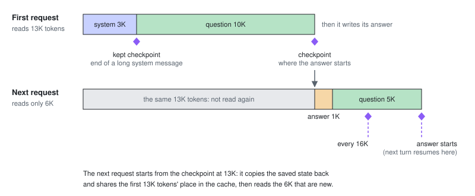
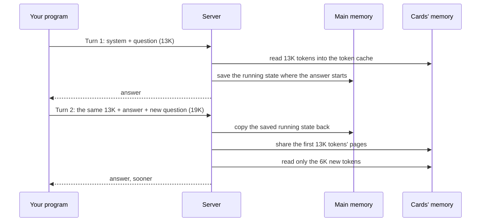
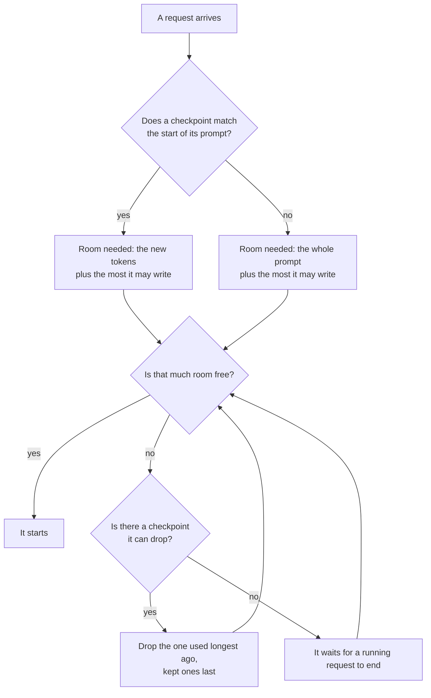
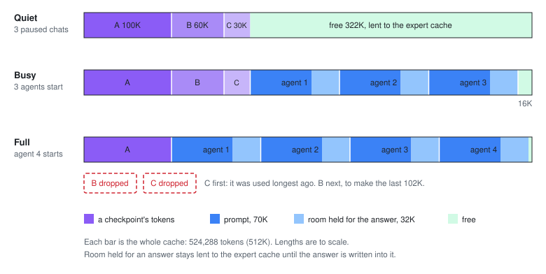
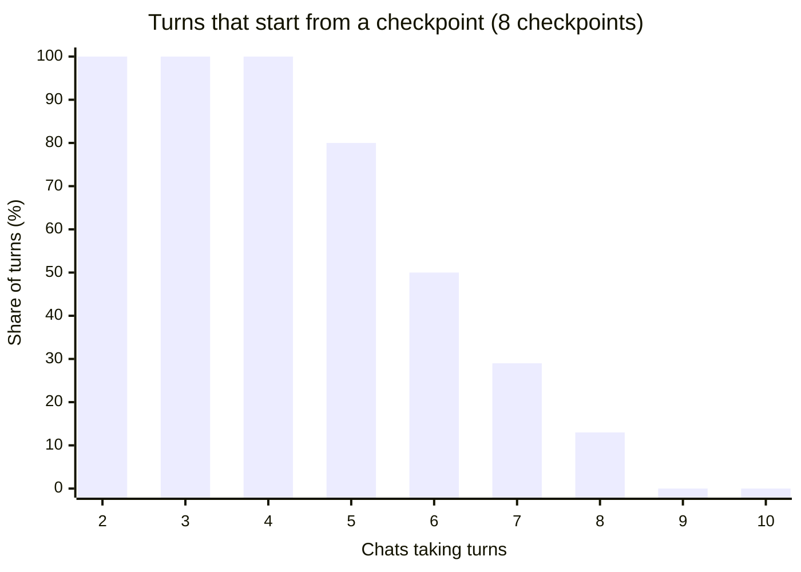

# Caching and load

This page explains what the server keeps in memory between requests, how it reuses the beginning of a prompt it has
seen before, and why that reuse works well on a quiet server and less well on a busy one. It is for people who run the
server and want to understand what they see, without knowing how the model works inside. The flags it mentions are
listed in the [README](../README.md#options).

A token is a piece of text, often a short word or part of one. A prompt is the whole conversation so far, as tokens:
the system message, every question and every answer. Sizes on this page are in tokens, with K for 1,024 tokens, as the
flags write them: 512K is 524,288 tokens.

## What the model keeps while it reads

The model reads a prompt one token after another and keeps two things as it goes.

The first is the **token cache**: a small entry for each token read, which every later token looks back at. It
lives in the cards' memory and grows by one entry per token. The code and the flags call it the KV cache, as in
`--kv-tokens`.

The second is the **running state**: a summary of everything read so far, the same size however long the prompt is.
Each token changes it. It cannot be wound back: from the state after 20K tokens, there is no way to get the state
after 13K.

Both are needed to go on from where a prompt ends. The token cache alone is not enough, which is why the next
sections need checkpoints.

## The shared room for the token cache

All requests share one token cache of a fixed size, set by `--kv-tokens`. With `--slots 4 --kv-tokens 512k`, up to
four requests run at once, and together they hold at most 512K tokens. The cache is cut into pages of 4 tokens, so a
request holds whatever pages it needs, wherever they are.

When a request starts, the server holds room for its whole prompt plus the most it may write: its `max_tokens`, or
`--default-max-tokens` when it gives none. The room is held up front so that a request never runs out of space
halfway through an answer. If the room is not there, the request waits.

## Reusing the beginning of a prompt

Most prompts start the way an earlier one did. The next turn of a chat repeats the whole conversation so far and adds
a question. Agents send the same long system message and tool list at the start of every request. The part two
prompts share at their start is called their **prefix**.

Reading a prefix again would give the same token cache and the same running state as the first time, so the server
saves them and skips that work. The token cache's pages can simply be shared. The running state cannot, because the
state the server holds is the one from the end of the earlier prompt, not from the end of the prefix. So at chosen
points the server saves a copy of the running state. Such a copy, together with the token cache pages that come
before it, is a **checkpoint**.

A checkpoint has two parts, in two places:

- the copy of the running state, about 118 MB, in the computer's main memory;
- a hold on the pages of the token cache for every token before it, in the cards' memory. Those pages stay in the
  cache while any checkpoint or request still uses them.

Checkpoints are taken where a later prompt is likely to match up to:

- where each answer starts, so that the next turn of the same conversation can go on from there;
- every 16K tokens of a long prompt, so that a prompt that matches only part of the way still saves most of the work;
- at the end of a system message of 2,048 tokens or more. This one is **kept**: it is dropped only when no other
  checkpoint can be. At most two are kept at a time.

When a request arrives, the server looks for the checkpoint with the longest match to the start of its prompt. If it
finds one, it copies the saved running state back, shares the token cache pages before it, and reads only the rest.
The first token of the answer then comes after reading a few thousand tokens instead of the whole conversation.

Several requests that share a prefix and arrive together do not each read it. The first one reads it and takes the
checkpoint; the others wait for that checkpoint, then start from it.

## The room the requests leave goes to speed

The model is made of many small parts called experts, and each token uses only a few of them. The cards cannot hold
them all, so they keep the most used ones, the **expert cache**, and the computer's processor works out the rest,
which is slower. The more experts the cards hold, the faster the server writes.

The part of the token cache that holds nothing is lent to the expert cache. Room held for an answer that has not been
written yet is lent too, until the answer needs it. With 4 slots and 512K tokens, lending the free room let the cards
hold 331 experts a layer instead of 248, and one request wrote 16% faster
([measured](measurements/MEASUREMENTS.md#2026-10-20-kv-pool-and-expert-cache-share)). With `--deterministic`, nothing
is lent.

So the cards' memory is shared three ways. Running requests come first. Checkpoints come next: their pages count as in
use, and they stay until a request needs the room. The expert cache gets what is left.

## What load does to checkpoints

Two limits decide how many checkpoints the server keeps.

The first is a count. The server keeps 8 checkpoints (set with `--engine-arg=--checkpoints=N`, each one another
118 MB of main memory). A new checkpoint past the count pushes out the one used longest ago.

The second is room. A request that cannot get its room drops checkpoints, the one used longest ago first and the kept
ones last, until it fits. It never drops the checkpoint it is about to start from. If dropping the others still does
not make room, it waits for a running request to end.

A dropped checkpoint costs nothing until its conversation comes back. Then the server reads that whole conversation
again, and the first token of its answer comes that much later.

### Example: four agents arrive at once

The server runs with `--slots 4 --kv-tokens 512k --default-max-tokens 32k`. Three chats are paused, and each has a
checkpoint where its last answer started: chat A at 100K tokens, B at 60K and C at 30K. C was used longest ago, A most
recently. The checkpoints hold 190K of the 512K tokens, and the other 322K is free and lent to the expert cache.

Four agents then send requests at once, each with a 70K-token prompt and no `max_tokens`, so each needs 70K + 32K =
102K tokens of room:

1. Agents 1, 2 and 3 fit in the free room. 16K is left.
2. Agent 4 needs 102K. The server drops C's checkpoint (46K free), then B's (106K free), and agent 4 starts.
   A's checkpoint stays. 4K is left.

While the agents run, the users of A and B come back, each with a 2K-token question. Neither fits in the 4K left, so
both wait. When the first agent ends, 106K is free:

- A still has its checkpoint. It needs only 2K + 32K = 34K of room, starts at once, and reads 2K tokens.
- B lost its checkpoint. It needs its whole 62K-token prompt + 32K = 94K of room, but only 72K is left after A, so it
  waits for another agent to end. Then it reads all 62K tokens, about 37 seconds of reading (*estimate*: 63,488
  tokens at the 1,713 tokens a second
  [measured](measurements/MEASUREMENTS.md#2026-10-20-kv-pool-and-expert-cache-share) for a 179,969-token prompt).

On a quiet server, the same follow-up from B would have read 2K tokens.

### Example: more conversations than checkpoints

Here the room is plentiful and the count runs out. Several short chats take turns, one after another, each turn a few
thousand tokens. Each turn starts from its chat's last checkpoint and takes a new one where its answer starts, so for a
while each chat holds two checkpoints: the one it just used and the new one. With 8 checkpoints, four chats keep
everything they need. A fifth starts pushing out checkpoints that are about to be used, and from nine on, no turn finds
its checkpoint.

The chart counts the turns that started from a checkpoint, out of five turns of each chat after its first. It comes
from running the server's own checkpoint bookkeeping (`engine/seqstate/`) on this pattern, not from a measurement.

Real traffic is less regular: a chat that answers quickly reuses its checkpoint before others push it out. The shape
holds, though: once more conversations are active than the checkpoints can cover, the ones that pause longest read
their whole prompt again.

## What this means for settings

A `max_tokens` close to what a request really writes holds less room, so more requests run at once and fewer
checkpoints are dropped to make room. `--default-max-tokens` does the same for requests that give none.

A larger `--kv-tokens` gives checkpoints more room to stay. Room that nothing uses is lent to the expert cache, but
the cards always keep enough memory free to give the whole token cache back, so a larger cache leaves fewer experts
that the cards hold for certain.

More checkpoints help when many conversations take turns, as in the second example. Each one costs 118 MB of main
memory, and they still need room in the token cache.
