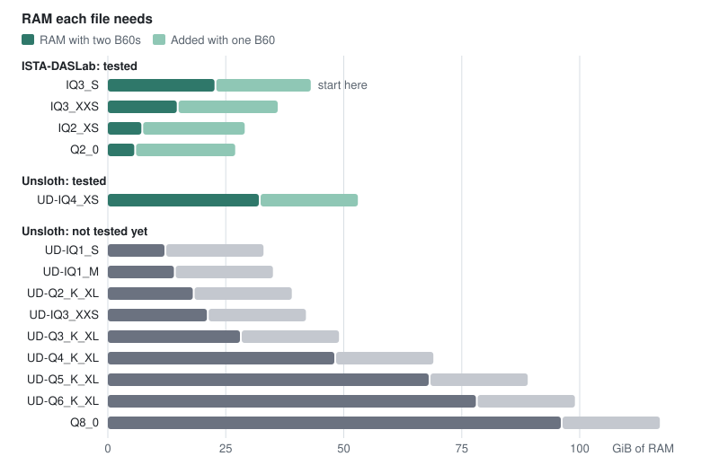

# Choosing a model

C0ven runs one model, Qwen3.8-Flash-Next. You download it as one file, and the files differ in size. A smaller file
needs less RAM, and its answers can be a little less accurate.

Two publishers make these files. ISTA-DASLab has four, and these are the ones to start with: we have run them all and
ISTA-DASLab publishes their accuracy. Unsloth has ten: we have run one, and expect the rest to work.

## Which file to pick

| Your situation | File |
| --- | --- |
| Not sure, and you have the RAM for it | IQ3_S |
| You want to use less RAM with almost no loss of accuracy | IQ3_XXS |
| You are short of RAM | IQ2_XS, or Q2_0 for the least RAM |
| You want answers closest to the original model, and have RAM to spare | UD-IQ4_XS |

Then go to the [quick start](../README.md#3-download-it) and use the file's name in the download command. You can
change your mind later: download another file and start the server with it.

To see what your machine has free, read the `available` column of `free -h` for RAM and the `Avail` column of `df -h ~`
for disk. You need the download size plus about 2 GB for the parts that go with it.

## ISTA-DASLab's files

We have run all four on two B60s, and IQ3_S on one B60 as well. Accuracy is the publisher's average test score, as a
share of the original model's. Read 100% and 99% as matching the original.

| File | Download | RAM, one B60 | RAM, two B60s | Accuracy |
| --- | ---: | ---: | ---: | ---: |
| IQ3_S | 83.6 GB | [43 GiB](measurements/MEASUREMENTS.md#2026-10-19-one-card) | [22.6 GiB](measurements/MEASUREMENTS.md#2026-10-19-other-quants) | 100% |
| IQ3_XXS | 75.8 GB | ~36 GiB | [14.6 GiB](measurements/MEASUREMENTS.md#2026-10-19-other-quants) | 99% |
| IQ2_XS | 68.0 GB | ~29 GiB | [7.1 GiB](measurements/MEASUREMENTS.md#2026-10-19-other-quants) | 96% |
| Q2_0 | 66.4 GB | ~27 GiB | ~5.6 GiB | 96% |

## Unsloth's files

Unsloth publishes no accuracy scores for these files.

### Tested

We have run this file on two B60s. Its choice of next word matches the original model's more often than IQ3_S's does:
[87.4%](measurements/MEASUREMENTS.md#2026-10-29-kl-ud-iq4xs) of the time against
[84.7%](measurements/MEASUREMENTS.md#2026-10-29-kl-bf16).

| File | Download | RAM, one B60 | RAM, two B60s |
| --- | ---: | ---: | ---: |
| UD-IQ4_XS | 93.7 GB | ~53 GiB | [~32 GiB](measurements/MEASUREMENTS.md#2026-10-29-ud-iq4xs-speed) |

### Not tested yet

We expect these to work, because [the engine has code](MODEL_FILES.md#unsloths-other-files) for every kind of weight in
them, but none has been run. If you try one, please [tell us how it went](https://github.com/avra-m3/c0ven/issues).

| File | Download | RAM, one B60 | RAM, two B60s |
| --- | ---: | ---: | ---: |
| UD-IQ1_S | 72.5 GB | ~33 GiB | ~12 GiB |
| UD-IQ1_M | 74.5 GB | ~35 GiB | ~14 GiB |
| UD-Q2_K_XL | 78.9 GB | ~39 GiB | ~18 GiB |
| UD-IQ3_XXS | 82.0 GB | ~42 GiB | ~21 GiB |
| UD-Q3_K_XL | 90.0 GB | ~49 GiB | ~28 GiB |
| UD-Q4_K_XL | 111.3 GB | ~69 GiB | ~48 GiB |
| UD-Q5_K_XL | 158.3 GB | ~89 GiB | ~68 GiB |
| UD-Q6_K_XL | 169.2 GB | ~99 GiB | ~78 GiB |
| Q8_0 | 188.2 GB | ~117 GiB | ~96 GiB |

## About the RAM figures

RAM is what the engine takes with one request at a time and a 262,144-token context. Each further request slot adds
about 3.2 GiB. Your system and other programs need room beyond this: if the machine starts to swap, every reply slows
down.

A figure with `~` is an *estimate*, from the engine's memory plan for that file plus 4 GiB, the amount the plan fell
short of IQ3_S's measured peak. Q2_0's on two B60s is its measured expert memory plus the 3.7 GiB the other files added.
UD-IQ4_XS's on two B60s is a measured figure, set against IQ3_S's 21 GiB in the same test.

## Accuracy test by test

ISTA-DASLab scored its files on three hard tests against the original 16-bit model. These are
[their figures](https://huggingface.co/ISTA-DASLab/Qwen3.8-Flash-Next-GSQ-RCO-GGUF), in percent correct:

| File | AIME25, maths | GPQA-Diamond, science | LiveCodeBench v6, coding | Average, as a share of the original's |
| --- | ---: | ---: | ---: | ---: |
| The original | 100 | 91.92 | 87.43 | 100% |
| IQ3_S | 100 | 92.93 | 86.86 | 100.2% |
| IQ3_XXS | 100 | 91.41 | 86.29 | 99.4% |
| IQ2_XS | 96.67 | 87.37 | 83.43 | 95.7% |
| Q2_0 | 96.67 | 89.39 | 81.14 | 95.7% |

A score above the original's is chance, because the tests are small. Nobody has measured these files on everyday
questions, summaries or chat.

## Keeping several files

ISTA-DASLab's four files share a 28.8 GB second part. The download reuses it when you already have one of them in the
folder, so a second file costs 28.8 GB less. Unsloth's files share nothing with them.

The [benchmarks](../README.md#benchmarks) show IQ3_S's speed on one and two cards.
