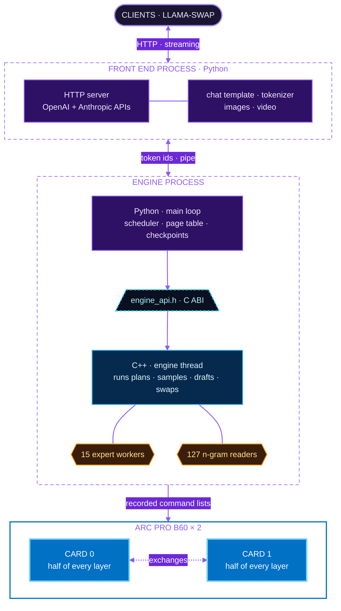
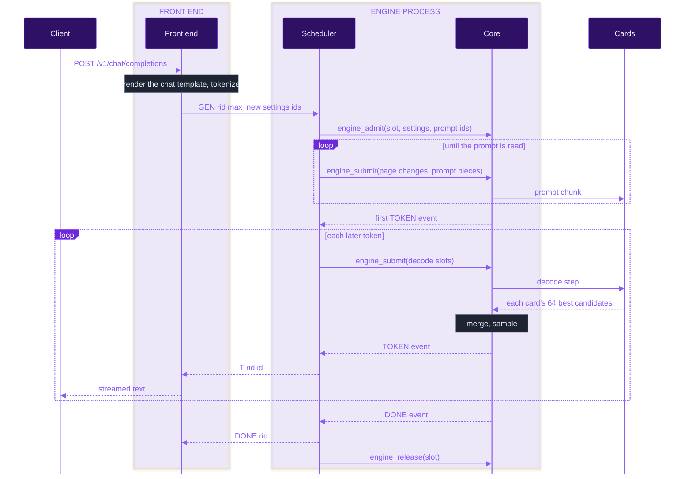
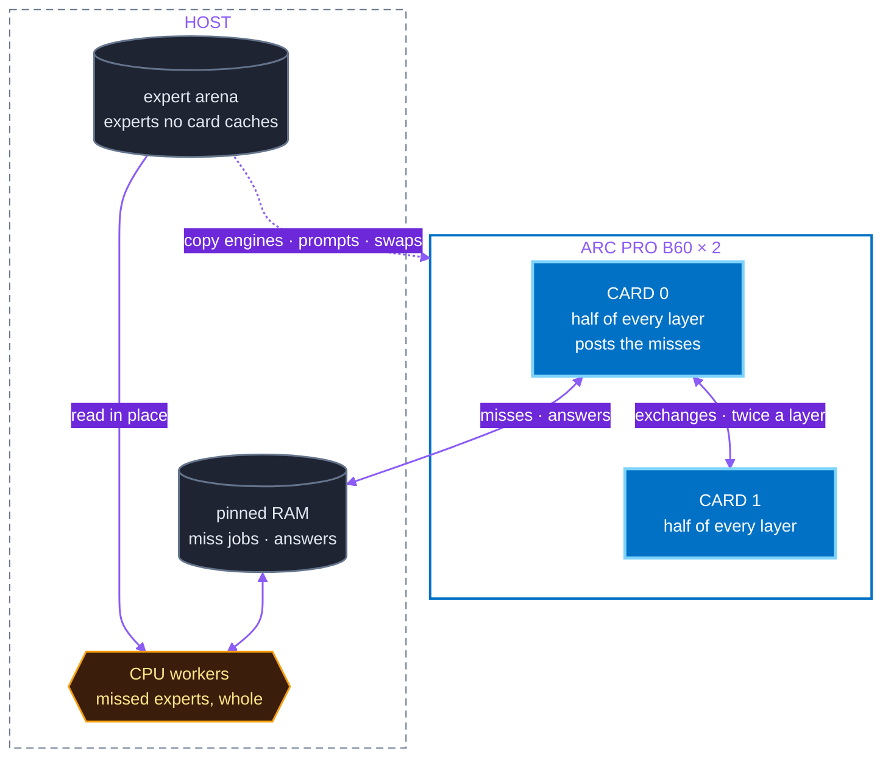
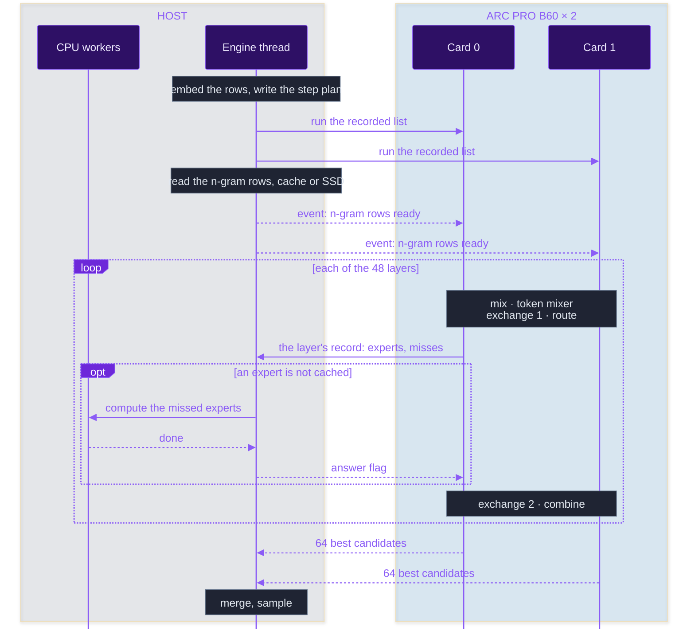

# Design

How the engine is built, as the code runs it now: its parts, what each part owns, how a request and a token move
through them, and the rules each part keeps. Why each choice was made is in the [ADRs](adr/README.md).
[DEVELOPING.md](DEVELOPING.md) walks through the code, [measurements/MEMORY_BUDGET.md](measurements/MEMORY_BUDGET.md) gives the sizes, and
[docs/spec/](spec/) says what the model computes. [ADR-0024](adr/0024-repository-layout.md) says where code goes.
Measured numbers link their row in [measurements/MEASUREMENTS.md](measurements/MEASUREMENTS.md), which also describes
[the test machine](measurements/MEASUREMENTS.md#the-test-machine). Words used throughout are in [Terms](#10-terms).

## Contents

1. [The parts](#1-the-parts)
2. [A request, end to end](#2-a-request-end-to-end)
3. [The C ABI between Python and C++](#3-the-c-abi-between-python-and-c)
4. [Sequence state: the KV cache and the rest](#4-sequence-state-the-kv-cache-and-the-rest)
5. [Two cards: every layer split across both](#5-two-cards-every-layer-split-across-both)
6. [Memory](#6-memory)
7. [Timing and debugging](#7-timing-and-debugging)
8. [Compared with other engines](#8-compared-with-other-engines)
9. [One decode step, and the CPU side](#9-one-decode-step-and-the-cpu-side)
10. [Terms](#10-terms)

## 1. The parts

| Part | What it is | What it owns | Code |
| --- | --- | --- | --- |
| Front end | A Python process: the service that clients and llama-swap talk to | The HTTP APIs, the chat template, tokenizing and detokenizing, stop strings, splitting reasoning, content and tool calls, JSON output, turning images and video into patches, sleep and wake | `frontend/` |
| Engine process, Python side | The front end's child process | The scheduler, admission, the page table, checkpoints, the memory plan, the cost model | `engine/` |
| Engine process, C++ core | A library the Python side loads with `ctypes` | Level Zero, every allocation on the cards and in pinned host memory, the recorded command lists, sampling, drafting, swaps, the image encoder | `core/`, `kernels/`, `shared/` |
| The cards | Two Arc Pro B60s | Half of every layer each (section 5) | |
| CPU workers | Threads of the core | The experts the cards do not hold (section 9) | `core/cpu/` |

The front end starts the engine process as its child and talks to it in token ids, one line per message over a pipe
([`protocol.py`](../protocol.py)). Every line about a request carries its id. If the engine dies, every request in
flight gets an error and the next request starts it again. A fault on the cards cannot take down the API
([ADR-0022](adr/0022-two-processes-python-and-cpp.md)).

One engine process drives both cards. Host memory that both cards read must come from one Level Zero context that
holds both cards: memory imported into a second context serves only one card
([the host memory record](measurements/MEASUREMENTS.md#2026-10-12-host-memory)).

Inside the engine process, Python decides what runs and the C++ core runs it. They meet only at the C ABI
(section 3).

The front end can put the engine to sleep, so that llama-swap can give the cards to other models. Asleep, the engine
frees its memory on the cards and keeps its RAM, and the front end stays up and answers every request with 503 until a
wake ([ADR-0032](adr/0032-sleep-the-front-end-stays-the-engine-keeps-the-arena.md);
[the README](../README.md#sharing-the-cards-with-other-models)).

## 2. A request, end to end

1. The front end checks the request, renders it through the chat template
   ([MODEL_IO.md, section 4](spec/MODEL_IO.md#4-the-tokenizer-and-the-chat-template)) and tokenizes it. A prompt
   that fills the context is refused, never truncated. A `max_tokens` past the context's end is cut to the rest of the
   context, and a request that reaches it ends with the finish reason `length`. A request's images and video frame
   pairs go before its `GEN`, one `IMG` line each, with the patches in a memfd that the engine reads.
2. The engine process reads lines on a thread of its own. After a `GEN` reaches an idle engine, it waits 2 ms for more
   lines before it plans, so requests sent together read their prompts in one plan
   ([the record](measurements/MEASUREMENTS.md#2026-10-17-requests-sent-together)).
3. The scheduler admits the request into a free slot, or queues it. When a checkpoint holds the start of the prompt,
   the slot restores it and reads only the rest (section 4). `engine_admit` copies the settings and the prompt ids
   into the core once. From then on the request is a slot number.
4. The scheduler reads the prompt in pieces. While another request is writing, it sizes each piece by time, so that
   decode keeps its share ([ADR-0017](adr/0017-scheduling-several-requests.md)). A piece of up to 64 tokens with no
   image runs as decode windows; a longer one goes through the prompt path (section 9).
5. The core runs each plan in order: its page changes, its prompt pieces, then one decode step for every slot that
   is writing. Python keeps two plans queued while any slot decodes, so the core never waits for Python between
   steps.
6. The core samples each token on the host from the cards' candidates, as llama.cpp does: the request's penalties,
   top-k, top-p, min-p, then its temperature and seed ([MODEL_IO.md, 2.4](spec/MODEL_IO.md#24-the-sampler)). A token
   depends only on the seed, its position and the tokens before it, never on how the work was split into steps.
   The penalties reorder those candidates only, so a penalised token never falls below one the cards did not return.
7. The scheduler turns each token event into a `T` line. The front end detokenizes, splits reasoning, content and
   tool calls, and streams.
8. The core ends a request at a stop token, at `max_tokens` or at the end of the context. The front end ends one at
   a stop string by sending `STOP`. Either way the slot is released.

## 3. The C ABI between Python and C++

[`include/engine_api.h`](../include/engine_api.h), version 9, is the one boundary between the Python side and the
core ([ADR-0022](adr/0022-two-processes-python-and-cpp.md)). Python loads the core with `ctypes`
(`engine/api/native.py`). `engine/api/abi.py` mirrors the header by hand, and a test checks every size and offset
against the built library.

| Call | What it does |
| --- | --- |
| `engine_open` | Loads the model and allocates everything. Reports the cards, slots, context, experts cached per layer, pages, checkpoints, and the memory each card and the arena take |
| `engine_admit` | Copies a request's settings and prompt ids into a free slot, once |
| `engine_admit_images` | Gives an admitted slot the images and video frame pairs of its prompt |
| `engine_release` | Frees a slot |
| `engine_submit` | Queues a step plan: page changes, prompt pieces, decode slots. Does not wait |
| `engine_poll`, `engine_wait` | Takes out events: tokens, prompt progress, finished requests and plans, stalls, errors. `wait` blocks until one is ready, without holding Python's GIL |
| `engine_checkpoint`, `engine_restore`, `engine_drop` | Copies a slot's fixed state to or from a checkpoint (section 4) |
| `engine_read_timing` | Takes out timing records (section 7) |
| `engine_sleep`, `engine_wake` | Frees, then loads again, everything the engine holds on the cards |
| `engine_last_error`, `engine_close`, `engine_abi_layout` | The last error's text; freeing everything; the layout table the ABI test reads |

The rules, from the header:

- C++ never calls Python. There are no callbacks, so no C++ thread waits for Python's GIL.
- Only the header's plain structs and buffers cross. Every call returns an `engine_status`, and no exception crosses.
- The core owns all memory and threads. Python owns every decision. It holds no device pointer, Level Zero handle or
  flag, only slot, page and checkpoint numbers.
- Calls are coarse: a few per step. A call through `ctypes` costs 0.3-2.3 µs
  ([the design-inputs record](measurements/MEASUREMENTS.md#2026-10-13-design-inputs)).

The scheduler is written against `engine/api/interface.py`, which differs from the header in several places.
`NativeEngine` in `engine/api/native.py` bridges the two, and
[ADR-0027](adr/0027-the-c-abi-as-the-core-was-optimised.md) lists each difference with what the adapter does. The
interface has three backends: `native` (the core, on the cards), `mock` (made-up tokens and real plans, with every
page table checked) and `reference` (replays llama.cpp's greedy tokens for the reference prompts). The last two run
without a card ([DEVELOPING.md](DEVELOPING.md#running-without-the-cards)).

## 4. Sequence state: the KV cache and the rest

Only 12 of the model's 48 layers keep a KV cache
([MODEL_LAYER.md, 3.7](spec/MODEL_LAYER.md#37-the-kv-layout-and-what-is-stored-per-token)). The other 36 are DeltaNet
layers, whose state has a fixed size.

| State of one sequence | Size | How it is kept |
| --- | ---: | --- |
| K, V and indexer keys of the 12 attention layers, 8-bit ([ADR-0008](adr/0008-kv-cache.md)) | 14,688 B per token ([measurements/MEMORY_BUDGET.md](measurements/MEMORY_BUDGET.md#kv-computed)) | In pages of 4 cells, in VRAM. Grows with the context. Can be shared with another request that starts the same way |
| The 36 DeltaNet layers' state and the n-gram embedding's history ([MODEL_LAYER.md, 2.7](spec/MODEL_LAYER.md#27-state-per-sequence)) | 118,038,528 B | Fixed size, overwritten by every token. Copied only into a checkpoint |
| The draft layer's KV | [measurements/MEMORY_BUDGET.md](measurements/MEMORY_BUDGET.md#state-and-the-rest-computed) | Each slot's own run of cells, not paged ([ADR-0033](adr/0033-paged-kv-kept-by-python.md), item 8) |

| Part | What it does | Code |
| --- | --- | --- |
| Bookkeeping, in Python | Slots, the page table, reference counts, reservations, the checkpoint pool, finding a shared prefix. It handles only integers | `engine/seqstate/` |
| Layout, one header | A page is 4 cells, one indexer block. Where each cell's K, V and indexer key sit. The kernels and the C++ code include the same header | `core/models/qwen4exp/layout.h` |
| Bytes, in the core | Applies a plan's page changes, writes each slot's row of the page table to both cards, copies partial pages, saves and restores the fixed state | `core/models/qwen4exp/state.cpp`, `core/api/engine_api.cpp` |

The rules ([ADR-0033](adr/0033-paged-kv-kept-by-python.md)):

- A page id names the same page on both cards. On two cards a slot's logical page `i` maps only to a page `p` with
  `p % 2 == i % 2`, because the indexer keys of page `p` live on card `p % 2` (below).
- A slot reads and writes only through its mapped pages. A slot that reaches a position past them waits, and says so
  once with a `STALLED` event, until a plan maps more. The scheduler maps a writing slot's pages at least 64 cells
  ahead, 256 cells at a time, so that few plans carry page changes.
- A shared prefix reuses its full KV pages and copies the partial last one. Its DeltaNet state can be reused only
  through a checkpoint taken where the prefix ends, so a later request with the same prefix waits for the first
  one's checkpoint ([ADR-0017](adr/0017-scheduling-several-requests.md)). Prefixes are matched by token ids, never by
  text.
- The engine process keeps 8 checkpoints by default (`--checkpoints`), in pinned host memory allocated at start. The
  least recently used goes first. `engine_checkpoint` and `engine_restore` wait for every queued plan to run.
- A window of drafts runs the DeltaNet state forward for every row. The core then keeps the state of the accepted
  rows only. The KV cells of rejected rows are overwritten when those positions come again
  ([MODEL_LAYER.md, 2.8](spec/MODEL_LAYER.md#28-what-must-be-saved-to-roll-back-rejected-draft-tokens)).

### The indexer on two cards: split by position

The indexer picks which 2,048 cached positions each query attends to, by scoring one key per position block. Each
card keeps the indexer keys of its own pages and scores them. The two cards then exchange their best 512 blocks
through host memory, and both merge them to the same choice. The keys are never copied to both cards. This costs one
more exchange per attention layer. Copying every key to both cards would cost each card 214 MB at 262,144 tokens, the
room for about 209 experts ([ADR-0033](adr/0033-paged-kv-kept-by-python.md), options not chosen).

## 5. Two cards: every layer split across both

Each card holds and computes half of every layer
([ADR-0023](adr/0023-two-cards-tensor-split.md), which replaces [ADR-0009](adr/0009-two-cards.md)). Nothing a card
owns is copied to the other. Only the exchanges and the CPU's answers cross.

| Tensors | How they are split |
| --- | --- |
| Projections into heads or channels: attention's q, k, v and gate, DeltaNet's, the hyper-connections', the shared expert's gate and up, the vocabulary head | By output rows. Each card computes half the heads or values |
| Projections out of them: attention's and DeltaNet's output, the shared expert's down | By input columns. Each card gives a partial sum, and an exchange adds the two |
| Cached experts | By rows. Both cards hold the same experts and work on every expert of a token at once |
| The router, the norms, the indexer's projections | Whole on both cards |
| The token embedding | Half of every row on each card |
| Experts no card caches | Whole, in the host's expert arena, computed by the CPU |

The rule for each tensor is in `engine/models/qwen4exp/split.py`.

The cards exchange partial sums twice per layer, and each exchange is signalled by an event. The first adds the token
mixer's output, the second the experts'. A one-row step exchanges through pinned host memory. A window of two rows or
more writes each card's partial sums straight into the other card's memory, and so does the prompt path
([ADR-0030](adr/0030-exchanges-into-the-other-card.md)). An attention layer adds a third exchange, for the indexer
(section 4).

Both cards route every token in full, so both know its misses. Card 0 alone hands them to the CPU, through flags in
host memory, each with one writer ([ADR-0011](adr/0011-cpu-gpu-signalling.md)). The CPU computes each missed expert
whole, in place in the arena, and card 0 adds the answer to its partial sum. A decode step copies no expert onto the
cards. The prompt path and swaps do, through the copy engines (section 9), and a prompt chunk of 1,024 rows or fewer
through copies the runtime makes with the CPU ([DEVELOPING.md](DEVELOPING.md#how-a-prompt-chunk-runs)).

The weights are the only large data, about 5.1 GB read per decode token, half on each card
([measurements/MEMORY_BUDGET.md](measurements/MEMORY_BUDGET.md#what-one-decode-token-reads-computed)). They never move during decode: each
byte is read where it lives. Everything else that moves per row is kilobytes: the exchanges, a miss's activation and
answer, the step plan, the token ids. What those cost is time spent waiting for each other.

No card is kept busy to hold its clock up. In decode both cards stay at 2,400 MHz in 99.74-100% of samples
([the record](measurements/MEASUREMENTS.md#2026-10-16-gpu-clock-in-decode)).

## 6. Memory

| Where | What it holds |
| --- | --- |
| Each card's VRAM (`zeMemAllocDevice`) | The card's half of every layer's weights and of each cached expert, its KV pages and state heads, its buffers and recorded lists |
| Pinned host memory (`zeMemAllocHost`) | What both cards or the CPU read: step plans, the misses' jobs and answers, the one-row exchanges, the step's n-gram rows, the cards' candidates, the checkpoints, the image encoder's weights |
| The expert arena: the engine's own memory, from `mmap` in 1 GiB pieces with huge pages | Every expert no card caches, each in one place. The CPU reads it for misses and copies from it for short prompt chunks, and the copy engines read it in place for longer chunks and swaps. The driver cannot move this memory under the host's reclaim, and it counts against the engine's cgroup ([ADR-0035](adr/0035-the-arena-in-the-engines-own-memory.md); [known limits](../README.md#known-limits)) |
| RAM | The n-gram rows already read, in a cache |
| The SSD | The n-gram table, 28.8 GB, read with `O_DIRECT` past the page cache ([ADR-0015](adr/0015-ngram-table-on-the-ssd.md)) |

The engine never uses shared memory (`zeMemAllocShared`), because the driver moves its pages without the engine
knowing.

Everything on the cards and in pinned host memory is allocated when the engine loads or wakes. A request takes only a
slot, pages and checkpoints from pools that already exist. Python's memory plan (`engine/memory_plan.py`) checks
before load that the options fit the host, and gives the core its page count. The core fits as many experts per
layer on each card as its memory allows, after leaving `reserve_bytes` (512 MiB) free
([ADR-0027](adr/0027-the-c-abi-as-the-core-was-optimised.md), item 3).

With swaps on, the KV pool and the expert cache share that memory ([ADR-0045](adr/0045-the-kv-pool-and-the-expert-cache-share-each-cards-memory.md)). The pool's buffers and
each layer's cache are ranges of addresses that never move, backed by 2 MB blocks of device memory that do. Python
takes the lowest free page first, and each plan tells the core how many pages at the top of the pool hold nothing.
Their blocks cache experts until the pages below them are needed: the core then takes blocks from the layers whose
cached experts are used least, and gives them back to the cache in the swap rounds as pages free. The cards always
keep room for the whole pool, so the cache holds at least about as many experts as a whole pool would leave it.
A change waits on the engine thread only for the copies of the experts that stay and the new maps; the blocks then
move on a thread beside the next steps, since no list reads them
([ADR-0048](adr/0048-the-kv-splits-blocks-move-beside-the-steps.md)).

A swap copies the expert leaving the cards into the arena place of the one coming in. Every staging slot of the
prompt path keeps its arena piece, so its copy list, recorded once at load, stays valid
([the record](measurements/MEASUREMENTS.md#2026-10-17-swaps-keep-the-copies)). That copy runs on a thread of its own behind the
next steps, and until it ends the CPU reads the leaving expert from the spare piece the swap thread filled; a prompt
chunk waits for it. When the pool and the cache share the cards, the staged set grows and shrinks with the cache: the
round that changes it records the prompt path's next list behind the steps, and frees the one before behind the next
round. The engine thread chooses those rounds, and a round that refills the cache first ends the moves of the round
before.

Asleep, the engine frees everything on the cards and the checkpoints, and keeps the arena and the image encoder's
weights in RAM, so a wake reads only the cards' part of the model again
([ADR-0032](adr/0032-sleep-the-front-end-stays-the-engine-keeps-the-arena.md)).

## 7. Timing and debugging

The core keeps its last 4,096 timing records, one for each prompt piece, decode step or draft round, with its rows
and the experts the CPU computed. `engine_read_timing` takes them out. The core stores only these small binary
records. Python adds them up and formats them.

The core also keeps counters since open, `engine_stats` in [`include/engine_api.h`](../include/engine_api.h): plans
and the engine thread's time in them; prompt chunks and windowed pieces with their rows and time; decode steps that
verified no drafts, with their rows, time, the experts the CPU computed and the layers that missed; draft rounds the
same, and each slot's run in a round by the source of its drafts, the draft layer or the slot's own tokens, with the
drafts verified and accepted and the rounds' time; swap rounds, the experts they swapped and their time; stalls,
checkpoints and restores; the n-gram table's rows, cache hits and SSD reads; and the experts cached per layer at the
last plan's end, beside the fewest the load keeps room for (ADR-0045). Each counter is one addition where the timing record is already written, so the step pays nothing
that a measurement could see. `engine_read_stats` copies them out, awake or asleep; `engine_read_slot_stats` gives one
admitted slot's: its steps, rounds, drafts and the accepted ones, and the part from its own tokens
([ADR-0049](adr/0049-counters-in-the-core-read-by-a-snapshot-call.md)).

The engine process answers `STATS` with the core's counters and the scheduler's (the requests waiting, reading and
writing, and the cost model's parts), and each request's `DONE` line carries its wait for a slot, its steps and its
drafts. `/metrics` reports both, and the ratios read from the counters (`frontend/metrics.py`): a step's and a
round's time, misses per decode row, tokens per second of card time in plain steps and in rounds by draft source,
drafts accepted per run, the engine thread's busy share and the swap rounds' part of it.

The scheduler's cost model (`engine/timing.py`) keeps a moving average of a decode step's time. It fits a prompt
chunk's time as a fixed part, the staging of the layers' uncached experts, and a part per row, and sizes prompt pieces
by them ([ADR-0017](adr/0017-scheduling-several-requests.md)). Every piece pays the fixed part, so a prompt of up to
1,024 rows is read whole, and a longer one in pieces of at most 1,024 rows, each holding the writers about as long as
a short prompt does ([ADR-0044](adr/0044-a-short-prompt-is-read-whole.md)). The protocol's
`PP` and `DONE` lines carry each request's prompt and decode times.

`Options::trace` in the core times every kernel of a prompt chunk's or a decode step's lists, for tests and tools.

`tools/attach.py` reads a shared timing region that no backend provides yet, so it cannot attach to a running engine
([ADR-0027](adr/0027-the-c-abi-as-the-core-was-optimised.md), item 10).

In a container, `gdb` can debug the engine only when it starts it, unless the container has `CAP_SYS_PTRACE` or
`ptrace_scope` is 0. Debugging kernels on the card, with Intel's GDB through Level Zero's debug API, needs the
driver's debug switch on the host.

## 8. Compared with other engines

C0ven runs one model on one kind of machine. llama.cpp and vLLM run many models on many kinds of hardware.

| | C0ven | llama.cpp | vLLM |
| --- | --- | --- | --- |
| Made for | One model on two Intel Arc Pro B60 cards | Many models on almost any computer | Many users at once on data-centre GPUs |
| Requests at once | One person, or a few | A few | Many |
| Two cards | One process drives both. Each card does half of every layer, at the same time | By default each card holds some of the layers, and the cards take turns ([`--split-mode`][l-split]) | One process per card, with the model split between them ([architecture][v-arch]) |
| A model too big for the cards | The experts used most stay on the cards, and the CPU computes the rest. Which experts stay follows what you ask | You choose which layers' experts stay on the CPU when you start it ([`--n-cpu-moe`][l-split]) | Part of the weights can stay in RAM, read over PCIe on every step ([`cpu_offload_gb`][v-offload]) |
| The web server | Its own process. It stays up if the engine crashes, and starts it again | In the same process as the model ([server queue][l-queue]) | Its own process ([architecture][v-arch]) |
| How it reaches the GPU | Level Zero, Intel's lowest-level GPU interface | SYCL, on Intel cards | PyTorch |

Ideas C0ven takes from them:

- The web server and tokenizer in a process apart from the engine, talking in token ids, as vLLM
  ([architecture][v-arch]) and SGLang ([`engine.py`][sg-engine]) do.
- A request's data sent to the engine once, then only what changes each step, as in vLLM
  ([`sched/output.py`][v-schedout]).
- The KV cache in pages taken from a pool made at start, shared between requests that begin the same way
  ([`block_pool.py`][v-pool]), with one rule for each kind of layer state ([hybrid KV cache][v-hybrid]), as in vLLM.
- The GPU's work recorded ahead of time for a few batch sizes, as vLLM does with CUDA graphs
  ([`cudagraph_dispatcher.py`][v-graphs]).
- Memory for the worst case reserved at start, as llama.cpp does ([`llama-context.cpp`][l-reserve]).

Read at vLLM [`656d0d4`][v], SGLang [`e0c957e`][sg] and llama.cpp [`9d7d504`][l].

## 9. One decode step, and the CPU side

A decode step runs one row for each writing slot, or a window of one slot's rows. Each card runs a command list
recorded at load for the step's width: 1, 2, 4 or 8 rows. The list's first command copies the step plan from host
memory to the card, and the kernels read that copy: a word read from host memory at each launch's start makes every
launch slower ([the record](measurements/MEASUREMENTS.md#2026-10-16-bf16-products-occupancy)).

Per layer, each card:

1. Mixes the hyper-connections with its half of the `hc_*` weights' rows.
2. Runs its half of the token mixer: half of a DeltaNet layer's value heads and their state, or one of an attention
   layer's two KV heads. In an attention layer the indexer scores the card's own pages, and the cards exchange their
   best 512 blocks (section 4).
3. Exchange 1: the mixer output's partial sums. Both cards now hold the same residual.
4. Routes the token in full. Both cards pick the same 10 experts, with no exchange for it. Reading the whole router
   costs each card about 0.3 ms a token (0.13 GB at 455 GB/s, *estimate*). Splitting it would need a third exchange
   per layer, about 0.5 ms (48 x 10.0-10.5 µs, [the card-to-card record](measurements/MEASUREMENTS.md#2026-10-12-card-to-card)).
5. Computes its half of every cached expert the token uses, and of the shared expert. Card 0 writes the layer's
   record into host memory and raises its flag: the routed experts, the missed ones, and the activation the CPU
   needs.
6. If an expert missed, card 0 waits for the CPU's answer and adds it to its partial sum. Card 1 never waits. In a
   layer with no miss the CPU computes nothing and card 0 goes straight on
   ([the expert hit rates record](measurements/MEASUREMENTS.md#2026-10-12-expert-hit-rates)).
7. Exchange 2: the experts' partial sums, then the hyper-connection combine.

Layer 1 waits for the n-gram rows, which the host reads while the cards run layer 0
([MODEL_IO.md, 1.2](spec/MODEL_IO.md#12-the-n-gram-embedding-ple)). After the last layer each card computes its half
of the vocabulary's logits and returns its 64 largest. Logits never leave the cards. The host merges both cards'
candidates and samples.

The host takes part in every step. It embeds the rows, reads the n-gram rows, serves the misses, and samples before
the next step starts ([ADR-0027](adr/0027-the-c-abi-as-the-core-was-optimised.md), item 1).

### Drafts

When the decoding slots all write, a step is a draft round
([ADR-0029](adr/0029-the-engine-process-drafts-and-swaps.md)). For each slot, the token sampled last and its drafts run
as one window, and the windows of all slots run in one step. The slots share the step's 8 rows: a lone slot takes up to
3 drafts, and each of several up to 2, fewer as there are more of them. Each slot's window is accepted and committed on
its own. A step of several slots runs no drafts while any slot has prompt left to read, or when it gives one of them its
second token ([the record](measurements/MEASUREMENTS.md#2026-10-19-draft-rounds-several-writers)). A draft is accepted while it
equals what the main model samples at its place, and the main model samples one more token after the accepted ones. The
accepted rows are committed, and the draft layer reads them and drafts again. Drafting stops at a draft whose
probability under the request's sampler is below 0.5. Drafts never change the tokens, because the main model samples
every one.

A lone writing slot may draft from its own tokens instead: when its last tokens match an earlier run of 12 or more,
the tokens that followed that run are drafts, up to 7. The round takes them when they give more tokens a millisecond
than the draft layer's, by how often each source's drafts were accepted for the slot lately and by the times of the
core's own windows of each width (`core/api/lookup.cpp`,
[ADR-0041](adr/0041-drafts-from-the-slots-own-tokens.md)).

The draft layer is the model's MTP layer, split across the cards as an attention layer is. All its 512 experts sit on
the cards, so a draft never waits for the CPU (`core/models/qwen4exp/mtp.cpp`).

### Swaps

The core counts which experts the requests route to. Between plans it lets the uncached experts used most replace the
cached ones used least, up to 64 in a round, shared out among the slots that wrote in the plan before (32 for two, 16
for four): after a plan that ends a prompt, after every 8th plan while one slot writes and every 16th while several do,
never while a slot is reading its prompt (`core/models/qwen4exp/swap.cpp`). When the KV pool and the cache share the
cards (section 6), a round also moves blocks between them: to the pool when the pages backed above those in use run
low, and back to the cache, with the most used uncached experts, when many are free. A swap changes which experts the CPU computes, and so their rounding. Tokens repeat
exactly from run to run only with `--deterministic`, which turns swaps off
([ADR-0029](adr/0029-the-engine-process-drafts-and-swaps.md)).
A round holds the engine thread only to append the halves' copies, switch the maps and wait for the cards' copies,
about 3 ms; the swap thread chooses the next round's swaps and builds their halves from the arena behind the steps
([the record](measurements/MEASUREMENTS.md#2026-10-20-swap-round-behind-the-steps)).

### A prompt chunk

The prompt path reads up to 4,352 tokens in one pass on both cards, from up to four sequences at once. The products
run on the cards' matrix units (XMX). Each card's copy engine streams the experts the card does not cache from the
arena, two layers ahead, so the CPU computes nothing for a prompt. That streaming is most of a short chunk's time, and
prompts read in one chunk share it ([ADR-0017](adr/0017-scheduling-several-requests.md), item 2). An image's encoder
runs just before the chunk that holds the image's tokens. Its weights stream through the prompt path's staging slots,
so it holds no VRAM of its own ([ADR-0031](adr/0031-images-through-the-prompt-path.md)).
[DEVELOPING.md](DEVELOPING.md#how-a-prompt-chunk-runs) gives the kernels.

### The CPU side

Sixteen threads compute the misses: the engine thread and 15 workers, one per core of the 7945HX.
`ENGINE_CPU_WORKERS` sets the count. The threads are not pinned to cores.

A job is one layer's misses for all the step's rows, and each missed expert's weights are read once for all of them.
The workers compute each missed expert whole, from its place in the arena, with ggml's kernels for its type
([ADR-0004](adr/0004-write-or-reuse.md)). As the reference does, the activation is first converted to the type's
dot-product type ([MODEL_LAYER.md, section 6](spec/MODEL_LAYER.md#6-numerics-on-llamacpps-cpu-backend)).
For IQ2_S, IQ3_XXS, IQ3_S and IQ4_NL, a weight row that several rows need is decoded once for up to four of them,
in ggml's AVX2 steps, so each sum keeps ggml's bits ([ADR-0040](adr/0040-multi-row-dots-for-the-cpus-misses.md)).

The workers sleep between jobs. Workers that kept polling made decode slower on the shared host
([the CPU miss path's record](measurements/MEASUREMENTS.md#2026-10-15-cpu-miss-path)).

ggml has no SIMD path for Q2_0, so the 9 down tensors of that type are the slowest misses
([the CPU bar record](measurements/MEASUREMENTS.md#2026-10-11-cpu-bar)).

The workers share RAM bandwidth with both cards' reads of host memory and everything else on the host. Under a
competing RAM load they are 1.6-2.2 times slower ([the design-inputs record](measurements/MEASUREMENTS.md#2026-10-13-design-inputs)).
So the front end and the Python side stay light on RAM during decode, and the n-gram table bypasses the page cache.

## 10. Terms

| Term | Meaning |
| --- | --- |
| Slot | The place in the engine's tables that one request holds from admission to release. `--slots` sets how many |
| Plan, step plan | What Python submits for the core to run next: page changes, prompt pieces and the slots to decode |
| Step | One run of each card's recorded list: a row for each writing slot, or a window |
| Window | A step whose rows are consecutive positions of one sequence: drafts being checked, or a short prompt piece |
| Prompt path | The kernels that read a long prompt chunk in one pass |
| Expert | One of the 512 small feed-forward blocks in each layer. Each token uses 10 |
| Cached expert | An expert held on the cards, half on each |
| Miss | An expert a token uses that the cards do not hold. The CPU computes it |
| Expert arena | The host memory that holds every expert no card caches |
| Exchange | The two cards adding their partial sums, twice per layer |
| Cell, page | A cell is one position's KV in an attention layer. A page is 4 cells, the unit Python maps |
| Fixed state | The DeltaNet layers' state and the n-gram embedding's history: the same size at any position |
| Checkpoint | A copy of a slot's fixed state at a known position, so a later request that starts the same way skips reading that part |
| n-gram rows | The rows of the model's n-gram embedding that a token needs, from a 28.8 GB table on the SSD |
| Draft layer | The model's MTP layer, which proposes tokens that the main model then checks |
| Swap | Replacing a cached expert with one the requests use more |
| Control plane, data plane | Code comments' names for the engine process's Python side and its C++ core |

[v]: https://github.com/vllm-project/vllm/tree/656d0d4506052a23d100c56e148c7b984828d637
[v-arch]: https://github.com/vllm-project/vllm/blob/656d0d4506052a23d100c56e148c7b984828d637/docs/design/arch_overview.md
[v-offload]: https://github.com/vllm-project/vllm/blob/656d0d4506052a23d100c56e148c7b984828d637/vllm/config/offload.py
[v-schedout]: https://github.com/vllm-project/vllm/blob/656d0d4506052a23d100c56e148c7b984828d637/vllm/v1/core/sched/output.py#L232
[v-graphs]: https://github.com/vllm-project/vllm/blob/656d0d4506052a23d100c56e148c7b984828d637/vllm/v1/cudagraph_dispatcher.py
[v-pool]: https://github.com/vllm-project/vllm/blob/656d0d4506052a23d100c56e148c7b984828d637/vllm/v1/core/block_pool.py
[v-hybrid]: https://github.com/vllm-project/vllm/blob/656d0d4506052a23d100c56e148c7b984828d637/docs/design/hybrid_kv_cache_manager.md
[sg]: https://github.com/sgl-project/sglang/tree/e0c957e22259cef81587b26d0a9a15ca630dcadf
[sg-engine]: https://github.com/sgl-project/sglang/blob/e0c957e22259cef81587b26d0a9a15ca630dcadf/python/sglang/srt/entrypoints/engine.py#L242
[l]: https://github.com/ggml-org/llama.cpp/tree/9d7d5049804be03fce6575cc9f49c058b3c48788
[l-split]: https://github.com/ggml-org/llama.cpp/blob/9d7d5049804be03fce6575cc9f49c058b3c48788/common/arg.cpp#L2763-L2825
[l-queue]: https://github.com/ggml-org/llama.cpp/blob/9d7d5049804be03fce6575cc9f49c058b3c48788/tools/server/server-queue.h
[l-reserve]: https://github.com/ggml-org/llama.cpp/blob/9d7d5049804be03fce6575cc9f49c058b3c48788/src/llama-context.cpp#L715
