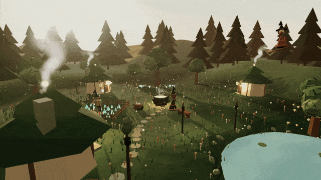

# Recreate the Coven Hollow animation with a coding agent

Coven Hollow is the animation in the README. It shows three witches at a cauldron, crooked cottages, a glowing
garden and a pond. Code in one HTML file draws all of it: [coven-hollow.html](coven-hollow.html). Open the file in a
browser to see it move. This guide has a coding agent write a scene like it, then record it as a GIF that loops.



## You need

- A coding agent that can write files and control a browser.
- A network connection. The page loads three.js 0.170.0 from a CDN. It needs no models, textures or build step.

## 1. Ask for the scene

```text
Make a single self-contained HTML file with an impressive animated Three.js scene: a cozy, whimsical
coven of witches at work in their little corner of the world. Storybook, Ghibli-like, everything built
procedurally: geometry, materials, shaders, particles. No external models or textures. Three.js 0.170.0
from an import map, OrbitControls and post-processing from the examples' jsm folder. Deep forest teal
(#1F3B34) is the palette backbone: roofs, pines, robes, shadows; warm complements over it: creams,
honey, amber, muted golds, blush, sage. Golden hour or soft twilight, never murky. A woodland clearing
with crooked cottages, herb gardens, glowing mushrooms, lanterns, a pond, drying herbs, potion bottles,
familiars (cats, owls, frogs), broomsticks, distant hills and trees. The witches do cheerful visible
magic: brewing, tending plants, floating ingredients, flying, chatting. Soft light, glow, drifting
particles (pollen, sparkles, fireflies, bubbles), haze, a lovely sky, ambient motion: chimney smoke,
swaying grass and leaves, rippling water. The viewer looks around and interacts. Full-window canvas,
resize handling, 60 fps, instancing for repeated details, pivot groups at swinging joints.
```

## 2. Ask for the loop

```text
Generate a GIF that loops to showcase the work. It must loop exactly, smooth 60fps, and have camera
movement.
```

A GIF loops with no visible seam only if the scene repeats. Every moving part must finish a whole number of
cycles in the length of the recording. Browsers show GIF frames at most every 20 ms, so a GIF plays at 50 fps at
most.

## How the file loops

The scene in [coven-hollow.html](coven-hollow.html) repeats every 8 s.

- Shader and script frequencies are whole multiples of the 8 s period.
- Particles, such as smoke and bubbles, have cycle lengths that divide 8 s.
- Things that would drift away, such as clouds, sway in place.
- The witch on the broom flies one full circuit in each period.
- Timed events, such as the spark between witches and the frog's hops, reset at the start of each period. The
  scene's random number generator resets with them.
- The camera moves at one steady speed along a closed path, once each period.

With `?pump` in the address, the page stops its own render loop. A script then moves the scene forward one frame
at a time and reads each frame as an image. The script runs two full periods to warm up, then records the third.
