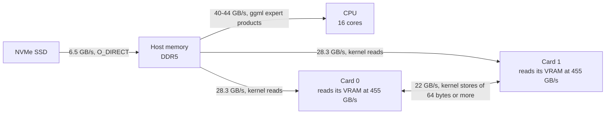

# Measurements

The engine's measured numbers: what operations cost on an Intel Arc Pro B60 through Level Zero, what the engine's
kernels reach, and how fast the engine runs. Each row gives a value and the date it was measured. The date links
the row, and code and other pages link these rows for their numbers.

## The test machine

Every number here was measured on one machine:

- two Intel Arc Pro B60 cards (24 GB each), each on its own PCIe 5.0 x8 link to the CPU;
- an AMD Ryzen 9 7945HX: 16 Zen 4 cores on two CCDs, with AVX-512 (VNNI, VBMI, BF16, IFMA);
- 96 GiB of dual-channel DDR5 at 5200 MT/s, about 90 GiB of it visible to Linux;
- a PCIe 4.0 NVMe SSD, which holds the model files;
- Linux 6.17 with the in-tree `xe` driver, and the engine image's user-space stack: compute-runtime 26.35.39758.10,
  IGC 2.41.5 and the Level Zero loader 1.32.0 ([ADR-0002](../adr/0002-pin-the-toolchain.md)).

Other software shares the machine. A number that rests on the host (the CPU's experts, host memory, load times)
moves with what else runs, so compare such numbers only within one row.

## How the numbers were taken

- A number is the median of at least five runs, or a range from least to most.
- "A → B" is a change judged against the code before it in ABBA order: rounds of A, B, B, A, at least three, so
  each arm runs six times. Each run is a fresh process with the same inputs
  ([ADR-0016](../adr/0016-how-a-change-is-judged.md)). Both arms of one row ran in one sitting. One row's A is not the
  previous row's B, so gains from several rows do not add up.
- A kernel is timed after at least 50 ms of work on its card. An idle B60 runs near 1200 MHz, and a kernel timed
  there looks 1.7-2 times slower ([the clock](#the-clock)).
- A change gave the same tokens in both arms unless its row says otherwise.
- `doc-4k-qa`, `doc-32k` and the other named prompts are in `reference/prompts.jsonl`. `long-4k`, `long-32k`,
  `long-128k` and `long-256k` are longer prompts kept with the records, not in the repository, as are `s512`,
  `s1024` and `s4352`, named by their length in tokens.

## Level Zero on a B60

[LEVEL_ZERO.md](LEVEL_ZERO.md) gives the calls. This section gives what they cost.

### Where data moves

Kernel reads, kernel stores and copy-engine copies, with the rate each reaches.

Both cards reading host memory at once reach about 45 GB/s together. A copy engine reads host memory at the
same 28.4 GB/s as a kernel. While a prompt runs, each card stages its experts from host memory at 19-22 GB/s.

### Memory

| Operation | Value | Measured |
| --- | --- | --- |
| Largest single device allocation (`zeMemAllocDevice`) | 22.71 GiB; 23.00 GiB with relaxed allocation limits | [2026-10-11](#2026-10-11-device-memory) |
| Device memory one card holds | 25.31 GB. Past VRAM, allocations spill to system RAM and do not fail. Only Sysman's free-memory figure shows where VRAM ends. | [2026-10-11](#2026-10-11-device-memory) |
| Kernel reads from VRAM | 455 GB/s a card; 909.5 GB/s for both | [2026-10-11](#2026-10-11-device-memory) |
| Kernel reads from host memory (`zeMemAllocHost`, one context for both cards) | 28.3 GB/s a card; about 45 GB/s for both | [2026-10-12](#2026-10-12-host-memory) |
| Host memory from `zeMemAllocHost` | The memory lock limit does not apply. Past 26-32 GiB the host swaps. Importing memory that already exists does not work. | [2026-10-12](#2026-10-12-host-memory) |
| Copy engine reading the process's own (anonymous) memory | 28.4 GB/s on both cards, the same as from `zeMemAllocHost` | [2026-10-17](#2026-10-17-anon-arena-under-reclaim) |
| One copy from anonymous memory | about 1.3 µs more than the same copy from `zeMemAllocHost` | [2026-10-17](#2026-10-17-anon-arena-default) |
| Recording a copy list whose sources are anonymous memory | The runtime binds each copy's source when the list is recorded (21-46 µs a copy) and unbinds it when the list is freed (50-89 µs). | [2026-10-17](#2026-10-17-swaps-keep-the-copies) |
| The same copies on an immediate list on the copy engine's ordinal | The runtime makes them with the CPU and binds nothing: the call returns when the copy is done, 47.8-56.5 µs for an expert's three copies (1.06 MB) with one card copying and 49.6-79.0 µs with both, against 48.8-48.9 µs on the copy engine with both; the first copy into a page of device memory 155-233 µs. Such a copy runs while the copy engine's queue waits on an event; a second queue on the copy ordinal is refused at index 1 (`0x78000004`), and at index 0 its list waits behind the first queue's | [2026-10-21](#2026-10-21-short-chunk-fetch) |
| Copies from anonymous memory, the VM in page-fault mode (the runtime's default; `sharedSystemAllocCapabilities` `0xf`) | A host migration of a 4 KiB page under a copy's binding resets the copy engine: a 512 MiB copy loop reset after 1,941 host migrations. 2 MiB pages, and pages the process replaces itself, did not | [2026-10-19](#2026-10-19-vm-fault-mode) |
| The same copies with `NEOReadDebugKeys=1 NEO_EnableRecoverablePageFaults=0` (no page faults; capabilities `0x0`) | No reset: the copy loop under 23,518-45,670 host migrations, its slowest copy 0.076-0.127 s against about 0.02 s; the engine on two cards, 6 runs under 117,121-3,031,892, same tokens, prompts 1,995.0-2,012.4 (doc-4k-qa) and 2,065.1-2,065.7 tokens/s (doc-32k). The key alone changes nothing | [2026-10-19](#2026-10-19-vm-fault-mode) |
| The engine out of fault mode (PR 13's `ze::init`) against in it, in one sitting | No change. ABBA, 6 fresh processes an arm, two cards: prompt reading 2,005.8 → 2,013.6 (doc-4k-qa) and 2,067.0 → 2,067.3 tokens/s (doc-32k); decode in the runs without a pause 85.2 → 85.7 and 74.6 → 74.8 tokens/s; first token 2.074 → 2.065 and 15.486 → 15.484 s; the same texts. Decode pauses of 0.3-0.9 s came in both arms alike | [2026-10-19](#2026-10-19-vm-without-fault-mode-speed) |
| Region copy (`zeCommandListAppendMemoryCopyRegion`) | half the rate of a plain copy | [2026-10-17](#2026-10-17-staging-half-downs) |
| Freeing 20 GiB of device memory, and mapping it again at the same addresses | 3.0-3.6 ms to free, 159-160 ms to map again | [2026-10-16](#2026-10-16-vram-give-back) |
| Replaying a list recorded before such a free | Works up to 16 GiB a card. Past 16 GiB the driver crashes (SIGSEGV in `libze_intel_gpu`). | [2026-10-16](#2026-10-16-vram-give-back) |
| Freed VRAM in Sysman's free figure | at once, or within 0.1 s if the other card read it | [2026-10-16](#2026-10-16-vram-give-back) |
| Freeing and mapping host physical memory the same way | fails with `ZE_RESULT_ERROR_OUT_OF_DEVICE_MEMORY` | [2026-10-16](#2026-10-16-vram-give-back) |
| VRAM held by an idle process with the runtime and every kernel loaded | 200 MiB a card | [2026-10-16](#2026-10-16-vram-give-back) |
| Level Zero's virtual memory: 2 MB blocks of device memory mapped into reserved ranges (`zeVirtualMemReserve`, `zePhysicalMemCreate`, `zeVirtualMemMap`) | Pages of 2 MB for ranges of 2 MB and up, 64 KB below. A block: create 32 µs, map 14 µs, unmap 63 µs, destroy 3.6 µs; moved from one range to another 60-116 µs. A physical allocation maps at one place at a time, any part of it. A list recorded before a remap reads the memory mapped after it. Copies through mapped blocks 197.2-197.4 GB/s, between plain allocations 198.0-198.1 | [2026-10-20](#2026-10-20-kv-pool-and-expert-cache-share) |

### Launches and command lists

| Operation | Value | Measured |
| --- | --- | --- |
| 960 small kernels launched one by one | 1.28 ms (1.3 µs a launch) | [2026-10-11](#2026-10-11-launch-cost) |
| The same 960 kernels replayed as 48 recorded lists | 0.83 ms, of which 0.06 ms host time | [2026-10-11](#2026-10-11-launch-cost) |
| Values that change each token, given to recorded kernels | Pass them through memory. Mutable command lists and indirect launches also work. | [2026-10-11](#2026-10-11-launch-cost) |
| A kernel reading one word of host memory at its start | 0.8 µs | [2026-10-16](#2026-10-16-bf16-products-occupancy) |
| Products that share inputs, launched together in a list with no ordering between them | a decode step 17.52 → 16.74 ms | [2026-10-16](#2026-10-16-decode-launches-together) |
| Two products fused into one launch, against the two launched together | 1.4-2.4 µs saved a pair | [2026-10-16](#2026-10-16-decode-launches-together) |
| Recording a copy list of about 35,000 copies | 45 ms; 8 ms of wait when recorded on a thread of its own | [2026-10-16](#2026-10-16-swaps-and-prompts) |
| Recording every list the engine uses, at load | 0.19 s | [2026-10-16](#2026-10-16-load-phases) |
| Global timestamps written by a recorded list of 600 small launches (`zeCommandListAppendWriteGlobalTimestamp`) | 2: 1.7-1.8 µs more a run (410.7 → 412.4-412.5 µs, medians of 120); 96: 84.8-84.9 µs more | [2026-10-25](#2026-10-25-kernel-clock) |

### Signals between the CPU and a card

| Operation | Value | Measured |
| --- | --- | --- |
| A spinning kernel seeing the CPU's write to host memory | Seen in 100 of 100 with a system-scope acquire fence before each volatile load. An atomic acquire load alone sees it in 21-37 of 100. | [2026-10-11](#2026-10-11-doorbell) |
| Round trip CPU → card → CPU through a flag in host memory | 4.54 µs median, 5.88 µs p99 | [2026-10-11](#2026-10-11-doorbell) |
| The same round trip with events | about the same as the flag | [2026-10-11](#2026-10-11-doorbell) |

### Between the two cards

| Operation | Value | Measured |
| --- | --- | --- |
| Round trip of flags alone through host memory | 6.4 µs | [2026-10-12](#2026-10-12-card-to-card) |
| Exchange of partial sums through host memory, 1-4 tokens | 10.0-10.5 µs; 96 in a row 0.99-1.03 ms | [2026-10-12](#2026-10-12-card-to-card) |
| Hand-off of 205 KB through host memory | 50.3 µs | [2026-10-12](#2026-10-12-card-to-card) |
| One fp16 store per work-item into host memory | 13-54 times slower than wider stores, and the sums were wrong | [2026-10-12](#2026-10-12-card-to-card) |
| Exchange of 2,560 floats a row, an event per exchange, through host memory | 3.9-5.0 µs at one row; 10.2-10.3 µs at four | [2026-10-16](#2026-10-16-peer-exchange) |
| The same exchange with the kernel writing into the other card's memory | 2.3-3.4 µs at one row; 5.1-5.2 µs at four | [2026-10-16](#2026-10-16-peer-exchange) |
| The same exchange as a copy into the other card | almost no saving at one row; 0.43 ms saved a decode step at four | [2026-10-16](#2026-10-16-peer-exchange) |
| A flag in the other card's memory in place of the event, 96 exchanges | 0.20 ms saved at one row, 0.16 ms at two; 0.05 ms lost at four | [2026-10-16](#2026-10-16-peer-exchange-decode) |
| Kernel stores into the other card's memory | 22.2-22.5 GB/s with stores of 64 bytes or more; 1.9 GB/s with one fp16 a work-item | [2026-10-15](#2026-10-15-prompt-exchange-stores) |
| Sending a 4,352-row chunk's mixed activations to the other card | 0.61 ms with 128-byte block stores; 11.7 ms with 2-byte stores | [2026-10-17](#2026-10-17-hc-split) |
| A copy of 1, 2 and 4 rows of 2,560 floats into the other card, by the copy's own timestamps (the load check) | 0.83, 1.04 and 1.77 µs | [2026-10-25](#2026-10-25-step-metrics) |
| A row to the other card and back, each card waiting on an event without timestamps, less the other card's copy, halved (the load check's hand-off) | 2.24-2.63 µs (median 2.55). A timestamp event that the other card waits on loses the device | [2026-10-25](#2026-10-25-step-metrics) |

### The clock

| Condition | Value | Measured |
| --- | --- | --- |
| Idle card | near 1200 MHz; a kernel timed there looks 1.7-2 times slower | [2026-10-11](#2026-10-11-kernel-spike) |
| Work needed to leave idle | about 50 ms | [2026-10-11](#2026-10-11-kernel-spike) |
| During decode, read by Sysman every 1.17 ms | 2,400 MHz, the top of the range, in 99.74-100% of samples, with no throttle reason | [2026-10-16](#2026-10-16-gpu-clock-in-decode) |
| Waiting between decode plans | down to 2,250 MHz for at most about 2 ms | [2026-10-16](#2026-10-16-gpu-clock-in-decode) |
| A kernel's `clock_read_device` (cl_khr_kernel_clock; IGC has it, its headers do not declare it), against the global timestamps | 2,399.4-2,399.8 ticks a µs over spans of 22-883 ms at the top clock: it counts the core clock's cycles. 1,303.5 over 41 µs and 2,300.9 over 461 ms while the clock rose from idle | [2026-10-25](#2026-10-25-kernel-clock) |

### What the driver reports

| Property | Value | Measured |
| --- | --- | --- |
| Extensions | every extension the design uses is listed | [2026-10-11](#2026-10-11-level-zero-report) |
| Contexts | one context holds both cards | [2026-10-11](#2026-10-11-level-zero-report) |
| Copy engines | one per card, at queue group ordinal 1 | [2026-10-11](#2026-10-11-level-zero-report) |
| Atomics on host memory | `ATOMIC`, not `CONCURRENT_ATOMIC` | [2026-10-11](#2026-10-11-level-zero-report) |
| Matrix and dot-product units | DPAS and DP4A flags set | [2026-10-11](#2026-10-11-level-zero-report) |
| PCIe link speed through Sysman | not reported | [2026-10-11](#2026-10-11-level-zero-report) |

## Kernels on a B60

The engine's kernels are OpenCL C ([ADR-0003](../adr/0003-kernel-language.md)). On the B60 the expert products read
257-344 GB/s at one token (56-76% of the card's 455 GB/s) and the dense products 370-421 GB/s. Experts in the
reordered layout run 3.2-8.8 times faster than in the file's layout
([2026-10-11](#2026-10-11-kernel-spike)).

### Decode kernels (1-4 rows)

"Step" is card 0's time in that kernel during one decode step, or the whole step where it says so.

| Kernel | Change | Kernel time | Step | Measured |
| --- | --- | --- | --- | --- |
| grouped expert products (`moe.cl`) | 32-bit offsets and vector loads; the kernels were bound by instructions, not memory | gate and up 2.0-2.4 times faster, down 1.2-2.1 times | 3.96 → 2.29 ms; 22.16 → 20.72 ms a token | [2026-10-14](#2026-10-14-decode-expert-kernels) |
| Q6_K, Q2_0 and i-quant decoders | bytewise subtraction in whole 32-bit words | Q6_K loop 187 instructions, was 299; Q6_K products about 4% faster | 17.34 → 17.255 ms a token, ranges overlapping | [2026-10-15](#2026-10-15-sub-bytes-words) |
| products of up to 512 rows | K split over 4 sub-groups | 6.7-7.7 → 3.5-4.6 µs | five products 1.22 → 0.81 ms; 17.76 → 17.48 ms a token | [2026-10-15](#2026-10-15-matvec-k-split) |
| hyper-connections' down product | K split of 8 in place of 16 | 19.1 → 18.1 µs at one row | 18.07 → 18.03 ms a token; greedy agreement moved to 1,041 of 1,063 | [2026-10-15](#2026-10-15-hc-down-split) |
| BF16 products | XMX units with bf16 activations | router's product 12.1 → 9.0 µs; PLE key product 169 → 123 µs | five products 1.41 → 1.11 ms; 19.13 → 18.82 ms a token; misses 25.01 → 25.12 a token from the rounding | [2026-10-15](#2026-10-15-bf16-products-xmx) |
| BF16 products | plan copied to each card in place of read from host memory | each launch 1.8-2.9 µs over a streaming read of its bytes; K split over work-groups 0.5-1.9 µs slower | 19.00 → 18.62 ms; decode 1.8-2.3% faster | [2026-10-16](#2026-10-16-bf16-products-occupancy) |
| out products (`ssm_out`, `attn_output`) | partial sums written in the card's memory and copied out, in place of written to host memory a float at a time | Q6_K at two rows 24.8 → 21.4 µs, four rows 35.6 → 26.3 µs; one row unchanged (19.9 against 20.0) | decode at long-4k 69.79 → 71.06 tokens/s | [2026-10-16](#2026-10-16-out-products-host-writes) |
| `router_group` | router and expert grouping in one launch | 0.822 → 0.688 ms | 19.17 → 19.07 ms a token, ranges overlapping | [2026-10-15](#2026-10-15-router-group) |
| `router_group` | threshold top 10 and the job written by a work split | one row 14.6 → 5.3 µs | 0.685 → 0.421 ms; 17.88 → 17.67 ms a token | [2026-10-15](#2026-10-15-router-top10) |
| `topk_select_few` (was `topk_rows`) | rank only a few candidates; same result, ties included | one row of 124,160 logits 281.3 → 26.2 µs | 20.69 → 20.19 ms a token | [2026-10-14](#2026-10-14-topk-rows) |
| `idx_cand`, `idx_merge` | no host-memory stores and no serial search | 37.0 → 9.8 µs and 57.1 → 15.7 µs | 20.32 → 19.56 ms a token; prompt 2,069 → 2,088 tokens/s | [2026-10-15](#2026-10-15-indexer-selection) |
| `idx_cand` top-513 selection | faster selection; merging hot bins alone was not enough | one launch at 30,834 values 80-279 → 59-155 µs | 1.865 → 0.92 ms a step at 246K positions; long-128k decode 63.48 → 64.58 tokens/s | [2026-10-16](#2026-10-16-indexer-select) |
| `gdn_conv`, `gdn_recur` | DeltaNet norm and gates moved in; two launches a layer fewer; same bits | 0.98 → 0.78 ms | 18.04 → 17.85 ms a token | [2026-10-15](#2026-10-15-gdn-fusion) |
| kernels that make a8 activations | write them directly; `quantize_a8` and five launches a layer gone | 0.69 ms a card removed, 0.15 ms added elsewhere | 19.35 → 19.11 ms a token, ranges overlapping | [2026-10-15](#2026-10-15-a8-fusion) |

### Decode kernels at a card's share of a layer

GB/s each kernel reads with a card's slice of a layer at 640, 320, 160 and 80 rows of the experts' gate and up (or
columns of their down), as one, two, four and eight cards a layer would hold, and the dense products split in the
same shares. Real IQ3_S weights on one card at 2,400 MHz, in a process that sees only that card, 128 experts cached,
each row with its own 10 experts: the median of five processes of 100 launches, within 2.5% across them. A column
split that cuts a quant block has no value. In a process that sees both cards, as the engine on two cards does, the
experts' kernels read at other rates: the rows "both cards visible", the median of three processes. The dense
products at 640 and 320 move by under 3% there (`ffn_down_shexp` at 320 by 12.8%). The load check's rows are its own: in the
loaded engine on two cards, 64 experts, zero activations, the median of 20 launches, the median of six loads (within
1.2% across them); 128 experts, random activations or 100 launches move them by under 4%. They are within 4.4% of
the rows with both cards visible.

| Kernel | Rows | 640 | 320 | 160 | 80 | Measured |
| --- | ---: | ---: | ---: | ---: | ---: | --- |
| IQ3_S gate and up | 1 | 255 | 253 | 180 | 101 | [2026-10-25](#2026-10-25-slice-width-kernels) |
|  | 2 | 260 | 225 | 229 | 162 | [2026-10-25](#2026-10-25-slice-width-kernels) |
|  | 4 | 294 | 275 | 240 | 200 | [2026-10-25](#2026-10-25-slice-width-kernels) |
| IQ3_XXS gate and up | 1 | 261 | 247 | 175 | 96 | [2026-10-25](#2026-10-25-slice-width-kernels) |
|  | 2 | 266 | 239 | 239 | 168 | [2026-10-25](#2026-10-25-slice-width-kernels) |
|  | 4 | 300 | 283 | 251 | 208 | [2026-10-25](#2026-10-25-slice-width-kernels) |
| IQ2_S gate and up | 1 | 198 | 207 | 153 | 92 | [2026-10-25](#2026-10-25-slice-width-kernels) |
|  | 2 | 215 | 188 | 195 | 145 | [2026-10-25](#2026-10-25-slice-width-kernels) |
|  | 4 | 252 | 233 | 202 | 183 | [2026-10-25](#2026-10-25-slice-width-kernels) |
| IQ4_NL down | 1 | 277 | 217 | 164 | not whole blocks | [2026-10-25](#2026-10-25-slice-width-kernels) |
|  | 2 | 291 | 237 | 168 | not whole blocks | [2026-10-25](#2026-10-25-slice-width-kernels) |
|  | 4 | 293 | 233 | 167 | not whole blocks | [2026-10-25](#2026-10-25-slice-width-kernels) |
| Q2_0 down | 1 | 259 | 228 | not whole blocks | not whole blocks | [2026-10-25](#2026-10-25-slice-width-kernels) |
|  | 2 | 274 | 209 | not whole blocks | not whole blocks | [2026-10-25](#2026-10-25-slice-width-kernels) |
|  | 4 | 224 | 182 | not whole blocks | not whole blocks | [2026-10-25](#2026-10-25-slice-width-kernels) |
| `attn_qkv`, Q6_K, by rows | 1 | 408 | 387 | 351 | 293 | [2026-10-25](#2026-10-25-slice-width-kernels) |
| `ssm_out`, Q6_K, by columns | 1 | 354 | 354 | 307 | 228 | [2026-10-25](#2026-10-25-slice-width-kernels) |
| `attn_output`, Q4_K, by columns | 1 | 259 | 230 | 182 | 142 | [2026-10-25](#2026-10-25-slice-width-kernels) |
| `attn_gate`, Q4_K, by rows | 1 | 221 | 171 | 186 | 113 | [2026-10-25](#2026-10-25-slice-width-kernels) |
| `ffn_gate_shexp`, Q4_K, by rows | 1 | 96 | 82 | 49 | 25 (a launch costs about 4.6 µs whatever it reads) | [2026-10-25](#2026-10-25-slice-width-kernels) |
| `ffn_down_shexp`, IQ4_NL, by columns | 1 | 148 | 101 | 71 | not whole blocks | [2026-10-25](#2026-10-25-slice-width-kernels) |
| `output`, Q6_K, by rows | 1 | 446 | 444 | 440 | 429 | [2026-10-25](#2026-10-25-slice-width-kernels) |
| IQ3_S gate and up, both cards visible | 1 | 230 | 264 | | | [2026-10-26](#2026-10-26-two-cards-visible) |
|  | 2 | 250 | 209 | | | [2026-10-26](#2026-10-26-two-cards-visible) |
|  | 4 | 289 | 273 | | | [2026-10-26](#2026-10-26-two-cards-visible) |
| IQ3_XXS gate and up, both cards visible | 1 | 233 | 264 | | | [2026-10-26](#2026-10-26-two-cards-visible) |
|  | 2 | 259 | 222 | | | [2026-10-26](#2026-10-26-two-cards-visible) |
|  | 4 | 295 | 280 | | | [2026-10-26](#2026-10-26-two-cards-visible) |
| IQ2_S gate and up, both cards visible | 1 | 182 | 212 | | | [2026-10-26](#2026-10-26-two-cards-visible) |
|  | 2 | 202 | 176 | | | [2026-10-26](#2026-10-26-two-cards-visible) |
|  | 4 | 243 | 227 | | | [2026-10-26](#2026-10-26-two-cards-visible) |
| IQ4_NL down, both cards visible | 1 | 255 | 218 | | | [2026-10-26](#2026-10-26-two-cards-visible) |
|  | 2 | 278 | 240 | | | [2026-10-26](#2026-10-26-two-cards-visible) |
|  | 4 | 285 | 241 | | | [2026-10-26](#2026-10-26-two-cards-visible) |
| Q2_0 down, both cards visible | 1 | 265 | 226 | | | [2026-10-26](#2026-10-26-two-cards-visible) |
|  | 2 | 273 | 208 | | | [2026-10-26](#2026-10-26-two-cards-visible) |
|  | 4 | 228 | 181 | | | [2026-10-26](#2026-10-26-two-cards-visible) |
| IQ3_S gate and up, the load check | 1 | 228 | 261 | | | [2026-10-25](#2026-10-25-step-metrics) |
|  | 2 | 248 | 210 | | | [2026-10-25](#2026-10-25-step-metrics) |
|  | 4 | 289 | 273 | | | [2026-10-25](#2026-10-25-step-metrics) |
| IQ4_NL down, the load check | 1 | 256 | 227 | | | [2026-10-25](#2026-10-25-step-metrics) |
|  | 2 | 274 | 243 | | | [2026-10-25](#2026-10-25-step-metrics) |
|  | 4 | 291 | 243 | | | [2026-10-25](#2026-10-25-step-metrics) |
| `attn_qkv`, the load check | 1 | 410 | 390 | | | [2026-10-25](#2026-10-25-step-metrics) |

### Prompt kernels (chunks of up to 4,352 rows)

"Chunk" is each card's time in that kernel for one chunk.

| Kernel | Change | Kernel time | Chunk and prompt rate | Measured |
| --- | --- | --- | --- | --- |
| prompt router | one sub-group per token | 4,159 tokens 987 → 29.3 µs | about 48 → 1.54 ms; 2,087 → 2,135 tokens/s | [2026-10-15](#2026-10-15-prompt-router) |
| `p_moe_scatter` | scatter each token's row once, in place of gathering the experts' activations | 2.74 → 2.03 ms | 131.8 → 98.5 ms; 2,135.5 → 2,174.5 tokens/s | [2026-10-15](#2026-10-15-prompt-moe-scatter) |
| `p_moe_scatter` | sub-group block reads and writes; it was bound by its stores | 2.02 → 0.77-0.79 ms (271-276 GB/s) | 98.4 → 33.6 ms; 2,594 → 2,698.5 tokens/s | [2026-10-15](#2026-10-15-prompt-moe-scatter-blocks) |
| `dequant_f16` | packed words and whole-line stores | 246-501 → 50-113 µs | 46.9 → 10.45 ms; 2,173 → 2,212.5 tokens/s | [2026-10-15](#2026-10-15-prompt-dequant-stores) |
| bf16 products | tiles of 4 tokens where K or N is short; same bits | down 1,129 → 884 µs; up 955 → 783-803 µs; ab 77-82 → 48.5 µs | 2,261.5 → 2,351.5 tokens/s | [2026-10-15](#2026-10-15-prompt-gemm-tiles) |
| products with weights larger than L2 | bands of rows; same bits; no gain below L2 | qkv 2.20 → 1.86 ms; q 2.62 → 2.40 ms; PLE keys 7.66 → 3.82 ms | 2,417 → 2,505 tokens/s | [2026-10-15](#2026-10-15-prompt-gemm-bands) |
| hyper-connections' low-rank down product (`gemm.cl`) | tiles of 32 tokens by 32 rows, 11 sub-groups a work-group; same bits; slower at 256 rows and fewer | 4,352 rows 0.911-0.917 → 0.775-0.782 ms; 1,024 rows 0.293-0.351 → 0.180-0.222 ms | long-128k first token 0.5% sooner | [2026-10-17](#2026-10-17-hc-lowrank) |
| expert gate and up | load each block's shared fields once (`block_raw`); bound by the decoding's loads | IQ2_S 7.27 → 5.66 ms; IQ3_S 7.15 → 5.74 ms | 329.4 → 284.1 ms; 2,216 → 2,275.5 tokens/s | [2026-10-15](#2026-10-15-prompt-expert-block-fields) |
| expert down | early loads, block writes and half tiles together | IQ4_NL 3.59 → 2.84 ms; Q2_0 2.97 → 2.62 ms | 178.7 → 148.9-149.1 ms; 2,545.5 → 2,599 tokens/s | [2026-10-15](#2026-10-15-prompt-expert-down) |
| tiled attention | mask computed once a tile; the mask was about a quarter of the kernel | 4,159 rows 9.02-9.03 → 7.16 ms | 106.5-106.8 → 84.5 ms; 2,509 → 2,545 tokens/s | [2026-10-15](#2026-10-15-prompt-attention-mask) |
| Gated DeltaNet recurrence | one loop and one barrier a token; faster forms that change the sums lost greedy agreement | 2.60 → 2.46 ms | 93.6-94.3 → 88.8-89.3 ms; 2,685 → 2,708.5 tokens/s | [2026-10-15](#2026-10-15-prompt-gdn-fused-loop) |
| `p_idx_score` | read each pooled key once for eight rows; every score bit-identical | 4,352 rows at position 239,360: 49.0-52.7 → 20.7 ms a layer; at 20,000: 7.1 → 6.1 ms | long-128k first token 2.5-2.9% sooner | [2026-10-17](#2026-10-17-idx-score-rows) |
| `p_hc_combine_norm` | write partial sums into the other card directly, in 64-byte stores | 243-246 → 136-139 ms | 2,353.5 → 2,427 tokens/s | [2026-10-15](#2026-10-15-prompt-exchange-stores) |
| hyper-connections | each card computes half the rows and sends the other card its half; only from 2,048 rows | 4,352 rows: 0.85 → 0.43 ms, plus 0.61 ms to send | s4352 first token 1,663 → 1,559 ms; long-128k 53,800 → 51,110 ms | [2026-10-17](#2026-10-17-hc-split) |

## The host

| Operation | Value | Measured |
| --- | --- | --- |
| ggml's CPU backend on i-quant expert products | 5.0-5.7 GB/s a core; 40-44 GB/s on 16 cores; bound by arithmetic | [2026-10-11](#2026-10-11-cpu-bar) |
| ggml on IQ4_XS and IQ4_NL | about 50 GB/s on 8 cores; bound by memory | [2026-10-11](#2026-10-11-cpu-bar) |
| ggml on Q2_0 | scalar code, 2.3 GB/s a core | [2026-10-11](#2026-10-11-cpu-bar) |
| ggml on 2-4 tokens at once | no reuse across the tokens | [2026-10-11](#2026-10-11-cpu-bar) |
| CPU's answer for one missed layer | 20-25 µs, plus 60-62 µs for each distinct expert, plus 19-25 µs for each further row on an expert already in the job | [2026-10-16](#2026-10-16-cpu-answer-per-layer) |
| Card 0 waiting for the CPU, decode on long-4k | 2.89, 4.31, 6.09 and 8.11 ms a step at 1, 2, 3 and 4 rows (16-26% of the step) | [2026-10-16](#2026-10-16-cpu-answer-per-layer) |
| A missed expert's weight rows decoded once for every row that needs it (IQ2_S, IQ3_XXS, IQ3_S, IQ4_NL; [ADR-0040](../adr/0040-multi-row-dots-for-the-cpus-misses.md)) | one core, one 640 × 2,560 matrix: 1.72-1.78 times faster than ggml's loop over rows at 2 rows, 2.22-2.35 at 3, 2.35-2.66 at 4; IQ4_NL down 1.15, 1.27, 1.39. Decode over eleven prompts +2.6% (one pair of fresh processes) and +2.4% (a second pair whose baseline also wrote a routing dump), the same tokens | [2026-10-19](#2026-10-19-multi-row-misses) |
| One expert on the CPU, `compute_many` in two pool jobs | 88-93 → 80-85 µs; 18.34 → 18.15 ms a token. Workers polling for 5 ms between jobs made the mean and tail steps worse, so workers sleep. | [2026-10-15](#2026-10-15-cpu-miss-path) |
| One expert on the CPU, `compute_many` in one pool job | 80.9-81.3 → 73.7-75.0 µs; 18.23 → 18.08 ms a token, ranges overlapping; same bits | [2026-10-15](#2026-10-15-cpu-one-job) |
| An expert's first miss on arena pages not yet touched | 268 µs with about 60 major faults, against 88 µs. Reading one byte a page at load removes the faults: 19.12 → 18.44 ms a token. | [2026-10-15](#2026-10-15-arena-touch) |
| Decode steps while the host is short of memory | 0.3-9 s, from about 60 major faults an expert. Giving back the model file's page cache removes most. | [2026-10-14](#2026-10-14-decode-stalls) |
| `xe` moving the engine's host buffers (12.2 GB) from GTT to system placement under reclaim | decode stalls of 6.92 s and 2.75 s, then 566,270 major faults over the next 5,415 steps | [2026-10-17](#2026-10-17-decode-stalls-eviction) |
| The same reclaim (one 54.8 GB page-cache read) with the arena in anonymous memory | worst step 48.1 ms, against a 5.75 s stall with the driver's arena; same tokens | [2026-10-17](#2026-10-17-anon-arena-under-reclaim) |
| Pinned host memory | given in contiguous pages; about 12 GiB available clean on 2026-10-13 | [2026-10-13](#2026-10-13-design-inputs) |
| Reading the model file with `O_DIRECT` | 6.49-6.64 GB/s with 8 threads of 1 MiB, on a quiet host | [2026-10-16](#2026-10-16-load-read-rates) |
| Rearranging experts into the cards' layout (`to_runs`, 16 threads) | 12.26-13.04 GB/s | [2026-10-16](#2026-10-16-load-read-rates) |
| Gathering doc-4k-qa's 66,544 n-gram rows with an empty page cache | 37.6 ms; 256 threads 31.2 ms against 33.6 ms with 128; Linux AIO 76.9-84.8 ms; `io_uring` is refused in the container | [2026-10-15](#2026-10-15-ngram-gather) |

## The engine

### Current figures

| Figure | Value | Measured |
| --- | --- | --- |
| Decode of doc-4k-qa | 17.255 ms a token | [2026-10-15](#2026-10-15-sub-bytes-words) |
| Prompt of doc-4k-qa (4,159 tokens) | 2,135 tokens/s | [2026-10-15](#2026-10-15-prompt-router) |
| `greedy_test` against llama.cpp, prompts of up to 512 tokens | 1,046 of 1,063 positions agree | [2026-10-15](#2026-10-15-matvec-k-split) |

### Start, load, sleep and wake

| Operation | Value | Measured |
| --- | --- | --- |
| Cold load at a 262,144-token context | 63.2-71.5 s (median 64.4), 55.4-63.0 s of it the experts | [2026-10-16](#2026-10-16-load-phases) |
| Copying the 20.49 GiB arena out of the mapped file on one thread | 39.4-46.2 s | [2026-10-16](#2026-10-16-load-phases) |
| Warm-up chunk at load | 1.9 s | [2026-10-16](#2026-10-16-load-phases) |
| Draft layer at load | 42.8 s more, nearly all quantising on the CPU | [2026-10-16](#2026-10-16-load-phases) |
| Host memory swapped out by a load | 2.4 GiB; 11-53 MB with pages given back per layer | [2026-10-16](#2026-10-16-load-phases) |
| Engine child to READY | 86.0-94.2 s, 8.7-8.9 s of it Python reading the GGUF twice | [2026-10-16](#2026-10-16-engine-start-and-quit) |
| Front end alone, to serving | 5.3-5.6 s, 4.4 s of it the same GGUF read | [2026-10-16](#2026-10-16-engine-start-and-quit) |
| QUIT | VRAM back 0.44-0.64 s after the line; the child exits after 0.61-1.11 s | [2026-10-16](#2026-10-16-engine-start-and-quit) |
| Host memory pinned at the defaults (8 checkpoints) | about 20.5 GiB of arena plus about 4 GiB a checkpoint | [2026-10-16](#2026-10-16-engine-start-and-quit) |
| Start to READY, weights read with `O_DIRECT` | 24.5-64.7 s; 19.9-54.3 s of it the load, which reads 58.95 GB | [2026-10-17](#2026-10-17-sleep-and-wake) |
| Sleep, arena kept | 376-718 ms (median 393) | [2026-10-17](#2026-10-17-sleep-and-wake) |
| Wake | 14.2-20.7 s (median 15.0), 11.9-18.1 s of it reading the cards' 38.30 GB; same greedy tokens as before the sleep | [2026-10-17](#2026-10-17-sleep-and-wake) |
| VRAM held while asleep | 0.31-0.32 GiB a card | [2026-10-17](#2026-10-17-sleep-and-wake) |
| Page cache growth during a load | at most 0.79 GiB | [2026-10-17](#2026-10-17-sleep-and-wake) |
| Host memory swapped out | 0-50 MiB by a wake; 2.7-790 MiB by a start, most when the host stalled on compaction | [2026-10-17](#2026-10-17-sleep-and-wake) |
| The load check at open, two cards ([DESIGN.md](../DESIGN.md), section 7) | 1.03-1.04 s, before `READY`; none when `load-check.json` holds one for the cards, driver and kernels. The layout chooser after it: 0.05 s | [2026-10-25](#2026-10-25-step-metrics) |

### Prompts

| Operation | Value | Measured |
| --- | --- | --- |
| Chunk of 64-1,024 tokens | 650-765 ms, of which 166-484 ms is the cards waiting for the 14.45 GB of uncached experts each card stages at 19-22 GB/s | [2026-10-17](#2026-10-17-prefill-timings) |
| Chunk of 4,352 tokens | 1,645-1,680 ms (2,590-2,646 tokens/s) at position 0; 2,748 ms at position 239,360 | [2026-10-17](#2026-10-17-prefill-timings) |
| One attention layer in a 4,352-token chunk | 41 ms at position 0; 132 ms at position 239,360 | [2026-10-17](#2026-10-17-prefill-timings) |
| Prompt of 246,674 tokens | 136.0 s (1,813.6 tokens/s) | [2026-10-17](#2026-10-17-prefill-timings) |
| Saving or restoring a checkpoint | 15-180 ms | [2026-10-17](#2026-10-17-prefill-timings) |
| Prompts of up to 64 tokens read as decode windows | first token: 1 token 465.9 → 19.7 ms; 16 tokens 466.4 → 77.8 ms; 64 tokens 483.5 → 330.5 ms; 65 tokens and more unchanged | [2026-10-17](#2026-10-17-prompt-windows) |
| One token after a checkpoint restore, as a decode window | 463.8-504.2 → 17.0-17.6 ms at 4K positions; 21.9-23.2 ms at 32K and 128K | [2026-10-17](#2026-10-17-prompt-windows) |
| Each card staging only its half of every uncached down product | staged bytes 14.45 → 10.07 GB a chunk; copy list busy time 656 → 481 ms at 64 rows; first token 25-32% sooner for 64-1,024 tokens, 3-5% at 4,018-31,338, 0.7% (inside the spread) at 112,981 | [2026-10-17](#2026-10-17-staging-half-downs) |
| Copy list recorded once, swaps copying into the outgoing expert's slot | s512 first token 815 → 488 ms; s4352 2,418 → 1,549 ms; long-4k 2,565 → 1,472 ms | [2026-10-17](#2026-10-17-swaps-keep-the-copies) |
| Arena in anonymous memory with region copies (`copy_rows`), against the driver's arena | 64-token prompt 294.2 → 282.8 ms; 1,024 and 4,352 tokens, decode and load unchanged | [2026-10-17](#2026-10-17-anon-arena-default) |
| Next chunk's n-gram rows read while this chunk runs | first token 1.3-1.5% sooner for long-32k and long-128k; one-chunk prompts unchanged | [2026-10-17](#2026-10-17-ngram-ahead) |
| Swap rounds held while a prompt is read | long-32k 2,088.8 → 2,132.2 tokens/s; long-4k unchanged | [2026-10-16](#2026-10-16-swaps-and-prompts) |
| A short prompt beside writing requests read whole, a chunk priced as a fixed part plus a part per row ([ADR-0044](../adr/0044-a-short-prompt-is-read-whole.md)) | first token of a 228-568-token prompt beside 3 writers 3.661 (3.053-9.686) → 1.126 (1.077-1.181) s, beside 2 3.466 → 1.108 s, beside 1 4.324 → 1.139 s; the writers' streamed pieces lost while it waits 178 → 65; alone 0.680 → 0.687 s and four sent together 2.612 → 2.621 s, both within the spread. A 1,200 ms budget with a quarter owed, without the change: 1.46-2.63 s beside 3 writers. A 3,380- or 7,555-token prompt beside 1 or 3 writers, in pieces of at most 1,024 rows: first token 48.9-55.4 → 7.47-7.59 s and 37.9-123.1 → 15.97-16.07 s, the writers' longest gap between tokens 0.70-1.01 → 0.70-0.77 s (1.67-1.73 s with the pieces uncapped) | [2026-10-20](#2026-10-20-short-prompt-whole) |
| Prompts of up to four requests read as one chunk, the experts staged once for all their rows | four gpqa prompts sent together: the last first token 2.768 (2.740-2.792) → 1.119 (1.097-1.190) s, each first token 2.670 → 1.032 s, decode 22.79 → 24.93 tokens/s a request; the same 64 greedy tokens as each read alone. One prompt alone within the spread: gpqa-2 0.681 → 0.677 s, agent-turn1 2.292 → 2.302 s, agent-turn4 5.552 → 5.541 s. Beside writers, prompts sent together read as one chunk when they reach the same step: three beside 1 writer, the last first token 3.351 (3.294-3.367) → 1.804 (1.280-2.370) s, two beside 2 writers 2.175 (2.151-2.195) → 1.155 (1.149-2.124) s; the writers' longest gap between tokens 0.716-0.750 → 0.679-0.767 s | [2026-10-20](#2026-10-20-prompts-share-a-chunk) |
| A prompt chunk of 1,024 rows or fewer copying in only the uncached experts its router picks, the hottest first while the router runs ([ADR-0046](../adr/0046-a-short-chunk-fetches-the-experts-its-router-picks.md)), against staging every uncached expert; 4 slots, a 524,288-token pool, about 330 experts a layer cached | a 247-351-token prompt alone, first token 0.486 → 0.376 s (gpqa-1 to gpqa-4, medians 0.475-0.486 → 0.357-0.380); edit-py (584 tokens) 0.503 → 0.519 s, the one slower; prompts of 113-132, 287-320 and 503-539 tokens 0.484 → 0.339, 0.491 → 0.400 and 0.504 → 0.448 s, of 976-1,158 tokens 0.680 → 0.683 s; four gpqa prompts sent together, the last first token 1.885 → 1.411 s; agent-turn1 1,707 → 1,882 and agent-turn2 1,718 → 1,845 tokens/s, edit-cpp 1,988 → 1,999; one request's decode 87.5 → 88.5 tokens/s (medians of 6 loads an arm, ABBA). The chunk itself: 108-127 rows 199-218 ms, 242-346 rows 272-365 ms, 498-577 rows 350-452 ms, 971 rows 490-495 ms (one load), where staging every uncached expert takes a chunk about 0.43 s of copies. Same `greedy_test` (843 of 861) | [2026-10-21](#2026-10-21-short-chunk-fetch) |

### Decode

| Operation | Value | Measured |
| --- | --- | --- |
| Both cards on every layer, the CPU taking the misses | 9.8-11.3 ms a token; one card alone 14.9-15.6 ms | [2026-10-13](#2026-10-13-design-inputs) |
| Drafting with the MTP layer and adaptive swaps | long-4k 54.76 → 65.31 tokens/s; long-32k 50.31 → 66.99; prompt 1.6-2.1% slower | [2026-10-16](#2026-10-16-drafting-and-swaps) |
| Swap rounds after every 8th plan instead of every 16th, one writing slot | eleven prompts, 6 runs a side in alternating order: decode +2.25% (each run +0.8% to +2.6%, main's -0.9% to +0.2%); draft rounds 29.3 → 27.9 ms for 3.0 → 5.9 s of swap rounds. Every 4th: -22.6%, the blocking swap rounds 36 s of 138 | [2026-10-20](#2026-10-20-swap-cadence-and-fill) |
| A swap round's host work behind the steps: the outgoing experts' copies on a thread of their own, the next choice and the incoming halves, built from the arena instead of the model file, on the swap thread | one request at a time, gpqa-1 and gpqa-4, 6 runs a side in alternating order, same swaps and tokens: rounds 27.5 → 2.87 ms with 248 experts cached (main's 17.1-40.8, the longer when the swap thread fell behind), 15.9 → 2.40 ms with 307; decode 75.3 → 83.8 tokens/s (+11.4% over all six runs, +6.6% against main's three runs without a slow swap thread) and 85.9 → 91.6 (+6.7%); first tokens and window steps no slower, but in a mixed load of four agent prompts two at a time one prompt's first token came later in both checks (+3% and +108%, which moves with the order the requests start in). Of main's round, the cards' copies took 0.4 ms to append and 9.9 ms went on host copies | [2026-10-20](#2026-10-20-swap-round-behind-the-steps) |
| One verify-window row | about 5 ms (about 70 more CPU experts) | [2026-10-16](#2026-10-16-draft-rounds) |
| Drafts sampled as the request samples, chain drafts at the catch-up's cell, q and k norms + 1 | long-4k 54.33 → 58.45 tokens/s; 1.579 → 1.645 tokens a step | [2026-10-16](#2026-10-16-draft-rounds) |
| A round's commit and catch-up; one chain draft | 2.42 → 1.97 ms; 1.39 → 1.34 ms; same drafts | [2026-10-16](#2026-10-16-draft-layer-passes) |
| Experts cached per layer at a 262,144-token context | 288 → 324 without the draft layer, 267 → 303 with it; long-4k decode 52.55 → 54.76 tokens/s, prompt 2,474.6 → 2,555.4 tokens/s | [2026-10-16](#2026-10-16-more-experts-cached) |
| Card 0 waiting for the host, a decode plan at long-4k | 0.73 ms | [2026-10-16](#2026-10-16-host-glue) |
| A step's n-gram rows read at once | layer 0's wait 0.91 → 0.19 ms a plan at long-4k, 2.18 → 0.25 ms at long-256k; long-32k decode 70.32 → 74.49 tokens/s | [2026-10-16](#2026-10-16-host-glue) |
| Exchanges written into the card's memory and copied into the other card's, from two rows | decode 0.9-2.0% faster: long-4k 72.19 → 72.88 tokens/s, long-256k 69.55 → 70.98 ([ADR-0030](../adr/0030-exchanges-into-the-other-card.md)) | [2026-10-16](#2026-10-16-peer-exchange-decode) |
| KV cache read through a page table kept by Python ([ADR-0033](../adr/0033-paged-kv-kept-by-python.md)) | no measurable cost: doc-32k 18.48 → 18.62 ms a step; the table's reads add about 11 µs to a step | [2026-10-17](#2026-10-17-paged-kv) |
| Arena in anonymous memory, against the driver's arena | 16.58 and 16.56 → 16.54 and 16.61 ms a step; the driver's host buffers 9.07 → 0.06 GB | [2026-10-17](#2026-10-17-anon-arena) |
| A decode step of 1, 2 and 4 requests' rows, 317 experts cached a layer, no swaps | 15.50, 19.25 and 25.46 ms; CPU misses 36.5, 71.4 and 141.7 a step. Waiting for the CPU's misses, traced: 0.24 ms at 1 row, 5.70 at 4. Of the 4-row step's 14.35 ms more (traced): 5.47 ms waiting for the CPU's misses, 4.22 ms in the cached experts' kernels, 1.23 ms in `gdn_recur`, 0.60 ms in the router | [2026-10-19](#2026-10-19-four-rows-a-step) |
| Draft rounds for several writing requests in one window, up to 2 drafts each | four 1,536-token answers 146.0 → 170.0 tokens/s while all write; shared4 130.1 → 152.0; duo 91.8 → 116.9; staggered's two writers 37.9 → 48.4 each; one request 81.6 → 81.5, lower in 5 of 7 pairs | [2026-10-19](#2026-10-19-draft-rounds-several-writers) |
| Drafts from a lone slot's own tokens when worth more than the draft layer's ([ADR-0041](../adr/0041-drafts-from-the-slots-own-tokens.md)); one slot's windows 16 ms at 1 row, 29 at 4, 64 at 8 | eleven prompts, 5 runs against 6 of main's in alternating order: decode +3.24% (each run +2.3% to +3.5%, main's -0.9% to +0.2%); edit-py +21.0%, doc-32k +9.5%, edit-cpp +6.1%, doc-4k-qa +4.0%, the others -2.4% to +0.7%. Lookup rounds 572-745 of about 3,100, all of 3 drafts. Taking every longer lookup without the comparison: doc-4k-summary -15% | [2026-10-20](#2026-10-20-lookup-drafts-against-main), [2026-10-19](#2026-10-19-lookup-drafts) |
| The KV pool's free pages lending their memory to the expert cache ([ADR-0045](../adr/0045-the-kv-pool-and-the-expert-cache-share-each-cards-memory.md)), 4 slots and a 524,288-token pool | experts cached a layer 248 → 331 at load, 321 with four 17,580-token prompts in; one request 73.2 → 84.9 tokens/s (gpqa-1) and 83.4 → 93.1 (gpqa-4); four together 119.8 → 150.8; four sent together, the last first token 2.705 → 1.885 s; a 247-351-token prompt alone, first token 0.681 → 0.484 s; 3,395-7,570-token prompts 1,502 → 1,670 tokens/s; four 17,580-token prompts sent together, the last first token 50.2 → 44.2 s; a 179,969-token prompt 1,660 → 1,713 tokens/s (one run each). Each change of the split blocked the engine 14.3-31.7 ms for 58-144 experts (12.4-19.9 ms per 64), 5 a run; giving the pages of four ended requests back, 34.8 ms (one load). Different tokens: the CPU computes other experts | [2026-10-20](#2026-10-20-kv-pool-and-expert-cache-share) |
| The engine's counters (`engine_stats`, the `STATS` line, the `DONE` counters; [ADR-0048](../adr/0048-counters-in-the-core-read-by-a-snapshot-call.md)) | three ABBA rounds, 6 fresh servers an arm, 4 slots at 262,144: prompt rates within 0.3% (1,853 → 1,856, 1,747 → 1,750, 1,597 → 1,595 tokens/s); decode medians 0.995-1.043 of main's on seven of eight prompts, long-gen 0.905 in the series and 1.10 alone; four writers 93.9 → 93.3 tokens/s; each run's geometric mean of decode rates 0.975-0.993 (main) and 0.977-1.011. The counters: 331 experts a layer at load, 328 at the end (the floor the load keeps room for, 246, is reported beside it); 66 misses a row; a plain step 20.2 ms, a round 35.0 ms; 67 tokens a second of card time in plain steps, 112 in rounds with the draft layer's drafts, 126 with the slot's own; the engine thread busy 99.3%, swap rounds 1.3% of it | [2026-10-25](#2026-10-25-counters-abba) |
| The step records (each card's span, the CPU wait, swaps; ABI 10), the load check and the layout chooser at load | three ABBA rounds, 6 fresh servers an arm, 4 slots at 262,144: each run's geometric mean of decode rates 0.962-1.002 (base) and 0.966-1.007; four writers 96.14 → 96.35 tokens/s; prompt rates within 1%; same `greedy_test` tokens (1,042 of 1,063) | [2026-10-25](#2026-10-25-step-metrics) |
| The step-time model against the steps it predicts, groups(1, 2), M from each step's misses | 256-step lines of at least 20 steps: one row median -1.1% (10 of 12 within 15%), four rows -8.9% (15 of 16); with the hit-rate curve's M, 10 of 12 and 6 of 16. Outside 15%: steps whose CPU wait was 6.5-16.4 ms against 0.4-9.3 ms for their misses; the steps less their CPU wait -8.4% to 0.0% | [2026-10-25](#2026-10-25-step-metrics) |
| The cards in groups that take the layers in turn ([ADR-0049](../adr/0049-the-core-runs-groups-of-cards-in-turn.md)), run as one group | three ABBA rounds, 6 fresh servers an arm, 4 slots at 262,144: a one-row step 15.97 → 15.97 ms; a four-row step's cards' part (the step less its CPU wait) 21.65 → 21.69 ms, the whole step 27.45 → 28.03 with more misses in the second arm's runs; each run's geometric mean of decode rates 0.964-1.013 (base) and 0.964-0.986; four writers 96.83 → 95.69 tokens/s; prompt rates within 0.5%; same `greedy_test` tokens (1,042 of 1,063) | [2026-10-26](#2026-10-26-groups-in-turn) |
| Two groups of one card, groups(2, 1) (`--layout layers`), against the tensor split | 3 fresh servers: a one-row step 21.36 ms (20.90-21.64), its cards' part 20.11; a four-row step 37.03 ms; decode rates 0.74-0.77 of the tensor split's, prompts 0.65-0.67, four writers 0.745; drafts accepted as often; `greedy_test` 1,048 of 1,063 | [2026-10-26](#2026-10-26-groups-in-turn) |
| The step-time model against groups(2, 1)'s steps, M from each step's misses | 256-step lines of at least 20 steps: one row median -3.5% (16 of 16 within 15%), four rows -7.9% (23 of 23); 21.37 ms predicted for a one-row step | [2026-10-26](#2026-10-26-groups-in-turn) |

### Against llama.cpp

One request at a time through each server's `/v1/chat/completions`, greedy, 512 tokens out, one slot at a
262,144-token context, the same IQ3_S file. C0ven runs with its defaults; llama.cpp is release b11719 with its SYCL
backend, its own placement (`--fit`, which keeps the experts of 18 of the 49 layers in host memory) and ubatch 1,024.
Prompt reading is the prompt's tokens over the time to the first token, decode the tokens after the first over the
time to the last, both at the client. Six fresh server processes each; C0ven's value is given first.

| Test | Value | Measured |
| --- | --- | --- |
| Prompt reading, doc-4k-qa (4,159 tokens) | 2,018.6 (2,011.5-2,021.9) against 356.9 (278.8-358.2) tokens/s; llama.cpp's lowest is its one run with the model file out of the page cache | [2026-10-18](#2026-10-18-against-llama-cpp) |
| Prompt reading, doc-32k (32,010 tokens) | 2,066.2 (2,061.4-2,067.4) against 353.9 (347.1-354.1) tokens/s | [2026-10-18](#2026-10-18-against-llama-cpp) |
| Decode after doc-4k-qa | 85.62 (68.15-86.36) against 16.97 (16.92-17.06) tokens/s | [2026-10-18](#2026-10-18-against-llama-cpp) |
| Decode after doc-32k | 75.03 (74.58-75.37) against 14.35 (14.27-14.43) tokens/s | [2026-10-18](#2026-10-18-against-llama-cpp) |
| Time to the first token, doc-4k-qa | 2.060 (2.057-2.068) against 11.653 (11.611-14.917) s | [2026-10-18](#2026-10-18-against-llama-cpp) |
| Time to the first token, doc-32k | 15.492 (15.483-15.528) against 90.454 (90.402-92.231) s | [2026-10-18](#2026-10-18-against-llama-cpp) |
| Greedy texts in six processes | C0ven one for each prompt; llama.cpp five for doc-4k-qa and two for doc-32k, four of whose six equal C0ven's | [2026-10-18](#2026-10-18-against-llama-cpp) |

### One card

The same tests with `ZE_AFFINITY_MASK=0`: the engine on card 0 alone, with 78 experts a layer in VRAM against two
cards' 307, and a 39.7 GiB arena. One card and two cards ran in one ABBA series, six fresh server processes each, with
the cards' VMs without page faults (`NEOReadDebugKeys=1 NEO_EnableRecoverablePageFaults=0` in the environment).
One card's value is given first.

| Test | Value | Measured |
| --- | --- | --- |
| Prompt reading, doc-4k-qa (4,159 tokens) | 930.9 (876.4-940.2) against 2,004.3 (1,850.9-2,016.9) tokens/s | [2026-10-19](#2026-10-19-one-card) |
| Prompt reading, doc-32k (32,010 tokens) | 1,122.5 (1,121.0-1,123.9) against 2,064.9 (2,057.0-2,069.5) tokens/s | [2026-10-19](#2026-10-19-one-card) |
| Decode after doc-4k-qa | 36.17 (33.24-39.40) against 84.41 (46.87-85.83) tokens/s | [2026-10-19](#2026-10-19-one-card) |
| Decode after doc-32k | 31.15 (29.40-32.70) against 73.16 (67.49-74.81) tokens/s | [2026-10-19](#2026-10-19-one-card) |
| Time to the first token, doc-4k-qa | 4.468 (4.423-4.745) against 2.075 (2.062-2.247) s | [2026-10-19](#2026-10-19-one-card) |
| Time to the first token, doc-32k | 28.516 (28.480-28.555) against 15.502 (15.468-15.561) s | [2026-10-19](#2026-10-19-one-card) |
| Greedy texts in six processes | one for each prompt on each arm. One card's doc-32k text differs from two cards' and llama.cpp's reference from its first token, and ends at 462 tokens | [2026-10-19](#2026-10-19-one-card) |
| Host memory for a one-card load | the process's anonymous memory peaked at 42.5-43.3 GiB | [2026-10-19](#2026-10-19-one-card) |
| One card with 4 slots at 262,144 and a 524,288-token pool (the KV pool lending to the expert cache, ADR-0045) | 104 experts a layer at load, 101 at the end (floor 19); 243 CPU misses a row, 46 of 48 layers a step; a plain step 45 ms, a round 83 ms; decode 35-53 tokens/s alone, four writers together 33.5-35.0 tokens/s (8-13 each), first token 1.4-1.7 s for 227-331-token prompts; prompts 777-785 tokens/s at 3,395 tokens and 475-631 at 7,570; 2 runs | [2026-10-25](#2026-10-25-counters-abba) |

### Other quants

ISTA-DASLab's IQ3_XXS, IQ2_XS and Q2_0 files of the same model, each against IQ3_S in its own ABBA series on two
cards, six fresh server processes each, the tests of [Against llama.cpp](#against-llamacpp) plus `long-256k`: c0ven's
own docs and source, 246,571 tokens. The quant's value is given first, then its series' IQ3_S.

| Test | Value | Measured |
| --- | --- | --- |
| Experts a layer in VRAM | IQ3_XXS 369, IQ2_XS 460, Q2_0 481, against IQ3_S's 307 | [2026-10-19](#2026-10-19-other-quants) |
| Experts in RAM (the arena), from the server's load log | IQ3_S 18.73, IQ3_XXS 11.15, IQ2_XS 3.35, Q2_0 1.91 GiB | [2026-10-19](#2026-10-19-other-quants) |
| Peak anonymous memory over a run with long-256k | IQ3_S 21.77-22.64, IQ3_XXS 14.43-14.62, IQ2_XS 6.71-7.10 GiB: about the arena plus one 262K sequence's K and V. Q2_0's was not separable from other processes' | [2026-10-19](#2026-10-19-other-quants) |
| Prompt reading, doc-4k-qa | IQ3_XXS 2,151.6 (2,141.8-2,152.7) against 2,008.6; IQ2_XS 2,251.9 (2,241.7-2,253.9) against 2,005.5; Q2_0 2,239.8 (2,233.1-2,245.6) against 2,014.1 tokens/s | [2026-10-19](#2026-10-19-other-quants) |
| Prompt reading, doc-32k | IQ3_XXS 2,158.3 (2,001.3-2,159.4) against 2,066.4; IQ2_XS 2,240.0 (2,238.4-2,240.7) against 2,066.8; Q2_0 2,229.7 (2,228.9-2,230.5) against 2,067.2 tokens/s | [2026-10-19](#2026-10-19-other-quants) |
| Prompt reading, long-256k | IQ3_XXS 1,868.1 (1,865.8-1,868.4) against 1,795.1; IQ2_XS 1,928.4 (1,927.4-1,928.6) against 1,794.2; Q2_0 1,925.0 (1,924.0-1,925.1) against 1,794.2 tokens/s | [2026-10-19](#2026-10-19-other-quants) |
| Time to the first token, long-256k | IQ3_XXS 131.99 against 137.36; IQ2_XS 127.86 against 137.43; Q2_0 128.09 against 137.43 s | [2026-10-19](#2026-10-19-other-quants) |
| Decode after doc-4k-qa | IQ3_XXS 98.30 (65.93-98.51) against 84.84; IQ2_XS 100.79 (100.64-101.01) against 85.30; Q2_0 104.42 (104.29-104.75) against 85.83 tokens/s | [2026-10-19](#2026-10-19-other-quants) |
| Decode after doc-32k | IQ2_XS 108.70 (107.42-108.82) against 74.88; Q2_0 108.80 (108.50-108.88) against 74.49 tokens/s. IQ3_XXS's greedy answer ends at 110 tokens, so it is not compared | [2026-10-19](#2026-10-19-other-quants) |
| Decode after long-256k | IQ2_XS 84.77 (84.49-84.84) against 79.25; Q2_0 79.63 (79.31-79.64) against 79.38 tokens/s, after doc-4k-qa and doc-32k in the same process. IQ3_XXS 68.46 (67.75-68.71) against 72.50, with long-256k alone | [2026-10-19](#2026-10-19-other-quants) |
| Greedy agreement with IQ3_S's references, prompts of up to 512 tokens | IQ3_XXS 93.60%, IQ2_XS 90.31%, Q2_0 89.93% (995, 960 and 956 of 1,063), against IQ3_S's own 98.02% | [2026-10-19](#2026-10-19-other-quants) |

### Tried and not adopted

| Idea | Value | Measured |
| --- | --- | --- |
| Copying likely misses to a card ahead of time | 21.83 → 23.88 ms a token, slower. The next layer's router finds 54% of misses with 10 guesses; the copies slow the cards' kernels 5-12%. | [2026-10-14](#2026-10-14-expert-prefetch) |
| KV streaming, 32,768 resident cells per attention layer ([ADR-0008](../adr/0008-kv-cache.md) item 3) | deterministic decode 1.5-3.9% faster from 32-40 more cached experts a layer, lost with drafting (77.32 → 73.97 tokens/s); reading the KV from host memory in place costs 50% of a decode step | [2026-10-17](#2026-10-17-kv-streaming) |
| Other draft rules, 270 replayed on long-256k | best 64.34 tokens/s against the engine's 64.01 (up to 3 drafts, each at probability 0.5 or more) | [2026-10-16](#2026-10-16-draft-rule-simulated) |
| Draft layer on `mv_xmx_bf16` and `hc_up_mix_xmx`, plan on the card | 0.15-0.45 ms a pass faster; long-32k 73.54 → 76.67 tokens/s, but long-4k 70.69 → 69.92, and its rounding moved | [2026-10-16](#2026-10-16-draft-layer-xmx) |
| A smaller draft head | chain draft 0.98 ms; first drafts accepted 0.798 → 0.749 | [2026-10-16](#2026-10-16-draft-layer-passes) |
| Draft-layer experts in Q8_0 instead of IQ4_NL (for BF16, whose products would read the same a8 activations); four drafts a round instead of three | first drafts accepted 0.878 → 0.881 greedy, 0.856 → 0.841 sampled, 307 → 293 experts cached a layer; decode over eight prompts 78.45 → 79.00 tokens/s greedy, 80.46 → 78.57 sampled. Four drafts: the fourth accepted 0.51-0.56 of the times reached, decode 77.69 and 78.70 | [2026-10-19](#2026-10-19-draft-experts-q8-and-four-drafts) |
| Expert gate and up as two passes over tiles of 128 assignments, the gate in fp32 between them | same bits; one card's half of every expert, 4,352 rows: 272.2 → 352.1 ms over 48 layers, slower on IQ2_S, IQ3_XXS and IQ3_S; 1,024 rows: 131.0 → 139.8 ms | [2026-10-19](#2026-10-19-gate-up-two-passes) |
| The indexer's candidate select with one histogram pass, then an exact select among the keys at or above the 513th's bin | same candidates; 4,352 rows at position 239,360: 11.08 → 16.69 ms a layer; at 69,632: 4.73 → 10.63 ms | [2026-10-19](#2026-10-19-candidate-select-bin) |
| One walk of 16 neighbouring prompt rows' indexer blocks (not built) | at position 239,360 the 16 rows choose 2,429 distinct blocks of their 8,208 (median; 1,912-3,211 p10-p90), 30%; at 69,632, 2,160 | [2026-10-19](#2026-10-19-indexer-block-unions) |
| The cards computing part of each layer's misses from host memory ([ADR-0023](../adr/0023-two-cards-tensor-split.md)'s revisit) | read in place ~565 µs an expert (2-byte loads), against ~61 µs on the CPU; copied to VRAM first, 37 µs + 13 µs. The CPU and the cards read the host's memory at 56.6 GB/s together, the CPU alone 30-32. A per-layer split saves at most 4.5-9.4% of a step at 1-4 rows, before the copies' binding from the anonymous arena (21-89 µs each) | [2026-10-19](#2026-10-19-pcie-share-of-misses) |
| Swaps every 4th plan (up to 96 with an additive margin and decay 0.7, or up to 64 with the current rule); the cache filled by one ranking across layers | replayed on one run's routing, the cadence alone cuts distinct misses 156.5 → 84.4 a step, the margin and decay nothing. In the engine, every 4th plan: decode 33.9% and 22.6% slower, the swap rounds blocking the engine thread (36 s of 138). Every 8th plan, +2.25% in 6 runs, is proposed for one writing slot separately. One ranking across layers: 7.3% fewer misses in replay, decode +1.3% in 6 runs (each +0.4% to +1.7%), and no gain on top of every 8th in 2 | [2026-10-19](#2026-10-19-swaps-cadence-and-fill) |
| The draft layer over its last 32,768 cells instead of 2,051; its cells filled from the prompt's last 2,048 rows | the window: drafts accepted a round within 1.2% at every position, decode -0.4%, as its cells start at the prompt's end. The fill, 8 rows a pass: doc-4k-qa 1.800 → 2.012 drafts a round, 85.59 → 92.68 tokens/s, first token 2.07 → 2.62 s | [2026-10-19](#2026-10-19-draft-layer-window-and-prefill) |

### Routing and requests

| Operation | Value | Measured |
| --- | --- | --- |
| Routed experts served by the cards, 24 a layer of 17,581 | 89.6% from a static cache, hottest first; 95.9% with swaps | [2026-10-12](#2026-10-12-expert-hit-rates) |
| Layers with no miss at 3 tokens | 26.9%; 46.1% with swaps | [2026-10-12](#2026-10-12-expert-hit-rates) |
| Routed experts a static cache serves, filled hottest first from the routing profile and scored on it, by experts cached a layer | 78: 49.6%; 128: 64.8%; 200: 79.8%; 248: 86.7%; 307: 92.6%; 317: 93.4%; 369: 96.6%; 400: 97.9%; 460: 99.5%; 481: 99.8%; 512: 100%. At 317 it gives 31.7 misses and 23.0 layers with a miss a one-row step, where the engine has 36.5 and 22.2 | [2026-10-25](#2026-10-25-hit-rate-against-experts-cached) |
| Four requests sent within 0.1 ms | Without a wait the engine planned before reading all four in 10 of 51 runs, and the late ones reached their first token 0.55-1.78 s later. With up to 2 ms of wait after a GEN to an idle engine, 0 of 24. | [2026-10-17](#2026-10-17-requests-sent-together) |
| Adaptive swaps shared out among the slots that wrote (a round's 64 over their count) | chats4 94.7 → 100.9 tokens/s while all write; staggered's two writers 37.9 → 39.1; four 1,536-token answers 145.9 → 146.8; one request 81.8 → 81.8 | [2026-10-19](#2026-10-19-swaps-several-writers) |

### Agreement with references

| Comparison | Value | Measured |
| --- | --- | --- |
| Image encoder against an F32 computation, 4,096 tokens | mean cosine 0.9998-0.99995, least 0.960-0.998 | [2026-10-17](#2026-10-17-encoder-reference) |
| llama.cpp's image encoder against an F32 computation | least cosine 0.990 without flash attention; mean 0.957 with it | [2026-10-17](#2026-10-17-encoder-reference) |
| Image encoder time, 4,096 tokens on two cards | 1.75-1.76 s | [2026-10-17](#2026-10-17-encoder-reference) |
| Video encoder against llama.cpp, two frame pairs | mean cosine 0.99991-0.99992, least 0.9962-0.9983 | [2026-10-17](#2026-10-17-video-pair-reference) |
| llama.cpp's CPU video encoder against an F64 computation | least cosine 0.9991 at 64 tokens, 0.9966 at 252; 0.34 with the frames swapped | [2026-10-17](#2026-10-17-video-pair-reference) |
| Video encoder time, one frame pair | 38.5-40.9 ms | [2026-10-17](#2026-10-17-video-pair-reference) |

### The engine image

| Check | Value | Measured |
| --- | --- | --- |
| The root Dockerfile | builds with nothing copied to the host; every version matches [ADR-0002](../adr/0002-pin-the-toolchain.md) | [2026-10-13](#2026-10-13-engine-image) |
| A container as user `ubuntu` | sees both B60s, compiles for `bmg-g21`, has an unlimited memory lock and reads `/models` | [2026-10-13](#2026-10-13-engine-image) |
