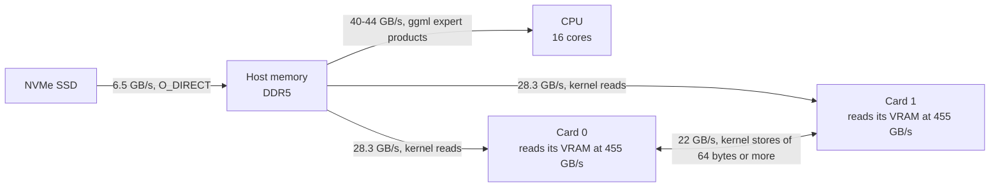

# Measurements

The engine's measured numbers: what operations cost on an Intel Arc Pro B60 through Level Zero, what the engine's
kernels reach, and how fast the engine runs. Each row gives a value and the date it was measured. The date links
the row, and code and other pages link these rows for their numbers.

## The test machine

Every number here was measured on one machine:

- two Intel Arc Pro B60 cards (24 GB each), each on its own PCIe 5.0 x8 link to the CPU;
- an AMD Ryzen 9 7945HX: 16 Zen 4 cores on two CCDs, with AVX-512 (VNNI, VBMI, BF16, IFMA);
- 96 GiB of dual-channel DDR5 at 5200 MT/s, about 90 GiB of it visible to Linux;
- a PCIe 4.0 NVMe SSD, which holds the model files;
- Linux 6.17 with the in-tree `xe` driver, and the engine image's user-space stack: compute-runtime 26.40.40196.8,
  IGC 2.42.6 and the Level Zero loader 1.32.0 ([ADR-0002](../adr/0002-pin-the-toolchain.md)). Rows measured before
  2026-11-06 ran on compute-runtime 26.35.39758.10 and IGC 2.41.5.

Other software shares the machine. A number that rests on the host (the CPU's experts, host memory, load times)
moves with what else runs, so compare such numbers only within one row.

## How the numbers were taken

- A number is the median of at least five runs, or a range from least to most.
- "A → B" is a change judged against the code before it in ABBA order: rounds of A, B, B, A, at least three, so
  each arm runs six times. Each run is a fresh process with the same inputs
  ([ADR-0016](../adr/0016-how-a-change-is-judged.md)). Both arms of one row ran in one sitting. One row's A is not the
  previous row's B, so gains from several rows do not add up.
- A kernel is timed after at least 50 ms of work on its card. An idle B60 runs near 1200 MHz, and a kernel timed
  there looks 1.7-2 times slower ([the clock](#the-clock)).
- A change gave the same tokens in both arms unless its row says otherwise.
- `doc-4k-qa`, `doc-32k` and the other named prompts are in `reference/prompts.jsonl`. `long-4k`, `long-32k`,
  `long-128k` and `long-256k` are longer prompts kept with the records, not in the repository, as are `s512`,
  `s1024` and `s4352`, named by their length in tokens.

## Level Zero on a B60

[LEVEL_ZERO.md](LEVEL_ZERO.md) gives the calls. This section gives what they cost.

### Where data moves

Kernel reads, kernel stores and copy-engine copies, with the rate each reaches.

Both cards reading host memory at once reach about 45 GB/s together. A copy engine reads host memory at the
same 28.4 GB/s as a kernel. While a prompt runs, each card stages its experts from host memory at 19-22 GB/s.

### Memory

| Operation | Value | Measured |
| --- | --- | --- |
| Largest single device allocation (`zeMemAllocDevice`) | 22.71 GiB; 23.00 GiB with relaxed allocation limits | [2026-10-11](#2026-10-11-device-memory) |
| Device memory one card holds | 25.31 GB. Past VRAM, allocations spill to system RAM and do not fail. Only Sysman's free-memory figure shows where VRAM ends. | [2026-10-11](#2026-10-11-device-memory) |
| Kernel reads from VRAM | 455 GB/s a card; 909.5 GB/s for both | [2026-10-11](#2026-10-11-device-memory) |
| Kernel reads from host memory (`zeMemAllocHost`, one context for both cards) | 28.3 GB/s a card; about 45 GB/s for both | [2026-10-12](#2026-10-12-host-memory) |
| Host memory from `zeMemAllocHost` | The memory lock limit does not apply. Past 26-32 GiB the host swaps. Importing memory that already exists does not work. | [2026-10-12](#2026-10-12-host-memory) |
| Copy engine reading the process's own (anonymous) memory | 28.4 GB/s on both cards, the same as from `zeMemAllocHost` | [2026-10-17](#2026-10-17-anon-arena-under-reclaim) |
| One copy from anonymous memory | about 1.3 µs more than the same copy from `zeMemAllocHost` | [2026-10-17](#2026-10-17-anon-arena-default) |
| Recording a copy list whose sources are anonymous memory | The runtime binds each copy's source when the list is recorded (21-46 µs a copy) and unbinds it when the list is freed (50-89 µs). | [2026-10-17](#2026-10-17-swaps-keep-the-copies) |
| The same copies on an immediate list on the copy engine's ordinal | The runtime makes them with the CPU and binds nothing: the call returns when the copy is done, 47.8-56.5 µs for an expert's three copies (1.06 MB) with one card copying and 49.6-79.0 µs with both, against 48.8-48.9 µs on the copy engine with both; the first copy into a page of device memory 155-233 µs. Such a copy runs while the copy engine's queue waits on an event; a second queue on the copy ordinal is refused at index 1 (`0x78000004`), and at index 0 its list waits behind the first queue's | [2026-10-21](#2026-10-21-short-chunk-fetch) |
| The same copies, one card, through the CPU's mapping of a device allocation (a dma-buf export, then `mmap`) | `memcpy` moves 22.4 GB/s, 94 µs for a 2.05 MB expert, the same for 1 to 6 threads, against 123 µs (16.7 GB/s) on an immediate list, where 1 to 8 threads give 14-19 GB/s in all. A page's first write takes a fault (0.87 GB/s on a first pass); pages written before the runtime's first copy into the memory fault again after it, for a reason not known. The runtime owns the exported descriptor: it returns the same number each time it is asked, and `zeMemFree` closes it. These copies are most of a short chunk: 700 of 806 ms at 79 rows, 1,186 of 1,281 ms at 212, 1,456 of 1,559 ms at 550. A second process asking for the card's whole memory is not refused: the allocation goes to host memory, the card's next use brings it back (that copy 380 ms against 11-12), and the CPU's next two writes fault on every page (1,952 MiB in 280 and 353 ms against 118-120); the bytes stay the same | [2026-11-05](#2026-11-05-staging-through-a-mapping) |
| Copies from anonymous memory, the VM in page-fault mode (the runtime's default; `sharedSystemAllocCapabilities` `0xf`) | A host migration of a 4 KiB page under a copy's binding resets the copy engine: a 512 MiB copy loop reset after 1,941 host migrations. 2 MiB pages, and pages the process replaces itself, did not | [2026-10-19](#2026-10-19-vm-fault-mode) |
| The same copies with `NEOReadDebugKeys=1 NEO_EnableRecoverablePageFaults=0` (no page faults; capabilities `0x0`) | No reset: the copy loop under 23,518-45,670 host migrations, its slowest copy 0.076-0.127 s against about 0.02 s; the engine on two cards, 6 runs under 117,121-3,031,892, same tokens, prompts 1,995.0-2,012.4 (doc-4k-qa) and 2,065.1-2,065.7 tokens/s (doc-32k). The key alone changes nothing | [2026-10-19](#2026-10-19-vm-fault-mode) |
| The engine out of fault mode (PR 13's `ze::init`) against in it, in one sitting | No change. ABBA, 6 fresh processes an arm, two cards: prompt reading 2,005.8 → 2,013.6 (doc-4k-qa) and 2,067.0 → 2,067.3 tokens/s (doc-32k); decode in the runs without a pause 85.2 → 85.7 and 74.6 → 74.8 tokens/s; first token 2.074 → 2.065 and 15.486 → 15.484 s; the same texts. Decode pauses of 0.3-0.9 s came in both arms alike | [2026-10-19](#2026-10-19-vm-without-fault-mode-speed) |
| Region copy (`zeCommandListAppendMemoryCopyRegion`) | half the rate of a plain copy | [2026-10-17](#2026-10-17-staging-half-downs) |
| Freeing 20 GiB of device memory, and mapping it again at the same addresses | 3.0-3.6 ms to free, 159-160 ms to map again | [2026-10-16](#2026-10-16-vram-give-back) |
| Replaying a list recorded before such a free | Works up to 16 GiB a card. Past 16 GiB the driver crashes (SIGSEGV in `libze_intel_gpu`). | [2026-10-16](#2026-10-16-vram-give-back) |
| Freed VRAM in Sysman's free figure | at once, or within 0.1 s if the other card read it | [2026-10-16](#2026-10-16-vram-give-back) |
| Freeing and mapping host physical memory the same way | fails with `ZE_RESULT_ERROR_OUT_OF_DEVICE_MEMORY` | [2026-10-16](#2026-10-16-vram-give-back) |
| VRAM held by an idle process with the runtime and every kernel loaded | 200 MiB a card | [2026-10-16](#2026-10-16-vram-give-back) |
| Level Zero's virtual memory: 2 MB blocks of device memory mapped into reserved ranges (`zeVirtualMemReserve`, `zePhysicalMemCreate`, `zeVirtualMemMap`) | Pages of 2 MB for ranges of 2 MB and up, 64 KB below. A block: create 32 µs, map 14 µs, unmap 63 µs, destroy 3.6 µs; moved from one range to another 60-116 µs. A physical allocation maps at one place at a time, any part of it. A list recorded before a remap reads the memory mapped after it. Copies through mapped blocks 197.2-197.4 GB/s, between plain allocations 198.0-198.1 | [2026-10-20](#2026-10-20-kv-pool-and-expert-cache-share) |
| Moving 2 MB blocks between ranges on one thread while the same card runs kernels or copies | No stall, no fault, no wrong read. Kernels that read no moved memory kept 99.9-100.2% of their rate; kernels reading or writing a range whose top blocks moved 98.8-99.0% (each about 1% longer); 8 MB copies into that range on the copy engine 97.5-98.4%; work on the other card 99.9-100.1%. A move 55-84 µs (medians). The same 8 MB copies ran at 283.5 GB/s with one card in the context, 190.5 GB/s with both | [2026-10-24](#2026-10-24-block-moves-beside-running-work) |

### Launches and command lists

| Operation | Value | Measured |
| --- | --- | --- |
| 960 small kernels launched one by one | 1.28 ms (1.3 µs a launch) | [2026-10-11](#2026-10-11-launch-cost) |
| The same 960 kernels replayed as 48 recorded lists | 0.83 ms, of which 0.06 ms host time | [2026-10-11](#2026-10-11-launch-cost) |
| Values that change each token, given to recorded kernels | Pass them through memory. Mutable command lists and indirect launches also work. | [2026-10-11](#2026-10-11-launch-cost) |
| A kernel reading one word of host memory at its start | 0.8 µs | [2026-10-16](#2026-10-16-bf16-products-occupancy) |
| Products that share inputs, launched together in a list with no ordering between them | a decode step 17.52 → 16.74 ms | [2026-10-16](#2026-10-16-decode-launches-together) |
| Two products fused into one launch, against the two launched together | 1.4-2.4 µs saved a pair | [2026-10-16](#2026-10-16-decode-launches-together) |
| Recording a copy list of about 35,000 copies | 45 ms; 8 ms of wait when recorded on a thread of its own | [2026-10-16](#2026-10-16-swaps-and-prompts) |
| Recording every list the engine uses, at load | 0.19 s | [2026-10-16](#2026-10-16-load-phases) |
| A process that ends without the driver's teardown 0-2 ms after its last copy-engine copy | the copy engine reset at 3 of 30 exits; at 20 ms, 0 of 15 | [2026-11-06](#2026-11-06-copy-engine-stuck-after-exit) |
| The same with the driver's copy loop kept running (`NEO_EnableDirectSubmissionController=0`) | reset at 6 of 10 exits; 1 of 10 left that card's copy engine unable to run new work, and the next process's first copy never started | [2026-11-06](#2026-11-06-copy-engine-stuck-after-exit) |
| The same loop kept running, at a normal exit through the driver's teardown | reset at 0 of 15 exits; destroying the context and then ending without the teardown, 4 of 15 | [2026-11-06](#2026-11-06-copy-engine-stuck-after-exit) |

### Signals between the CPU and a card

| Operation | Value | Measured |
| --- | --- | --- |
| A spinning kernel seeing the CPU's write to host memory | Seen in 100 of 100 with a system-scope acquire fence before each volatile load. An atomic acquire load alone sees it in 21-37 of 100. | [2026-10-11](#2026-10-11-doorbell) |
| Round trip CPU → card → CPU through a flag in host memory | 4.54 µs median, 5.88 µs p99 | [2026-10-11](#2026-10-11-doorbell) |
| The same round trip with events | about the same as the flag | [2026-10-11](#2026-10-11-doorbell) |

### Between the two cards

| Operation | Value | Measured |
| --- | --- | --- |
| Round trip of flags alone through host memory | 6.4 µs | [2026-10-12](#2026-10-12-card-to-card) |
| Exchange of partial sums through host memory, 1-4 tokens | 10.0-10.5 µs; 96 in a row 0.99-1.03 ms | [2026-10-12](#2026-10-12-card-to-card) |
| Hand-off of 205 KB through host memory | 50.3 µs | [2026-10-12](#2026-10-12-card-to-card) |
| One fp16 store per work-item into host memory | 13-54 times slower than wider stores, and the sums were wrong | [2026-10-12](#2026-10-12-card-to-card) |
| Exchange of 2,560 floats a row, an event per exchange, through host memory | 3.9-5.0 µs at one row; 10.2-10.3 µs at four | [2026-10-16](#2026-10-16-peer-exchange) |
| The same exchange with the kernel writing into the other card's memory | 2.3-3.4 µs at one row; 5.1-5.2 µs at four | [2026-10-16](#2026-10-16-peer-exchange) |
| The same exchange as a copy into the other card | almost no saving at one row; 0.43 ms saved a decode step at four | [2026-10-16](#2026-10-16-peer-exchange) |
| A flag in the other card's memory in place of the event, 96 exchanges | 0.20 ms saved at one row, 0.16 ms at two; 0.05 ms lost at four | [2026-10-16](#2026-10-16-peer-exchange-decode) |
| Kernel stores into the other card's memory | 22.2-22.5 GB/s with stores of 64 bytes or more; 1.9 GB/s with one fp16 a work-item | [2026-10-15](#2026-10-15-prompt-exchange-stores) |
| Sending a 4,352-row chunk's mixed activations to the other card | 0.61 ms with 128-byte block stores; 11.7 ms with 2-byte stores | [2026-10-17](#2026-10-17-hc-split) |

### The clock

| Condition | Value | Measured |
| --- | --- | --- |
| Idle card | near 1200 MHz; a kernel timed there looks 1.7-2 times slower | [2026-10-11](#2026-10-11-kernel-spike) |
| Work needed to leave idle | about 50 ms | [2026-10-11](#2026-10-11-kernel-spike) |
| During decode, read by Sysman every 1.17 ms | 2,400 MHz, the top of the range, in 99.74-100% of samples, with no throttle reason | [2026-10-16](#2026-10-16-gpu-clock-in-decode) |
| Waiting between decode plans | down to 2,250 MHz for at most about 2 ms | [2026-10-16](#2026-10-16-gpu-clock-in-decode) |

### What the driver reports

| Property | Value | Measured |
| --- | --- | --- |
| Extensions | every extension the design uses is listed | [2026-10-11](#2026-10-11-level-zero-report) |
| Contexts | one context holds both cards | [2026-10-11](#2026-10-11-level-zero-report) |
| Copy engines | one per card, at queue group ordinal 1 | [2026-10-11](#2026-10-11-level-zero-report) |
| Atomics on host memory | `ATOMIC`, not `CONCURRENT_ATOMIC` | [2026-10-11](#2026-10-11-level-zero-report) |
| Matrix and dot-product units | DPAS and DP4A flags set | [2026-10-11](#2026-10-11-level-zero-report) |
| PCIe link speed through Sysman | not reported | [2026-10-11](#2026-10-11-level-zero-report) |

## Kernels on a B60

The engine's kernels are OpenCL C ([ADR-0003](../adr/0003-kernel-language.md)). On the B60 the expert products read
257-344 GB/s at one token (56-76% of the card's 455 GB/s) and the dense products 370-421 GB/s. Experts in the
reordered layout run 3.2-8.8 times faster than in the file's layout
([2026-10-11](#2026-10-11-kernel-spike)).

### Decode kernels (1-4 rows)

"Step" is card 0's time in that kernel during one decode step, or the whole step where it says so.

| Kernel | Change | Kernel time | Step | Measured |
| --- | --- | --- | --- | --- |
| grouped expert products (`moe.cl`) | 32-bit offsets and vector loads; the kernels were bound by instructions, not memory | gate and up 2.0-2.4 times faster, down 1.2-2.1 times | 3.96 → 2.29 ms; 22.16 → 20.72 ms a token | [2026-10-14](#2026-10-14-decode-expert-kernels) |
| Q6_K, Q2_0 and i-quant decoders | bytewise subtraction in whole 32-bit words | Q6_K loop 187 instructions, was 299; Q6_K products about 4% faster | 17.34 → 17.255 ms a token, ranges overlapping | [2026-10-15](#2026-10-15-sub-bytes-words) |
| products of up to 512 rows | K split over 4 sub-groups | 6.7-7.7 → 3.5-4.6 µs | five products 1.22 → 0.81 ms; 17.76 → 17.48 ms a token | [2026-10-15](#2026-10-15-matvec-k-split) |
| hyper-connections' down product | K split of 8 in place of 16 | 19.1 → 18.1 µs at one row | 18.07 → 18.03 ms a token; greedy agreement moved to 1,041 of 1,063 | [2026-10-15](#2026-10-15-hc-down-split) |
| BF16 products | XMX units with bf16 activations | router's product 12.1 → 9.0 µs; PLE key product 169 → 123 µs | five products 1.41 → 1.11 ms; 19.13 → 18.82 ms a token; misses 25.01 → 25.12 a token from the rounding | [2026-10-15](#2026-10-15-bf16-products-xmx) |
| BF16 products | plan copied to each card in place of read from host memory | each launch 1.8-2.9 µs over a streaming read of its bytes; K split over work-groups 0.5-1.9 µs slower | 19.00 → 18.62 ms; decode 1.8-2.3% faster | [2026-10-16](#2026-10-16-bf16-products-occupancy) |
| every kernel module | built with `-cl-fp32-correctly-rounded-divide-sqrt` ([ADR-0052](../adr/0052-kernels-round-divides-and-sqrt-correctly.md)) | of 16.8 million inputs, `x / 127` 4.7% and `sqrt(x)` 8.2% off the correctly rounded value, and of a million Q8_0 blocks 4.3% off ggml's bytes, against none | 15.62 → 15.69 ms a token; prompt of doc-4k-qa 2,967 → 2,957 tokens/s; greedy agreement 843 → 847 of 861 (843 → 844 with prompts read in chunks of 512) | [2026-10-27](#2026-10-27-divide-sqrt-rounding) |
| out products (`ssm_out`, `attn_output`) | partial sums written in the card's memory and copied out, in place of written to host memory a float at a time | Q6_K at two rows 24.8 → 21.4 µs, four rows 35.6 → 26.3 µs; one row unchanged (19.9 against 20.0) | decode at long-4k 69.79 → 71.06 tokens/s | [2026-10-16](#2026-10-16-out-products-host-writes) |
| `router_group` | router and expert grouping in one launch | 0.822 → 0.688 ms | 19.17 → 19.07 ms a token, ranges overlapping | [2026-10-15](#2026-10-15-router-group) |
| `router_group` | threshold top 10 and the job written by a work split | one row 14.6 → 5.3 µs | 0.685 → 0.421 ms; 17.88 → 17.67 ms a token | [2026-10-15](#2026-10-15-router-top10) |
| `topk_select_few` (was `topk_rows`) | rank only a few candidates; same result, ties included | one row of 124,160 logits 281.3 → 26.2 µs | 20.69 → 20.19 ms a token | [2026-10-14](#2026-10-14-topk-rows) |
| `idx_cand`, `idx_merge` | no host-memory stores and no serial search | 37.0 → 9.8 µs and 57.1 → 15.7 µs | 20.32 → 19.56 ms a token; prompt 2,069 → 2,088 tokens/s | [2026-10-15](#2026-10-15-indexer-selection) |
| `idx_cand` top-513 selection | faster selection; merging hot bins alone was not enough | one launch at 30,834 values 80-279 → 59-155 µs | 1.865 → 0.92 ms a step at 246K positions; long-128k decode 63.48 → 64.58 tokens/s | [2026-10-16](#2026-10-16-indexer-select) |
| `gdn_conv`, `gdn_recur` | DeltaNet norm and gates moved in; two launches a layer fewer; same bits | 0.98 → 0.78 ms | 18.04 → 17.85 ms a token | [2026-10-15](#2026-10-15-gdn-fusion) |
| kernels that make a8 activations | write them directly; `quantize_a8` and five launches a layer gone | 0.69 ms a card removed, 0.15 ms added elsewhere | 19.35 → 19.11 ms a token, ranges overlapping | [2026-10-15](#2026-10-15-a8-fusion) |
| KV pages in host memory, 32,768 cells a slot resident on the cards ([ADR-0008](../adr/0008-kv-cache.md) item 3), the rest of the cache gathered a step from pinned host copies; 4 slots at 262,144, four 255k prompts answered at once from the prompt cache | experts cached a layer 156 → 330 (deployed pool) and 60 → 330 (a 524,288-token pool); misses a row 195.5 → 63.4 against the full pool, a round 73.5 (72.6-80.3) → 48.0 (37.4-65.1) ms, a step 40.6 → 33.7 ms, 110.1 (104.3-111.4) → 135.9 (76.8-161.6) tokens/s over the four writers, 5 and 4 runs in ABBA order; two 255k prompts against the deployed pool, 3 runs a side: misses 78.4 → 40.6, a round 36.0 → 30.6 ms, 144.7 → 172.8 tokens/s; `greedy_test` 847 → 850 of 861 | [2026-10-28](#2026-10-28-kv-streaming-near-full-context) |
| The resident ring backed as the slots need it, the claim skipped while a slot's pages are claimed through its position plus 32 pages, a slot idle 5 minutes dropped from the ring; 4 slots at 262,144 | against main, 3 runs a side, interleaved: experts cached a layer 325 → 329; long-256k decode 73.6 (72.7-73.6) → 76.2 (75.3-77.6) tokens/s, its first token 153.75 (153.65-157.51) → 154.45 (154.05-172.28) s, the short prompts level; four 8k writers at once, 4 runs a side: a step 20.93 → 20.94 ms, a round 27.62 → 25.58 ms, misses a row 44.7 → 36.7. | [2026-10-29](#2026-10-29-kv-streaming-ring-on-demand) |
| KV streaming's tokens against main's, `--deterministic`, 1 slot, four short prompts | the same text at one cache size (both 300 experts a layer); at each build's own size (306 main, 338 streamed) 2 of 4 prompts differ, from the CPU computing other experts; served, the streamed text changes from run to run with the swaps | [2026-10-29](#2026-10-29-kv-streaming-tokens-match-at-one-cache-size) |

### Prompt kernels (chunks of up to 4,352 rows)

"Chunk" is each card's time in that kernel for one chunk.

| Kernel | Change | Kernel time | Chunk and prompt rate | Measured |
| --- | --- | --- | --- | --- |
| prompt router | one sub-group per token | 4,159 tokens 987 → 29.3 µs | about 48 → 1.54 ms; 2,087 → 2,135 tokens/s | [2026-10-15](#2026-10-15-prompt-router) |
| `p_moe_scatter` | scatter each token's row once, in place of gathering the experts' activations | 2.74 → 2.03 ms | 131.8 → 98.5 ms; 2,135.5 → 2,174.5 tokens/s | [2026-10-15](#2026-10-15-prompt-moe-scatter) |
| `p_moe_scatter` | sub-group block reads and writes; it was bound by its stores | 2.02 → 0.77-0.79 ms (271-276 GB/s) | 98.4 → 33.6 ms; 2,594 → 2,698.5 tokens/s | [2026-10-15](#2026-10-15-prompt-moe-scatter-blocks) |
| `dequant_f16` | packed words and whole-line stores | 246-501 → 50-113 µs | 46.9 → 10.45 ms; 2,173 → 2,212.5 tokens/s | [2026-10-15](#2026-10-15-prompt-dequant-stores) |
| bf16 products | tiles of 4 tokens where K or N is short; same bits | down 1,129 → 884 µs; up 955 → 783-803 µs; ab 77-82 → 48.5 µs | 2,261.5 → 2,351.5 tokens/s | [2026-10-15](#2026-10-15-prompt-gemm-tiles) |
| products with weights larger than L2 | bands of rows; same bits; no gain below L2 | qkv 2.20 → 1.86 ms; q 2.62 → 2.40 ms; PLE keys 7.66 → 3.82 ms | 2,417 → 2,505 tokens/s | [2026-10-15](#2026-10-15-prompt-gemm-bands) |
| hyper-connections' low-rank down product (`gemm.cl`) | tiles of 32 tokens by 32 rows, 11 sub-groups a work-group; same bits; slower at 256 rows and fewer | 4,352 rows 0.911-0.917 → 0.775-0.782 ms; 1,024 rows 0.293-0.351 → 0.180-0.222 ms | long-128k first token 0.5% sooner | [2026-10-17](#2026-10-17-hc-lowrank) |
| expert gate and up | load each block's shared fields once (`block_raw`); bound by the decoding's loads | IQ2_S 7.27 → 5.66 ms; IQ3_S 7.15 → 5.74 ms | 329.4 → 284.1 ms; 2,216 → 2,275.5 tokens/s | [2026-10-15](#2026-10-15-prompt-expert-block-fields) |
| expert down | early loads, block writes and half tiles together | IQ4_NL 3.59 → 2.84 ms; Q2_0 2.97 → 2.62 ms | 178.7 → 148.9-149.1 ms; 2,545.5 → 2,599 tokens/s | [2026-10-15](#2026-10-15-prompt-expert-down) |
| streamed experts (the file's layout) | each field from 4-byte-aligned loads, shifted into place, in place of 2-byte loads; same bits | one card, a 4,352-row chunk's expert products, the cached ones unchanged: gate and up 595.3-595.5 → 550.9-551.2 ms, down 299.1-299.2 → 246.9-247.1 ms | chunk 2,640-2,657 → 2,558-2,560 ms | [2026-11-06](#2026-11-06-file-layout-wide-loads) |
| tiled attention | mask computed once a tile; the mask was about a quarter of the kernel | 4,159 rows 9.02-9.03 → 7.16 ms | 106.5-106.8 → 84.5 ms; 2,509 → 2,545 tokens/s | [2026-10-15](#2026-10-15-prompt-attention-mask) |
| Gated DeltaNet recurrence | one loop and one barrier a token; faster forms that change the sums lost greedy agreement | 2.60 → 2.46 ms | 93.6-94.3 → 88.8-89.3 ms; 2,685 → 2,708.5 tokens/s | [2026-10-15](#2026-10-15-prompt-gdn-fused-loop) |
| `p_idx_score` | read each pooled key once for eight rows; every score bit-identical | 4,352 rows at position 239,360: 49.0-52.7 → 20.7 ms a layer; at 20,000: 7.1 → 6.1 ms | long-128k first token 2.5-2.9% sooner | [2026-10-17](#2026-10-17-idx-score-rows) |
| `p_hc_combine_norm` | write partial sums into the other card directly, in 64-byte stores | 243-246 → 136-139 ms | 2,353.5 → 2,427 tokens/s | [2026-10-15](#2026-10-15-prompt-exchange-stores) |
| hyper-connections | each card computes half the rows and sends the other card its half; only from 2,048 rows | 4,352 rows: 0.85 → 0.43 ms, plus 0.61 ms to send | s4352 first token 1,663 → 1,559 ms; long-128k 53,800 → 51,110 ms | [2026-10-17](#2026-10-17-hc-split) |

### The kernel tests' random blocks

Why `qgemm_test` once failed on random blocks with max error inf, and how large its blocks are now against real
weights. Computed on the CPU, no card, by a program not kept. It repeats `qgemm_test`'s draws: `std::mt19937` seed 99,
75 assignments of 2,560 N(0, 1) activations rounded through fp16, then for each type the blocks in the test's order. It
dequantises them with ggml and computes `moe_gate_up_t`'s reference, silu(gate x) (up x), in double precision for rows
512-1,023 of 1,024, 38,400 values a type. A value is past fp16 when `ggml_fp32_to_fp16` gives inf (from 65,520; the
largest finite fp16 is 65,504). The real weights are expert 7 of the first layer of each gate and down type in the IQ3_S
and UD-IQ4_XS files, with the same activations on rows 320-639 for the reference. They sample those files; the other
experts were not read.

| Blocks | Largest \|reference\|, and values past fp16 of 38,400 | Measured |
| --- | --- | --- |
| Random bytes, each f16 scale with a random sign and mantissa and an exponent of 2^-6 to 2^-2, 18 types (`qgemm_test` passed Q2_0 and Q4_0, and failed the other 16) | Q2_0 1,327, 0; Q4_0 18,610, 0; IQ1_S 67,260, 1; Q5_0 87,510, 1; IQ1_M 903,200, 578; Q2_K 445,700, 1,365; the other 12 types 2.3e6 to 1.96e9, 8,758 to 19,228 | [2026-11-02](#2026-11-02-random-blocks) |
| `test::random_blocks`, each scale set so its term of a value reaches 2^-5 to 2^-2, 19 types | 36.8 (IQ4_XS) to 596 (Q5_1), none past fp16; largest \|weight\| 0.25 to 0.496 | [2026-11-02](#2026-11-02-random-blocks) |
| The files' expert weights | largest reference 3.10 to 5.81, none past fp16; largest \|weight\| in an expert 0.0718 to 0.429, rms 0.0121 to 0.0143 | [2026-11-02](#2026-11-02-random-blocks) |

## The host

| Operation | Value | Measured |
| --- | --- | --- |
| ggml's CPU backend on i-quant expert products | 5.0-5.7 GB/s a core; 40-44 GB/s on 16 cores; bound by arithmetic | [2026-10-11](#2026-10-11-cpu-bar) |
| ggml on IQ4_XS and IQ4_NL | about 50 GB/s on 8 cores; bound by memory | [2026-10-11](#2026-10-11-cpu-bar) |
| ggml on Q2_0 | scalar code, 2.3 GB/s a core | [2026-10-11](#2026-10-11-cpu-bar) |
| ggml on 2-4 tokens at once | no reuse across the tokens | [2026-10-11](#2026-10-11-cpu-bar) |
| CPU's answer for one missed layer | 20-25 µs, plus 60-62 µs for each distinct expert, plus 19-25 µs for each further row on an expert already in the job | [2026-10-16](#2026-10-16-cpu-answer-per-layer) |
| Card 0 waiting for the CPU, decode on long-4k | 2.89, 4.31, 6.09 and 8.11 ms a step at 1, 2, 3 and 4 rows (16-26% of the step) | [2026-10-16](#2026-10-16-cpu-answer-per-layer) |
| A missed expert's weight rows decoded once for every row that needs it (IQ2_S, IQ3_XXS, IQ3_S, IQ4_NL; [ADR-0040](../adr/0040-multi-row-dots-for-the-cpus-misses.md)) | one core, one 640 × 2,560 matrix: 1.72-1.78 times faster than ggml's loop over rows at 2 rows, 2.22-2.35 at 3, 2.35-2.66 at 4; IQ4_NL down 1.15, 1.27, 1.39. Decode over eleven prompts +2.6% (one pair of fresh processes) and +2.4% (a second pair whose baseline also wrote a routing dump), the same tokens | [2026-10-19](#2026-10-19-multi-row-misses) |
| One expert on the CPU, `compute_many` in two pool jobs | 88-93 → 80-85 µs; 18.34 → 18.15 ms a token. Workers polling for 5 ms between jobs made the mean and tail steps worse, so workers sleep. | [2026-10-15](#2026-10-15-cpu-miss-path) |
| One expert on the CPU, `compute_many` in one pool job | 80.9-81.3 → 73.7-75.0 µs; 18.23 → 18.08 ms a token, ranges overlapping; same bits | [2026-10-15](#2026-10-15-cpu-one-job) |
| An expert's first miss on arena pages not yet touched | 268 µs with about 60 major faults, against 88 µs. Reading one byte a page at load removes the faults: 19.12 → 18.44 ms a token. | [2026-10-15](#2026-10-15-arena-touch) |
| Decode steps while the host is short of memory | 0.3-9 s, from about 60 major faults an expert. Giving back the model file's page cache removes most. | [2026-10-14](#2026-10-14-decode-stalls) |
| `xe` moving the engine's host buffers (12.2 GB) from GTT to system placement under reclaim | decode stalls of 6.92 s and 2.75 s, then 566,270 major faults over the next 5,415 steps | [2026-10-17](#2026-10-17-decode-stalls-eviction) |
| The same reclaim (one 54.8 GB page-cache read) with the arena in anonymous memory | worst step 48.1 ms, against a 5.75 s stall with the driver's arena; same tokens | [2026-10-17](#2026-10-17-anon-arena-under-reclaim) |
| Pinned host memory | given in contiguous pages; about 12 GiB available clean on 2026-10-13 | [2026-10-13](#2026-10-13-design-inputs) |
| Reading the model file with `O_DIRECT` | 6.49-6.64 GB/s with 8 threads of 1 MiB, on a quiet host | [2026-10-16](#2026-10-16-load-read-rates) |
| Rearranging experts into the cards' layout (`to_runs`, 16 threads) | 12.26-13.04 GB/s | [2026-10-16](#2026-10-16-load-read-rates) |
| Gathering doc-4k-qa's 66,544 n-gram rows with an empty page cache | 37.6 ms; 256 threads 31.2 ms against 33.6 ms with 128; Linux AIO 76.9-84.8 ms; `io_uring` is refused in the container | [2026-10-15](#2026-10-15-ngram-gather) |
| The n-gram table in RAM with 22 GiB of the host's 90 GiB left free, against in the file, a first load on two cards, 1 slot at 262,144, a 255,017-token prompt | first token 230.83 (220.45-233.38) → 119.49 (119.30-119.53) s; pages the host moved 4.32-5.65 M → 0; pages swapped out 68,655-250,153 → 0; engines failed 2 of 4 → 0 of 4 | [2026-11-04](#2026-11-04-ngram-room) |
| A deployment of 0.20.0 serving: two cards, 3 slots at 262,144, `--hugepages`, n-gram table in the file, a pool of 36 reserved huge pages of 1 GiB, read from its fit report and `/metrics` | arena 17.14 GiB at load, so 17 pages free; about 14 GiB of host memory available, 6 GB in swap; the default n-gram cache of 1,048,576 rows serves 77% of the rows asked for, which leaves about 2,860 reads from the SSD a second at 76 µs each | [2026-11-08](#2026-11-08-ngram-cache-in-file) |

## The engine

### Current figures

| Figure | Value | Measured |
| --- | --- | --- |
| Decode of doc-4k-qa | 17.255 ms a token | [2026-10-15](#2026-10-15-sub-bytes-words) |
| Prompt of doc-4k-qa (4,159 tokens) | 2,135 tokens/s | [2026-10-15](#2026-10-15-prompt-router) |
| `kl_test`: the IQ3_S file against the BF16 checkpoint on the KL set | mean KL 0.158, top-1 84.7% | [2026-10-29](#2026-10-29-kl-bf16) |

### Start, load, sleep and wake

| Operation | Value | Measured |
| --- | --- | --- |
| Cold load at a 262,144-token context | 63.2-71.5 s (median 64.4), 55.4-63.0 s of it the experts | [2026-10-16](#2026-10-16-load-phases) |
| Copying the 20.49 GiB arena out of the mapped file on one thread | 39.4-46.2 s | [2026-10-16](#2026-10-16-load-phases) |
| Warm-up chunk at load | 1.9 s | [2026-10-16](#2026-10-16-load-phases) |
| Draft layer at load | 42.8 s more, nearly all quantising on the CPU | [2026-10-16](#2026-10-16-load-phases) |
| Host memory swapped out by a load | 2.4 GiB; 11-53 MB with pages given back per layer | [2026-10-16](#2026-10-16-load-phases) |
| Engine child to READY | 86.0-94.2 s, 8.7-8.9 s of it Python reading the GGUF twice | [2026-10-16](#2026-10-16-engine-start-and-quit) |
| Front end alone, to serving | 5.3-5.6 s, 4.4 s of it the same GGUF read | [2026-10-16](#2026-10-16-engine-start-and-quit) |
| QUIT | VRAM back 0.44-0.64 s after the line; the child exits after 0.61-1.11 s | [2026-10-16](#2026-10-16-engine-start-and-quit) |
| Host memory pinned at the defaults (8 checkpoints) | about 20.5 GiB of arena plus about 4 GiB a checkpoint | [2026-10-16](#2026-10-16-engine-start-and-quit) |
| Start to READY, weights read with `O_DIRECT` | 24.5-64.7 s; 19.9-54.3 s of it the load, which reads 58.95 GB | [2026-10-17](#2026-10-17-sleep-and-wake) |
| Sleep, arena kept | 376-718 ms (median 393) | [2026-10-17](#2026-10-17-sleep-and-wake) |
| Wake | 14.2-20.7 s (median 15.0), 11.9-18.1 s of it reading the cards' 38.30 GB; same greedy tokens as before the sleep | [2026-10-17](#2026-10-17-sleep-and-wake) |
| VRAM held while asleep | 0.31-0.32 GiB a card | [2026-10-17](#2026-10-17-sleep-and-wake) |
| Page cache growth during a load | at most 0.79 GiB | [2026-10-17](#2026-10-17-sleep-and-wake) |
| Host memory swapped out | 0-50 MiB by a wake; 2.7-790 MiB by a start, most when the host stalled on compaction | [2026-10-17](#2026-10-17-sleep-and-wake) |
| The expert arena resident while serving and asleep (3 slots, 262,144 context, 589,824-token pool) | 16,642 MiB at load, 335.6 experts a layer cached; 22,080 MiB after two 255,028-token prompts at once took the cache to 283.5, and all of it held asleep and after the wake. It follows the deepest eviction since the start: the same two prompts again grew it 138 MiB | [2026-10-25](#2026-10-25-arena-resident-and-tail-drop) |
| Arena positions left stale (filled by an eviction, their expert back on the cards) | at least 1.36 GB of 5.12 GB filled, after refills to 297.3 experts a layer; at least 0.55 GB of 4.78 GB after 3.6 h of serving; at most the 96.6 free positions a layer, 9.49 GB | [2026-10-25](#2026-10-25-arena-resident-and-tail-drop) |
| Dropping arena pieces (`munlock` and `MADV_DONTNEED` a piece, rounded in to 4 KiB) | 19 ms for 3.05 GB, 31 ms for 5.11 GB. Pieces dropped together free all but their partial end pages; a piece dropped between kept ones frees little: 113 of 2,900 MiB, the rest charged as partly mapped huge pages until the kernel splits them | [2026-10-25](#2026-10-25-arena-resident-and-tail-drop) |
| Reading the arena's coldest 31 or 52 experts a layer back from the file with `O_DIRECT`, 8 threads | 3.05 GB in 0.59-1.06 s, 5.11 GB in 0.98-1.61 s (2.9-5.2 GB/s), no compaction stall. After a drop they fault back in small pages under either advice; `MADV_COLLAPSE` adds 0.70-0.78 s and 1.12-1.23 s | [2026-10-25](#2026-10-25-arena-resident-and-tail-drop) |
| One expert read from the file on a miss (its three matrices, `O_DIRECT`) | 0.52-1.22 ms (median 0.79) with the three read at once; 1.17-2.67 ms (median 1.63) one after another | [2026-10-25](#2026-10-25-arena-resident-and-tail-drop) |
| The plan's first estimate of working memory per card against the core's, IQ3_S, 15 loads on one and two cards, 1-4 slots, context 4,096-262,144, MTP, DFlash and no drafter | within 0.04 GiB; 3.36 against 3.37 GiB at 1 slot and 262,144 tokens, where the fixed 1.49 GiB was 1.88 GiB short | [2026-11-04](#2026-11-04-working-memory-estimate) |
| What the core holds per card with no context and no KV pool, its 512 MiB reserve included | 2.26 GiB on two cards (2.23-2.29), 1.75 GiB on one (1.74-1.76); the same at 20 GiB of card memory and on UD-IQ4_XS | [2026-11-04](#2026-11-04-working-memory-estimate) |
| A first load at 1 slot and 262,144 tokens, then a 255k prompt, same check | the estimate: n-gram table in the file, first token 119.41 s, no pages swapped out; the fixed 1.49 GiB: table in RAM, stopped at 21.9 GiB free, 240,394 pages swapped out | [2026-11-04](#2026-11-04-working-memory-estimate) |
| The plan's experts a layer with the prompt path's staging, against the core's "at least" count, IQ3_S, 5 first loads on one and two cards | 338 against 337, 302 against 302, 151 against 151, 110 against 110, 124 against 124; the plan's arena within 0.10 GiB of the core's | [2026-11-04](#2026-11-04-working-memory-estimate) |
| The same 5 first loads with the core's 1 GiB reserve and each card's physical memory (PR 127) | experts a layer 354 against 353, 318 against 318, 159 against 159, 118 against 118, 132 against 132; working memory within 0.03 GiB and the arena within 0.09 GiB of the core's | [2026-11-04](#2026-11-04-working-memory-estimate) |

### Prompts

| Operation | Value | Measured |
| --- | --- | --- |
| Chunk of 64-1,024 tokens | 650-765 ms, of which 166-484 ms is the cards waiting for the 14.45 GB of uncached experts each card stages at 19-22 GB/s | [2026-10-17](#2026-10-17-prefill-timings) |
| Chunk of 4,352 tokens | 1,645-1,680 ms (2,590-2,646 tokens/s) at position 0; 2,748 ms at position 239,360 | [2026-10-17](#2026-10-17-prefill-timings) |
| One attention layer in a 4,352-token chunk | 41 ms at position 0; 132 ms at position 239,360 | [2026-10-17](#2026-10-17-prefill-timings) |
| Prompt of 246,674 tokens | 136.0 s (1,813.6 tokens/s) | [2026-10-17](#2026-10-17-prefill-timings) |
| Saving or restoring a checkpoint | 15-180 ms | [2026-10-17](#2026-10-17-prefill-timings) |
| Prompts of up to 64 tokens read as decode windows | first token: 1 token 465.9 → 19.7 ms; 16 tokens 466.4 → 77.8 ms; 64 tokens 483.5 → 330.5 ms; 65 tokens and more unchanged | [2026-10-17](#2026-10-17-prompt-windows) |
| One token after a checkpoint restore, as a decode window | 463.8-504.2 → 17.0-17.6 ms at 4K positions; 21.9-23.2 ms at 32K and 128K | [2026-10-17](#2026-10-17-prompt-windows) |
| Each card staging only its half of every uncached down product | staged bytes 14.45 → 10.07 GB a chunk; copy list busy time 656 → 481 ms at 64 rows; first token 25-32% sooner for 64-1,024 tokens, 3-5% at 4,018-31,338, 0.7% (inside the spread) at 112,981 | [2026-10-17](#2026-10-17-staging-half-downs) |
| Copy list recorded once, swaps copying into the outgoing expert's slot | s512 first token 815 → 488 ms; s4352 2,418 → 1,549 ms; long-4k 2,565 → 1,472 ms | [2026-10-17](#2026-10-17-swaps-keep-the-copies) |
| Arena in anonymous memory with region copies (`copy_rows`), against the driver's arena | 64-token prompt 294.2 → 282.8 ms; 1,024 and 4,352 tokens, decode and load unchanged | [2026-10-17](#2026-10-17-anon-arena-default) |
| Next chunk's n-gram rows read while this chunk runs | first token 1.3-1.5% sooner for long-32k and long-128k; one-chunk prompts unchanged | [2026-10-17](#2026-10-17-ngram-ahead) |
| Swap rounds held while a prompt is read | long-32k 2,088.8 → 2,132.2 tokens/s; long-4k unchanged | [2026-10-16](#2026-10-16-swaps-and-prompts) |
| A short prompt beside writing requests read whole, a chunk priced as a fixed part plus a part per row ([ADR-0044](../adr/0044-a-short-prompt-is-read-whole.md)) | first token of a 228-568-token prompt beside 3 writers 3.661 (3.053-9.686) → 1.126 (1.077-1.181) s, beside 2 3.466 → 1.108 s, beside 1 4.324 → 1.139 s; the writers' streamed pieces lost while it waits 178 → 65; alone 0.680 → 0.687 s and four sent together 2.612 → 2.621 s, both within the spread. A 1,200 ms budget with a quarter owed, without the change: 1.46-2.63 s beside 3 writers. A 3,380- or 7,555-token prompt beside 1 or 3 writers, in pieces of at most 1,024 rows: first token 48.9-55.4 → 7.47-7.59 s and 37.9-123.1 → 15.97-16.07 s, the writers' longest gap between tokens 0.70-1.01 → 0.70-0.77 s (1.67-1.73 s with the pieces uncapped) | [2026-10-20](#2026-10-20-short-prompt-whole) |
| A prompt piece beside writers of at most 1,021 rows instead of 1,024, so that its chunk with up to three writers' rows stays at 1,024 rows or fewer, where the experts are fetched as the router picks them; the stretch kept at 1.6 (`whole_rows` of the core's `fetch_rows`, `STRETCH`) | pieces forced to a size beside 1, 2 and 4 writers, positions 0-16k: 1,000 rows 550 ms a chunk, 1,036-1,106 tokens/s in all, the writers' longest gap 582-610 ms, against 1,024 rows 667-669 ms, 929-986 tokens/s, 746-765 ms; at 81k-110k 688 against 769 ms, at 180k-219k 801 against 840 ms. A chunk of up to 1,024 rows takes about 247 ms + 0.31 ms a row, a longer one 316 ms + 0.35 ms a row, and 0.19 and 0.07 ms a row more per 100k positions; a writer's longest gap is the longest chunk beside it plus 0-85 ms. A mixed load (2 writers, 8 prompts of 649-65,724 tokens), 4 fresh servers a side: 779.5 (774.3-784.8) → 784.2 (779.0-786.2) tokens/s, the longest gap a run 736-861 → 697-868 ms, both arms' longest from prompts joined past 1,024 rows. A stretch of 1.7 with 1,021 rows: 784.8 (782.8-786.1) → 778.1 (766.9-786.3) tokens/s | [2026-11-01](#2026-11-01-whole-rows-and-stretch) |
| A long prompt's piece beside writers sized to 1.6 times the budget instead of the budget, up to 1,021 rows, and no prompt joining a chunk past that | a mixed load (2 writers, 8 prompts of 651-65,729 tokens), 6 fresh servers a side: 794.7 (784.2-804.1) → 908.8 (901.1-911.3) tokens/s in all, prefill 756.7 (749.6-767.3) → 872.6 (869.4-875.4) tokens/s, writers 44.1 (42.8-44.4) → 43.8 (42.9-44.3) tokens/s, the mean first token 21.6 (20.81-21.87) → 19.1 (18.58-19.31) s, the writers' 99th-percentile gap 532 (528-537) → 650 (647-651) ms, the longest gap a run 836 (770-949) → 726 (711-865) ms | [2026-11-01](#2026-11-01-full-prompt-pieces) |
| A long prompt's piece beside writers aiming by the fixed part and a decode token's worth of 30 prompt rows, with the time per row fitted from about the last 50 chunks, against always 1.6 times the budget | a mixed load with no long prompt read alone first (2 writers, 8 prompts of about 650-65,700 tokens), 4 fresh servers a side: 910.3 (905.9-912.0) → 910.7 (909.6-911.9) tokens/s in all, writers 45.7 (45.1-46.7) → 44.9 (44.8-45.5) tokens/s, the score with decode x 30 2,352 (2,337-2,378) → 2,332 (2,329-2,346), the longest gap a run 734 (721-843) → 734 (718-860) ms; the same pieces on this load. A much smaller fixed part is not measured | [2026-11-01](#2026-11-01-piece-rule-with-a-slow-split) |
| Prompts of up to four requests read as one chunk, the experts staged once for all their rows | four gpqa prompts sent together: the last first token 2.768 (2.740-2.792) → 1.119 (1.097-1.190) s, each first token 2.670 → 1.032 s, decode 22.79 → 24.93 tokens/s a request; the same 64 greedy tokens as each read alone. One prompt alone within the spread: gpqa-2 0.681 → 0.677 s, agent-turn1 2.292 → 2.302 s, agent-turn4 5.552 → 5.541 s. Beside writers, prompts sent together read as one chunk when they reach the same step: three beside 1 writer, the last first token 3.351 (3.294-3.367) → 1.804 (1.280-2.370) s, two beside 2 writers 2.175 (2.151-2.195) → 1.155 (1.149-2.124) s; the writers' longest gap between tokens 0.716-0.750 → 0.679-0.767 s | [2026-10-20](#2026-10-20-prompts-share-a-chunk) |
| A prompt chunk of 1,024 rows or fewer copying in only the uncached experts its router picks, the hottest first while the router runs ([ADR-0046](../adr/0046-a-short-chunk-fetches-the-experts-its-router-picks.md)), against staging every uncached expert; 4 slots, a 524,288-token pool, about 330 experts a layer cached | a 247-351-token prompt alone, first token 0.486 → 0.376 s (gpqa-1 to gpqa-4, medians 0.475-0.486 → 0.357-0.380); edit-py (584 tokens) 0.503 → 0.519 s, the one slower; prompts of 113-132, 287-320 and 503-539 tokens 0.484 → 0.339, 0.491 → 0.400 and 0.504 → 0.448 s, of 976-1,158 tokens 0.680 → 0.683 s; four gpqa prompts sent together, the last first token 1.885 → 1.411 s; agent-turn1 1,707 → 1,882 and agent-turn2 1,718 → 1,845 tokens/s, edit-cpp 1,988 → 1,999; one request's decode 87.5 → 88.5 tokens/s (medians of 6 loads an arm, ABBA). The chunk itself: 108-127 rows 199-218 ms, 242-346 rows 272-365 ms, 498-577 rows 350-452 ms, 971 rows 490-495 ms (one load), where staging every uncached expert takes a chunk about 0.43 s of copies. Same `greedy_test` (843 of 861) | [2026-10-21](#2026-10-21-short-chunk-fetch) |
| Writing slots' next tokens in a prompt chunk as runs of one row, a run of up to 8 rows attending from the 8-bit cache, the per-sequence prompt kernels launched once for all runs ([ADR-0053](../adr/0053-writers-rows-ride-in-a-prompt-chunk.md)) | 1-3 writers' rows add to a chunk 7.0-76.3 → 5.6-9.8 ms (medians), against 20.4-58.4 ms for the same writers' decode step; beside a 3,259-row chunk with 3 writers at position 16,400, 76.3 → 7.4 ms. 1-3 writers beside five 8-token GPQA prompts sent one after another: the writers' tokens a prompt 27.0 → 28.5, 27.0 → 29.5 and 38.0 → 40.0 (ranges overlapping), the prompt's first token 0.657 → 0.654, 0.593 → 0.603 and 0.628 → 0.635 s, the writers' longest gap unchanged. A lone 3,259-row chunk 1,344.8 → 1,347.7 ms, a lone 217-row chunk and four prompts in one chunk within the spread (753.6 → 755.9 ms). Long runs' candidates bit-identical, same `greedy_test`; a writer's row gives its decode step's top-1 token in 64 of 64 rows, logits within 0.044 (median) | [2026-10-28](#2026-10-28-writers-rows-in-a-prompt-chunk) |
| A plan carrying up to 4,352 prompt rows, the core's chunk, instead of 2,048, and up to 2,048 page changes (a chunk's 1,088 fit) | a 255k prompt alone, 4 slots, the full pool, 3 runs a side in alternating order: first token 150.7 (150.7-150.7) → 133.5 (133.5-133.6) s and 152.6 → 135.3 s for a second prompt (11.4% sooner); prompt chunks for the two 261 → 132, a chunk 585 → 914 ms, the core's prompt time 300.4 → 265.4 s | [2026-10-29](#2026-10-29-whole-chunk-plans) |
| The same, `p_attn_prep` writing the chunk's new cells to a staging buffer in card memory and `p_kv_flush` copying them to the host copy in whole lines, plans of whole 4,352-row chunks on both arms | a 255k prompt alone, first token 139.2 → 133.4 (133.4-133.5) s, prompt 2 140.0 → 134.8 (134.7-134.9) s, 2 and 6 runs, level with main's 133.5 and 135.3; the same text. Traced, one slot: the streamed prompt 132.6 s against main's 126.3, `p_attn_prep` 8.0 s against 1.4 writing the host copy from the kernel, in bytes or in 16-byte words alike; staged, 125.8 s, `p_attn_prep` 1.2 and the flush 0.08 s; `p_kv16` 2.3 against 2.0 s is the streamed path's last own cost | [2026-10-29](#2026-10-29-kv-streaming-staged-store) |
| The prompt indexer's scores on the XMX units, each operand split in two fp16 terms (`p_idx_score_xmx`, hi·hi + hi·lo + lo·hi in f32), the f32 kernel kept for the decode step | a 255k prompt alone, streamed: first token 133.4 (133.4-133.5) → 129.0 and 128.9 s, prompt 2 134.8 → 130.3 and 130.2 s, 6 and 2 runs; traced, `p_idx_score` 8.94 → 4.26 s, the prompt 125.8 → 121.3 s, a layer's scores at position 239,360 21.2 → 10.7 ms. On a 256k prompt's queries and keys the final 512 blocks differ in 0 to 2 rows of 4,352 by one block, scores by 7.6e-5 at most; `greedy_test` 850 of 861, whose prompts do not reach the indexer; `kl_test` after a 59,000-token prompt, against the f32 scores: mean KL 0.175, top-1 83.4%, the true tokens' perplexity 16.71 → 17.05 within noise, as far as either read is from a decode-path-only read (0.165 and 0.185) | [2026-10-29](#2026-10-29-prompt-indexer-scores-on-xmx), [2026-10-30](#2026-10-30-kl-long-prompt-indexer-xmx) |
| One prompt attention kernel at every context (`p_attn_xmx`; `p_attn_tiled` removed): V read in runs of 4 cells by 2D block reads, the queries in registers, the softmax's maximum kept until a score passes it by more than 8, 8 rows a work-group, 16 query slots a KV head | a chunk of 4,352 rows, one layer on one card: 24.4 → 11.0 ms at the start, 36.9 → 14.5 ms from 8,192, 46.4 → 18.8 ms from 131,072 (`p_attn_tiled` 7.9, 35.7, 109.3 ms); prompt throughput 2,476 → 2,424 tokens/s at 2,048 tokens, 2,817 → 2,779 at 4,096, 2,707 → 2,743 at 8,192, 2,621 → 2,719 at 12,288; a 255k prompt alone, first token 152.4 → 136.6 s (1,673 → 1,867 tokens/s); decode level; `kl_test` against BF16 with 500 prompt tokens 0.1775 → 0.1762 (95% of the difference -0.0104 to +0.0077). On one card the old kernel gave heads 12-15 the other KV head's cells | [2026-10-30](#2026-10-30-one-prompt-attention-kernel) |

### Decode

| Operation | Value | Measured |
| --- | --- | --- |
| Both cards on every layer, the CPU taking the misses | 9.8-11.3 ms a token; one card alone 14.9-15.6 ms | [2026-10-13](#2026-10-13-design-inputs) |
| Drafting with the MTP layer and adaptive swaps | long-4k 54.76 → 65.31 tokens/s; long-32k 50.31 → 66.99; prompt 1.6-2.1% slower | [2026-10-16](#2026-10-16-drafting-and-swaps) |
| Swap rounds after every 8th plan instead of every 16th, one writing slot | eleven prompts, 6 runs a side in alternating order: decode +2.25% (each run +0.8% to +2.6%, main's -0.9% to +0.2%); draft rounds 29.3 → 27.9 ms for 3.0 → 5.9 s of swap rounds. Every 4th: -22.6%, the blocking swap rounds 36 s of 138 | [2026-10-20](#2026-10-20-swap-cadence-and-fill) |
| Swap rounds after every 4th plan instead of every 8th, one writing slot, the rounds' host work behind the steps | eleven prompts, 4 runs a side in alternating order: 101.18 (100.45-103.18) → 103.99 (103.55-104.23) tokens/s over all of a run's tokens; rounds 26.80 → 25.76 ms, misses a row 28.0 → 20.0, swap rounds 0.19 → 0.26 ms a token. gpqa-2, gpqa-3, chat-system, tool-result and agent-turn4, 4 runs a side: 82.47 (81.71-88.65) → 88.65 (86.90-92.67), misses a row 56.1 → 33.4. long-256k, 2,048 tokens out, 4 runs a side: over the first 1,248 tokens 69.39 (68.04-73.79) → 72.25 (71.94-72.87), misses a row 22.5 → 22.3, rounds 28.31 → 27.07 ms; first token unchanged (152 s). Different tokens on most prompts, so the mean of per-prompt rates is -2.7% and -0.05%. On e6cda24, eleven prompts, 4 runs a side: 102.10 (87.07-103.16) → 103.19 (88.90-103.63), ranges overlapping, the first run of each under host load; rounds 26.77 → 25.73 ms, misses a row 28.3 → 20.4 | [2026-10-28](#2026-10-28-swaps-every-4th-plan) |
| A swap round's host work behind the steps: the outgoing experts' copies on a thread of their own, the next choice and the incoming halves, built from the arena instead of the model file, on the swap thread | one request at a time, gpqa-1 and gpqa-4, 6 runs a side in alternating order, same swaps and tokens: rounds 27.5 → 2.87 ms with 248 experts cached (main's 17.1-40.8, the longer when the swap thread fell behind), 15.9 → 2.40 ms with 307; decode 75.3 → 83.8 tokens/s (+11.4% over all six runs, +6.6% against main's three runs without a slow swap thread) and 85.9 → 91.6 (+6.7%); first tokens and window steps no slower, but in a mixed load of four agent prompts two at a time one prompt's first token came later in both checks (+3% and +108%, which moves with the order the requests start in). Of main's round, the cards' copies took 0.4 ms to append and 9.9 ms went on host copies | [2026-10-20](#2026-10-20-swap-round-behind-the-steps) |
| One verify-window row | about 5 ms (about 70 more CPU experts) | [2026-10-16](#2026-10-16-draft-rounds) |
| Drafts sampled as the request samples, chain drafts at the catch-up's cell, q and k norms + 1 | long-4k 54.33 → 58.45 tokens/s; 1.579 → 1.645 tokens a step | [2026-10-16](#2026-10-16-draft-rounds) |
| Drafting with DFlash 2 instead of the MTP layer ([ADR-0050](../adr/0050-dflash-2-drafts.md)), one slot at 262,144, 300 experts cached a layer in both | six reference prompts 103.5 (97.9-104.5) → 107.2 (104.7-109.9) tokens/s, same tokens; edit-py 137.1 → 186.7, gpqa-1 to gpqa-4 103.2 → 106.3, gpqa-4 97.7 → 96.5, agent-turn1 57.6 → 57.6; a window 2.52 → 3.00 tokens and 24.3 → 27.9 ms, drafts accepted 0.832 → 0.778 (medians of 6 loads an arm, ABBA). The main model's step 15.9 ms at 1 row, 24.1 at 4, 30.2 at 5, 35.8 at 8. Uncapped, 346 → 356 experts cached a layer | [2026-10-26](#2026-10-26-dflash2-on-the-cards) |
| A DFlash 2 pass, a block of 8 rows | 4.0 ms a window while serving. Alone, 3.72 ms at 2,000 stored positions and 3.29 at 200: the main model's head 1.09, the BF16 products about 1.39, attention 0.43 (1.12 reading the context once a row) | [2026-10-26](#2026-10-26-dflash2-on-the-cards) |
| DFlash 2's drafts on the engine's own text, scored offline in BF16 | accepted 0.889, 0.812, 0.732, 0.670, 0.613, 0.566, 0.525 greedy (1st to 7th) against the MTP layer's 0.872, 0.802, 0.748; sampled 0.832, 0.746, 0.671 against 0.807, 0.740, 0.688. Without the candidate selector, the 3rd 0.662 and the 7th 0.381 greedy; with the context from the prompt's last 8 rows instead of its last 2,048, the 3rd 0.700 and the 7th 0.475 | [2026-10-26](#2026-10-26-dflash2-acceptance) |
| A round's commit and catch-up; one chain draft | 2.42 → 1.97 ms; 1.39 → 1.34 ms; same drafts | [2026-10-16](#2026-10-16-draft-layer-passes) |
| Experts cached per layer at a 262,144-token context | 288 → 324 without the draft layer, 267 → 303 with it; long-4k decode 52.55 → 54.76 tokens/s, prompt 2,474.6 → 2,555.4 tokens/s | [2026-10-16](#2026-10-16-more-experts-cached) |
| Card 0 waiting for the host, a decode plan at long-4k | 0.73 ms | [2026-10-16](#2026-10-16-host-glue) |
| A step's n-gram rows read at once | layer 0's wait 0.91 → 0.19 ms a plan at long-4k, 2.18 → 0.25 ms at long-256k; long-32k decode 70.32 → 74.49 tokens/s | [2026-10-16](#2026-10-16-host-glue) |
| Exchanges written into the card's memory and copied into the other card's, from two rows | decode 0.9-2.0% faster: long-4k 72.19 → 72.88 tokens/s, long-256k 69.55 → 70.98 ([ADR-0030](../adr/0030-exchanges-into-the-other-card.md)) | [2026-10-16](#2026-10-16-peer-exchange-decode) |
| KV cache read through a page table kept by Python ([ADR-0033](../adr/0033-paged-kv-kept-by-python.md)) | no measurable cost: doc-32k 18.48 → 18.62 ms a step; the table's reads add about 11 µs to a step | [2026-10-17](#2026-10-17-paged-kv) |
| Arena in anonymous memory, against the driver's arena | 16.58 and 16.56 → 16.54 and 16.61 ms a step; the driver's host buffers 9.07 → 0.06 GB | [2026-10-17](#2026-10-17-anon-arena) |
| A decode step of 1, 2 and 4 requests' rows, 317 experts cached a layer, no swaps | 15.50, 19.25 and 25.46 ms; CPU misses 36.5, 71.4 and 141.7 a step. Of the 4-row step's 14.35 ms more (traced): 5.47 ms waiting for the CPU's misses, 4.22 ms in the cached experts' kernels, 1.23 ms in `gdn_recur`, 0.60 ms in the router | [2026-10-19](#2026-10-19-four-rows-a-step) |
| Decode lists for 3 and 6 rows besides 1, 2, 4 and 8, so a step of 3 or 6 rows no longer runs the next list's padded rows; rows from distinct slots, 4,096-token context | a 3-row step 22.93 (22.76-24.98) → 21.93 ms (21.89-23.02), a 6-row step 36.76 (36.65-40.37) → 34.54 ms (34.48-36.24), the same tokens; 4 and 8 rows unchanged (25.62 and 25.61, 42.45 and 42.25 ms); `greedy_test` unchanged. Served, 4 slots at 262,144 with the draft layer: one request at a time 87.05 → 88.02 tokens/s, three at once 137.86 → 139.74, four at once 165.07 → 169.31, ranges overlapping | [2026-10-28](#2026-10-28-step-widths-3-and-6) |
| Where a decode token's time goes, 4 slots at 262,144 and a 524,288-token pool, 330 experts cached a layer, every 4th step's kernels traced; gpqa-1 to gpqa-4 alone at 512 tokens, then eight requests four at a time | one writer 11.53 (11.39-11.81) ms a token: card kernels 7.79 (dense quantised `matvec` 2.28, cached experts 2.02, hyper-connections 1.65, DeltaNet 0.52, bf16 products 0.44, router 0.29, head 0.28, attention 0.27), the draft layer 1.46, card 0 waiting for the CPU's misses 1.35, HC combine and exchange 0.45, host work 0.28, swap rounds 0.21; 28 misses a row. Four writers 7.49 (7.44-7.61) ms a token: cached experts 1.78, waiting for the misses 1.50, dense quantised `matvec` 1.36, hyper-connections 0.74, the draft layer 0.68, HC combine and exchange 0.20, host work 0.12; 38 misses a row. 3 processes each | [2026-10-25](#2026-10-25-decode-trace-today) |
| Draft rounds for several writing requests in one window, up to 2 drafts each | four 1,536-token answers 146.0 → 170.0 tokens/s while all write; shared4 130.1 → 152.0; duo 91.8 → 116.9; staggered's two writers 37.9 → 48.4 each; one request 81.6 → 81.5, lower in 5 of 7 pairs | [2026-10-19](#2026-10-19-draft-rounds-several-writers) |
| Drafts from a lone slot's own tokens when worth more than the draft layer's ([ADR-0041](../adr/0041-drafts-from-the-slots-own-tokens.md)); one slot's windows 16 ms at 1 row, 29 at 4, 64 at 8 | eleven prompts, 5 runs against 6 of main's in alternating order: decode +3.24% (each run +2.3% to +3.5%, main's -0.9% to +0.2%); edit-py +21.0%, doc-32k +9.5%, edit-cpp +6.1%, doc-4k-qa +4.0%, the others -2.4% to +0.7%. Lookup rounds 572-745 of about 3,100, all of 3 drafts. Taking every longer lookup without the comparison: doc-4k-summary -15% | [2026-10-20](#2026-10-20-lookup-drafts-against-main), [2026-10-19](#2026-10-19-lookup-drafts) |
| The draft layer's catch-up: every row writes its cell, only each drafting slot's last accepted row runs the whole layer, a round of several slots leaves out its rejected rows; the same draft candidates | one slot, eight reference prompts at 512 tokens: a catch-up 2.089 (2.073-2.104) → 1.931 (1.912-1.934) ms, about 3 rows; four writers, gpqa-1 to gpqa-4 at once: 4.112 (4.076-4.147) → 3.530 (3.505-3.536) ms, 7.12 → 6.84 rows, 111.95 → 112.91 tokens/s. 6 fresh servers an arm, alternating | [2026-10-28](#2026-10-28-catchup-accepted-row) |
| The KV pool's free pages lending their memory to the expert cache ([ADR-0045](../adr/0045-the-kv-pool-and-the-expert-cache-share-each-cards-memory.md)), 4 slots and a 524,288-token pool | experts cached a layer 248 → 331 at load, 321 with four 17,580-token prompts in; one request 73.2 → 84.9 tokens/s (gpqa-1) and 83.4 → 93.1 (gpqa-4); four together 119.8 → 150.8; four sent together, the last first token 2.705 → 1.885 s; a 247-351-token prompt alone, first token 0.681 → 0.484 s; 3,395-7,570-token prompts 1,502 → 1,670 tokens/s; four 17,580-token prompts sent together, the last first token 50.2 → 44.2 s; a 179,969-token prompt 1,660 → 1,713 tokens/s (one run each). Each change of the split blocked the engine 14.3-31.7 ms for 58-144 experts (12.4-19.9 ms per 64), 5 a run; giving the pages of four ended requests back, 34.8 ms (one load). Different tokens: the CPU computes other experts | [2026-10-20](#2026-10-20-kv-pool-and-expert-cache-share) |
| A change of the KV split's blocks moved on a thread beside the steps ([ADR-0048](../adr/0048-the-kv-splits-blocks-move-beside-the-steps.md)), 4 slots, a 262,144-token context and a 524,288-token pool, 7 loads an arm against the commit before | A change blocks the engine 1.0-3.6 ms instead of 14.5-37.8 ms, 28 changes a full load; 42.4-45.0 ms a load instead of 647.3-676.2. The moves take 13.5-36.5 ms on their own thread. Giving pages back, 0.0 ms instead of 34.8 (one load). No rate changed beyond the spread of the loads: a 255,028-token prompt 1,690.3 against 1,690.2 tokens/s and decode at that context 69.6 against 70.0 (medians); four 123,777-token prompts at once 1,498 against 1,503 tokens/s; four short requests 83.0 against 81.6 tokens/s in all. Decode at long context varied up to 14% between loads of either arm with the host's free CPU | [2026-10-25](#2026-10-25-kv-moves-beside-the-steps) |
| The engine's counters (`engine_stats`, the `STATS` line, the `DONE` counters; [ADR-0049](../adr/0049-counters-in-the-core-read-by-a-snapshot-call.md)) | three ABBA rounds, 6 fresh servers an arm, 4 slots at 262,144: prompt rates within 0.3% (1,853 → 1,856, 1,747 → 1,750, 1,597 → 1,595 tokens/s); decode medians 0.995-1.043 of main's on seven of eight prompts, long-gen 0.905 in the series and 1.10 alone; four writers 93.9 → 93.3 tokens/s; each run's geometric mean of decode rates 0.975-0.993 (main) and 0.977-1.011. The counters: 331 experts a layer at load, 328 at the end (the floor the load keeps room for, 246, is reported beside it); 66 misses a row; a plain step 20.2 ms, a round 35.0 ms; 67 tokens a second of card time in plain steps, 112 in rounds with the draft layer's drafts, 126 with the slot's own; the engine thread busy 99.3%, swap rounds 1.3% of it | [2026-10-25](#2026-10-25-counters-abba) |

### One request and four at once: C0ven, Strata and llama.cpp

One request at a time through each server's `/v1/chat/completions`, or four sent together, greedy, 512 tokens out at most,
a 262,144-token context, the same IQ3_S file. C0ven 0.12.2 ran with DFlash 2 drafting and the image encoder; one slot, or
four with `--slots 4 --kv-tokens 524288 --default-max-tokens 32768`. Strata is 0.2.9 with engine 0.1.55 and llama.cpp
release b12032 with its SYCL backend; [BENCHMARKS.md](../BENCHMARKS.md) gives their settings. Prompt reading is the prompt's
tokens over the time to the first token, decode the tokens after the first over the time to the last, both at the client.
Six fresh server processes each, in six rounds with even rounds reversed, except llama.cpp at 255k: two.

| Two cards | C0ven | Strata | llama.cpp | Measured |
| --- | --- | --- | --- | --- |
| Prompt reading, doc-4k-qa (4,159 tokens), tokens/s | 2,379.1 (2,356.6-2,386.8) | 823.3 (802.1-837.3) | 358.4 (305.0-367.2) | [2026-11-01](#2026-11-01-against-strata-and-llama-cpp) |
| Prompt reading, doc-32k (32,010 tokens), tokens/s | 2,634.5 (2,608.3-2,637.4) | 1,561.1 (1,558.2-1,575.4) | 357.0 (353.3-357.5) | [2026-11-01](#2026-11-01-against-strata-and-llama-cpp) |
| Prompt reading, the 255,017-token prompt, tokens/s | 2,134.7 (2,131.5-2,135.9) | 1,114.5 (1,113.4-1,115.1); it counts 255,198 tokens | about 199.1 (198.8-199.5), two runs | [2026-11-01](#2026-11-01-against-strata-and-llama-cpp) |
| Decode after doc-4k-qa, tokens/s | 102.31 (83.57-105.55) | 55.73 (54.81-55.86) | 17.17 (17.12-17.23) | [2026-11-01](#2026-11-01-against-strata-and-llama-cpp) |
| Decode after doc-32k, tokens/s | 99.43 (98.29-129.41); 98.3-99.7 in the four runs that end at 110 tokens, 127.5 and 129.4 in the two that reach 512 | 63.62 (61.76-64.09); every run ends at 110 tokens | 14.49 (14.44-14.56) | [2026-11-01](#2026-11-01-against-strata-and-llama-cpp) |
| Decode after the 255,017-token prompt, tokens/s | 75.53 (65.69-81.31) | 41.89 (41.80-41.96) | about 5.91 (5.89-5.92), two runs | [2026-11-01](#2026-11-01-against-strata-and-llama-cpp) |
| Time to the first token, doc-4k-qa, s | 1.75 (1.74-1.76) | 5.05 (4.97-5.19) | 11.61 (11.33-13.64) | [2026-11-01](#2026-11-01-against-strata-and-llama-cpp) |
| Time to the first token, doc-32k, s | 12.15 (12.14-12.27) | 20.50 (20.32-20.54) | 89.67 (89.55-90.60) | [2026-11-01](#2026-11-01-against-strata-and-llama-cpp) |
| Time to the first token, the 255,017-token prompt, s | 119.47 (119.39-119.64) | 228.99 (228.87-229.21) | about 1,280.6 (1,278.6-1,282.6), two runs | [2026-11-01](#2026-11-01-against-strata-and-llama-cpp) |

| One card | C0ven | Strata | llama.cpp | Measured |
| --- | --- | --- | --- | --- |
| Prompt reading, doc-4k-qa, tokens/s | 1,446.5 (1,375.8-1,471.7) | 1,063.4 (1,044.5-1,077.9) | 255.1 (105.2-289.5); its first token fell run by run, cause not checked | [2026-11-01](#2026-11-01-against-strata-and-llama-cpp) |
| Prompt reading, doc-32k, tokens/s | 1,495.6 (1,356.7-1,497.2) | 1,261.0 (1,254.4-1,263.9) | 282.3 (278.1-284.8) | [2026-11-01](#2026-11-01-against-strata-and-llama-cpp) |
| Prompt reading, the 255,017-token prompt, tokens/s | 1,102.1 (1,072.1-1,102.9) | 752.1 (751.9-752.5) | about 168.6 (168.0-169.2), two runs | [2026-11-01](#2026-11-01-against-strata-and-llama-cpp) |
| Decode after doc-4k-qa, tokens/s | 48.68 (48.28-50.45) | 33.97 (32.97-34.01) | 15.20 (15.01-15.45) | [2026-11-01](#2026-11-01-against-strata-and-llama-cpp) |
| Decode after doc-32k, tokens/s | 53.18 (43.06-54.51); the lowest is the one run that ends at 110 tokens | 32.90 (32.68-32.97) | 13.19 (12.99-13.34) | [2026-11-01](#2026-11-01-against-strata-and-llama-cpp) |
| Decode after the 255,017-token prompt, tokens/s | 37.27 (36.49-38.17) | 29.78 (29.74-29.78) | about 5.84 (5.81-5.88), two runs | [2026-11-01](#2026-11-01-against-strata-and-llama-cpp) |
| Time to the first token, doc-4k-qa, s | 2.88 (2.83-3.02) | 3.91 (3.86-3.98) | 16.33 (14.37-39.53) | [2026-11-01](#2026-11-01-against-strata-and-llama-cpp) |
| Time to the first token, doc-32k, s | 21.40 (21.38-23.59) | 25.39 (25.33-25.52) | 113.41 (112.38-115.11) | [2026-11-01](#2026-11-01-against-strata-and-llama-cpp) |
| Time to the first token, the 255,017-token prompt, s | 231.39 (231.22-237.86) | 339.29 (339.15-339.40) | about 1,512.8 (1,507.4-1,518.2), two runs | [2026-11-01](#2026-11-01-against-strata-and-llama-cpp) |

Four requests at once on two cards, `agent-turn1` to `agent-turn4` with no shared prefix (22,324 prompt tokens; Strata counts
21,892). All four stop at a tool call, so the tokens out vary. The aggregate rate is all tokens out over the time from
the first send to the last token. Reading is all prompt tokens over the time to the last first token.

| Four requests | C0ven | Strata | llama.cpp | Measured |
| --- | --- | --- | --- | --- |
| Aggregate rate, tokens/s | 40.91 (36.00-43.78) | 14.60 (12.49-14.67) | 6.50 (5.82-7.52) | [2026-11-01](#2026-11-01-against-strata-and-llama-cpp) |
| Reading, tokens/s | 1,712.0 (1,697.6-1,757.4) | 771.5 (673.8-777.6) | 299.0 (276.6-303.4) | [2026-11-01](#2026-11-01-against-strata-and-llama-cpp) |
| Time to the last first token, s | 13.04 (12.70-13.15) | 28.37 (28.15-32.49) | 74.66 (73.57-80.71) | [2026-11-01](#2026-11-01-against-strata-and-llama-cpp) |
| Time to the last token, s | 16.72 (15.67-18.06) | 44.62 (41.82-52.19) | 108.80 (97.12-116.51) | [2026-11-01](#2026-11-01-against-strata-and-llama-cpp) |

### One request, two cards and one, C0ven 0.5.0

One request at a time through `/v1/chat/completions`, greedy, 512 tokens out, one slot at a 262,144-token context,
the IQ3_S file, DFlash 2 drafting and the image encoder loaded. Prompt reading is the prompt's tokens over the time to
the first token, decode the tokens after the first over the time to the last, both at the client. One card is
`ZE_AFFINITY_MASK=0`. Six fresh server processes each, two cards and one in ABBA order; two cards' value is given
first.

| Test | Value | Measured |
| --- | --- | --- |
| Prompt reading, doc-4k-qa (4,159 tokens) | 2,072.3 (2,022.5-2,078.0) against 1,075.6 (1,020.1-1,089.1) tokens/s | [2026-10-27](#2026-10-27-readme-benchmarks) |
| Prompt reading, doc-32k (32,010 tokens) | 2,069.4 (2,062.0-2,072.6) against 1,174.3 (803.8-1,175.9) tokens/s; one card's lowest is its first load, which swapped out 3.9 GiB | [2026-10-27](#2026-10-27-readme-benchmarks) |
| Prompt reading, a 255,017-token prompt (with 512 tokens out, 255,529 of the 262,144 cells) | 1,699.6 (1,696.0-1,701.2) against 912.6 (836.5-913.8) tokens/s | [2026-10-27](#2026-10-27-readme-benchmarks) |
| Decode after doc-4k-qa | 102.24 (89.64-103.03) against 48.33 (28.86-48.71) tokens/s | [2026-10-27](#2026-10-27-readme-benchmarks) |
| Decode after doc-32k | 111.14 (90.66-123.45) against 45.06 (37.83-45.82) tokens/s; two cards' runs in two groups, 90.7-101.1 and 121.2-123.5, with the same text | [2026-10-27](#2026-10-27-readme-benchmarks) |
| Decode after the 255,017-token prompt | 69.16 (58.44-71.19) against 29.61 (27.85-30.28) tokens/s | [2026-10-27](#2026-10-27-readme-benchmarks) |
| Time to the first token, doc-4k-qa | 2.007 (2.001-2.056) against 3.867 (3.819-4.077) s | [2026-10-27](#2026-10-27-readme-benchmarks) |
| Time to the first token, doc-32k | 15.468 (15.445-15.524) against 27.258 (27.222-39.825) s | [2026-10-27](#2026-10-27-readme-benchmarks) |
| Time to the first token, the 255,017-token prompt | 150.042 (149.904-150.363) against 279.444 (279.063-304.865) s | [2026-10-27](#2026-10-27-readme-benchmarks) |
| Experts cached a layer; load, start to serving | 356 against 129; 30.8 (30.0-32.7) against 28.3 (27.9-34.5) s | [2026-10-27](#2026-10-27-readme-benchmarks) |
| Greedy texts in six processes | two cards 2 for doc-4k-qa, 1 for doc-32k, 5 for the long prompt; one card 1, 1 (ending at 462 tokens) and 3. Swaps change which experts the CPU computes, and so the rounding | [2026-10-27](#2026-10-27-readme-benchmarks) |

### Against llama.cpp

One request at a time through each server's `/v1/chat/completions`, greedy, 512 tokens out, one slot at a
262,144-token context, the same IQ3_S file. C0ven runs with its defaults; llama.cpp is release b11719 with its SYCL
backend, its own placement (`--fit`, which keeps the experts of 18 of the 49 layers in host memory) and ubatch 1,024.
Prompt reading is the prompt's tokens over the time to the first token, decode the tokens after the first over the
time to the last, both at the client. Six fresh server processes each; C0ven's value is given first.

| Test | Value | Measured |
| --- | --- | --- |
| Prompt reading, doc-4k-qa (4,159 tokens) | 2,018.6 (2,011.5-2,021.9) against 356.9 (278.8-358.2) tokens/s; llama.cpp's lowest is its one run with the model file out of the page cache | [2026-10-18](#2026-10-18-against-llama-cpp) |
| Prompt reading, doc-32k (32,010 tokens) | 2,066.2 (2,061.4-2,067.4) against 353.9 (347.1-354.1) tokens/s | [2026-10-18](#2026-10-18-against-llama-cpp) |
| Decode after doc-4k-qa | 85.62 (68.15-86.36) against 16.97 (16.92-17.06) tokens/s | [2026-10-18](#2026-10-18-against-llama-cpp) |
| Decode after doc-32k | 75.03 (74.58-75.37) against 14.35 (14.27-14.43) tokens/s | [2026-10-18](#2026-10-18-against-llama-cpp) |
| Time to the first token, doc-4k-qa | 2.060 (2.057-2.068) against 11.653 (11.611-14.917) s | [2026-10-18](#2026-10-18-against-llama-cpp) |
| Time to the first token, doc-32k | 15.492 (15.483-15.528) against 90.454 (90.402-92.231) s | [2026-10-18](#2026-10-18-against-llama-cpp) |
| Greedy texts in six processes | C0ven one for each prompt; llama.cpp five for doc-4k-qa and two for doc-32k, four of whose six equal C0ven's | [2026-10-18](#2026-10-18-against-llama-cpp) |

### One card

The same tests with `ZE_AFFINITY_MASK=0`: the engine on card 0 alone, with 78 experts a layer in VRAM against two
cards' 307, and a 39.7 GiB arena. One card and two cards ran in one ABBA series, six fresh server processes each, with
the cards' VMs without page faults (`NEOReadDebugKeys=1 NEO_EnableRecoverablePageFaults=0` in the environment).
One card's value is given first.

| Test | Value | Measured |
| --- | --- | --- |
| Prompt reading, doc-4k-qa (4,159 tokens) | 930.9 (876.4-940.2) against 2,004.3 (1,850.9-2,016.9) tokens/s | [2026-10-19](#2026-10-19-one-card) |
| Prompt reading, doc-32k (32,010 tokens) | 1,122.5 (1,121.0-1,123.9) against 2,064.9 (2,057.0-2,069.5) tokens/s | [2026-10-19](#2026-10-19-one-card) |
| Decode after doc-4k-qa | 36.17 (33.24-39.40) against 84.41 (46.87-85.83) tokens/s | [2026-10-19](#2026-10-19-one-card) |
| Decode after doc-32k | 31.15 (29.40-32.70) against 73.16 (67.49-74.81) tokens/s | [2026-10-19](#2026-10-19-one-card) |
| Time to the first token, doc-4k-qa | 4.468 (4.423-4.745) against 2.075 (2.062-2.247) s | [2026-10-19](#2026-10-19-one-card) |
| Time to the first token, doc-32k | 28.516 (28.480-28.555) against 15.502 (15.468-15.561) s | [2026-10-19](#2026-10-19-one-card) |
| Greedy texts in six processes | one for each prompt on each arm. One card's doc-32k text differs from two cards' and llama.cpp's reference from its first token, and ends at 462 tokens | [2026-10-19](#2026-10-19-one-card) |
| Host memory for a one-card load | the process's anonymous memory peaked at 42.5-43.3 GiB | [2026-10-19](#2026-10-19-one-card) |
| One card with 4 slots at 262,144 and a 524,288-token pool (the KV pool lending to the expert cache, ADR-0045) | 104 experts a layer at load, 101 at the end (floor 19); 243 CPU misses a row, 46 of 48 layers a step; a plain step 45 ms, a round 83 ms; decode 35-53 tokens/s alone, four writers together 33.5-35.0 tokens/s (8-13 each), first token 1.4-1.7 s for 227-331-token prompts; prompts 777-785 tokens/s at 3,395 tokens and 475-631 at 7,570; 2 runs | [2026-10-25](#2026-10-25-counters-abba) |
| Where a decode token's time goes, one card, 4 slots at 262,144 and a 524,288-token pool, 103 experts cached a layer, every 4th step's kernels traced | one writer 24.57 (23.86-28.83) ms a token: card 0 waiting for the CPU's misses 10.83, card kernels 10.39 (dense quantised `matvec` 4.32, cached experts 2.51, hyper-connections 1.69), the draft layer 2.41, swap rounds 0.37; 165 misses a row. Four writers 20.56 (20.44-20.72) ms a token: waiting for the misses 12.00, card kernels 6.89, the draft layer 1.20; 212 misses a row. 3 processes each | [2026-10-25](#2026-10-25-decode-trace-today) |
| `compute_many` with an expert's gate and up rows and their h as one task, each task's floats on its own thread, one card, one slot at 262,144, 129 experts cached a layer | decode after gpqa-1 50.8 → 52.8 tokens/s, a second gpqa-1 64.5 → 67.8, edit-py 63.9 → 67.5, long-gen 47.7 → 49.2, doc-4k-qa at a `window_rows` of 66 50.0 → 50.0 and of 49 47.0 → 48.9; first token level, except doc-4k-qa at 66 2.97 → 3.03 s, all of it time waiting in the queue, 278-320 → 354-365 ms, which a load that settles the cache removes; 4 runs an arm, 2 at 49. Two cards level: short 103.70 → 102.35 tokens/s, four 32.45 → 34.75, mixed 35.80 → 37.25 | [2026-11-05](#2026-11-05-compute-many-one-card) |
| A load ending with the expert cache settled, one card, one slot at 262,144 | the request right behind the first after a start: time waiting in the queue 103-176 → 3-4 ms; doc-4k-qa first token 2.82 (2.77-2.85) → 2.69 (2.68-2.69) s, prompt reading by the client's clock 1,473 (1,459-1,499) → 1,548 (1,547-1,549) tokens/s. gpqa-1 first token 1.28 (1.24-1.33) → 1.32 (1.27-1.34) s, reading 169 → 165 tokens/s, ranges overlapping; other first tokens level. Decode long-gen 47.2 (47.0-48.1) → 49.1 (48.9-49.4) tokens/s, others level. Two cards: first token short 0.39 → 0.38 s, others level; decode level | [2026-11-05](#2026-11-05-load-settles-the-cache) |
| The arena taking huge pages only while the host keeps 5 GiB of free 2 MiB blocks, one card, one slot at 262,144 | pages the host moved in a run 186,713-1,104,354 → 0; pages swapped out 2,820-176,819 → 0; compaction stalls 98-1,045 → 0; doc-32k first token 22.89 (21.66-27.80) → 21.60 (21.58-21.65) s, prompt reading 1,399 (1,151-1,478) → 1,482 (1,478-1,484) tokens/s; decode level. Two cards level: short 102.2 → 102.3 tokens/s, four 31.35 → 30.60, mixed 35.5 → 36.35 | [2026-11-04](#2026-11-04-arena-keeps-free-huge-blocks) |
| The expert budget from each card's physical memory less 1 GiB, against the driver's offered size less 512 MiB, one card, one slot at 262,144 | experts cached a layer 129 → 137; decode after doc-4k-qa 50.1 → 51.0 tokens/s, gpqa-1 50.6 → 52.5, long-gen 47.9 → 47.8; first token doc-4k-qa 2.80 → 2.82 s, gpqa-1 1.25 → 1.21, long-gen 0.77 → 0.72. Two cards: first token short 0.39 → 0.36 s, mixed 6.08 → 5.75; decode short 103.25 → 105.45 tokens/s, four 30.00 → 35.15, mixed 35.05 → 36.50 | [2026-11-04](#2026-11-04-budget-from-physical-size) |
| The prompt's staging buffer written through the CPU's mapping of it, one card, one slot at 262,144, 137 experts cached a layer | first token long-gen 0.76 (0.76-0.78) → 0.64 (0.64-0.65) s, gpqa-1 1.26 (1.24-1.32) → 1.04 (1.03-1.06) s; prompt reading by the client's clock 113 (110-114) → 134 (133-135) tokens/s, 172 (165-175) → 209 (205-211). doc-4k-qa and doc-32k, whose chunks do not take this path, level. Decode level. Start to `core open` 25.1 → 25.6 s. Two cards level: short first token 0.35 → 0.34 s, decode 105.3 → 104.2 tokens/s, four 36.1 → 34.2, mixed 38.0 → 38.7 | [2026-11-05](#2026-11-05-staging-through-a-mapping) |
| The experts copied in for a prompt read by 4-byte-aligned loads in place of 2-byte loads, one card, one slot at 262,144, 137 experts cached a layer | first token doc-32k 21.85 (21.47-23.74) → 20.32 (20.31-20.34) s, prompt reading 1,468 → 1,579.5 tokens/s; doc-4k-qa 2.69 (2.69-2.70) → 2.535 (2.53-2.59) s, 1,551.5 → 1,648 tokens/s; edit-py, gpqa-1 and long-gen overlapping; decode per window level. Two cards: decode short 104.3 → 104.75 tokens/s, four 32.2 → 32.5, mixed 38.4 → 38.15; first token mixed 5.75 → 5.665 s, four 8.415 → 8.055, the long prompt level | [2026-11-06](#2026-11-06-file-layout-wide-loads) |
| A short chunk's uncached experts of 3 rows or fewer computed by the CPU, against the mapped staging buffer alone, one card, one slot at 262,144, 137 experts cached a layer | first token long-gen 0.65 (0.64-0.65) → 0.48 (0.47-0.49) s, gpqa-1 1.04 (1.04-1.05) → 0.81 (0.78-0.83) s; prompt reading by the client's clock 133 (133-134) → 179 (175-183) tokens/s, 209 (207-209) → 267 (262-277). doc-4k-qa and doc-32k, whose long chunks do not take this path, level. Decode moves with the drafts the rounding changes: gpqa-1 52.9 → 54.1 tokens/s, long-gen 48.7 → 48.3, doc-4k-qa 53.7 → 53.5, doc-32k at 110 tokens 41.6 → 40.2. `kl_test` at 500 prompt tokens, one card: mean KL 0.1799 → 0.1798 (95%: -0.0070 to +0.0068), top-1 84.12 → 83.68%. Two cards level: short first token 0.35 → 0.34 s, decode 104.4 → 105.0 tokens/s, four 31.6 → 34.8, mixed 38.1 → 38.8 | [2026-11-05](#2026-11-05-rare-experts-on-the-cpu) |
| The same with a limit of 0, 1, 2, 3, 4 and 6 rows, 2 runs each | first token long-gen 0.68, 0.56, 0.50-0.51, 0.51-0.53, 0.54-0.58, 0.60-0.64 s; gpqa-1 1.04-1.05, 0.92, 0.85-0.86, 0.82-0.83, 0.80-0.81, 0.88-0.90 s. Reading 127, 154-155, 172-173, 166-171, 150-162, 137-146 tokens/s; 207-210, 238, 253-256, 263-267, 269-271, 244-248. The CPU's part of a chunk: 41-47 experts a layer and about 132 ms at 1 row, 59-73 and 180-218 ms at 2, 77-104 and 266-354 ms at 4 | [2026-11-05](#2026-11-05-rare-experts-on-the-cpu) |

### Past the trained context

The IQ3_S file with `--context 524288`, one slot, and the rotation scaled by YaRN. One request with `max_tokens` 64 on a
prompt of repeated text. The arena was not locked, so the times are indicative
([DEVELOPING.md](../DEVELOPING.md) says not to time runs that way), and there was one run.

| Test | Value | Measured |
| --- | --- | --- |
| First token, 299,999-token prompt | 133.45 s | [2026-11-02](#2026-11-02-context-524288) |
| Prompt reading | 2,260.91 tokens/s | [2026-11-02](#2026-11-02-context-524288) |
| Decode after it, 64 tokens | 56.66 tokens/s | [2026-11-02](#2026-11-02-context-524288) |
| Experts cached per layer, plan 363 | 325 at load, 314.3 at the end | [2026-11-02](#2026-11-02-context-524288) |

### Other quants

ISTA-DASLab's IQ3_XXS, IQ2_XS and Q2_0 files of the same model, each against IQ3_S in its own ABBA series on two
cards, six fresh server processes each, the tests of [Against llama.cpp](#against-llamacpp) plus `long-256k`: c0ven's
own docs and source, 246,571 tokens. The quant's value is given first, then its series' IQ3_S.

| Test | Value | Measured |
| --- | --- | --- |
| Experts a layer in VRAM | IQ3_XXS 369, IQ2_XS 460, Q2_0 481, against IQ3_S's 307 | [2026-10-19](#2026-10-19-other-quants) |
| Experts in RAM (the arena), from the server's load log | IQ3_S 18.73, IQ3_XXS 11.15, IQ2_XS 3.35, Q2_0 1.91 GiB | [2026-10-19](#2026-10-19-other-quants) |
| Peak anonymous memory over a run with long-256k | IQ3_S 21.77-22.64, IQ3_XXS 14.43-14.62, IQ2_XS 6.71-7.10 GiB: about the arena plus one 262K sequence's K and V. Q2_0's was not separable from other processes' | [2026-10-19](#2026-10-19-other-quants) |
| Prompt reading, doc-4k-qa | IQ3_XXS 2,151.6 (2,141.8-2,152.7) against 2,008.6; IQ2_XS 2,251.9 (2,241.7-2,253.9) against 2,005.5; Q2_0 2,239.8 (2,233.1-2,245.6) against 2,014.1 tokens/s | [2026-10-19](#2026-10-19-other-quants) |
| Prompt reading, doc-32k | IQ3_XXS 2,158.3 (2,001.3-2,159.4) against 2,066.4; IQ2_XS 2,240.0 (2,238.4-2,240.7) against 2,066.8; Q2_0 2,229.7 (2,228.9-2,230.5) against 2,067.2 tokens/s | [2026-10-19](#2026-10-19-other-quants) |
| Prompt reading, long-256k | IQ3_XXS 1,868.1 (1,865.8-1,868.4) against 1,795.1; IQ2_XS 1,928.4 (1,927.4-1,928.6) against 1,794.2; Q2_0 1,925.0 (1,924.0-1,925.1) against 1,794.2 tokens/s | [2026-10-19](#2026-10-19-other-quants) |
| Time to the first token, long-256k | IQ3_XXS 131.99 against 137.36; IQ2_XS 127.86 against 137.43; Q2_0 128.09 against 137.43 s | [2026-10-19](#2026-10-19-other-quants) |
| Decode after doc-4k-qa | IQ3_XXS 98.30 (65.93-98.51) against 84.84; IQ2_XS 100.79 (100.64-101.01) against 85.30; Q2_0 104.42 (104.29-104.75) against 85.83 tokens/s | [2026-10-19](#2026-10-19-other-quants) |
| Decode after doc-32k | IQ2_XS 108.70 (107.42-108.82) against 74.88; Q2_0 108.80 (108.50-108.88) against 74.49 tokens/s. IQ3_XXS's greedy answer ends at 110 tokens, so it is not compared | [2026-10-19](#2026-10-19-other-quants) |
| Decode after long-256k | IQ2_XS 84.77 (84.49-84.84) against 79.25; Q2_0 79.63 (79.31-79.64) against 79.38 tokens/s, after doc-4k-qa and doc-32k in the same process. IQ3_XXS 68.46 (67.75-68.71) against 72.50, with long-256k alone | [2026-10-19](#2026-10-19-other-quants) |
| Greedy agreement with IQ3_S's references, prompts of up to 512 tokens | IQ3_XXS 93.60%, IQ2_XS 90.31%, Q2_0 89.93% (995, 960 and 956 of 1,063), against IQ3_S's own 98.02% | [2026-10-19](#2026-10-19-other-quants) |

### Unsloth's UD-IQ4_XS

Unsloth's UD-IQ4_XS file against IQ3_S in one ABBA series on two cards, one slot of 262,144 tokens, MTP drafting, a
fresh server process a run: 5 IQ3_S runs and 4 UD-IQ4_XS runs (a card reset in another program's run cut the third
round short).
The tests of [Other quants](#other-quants). UD-IQ4_XS's value is given first, then IQ3_S's.

| Test | Value | Measured |
| --- | --- | --- |
| Experts a layer in VRAM | 278 at load, 244 after long-256k (243-268), against 346 and 306 (305-316) | [2026-10-29](#2026-10-29-ud-iq4xs-speed) |
| Experts in RAM (the arena), from the server's load log | 29.1 against 18.8 GiB | [2026-10-29](#2026-10-29-ud-iq4xs-speed) |
| Prompt reading, doc-4k-qa | 1,916.3 (1,912.7-1,922.1) against 2,054.1 (2,039.9-2,056.7) tokens/s | [2026-10-29](#2026-10-29-ud-iq4xs-speed) |
| Prompt reading, doc-32k | 1,965.9 (1,963.8-1,968.0) against 2,050.9 (2,049.7-2,052.4) tokens/s | [2026-10-29](#2026-10-29-ud-iq4xs-speed) |
| Prompt reading, long-256k | 1,694.7 (1,694.6-1,694.8) against 1,763.0 (1,726.1-1,765.1) tokens/s | [2026-10-29](#2026-10-29-ud-iq4xs-speed) |
| Time to the first token, long-256k | 145.49 (145.48-145.50) against 139.86 (139.69-142.85) s | [2026-10-29](#2026-10-29-ud-iq4xs-speed) |
| Decode after doc-4k-qa | 81.48 (81.21-81.80) against 99.74 (99.67-100.15) tokens/s | [2026-10-29](#2026-10-29-ud-iq4xs-speed) |
| Decode after doc-32k, an answer of 110 tokens | 65.64 (65.22-66.11) against 83.53 (80.19-84.68) tokens/s | [2026-10-29](#2026-10-29-ud-iq4xs-speed) |
| Decode after long-256k | 65.46 (62.75-66.04) against 74.34 (74.23-74.82, and 30.05 in a run another process slowed) tokens/s | [2026-10-29](#2026-10-29-ud-iq4xs-speed) |

### Tried and not adopted

| Idea | Value | Measured |
| --- | --- | --- |
| Prompt chunks of 8,704 rows (the engine's `prompt_chunk`, the plan's rows and `MAX_PAGE_CHANGES` doubled), streamed, 4 slots at 262,144 | traced, one slot: a 255k prompt 125.8 → 119.1 s (17,408 rows: 117.6 s), experts cached a layer 360 → 320 (241); served, the bigger chunk buffers left 276 experts a layer against 316, the host swapped out 595,391 and 82,341 pages in the two runs, first token 146.2 and 126.2 against 133.4 s, the decode phase 2 to 4 times slower; dropped for host memory | [2026-10-29](#2026-10-29-kv-streaming-staged-store) |
| Copying likely misses to a card ahead of time | 21.83 → 23.88 ms a token, slower. The next layer's router finds 54% of misses with 10 guesses; the copies slow the cards' kernels 5-12%. | [2026-10-14](#2026-10-14-expert-prefetch) |
| KV streaming, 32,768 resident cells per attention layer ([ADR-0008](../adr/0008-kv-cache.md) item 3) | deterministic decode 1.5-3.9% faster from 32-40 more cached experts a layer, lost with drafting (77.32 → 73.97 tokens/s); reading the KV from host memory in place costs 50% of a decode step | [2026-10-17](#2026-10-17-kv-streaming) |
| Other draft rules, 270 replayed on long-256k | best 64.34 tokens/s against the engine's 64.01 (up to 3 drafts, each at probability 0.5 or more) | [2026-10-16](#2026-10-16-draft-rule-simulated) |
| The draft layer's bar (`draft_min_p`) at 0.4 and 0.3 instead of 0.5, two cards, 4 slots | a lone writer, seven requests: plain steps 18.6% → 15.1% → 11.1% of passes, tokens a pass 2.687 → 2.768 → 2.827, decode 90.12 → 91.38 → 90.28 tokens/s (ranges overlapping); the added drafts accepted 8-9% of the time, draft-layer acceptance 0.756 → 0.720 → 0.686; four writers 114.6 → 113.3 → 113.3 tokens/s | [2026-10-25](#2026-10-25-draft-min-p) |
| Draft layer on `mv_xmx_bf16` and `hc_up_mix_xmx`, plan on the card | 0.15-0.45 ms a pass faster; long-32k 73.54 → 76.67 tokens/s, but long-4k 70.69 → 69.92, and its rounding moved | [2026-10-16](#2026-10-16-draft-layer-xmx) |
| A smaller draft head | chain draft 0.98 ms; first drafts accepted 0.798 → 0.749 | [2026-10-16](#2026-10-16-draft-layer-passes) |
| Draft-layer experts in Q8_0 instead of IQ4_NL (for BF16, whose products would read the same a8 activations); four drafts a round instead of three | first drafts accepted 0.878 → 0.881 greedy, 0.856 → 0.841 sampled, 307 → 293 experts cached a layer; decode over eight prompts 78.45 → 79.00 tokens/s greedy, 80.46 → 78.57 sampled. Four drafts: the fourth accepted 0.51-0.56 of the times reached, decode 77.69 and 78.70 | [2026-10-19](#2026-10-19-draft-experts-q8-and-four-drafts) |
| Expert gate and up as two passes over tiles of 128 assignments, the gate in fp32 between them | same bits; one card's half of every expert, 4,352 rows: 272.2 → 352.1 ms over 48 layers, slower on IQ2_S, IQ3_XXS and IQ3_S; 1,024 rows: 131.0 → 139.8 ms | [2026-10-19](#2026-10-19-gate-up-two-passes) |
| The indexer's candidate select with one histogram pass, then an exact select among the keys at or above the 513th's bin | same candidates; 4,352 rows at position 239,360: 11.08 → 16.69 ms a layer; at 69,632: 4.73 → 10.63 ms | [2026-10-19](#2026-10-19-candidate-select-bin) |
| One walk of 16 neighbouring prompt rows' indexer blocks (not built) | at position 239,360 the 16 rows choose 2,429 distinct blocks of their 8,208 (median; 1,912-3,211 p10-p90), 30%; at 69,632, 2,160 | [2026-10-19](#2026-10-19-indexer-block-unions) |
| The cards computing part of each layer's misses from host memory ([ADR-0023](../adr/0023-two-cards-tensor-split.md)'s revisit) | read in place ~565 µs an expert (2-byte loads), against ~61 µs on the CPU; copied to VRAM first, 37 µs + 13 µs. The CPU and the cards read the host's memory at 56.6 GB/s together, the CPU alone 30-32. A per-layer split saves at most 4.5-9.4% of a step at 1-4 rows, before the copies' binding from the anonymous arena (21-89 µs each) | [2026-10-19](#2026-10-19-pcie-share-of-misses) |
| Swaps every 4th plan (up to 96 with an additive margin and decay 0.7, or up to 64 with the current rule); the cache filled by one ranking across layers | replayed on one run's routing, the cadence alone cuts distinct misses 156.5 → 84.4 a step, the margin and decay nothing. In the engine, every 4th plan: decode 33.9% and 22.6% slower, the swap rounds blocking the engine thread (36 s of 138). Every 8th plan, +2.25% in 6 runs, is proposed for one writing slot separately. One ranking across layers: 7.3% fewer misses in replay, decode +1.3% in 6 runs (each +0.4% to +1.7%), and no gain on top of every 8th in 2. With the swap rounds' host work behind the steps, every 4th plan was adopted for one writing slot ([2026-10-28](#2026-10-28-swaps-every-4th-plan)) | [2026-10-19](#2026-10-19-swaps-cadence-and-fill) |
| The draft layer over its last 32,768 cells instead of 2,051; its cells filled from the prompt's last 2,048 rows | the window: drafts accepted a round within 1.2% at every position, decode -0.4%, as its cells start at the prompt's end. The fill, 8 rows a pass: doc-4k-qa 1.800 → 2.012 drafts a round, 85.59 → 92.68 tokens/s, first token 2.07 → 2.62 s | [2026-10-19](#2026-10-19-draft-layer-window-and-prefill) |

### Routing and requests

| Operation | Value | Measured |
| --- | --- | --- |
| Routed experts served by the cards, 24 a layer of 17,581 | 89.6% from a static cache, hottest first; 95.9% with swaps | [2026-10-12](#2026-10-12-expert-hit-rates) |
| Layers with no miss at 3 tokens | 26.9%; 46.1% with swaps | [2026-10-12](#2026-10-12-expert-hit-rates) |
| Four requests sent within 0.1 ms | Without a wait the engine planned before reading all four in 10 of 51 runs, and the late ones reached their first token 0.55-1.78 s later. With up to 2 ms of wait after a GEN to an idle engine, 0 of 24. | [2026-10-17](#2026-10-17-requests-sent-together) |
| Adaptive swaps shared out among the slots that wrote (a round's 64 over their count) | chats4 94.7 → 100.9 tokens/s while all write; staggered's two writers 37.9 → 39.1; four 1,536-token answers 145.9 → 146.8; one request 81.8 → 81.8 | [2026-10-19](#2026-10-19-swaps-several-writers) |
| A new checkpoint past the count pushing out, of those another extends, the one leaving the smallest gap for its distance from its conversation's end ([ADR-0051](../adr/0051-checkpoints-stay-spread-back-from-each-conversations-end.md)), against the least recently used; 8 checkpoints, `engine/seqstate/` replaying 37,881 requests of 1,022 agent sessions (635 of them subagents, median prompt 48,686 tokens) one at a time | prompt tokens read again 248.4 → 100.0 M of 2,293 M (10.8 → 4.4%); least recently used with 16 checkpoints 180.8 M, with 64 103.0 M; this rule with 16 93.2 M. Fewer on 4,084 requests (median 33,976 tokens each), more on 61 (1.8 M in all). Requests continuing their conversation that did not resume where their last turn started 4,273 → 216. One conversation, 200 turns of 1,000 tokens after a 9,525-token system prompt, rewritten 42,000 tokens back: 200,000 → 47,000 tokens read again; 6,000 back: 6,000 → 11,000 | [2026-10-28](#2026-10-28-checkpoints-spread) |

### Agreement with references

| Comparison | Value | Measured |
| --- | --- | --- |
| Image encoder against an F32 computation, 4,096 tokens | mean cosine 0.9998-0.99995, least 0.960-0.998 | [2026-10-17](#2026-10-17-encoder-reference) |
| llama.cpp's image encoder against an F32 computation | least cosine 0.990 without flash attention; mean 0.957 with it | [2026-10-17](#2026-10-17-encoder-reference) |
| Image encoder time, 4,096 tokens on two cards | 1.75-1.76 s | [2026-10-17](#2026-10-17-encoder-reference) |
| Video encoder against llama.cpp, two frame pairs | mean cosine 0.99991-0.99992, least 0.9962-0.9983 | [2026-10-17](#2026-10-17-video-pair-reference) |
| llama.cpp's CPU video encoder against an F64 computation | least cosine 0.9991 at 64 tokens, 0.9966 at 252; 0.34 with the frames swapped | [2026-10-17](#2026-10-17-video-pair-reference) |
| Video encoder time, one frame pair | 38.5-40.9 ms | [2026-10-17](#2026-10-17-video-pair-reference) |
| The engine on the IQ3_S file against the BF16 checkpoint on the KL set (4,995 positions, one token a step, c0ven `54d4170`) | top-1 84.72%, mean KL 0.1584 (standard error 0.0065), p99 KL 1.88; perplexity 6.056 against the base's 6.081. By segment, mean KL: code 0.148, docs 0.096, English 0.087, four languages 0.102, agent 0.359 | [2026-10-29](#2026-10-29-kl-bf16) |
| The same, positions 499-998 of each segment, the first 499 tokens read by the prompt path in one chunk | mean KL 0.1775, top-1 83.80%; the decode path alone on the same positions 0.1755, 83.92% | [2026-10-29](#2026-10-29-kl-bf16) |
| The prompt path against the decode path on those positions, engine against engine | mean KL 0.035, top-1 93.4% | [2026-10-29](#2026-10-29-kl-bf16) |
| The engine twice, and vLLM's BF16 reading twice | the same bytes each time | [2026-10-29](#2026-10-29-kl-bf16) |
| llama.cpp `3cf0325` (CPU, AVX2 build) on the same file against the BF16 checkpoint, same set | one token a step: top-1 84.78%, mean KL 0.1602, p99 2.24; each segment in one batch at `-ub 512`: 84.44%, 0.1590. The engine minus llama.cpp step, paired: -0.0018 +/- 0.0063 (95%), so the engine's 0.158 is the file's loss | [2026-10-29](#2026-10-29-kl-iq3s-llamacpp) |
| The engine against llama.cpp on the same file, and llama.cpp batch against llama.cpp step | 93.53% top-1, mean KL 0.035; 93.17%, 0.034 | [2026-10-29](#2026-10-29-kl-iq3s-llamacpp) |
| The engine on Unsloth's UD-IQ4_XS file against the BF16 checkpoint on the KL set (4,995 positions, one token a step) | top-1 87.45%, mean KL 0.1121, p99 KL 1.39; perplexity 6.254 against the base's 6.081. By segment, mean KL: code 0.114, docs 0.063, English 0.053, four languages 0.060, agent 0.271 | [2026-10-29](#2026-10-29-kl-ud-iq4xs) |
| The engine's `haswell` CPU level against its `zen4` level, IQ3_S file, same set | the same bytes; mean KL 0.1584 on both; `kl_test` 107 and 109 s | [2026-11-01](#2026-11-01-cpu-levels-check) |
| The engine's `x64` CPU level against the BF16 checkpoint, IQ3_S file, same set, the multi-row dots still on AVX2 | top-1 84.72%, mean KL 0.1629, p99 KL 2.09; against `zen4` top-1 93.65%, mean KL 0.029; `kl_test` 152 s against 109 s | [2026-11-01](#2026-11-01-cpu-levels-check) |

### The engine image

| Check | Value | Measured |
| --- | --- | --- |
| The root Dockerfile | builds with nothing copied to the host; every version matches [ADR-0002](../adr/0002-pin-the-toolchain.md) | [2026-10-13](#2026-10-13-engine-image) |
| A container as user `ubuntu` | sees both B60s, compiles for `bmg-g21`, has an unlimited memory lock and reads `/models` | [2026-10-13](#2026-10-13-engine-image) |
| compute-runtime 26.40.40196.8 and IGC 2.42.6, kernels rebuilt, against 26.35.39758.10 and 2.41.5: one ABBA round deployed, two cards | short 19.98 → 19.46 s (decode 104.2 → 107.1 tokens/s), four 13.69 → 13.27 s, mixed 14.78 → 14.73 s; all GPU tests pass | [2026-11-06](#2026-11-06-intel-stack-26-40) |
