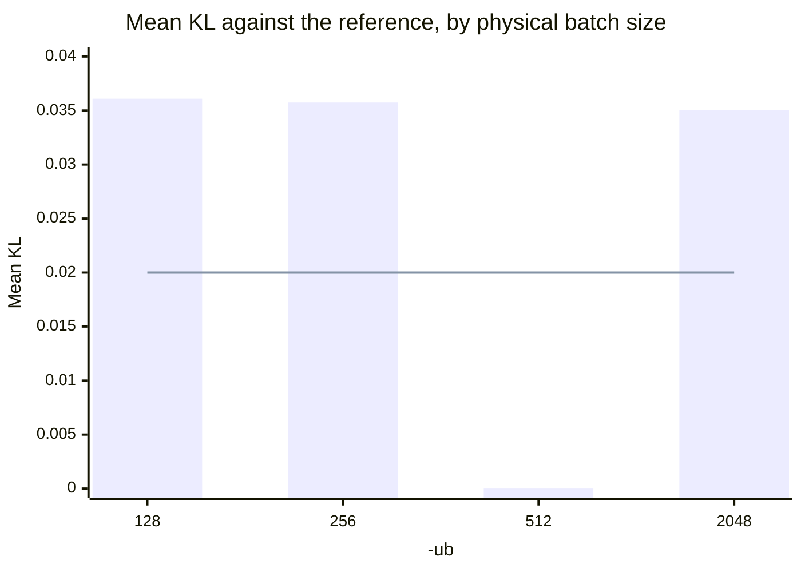
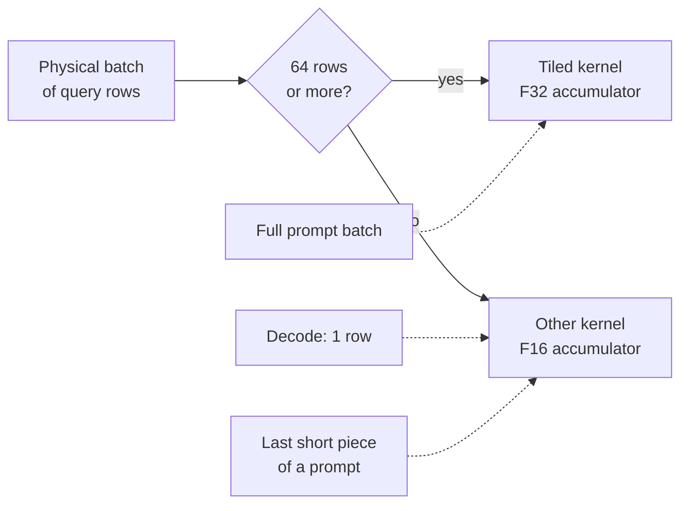

# Reference outputs: what "correct" means end to end

The tokens and probabilities the engine is compared against, made with llama.cpp on 2026-10-11 and 2026-10-12 (the
outputs of two prompts again on 2026-10-18), and how they were made. The correctness rule they serve is
[ADR-0012](../adr/0012-correctness-reference.md).

**Warning: the reference depends on how the prompt is chunked.** With the same file, the same prompt and greedy
sampling, llama.cpp gives different tokens when its physical batch size (`-ub`) changes, and a mean KL of about 0.036
between two such runs ([How far to trust the reference](#how-far-to-trust-the-reference)). The thread count does not
matter. So the reference is pinned to `-ub 512`, and the engine's prompt chunking must be part of what is tested.

## What is here

| File | What it is | Size |
| --- | --- | ---: |
| [`reference/prompts.jsonl`](../../reference/prompts.jsonl) | 24 prompts: id, kind, thinking on/off, effort, `max_tokens` for a benchmark run, the rendered text, and its token ids | 2.0 MB |
| [`reference/messages.jsonl`](../../reference/messages.jsonl) | the chat messages and tools of the 12 prompts added on 2026-10-20, as `/v1/chat/completions` takes them; `tools/reference_prompts.py` renders them | 644 KB |
| [`reference/llamacpp-3cf0325-IQ3_S-greedy.jsonl`](../../reference/llamacpp-3cf0325-IQ3_S-greedy.jsonl) | greedy output token ids per prompt, first line names the commit, the backend and the model files with their sha256 | 8 KB |
| The KL base (on the machine, not in Git) | llama.cpp's saved log-probabilities for 64 chunks of a fixed text | 8.1 GB |

Everything in `reference/` is text and holds no logits.

## The reference

| Item | Value |
| --- | --- |
| Program | llama.cpp `3cf03257f219afbe7334045ff7c6a06ac68c627d` (`3cf0325`, "CUDA: enable sparse fa for qwen4"), the commit Strata's `setup.py` pins ([ADR-0012](../adr/0012-correctness-reference.md)). Source: a clean tree of that commit |
| Backend | CPU only. `GGML_SYCL`, `GGML_VULKAN`, `GGML_CUDA` off |
| Machine | the test machine ([MEASUREMENTS.md#the-test-machine](MEASUREMENTS.md#the-test-machine)) |
| Build environment | Ubuntu 26.04.1, g++ 15.2.0, cmake 4.2.3, Ninja 1.13.2 |
| Model | the IQ3_S file, both shards ([MODEL_FILES.md](../MODEL_FILES.md)) |
| Prompt chunking | `n_batch` 2048, `n_ubatch` 512: a 512-token physical batch |
| Threads | 16, pinned with `taskset -c 0-15`. The thread count does not change the result: 8 and 16 gave mean KL 0.000000 ([below](#what-changes-it)) |
| Context | 33,024 tokens (the 32K prompt plus 128 new tokens, with room), one sequence |

The model files are the ones [MODEL_FILES.md](../MODEL_FILES.md) lists with their sha256.

### The build line

With the compiler and tools above:

```
cmake -S llama.cpp -B build -G Ninja -DCMAKE_BUILD_TYPE=Release \
  -DGGML_NATIVE=OFF -DGGML_AVX=ON -DGGML_AVX2=ON -DGGML_FMA=ON -DGGML_F16C=ON -DGGML_BMI2=ON \
  -DGGML_AVX512=ON -DGGML_AVX512_VBMI=ON -DGGML_AVX512_VNNI=ON -DGGML_AVX512_BF16=ON \
  -DGGML_OPENMP=ON -DLLAMA_BUILD_TESTS=OFF -DLLAMA_BUILD_EXAMPLES=OFF -DLLAMA_BUILD_SERVER=OFF \
  -DGGML_SYCL=OFF -DGGML_VULKAN=OFF -DGGML_CUDA=OFF
taskset -c 8-15,24-31 cmake --build build -j 8 --target llama-completion llama-tokenize llama-perplexity
```

These are the same CPU flags as the build in the [CPU-bar record](MEASUREMENTS.md#2026-10-11-cpu-bar). `ggml` is
built as shared libraries, and `libllama` is linked by the small program in [The greedy outputs](#the-greedy-outputs).

## The prompt set

24 prompts, all rendered with the model's own chat template (the `tokenizer.chat_template` string in the GGUF).
The first 12 are what remains of the reference's original 16: `doc-4k-summary`, `tool-weather`, `tool-choose` and
`code-sql` were taken out on 2026-10-20, with their greedy outputs. The 12 after them are the shapes the engine
meets in use: a graduate-level question with a 1,500-token reasoning answer, a coding harness's turns, one of them
a session of 180,000 tokens, an edit printed whole and a long answer. They have no greedy outputs yet
([The greedy outputs](#the-greedy-outputs)).

| Prompt | Kind | Thinking | Prompt tokens | New tokens | Stop | Prefill (s) | Decode (s) |
| --- | --- | --- | ---: | ---: | --- | ---: | ---: |
| `chat-capital` | chat | on | 66 | 128 | length | 9.2 | 104.1 |
| `chat-hashmap` | chat | off | 36 | 128 | length | 4.3 | 87.7 |
| `chat-arith` | chat | on | 108 | 128 | length | 8.3 | 91.3 |
| `chat-multiturn` | chat | off | 98 | 128 | length | 7.6 | 57.8 |
| `chat-system` | chat | off | 52 | 61 | eog | 2.1 | 11.9 |
| `code-intervals` | code | off | 55 | 128 | length | 5.0 | 61.3 |
| `code-cbug` | code | on | 138 | 128 | length | 7.9 | 37.1 |
| `tool-result` | tool | off | 473 | 32 | eog | 9.5 | 5.5 |
| `effort-xhigh` | effort | on (xhigh) | 959 | 128 | length | 22.6 | 23.8 |
| `effort-low` | effort | on (low) | 947 | 128 | length | 19.6 | 25.2 |
| `doc-4k-qa` | long | on | 4,159 | 128 | length | 95.8 | 24.5 |
| `doc-32k` | long | off | 32,010 | 128 | length | 803.0 | 26.3 |
| `gpqa-1` | gpqa | on | 217 | | | | |
| `gpqa-2` | gpqa | on | 251 | | | | |
| `gpqa-3` | gpqa | on | 256 | | | | |
| `gpqa-4` | gpqa | on | 321 | | | | |
| `agent-turn1` | agent | on | 3,259 | | | | |
| `agent-turn2` | agent | on | 4,547 | | | | |
| `agent-turn3` | agent | on | 6,628 | | | | |
| `agent-turn4` | agent | on | 7,434 | | | | |
| `agent-180k` | agent | on | 179,830 | | | | |
| `edit-py` | edit | off | 556 | | | | |
| `edit-cpp` | edit | off | 2,563 | | | | |
| `long-gen` | gen | off | 86 | | | | |

- "Stop" is `length` (128 new tokens) or `eog` (an end-of-generation token; it is kept as the last token).
- Times are from one run, on the test machine. They are not a performance
  measurement. They include a cold start: the first prompts read the model file from disk, so the first decode rates
  (1.2-1.5 tokens/s, new tokens over decode time) are not the steady rate. The others decode at 2.1-5.8 tokens/s.
- The row of `doc-32k` is from a second run on 2026-10-18, made after its text changed
  ([The rerun](#the-rerun-of-2026-10-18)), on a host that was shared with other work. Its times are not comparable
  with the other rows'.
- The 12 rows of 2026-10-20 have no greedy outputs yet, so their new-token, stop and time cells are empty.
- Thinking "on" is the template's default: the prompt ends with `<think>\n`, so the first 128 tokens are the model's
  reasoning. "Off" is `enable_thinking=false`: the prompt ends with `<think>\n\n</think>\n\n`.

What each group holds:

| Group | Prompts | Notes |
| --- | --- | --- |
| chat | 5 | short questions; one multi-turn with an earlier assistant turn; one with a system prompt |
| code | 2 | write a function, find bugs in C |
| tool | 1 | tool definitions in the system block, a tool call and its result fed back |
| effort | 2 | the same ~900-token system prompt and the same user question, with `reasoning_effort` `xhigh` and `low` |
| long | 2 | text from this repository's docs: about 4K and 32K tokens, with a question after the text; older copies of pages |
| gpqa | 4 | graduate-level multiple-choice science questions (equilibrium chemistry, a spin-1/2 measurement, linked genes, a reaction sequence) with the instruction a GPQA harness adds, "reason step by step" and a boxed letter. Written for the set, not taken from GPQA. Thinking on, so the answer is a long reasoning trace: `max_tokens` 1,536 |
| agent | 5 | one coding-harness conversation at four points, and a long session. A system prompt of agent rules with twelve tool definitions, then a task (a failing test to fix) with the harness's environment block; then the model's tool calls and their results, turn by turn: a listing and the test file, the module, the waiter, the git log and a test run, the commit that broke it, the edit, the passing run and the diff. Each turn's prompt starts with the whole of the one before. `agent-180k` is a session of 179,830 tokens over this repository's own tree at the commit that added it: the same system prompt and tools, then seven user requests (walk the request path, find the context check, run the tests, read the core's API, the tokenizer, the docs, the image path) and 32 assistant turns that list directories, read 60 of the repository's files whole with line numbers, grep them and run the host tests, each result fed back as the harness feeds it, ending with a request for a written summary |
| edit | 2 | a 55-line Python file and a 250-line C++ file, each to be changed in one place and printed whole: `max_tokens` 1,536 and 4,096 |
| gen | 1 | a 3,000-word essay from an 86-token prompt: `max_tokens` 4,096 |

The effort pair shares only 9 tokens of prefix. The template puts the effort sentence at the start of the system
block, before the long system prompt. So `effort-xhigh` and `effort-low` agree for 9 tokens
(`<|im_start|>system\nReasoning effort is set to `) and then differ. The 920 tokens after that (the shared system
prompt, the question and the generation prompt) are the same text at a different position, so a prefix cache keyed on
the token prefix does not share them. `medium` adds no sentence, so a `medium` request shares nothing with either.

### How the prompts were rendered

The original prompts were rendered by a script that follows the template line by line, `build_prompts.py`, which is
not in the repository. It covers the message shapes used: system, user, assistant (with and without tool calls),
tool responses, a tool list, `enable_thinking` and `reasoning_effort`.

The 12 prompts of 2026-10-20 are rendered from `reference/messages.jsonl` by `tools/reference_prompts.py`, through
the front end's own template and tokenizer (`frontend/template.py`, `frontend/tokenizer.py`), so their text is what
the server renders for the same request. A thinking-on request without a system message gets the template's
`xhigh` system line, as `chat-capital` has. Run it with the GGUF, or with a `tokenizer.json` and a
`chat_template.jinja`; `--check` tokenizes every row's text again and names the rows whose tokens differ. The
vocabulary and template of `Qwen/Qwen3.8-Flash-Next` on the Hub (`vocab.json`, `merges.txt`, the added tokens of
`tokenizer_config.json`, `chat_template.jinja`) give the original rows' tokens exactly, so the 12 rows' tokens were
made from them.

**The rendering is not checked against llama.cpp's template engine.** The one place the output can differ is
`tojson` for the tool definitions: the script uses Python's `json.dumps` with the default separators (`", "` and
`": "`), keys in the order written. If the engine's own template code serialises tools differently, the prompt text differs.
The token ids in `prompts.jsonl` are of the text in the same file, so the reference is self-consistent either way.

The token ids come from `llama_tokenize` on the loaded vocabulary (`vocab_only`), with `add_special=false` (the model
sets `add_bos_token` false) and `parse_special=true`, so `<|im_start|>`, `<think>` and the like become single tokens.
`tests/end_to_end/qwen4exp/test_model_text.py` checks the engine's tokenizer against these ids.

The two 4K prompts and the 32K prompt are cut by trial to 4,150, 4,159 and 32,010 tokens. `doc-4k-summary` is the
first 14,369 characters of `docs/DESIGN.md` at commit `fdfc1bb`, between `Here is a document.` and the instruction
`Summarise the document's main points in five bullet points.`.

## The greedy outputs

For each prompt, the largest-logit token is taken at every step, with no penalties, for up to 128 new tokens. The 12
prompts of 2026-10-20 have none yet: `refgen gen` on the machine, as below, adds them (`agent-180k` needs a context
of 180,000 tokens and more, so it runs alone). Until then `greedy_test` and `route_profile` run the 12 that have
outputs. The four prompts taken out on 2026-10-20 held 202 of the 1,063 positions the agreement figure was over, so
the figure is taken again over the prompts that remain.

llama.cpp's `llama-completion` prints text, not token ids. So the outputs come from `refgen`, a 90-line C++ program
that is not in the repository. It links `libllama` and, for each prompt:

1. load the model once for all prompts (`llama_model_load_from_file`, default `use_mmap`), and create one context with
   `n_ctx` 33,024, `n_batch` 2048, `n_ubatch` 512 and 16 threads;
2. clear the memory (`llama_memory_clear`) and reset the sampler;
3. decode the prompt in pieces of at most 2,048 tokens (`llama_batch_get_one`; the context splits each into 512-token
   physical batches);
4. take `llama_sampler_sample` from a chain with only `llama_sampler_init_greedy`, decode the token, repeat for 128
   tokens or until `llama_vocab_is_eog`.

Cross-check against the stock tool: on `chat-hashmap` and `tool-weather`, `llama-completion -no-cnv -n 128 -c 2048
-t 16 --temp 0 --top-k 1 -sp` prints the same text that `refgen`'s token ids detokenize to (556 and 143 bytes).
**Warning:** give the prompt with `-p`, with its trailing newlines kept (`P="$(cat f; printf x)"; P="${P%x}"`). With
`-f` the stock tool removes the prompt's last newline. On `chat-hashmap` that changed the prompt's final token from
`\n\n` to `\n` and the first generated token from `A` to `#`.

### Commands

Twelve prompts have no rows in `reference/llamacpp-3cf0325-IQ3_S-greedy.jsonl`: `gpqa-1` to `gpqa-4`,
`agent-turn1` to `agent-turn4`, `agent-180k`, `edit-py`, `edit-cpp` and `long-gen`. `refgen gen` below makes them;
`agent-180k` needs a run of its own with a context above 180,000 tokens.

```
M=Qwen3.8-Flash-Next-GSQ-RCO-IQ3_S-00001-of-00002.gguf     # shard 2 loads with it
# prompt token ids
LD_LIBRARY_PATH=build/bin ./refgen tok $M prompts tok.jsonl <ids>
# greedy outputs: the 13 prompts of up to 959 tokens, then the two 4K prompts, then the 32K prompt
LD_LIBRARY_PATH=build/bin timeout 3600 taskset -c 0-15 ./refgen gen $M prompts greedy.jsonl 33024 128 16 <ids>
```

The long prompts ran as separate invocations under `timeout 1800` (the two 4K prompts, 6 minutes in all) and
`timeout 7200` (the 32K prompt, 16 minutes). All exited with code 0.

### The rerun of 2026-10-18

`doc-4k-summary` and `doc-32k` were made again after their text changed, with the same llama.cpp commit, build line,
compiler and tool versions, model files and settings as above. `refgen` was written again from the steps above, and
llama.cpp was rebuilt. Two checks show that the rerun reproduces the first:

- `refgen tok` gives the stored token ids for the text of all 14 prompts that did not change.
- The stored outputs of `chat-hashmap`, `tool-weather` and `doc-4k-qa` come out again byte for byte the same.

The 4K prompts ran as one invocation, `doc-4k-summary` and then `doc-4k-qa` (the check), under `timeout 1800`. The 32K
prompt ran as its own invocation under `timeout 7200`, 15 minutes. All exited with code 0.

## The KL base

`llama-perplexity --kl-divergence-base` saves the model's log-probabilities for a fixed text. A run with
`--kl-divergence` reads them back and reports the divergence of the model it runs from the saved one.

| Item | Value |
| --- | --- |
| Text | the first 110,000 bytes of `docs/DUAL_B60_DATAFLOW.md`, `docs/EXPERT_PREFETCH.md`, `docs/spec/MODEL_LAYER.md` and `docs/spec/QUANT_FORMATS.md` at commit `ddc07bc`, concatenated in that order (`cat ... \| head -c 110000`). The file is `kl-text.txt` |
| Text sha256 | `eaeb8584f9a9da28eb4cfd36b4fc18c108812a5e555b0ff092cf35e86a219598` |
| Chunks | 64 chunks of 512 tokens (`-c 512 --chunks 64`); probabilities are kept for the second half of each chunk, 255 positions: 16,320 scored positions |
| File | `kl-base-IQ3_S.bin`, not distributed |
| Size | 8,105,426,452 bytes (8.1 GB) |
| sha256 | `844b50e3a6c121df713f6d6cf51f4141159affabfa180bbe1244232ee18af77e` |
| Perplexity of the base run | 7.2183 ± 0.15843 over the 64 chunks (`Final estimate`) |

The command, verbatim (run on 2026-10-12, 00:02 to 00:15 UTC):

```
LD_LIBRARY_PATH=build/bin timeout 5400 taskset -c 0-15 build/bin/llama-perplexity \
  -m /models/Qwen3.8-Flash-Next-GSQ-RCO-IQ3_S-00001-of-00002.gguf -f kl-text.txt -c 512 --chunks 64 -t 16 \
  --kl-divergence-base kl-base-IQ3_S.bin
```

`-b` and `-ub` are at their defaults, 2048 and 512. With `-c 512` that makes 4 sequences per batch.

The file's layout, from `tools/perplexity/perplexity.cpp` at `3cf0325`, for the engine's own comparator: the 8
bytes `_logits_`, an `int32` `n_ctx` (512), an `int32` `n_vocab` (248,320), an `int32` `n_chunk` (64),
`n_chunk x 512` `int32` token ids, then for each chunk the
255 positions from 256 to 510. Each position is `2 * ((n_vocab + 1) / 2) + 4` `uint16` values: a `float32`
`scale`, a `float32` `min_log_prob`, then `n_vocab` `uint16` codes. Code `c` stands for the logit `min_logit + c *
scale`, where `min_logit` is the larger of the position's smallest logit and its largest minus 16. Subtracting the
log-sum-exp gives the log-probability. This layout accounts for the file's size to the byte: 20 + 131,072 +
16,320 x 496,648 = 8,105,426,452. The tokens in the file are the ids the engine must feed. No BOS token is
added: the program adds one only when the model's `add_bos_token` is true, and for this model it is false.

## How the engine is compared

| Check | How | What it shows |
| --- | --- | --- |
| Tokenizer | the engine's tokenizer on each prompt's `text` equals its `tokens` | the tokenizer |
| Greedy agreement, teacher-forced | feed the prompt as the reference did (512-token pieces), then the reference tokens one at a time, as they were generated; at each generated position, is the engine's largest logit the reference's next token? Report the fraction of positions | the per-position agreement. A flipped token does not carry into later positions |
| Greedy agreement, free-running | the engine generates 128 tokens; report the length of the common prefix with the reference, and the fraction of positions equal | what a user sees. After the first flip the two texts differ and later positions are not comparable |
| Mean KL and top-1 agreement | the engine's log-probabilities on the 64 chunks of the KL text against the base file | the distribution as a whole (`Mean KLD`, `Same top p` in llama.cpp's report) |

For llama.cpp itself, the last check is `llama-perplexity -m <file> -f kl-text.txt -c 512 --chunks 64 --kl-divergence-base
<base> --kl-divergence`. The engine is not llama.cpp, so it needs its own comparator that reads the layout above.
The repository has no such comparator, and no test reads the KL base.

## How far to trust the reference

Run again with the same settings, the reference gives the same result. Whether that result is the most accurate one
is not known.

### What changes it

Each run below uses the same model file and the KL text, read against the KL base, with one setting changed. Mean KL
and "same top p" are from llama.cpp's own report. The thread count has no effect: 8 and 16 threads give the same
numbers at `-ub 512` and `-ub 128`, so the table shows 16.

| `-ub` | Mean KL | Same top token |
| ---: | ---: | ---: |
| 512 (the reference) | 0.000000 | 99.988 % |
| 128 | 0.036092 ± 0.000597 | 91.305 % |
| 256 | 0.035744 ± 0.000587 | 91.667 % |
| 2048 | 0.035042 ± 0.000564 | 91.685 % |



The line is the KL gate, 0.02 ([TESTING.md](../TESTING.md#tolerances)). At `-ub 512`, the 0.012 % of positions where the
top token differs are ties. Any other `-ub` is above the KL gate, and its top-1 agreement is below the 95 % gate. An
engine that matched llama.cpp's arithmetic exactly but grouped prompt tokens differently would fail both gates. So
the engine's KL check feeds the text in 512-token pieces, as the reference does.

On the KL text, `-ub 2048` splits no sequence. Each chunk is one 512-token sequence, and `-ub 2048` puts four of them
in one physical batch. Its row measures batching several sequences together, not splitting one sequence differently.

### Which greedy outputs to trust

Greedy tokens against the `-ub 512` outputs:

| Prompt | Prompt tokens | `-ub 128` | `-ub 2048` |
| --- | ---: | --- | --- |
| `chat-capital`, `chat-hashmap`, `chat-arith`, `chat-multiturn`, `chat-system`, `code-intervals`, `code-sql`, `tool-weather`, `tool-result` | 36-473 | identical | not run |
| `code-cbug` | 138 | differs from token 49 | identical |
| `tool-choose` | 449 | differs from token 0, in a sentence before the tool call | identical |
| `effort-xhigh` | 959 | differs from token 58 | differs from token 12 |
| `effort-low` | 947 | differs from token 53 | differs from token 59 |
| `doc-4k-summary`, before its text changed | 4,150 | not run | differs from token 4 |
| `doc-4k-qa` | 4,159 | not run | differs from token 113 |

The tokens change only when the prompt is split into different physical batches. A prompt of up to 512 tokens is one
batch at both `-ub 512` and `-ub 2048`, so those outputs are the most reliable. The teacher-forced gate covers only
those prompts. The longer prompts are tied to `-ub 512` and are reported, not gated.

### The known cause

In a dump of every node at `-ub 512` and `-ub 16`, the first node to differ is the first attention layer's
`FLASH_ATTN_EXT`. llama.cpp's CPU flash attention picks its kernel by the number of query rows in a physical batch
(`ggml/src/ggml-cpu/ops.cpp:9212-9345` at `3cf0325`):



So inside the reference itself, full prompt batches and generated tokens round attention differently. An engine
that accumulates attention in F32 everywhere can differ from the reference on generated tokens for this reason alone.

### What is not known

- Why `-ub 128` and `-ub 256` differ from 512, though all three use the tiled kernel. If the cause is a llama.cpp
  bug at this commit, the reference is reproducible but not correct, and
  [ADR-0012](../adr/0012-correctness-reference.md)'s "revisit when llama.cpp's implementation is found to be wrong" may
  apply.
- Whether `-ub 512` is the most accurate setting. Only the agreement between settings is measured. `-ub 512` uses the
  F32 kernel on full batches, which the code suggests is the more accurate one, but it is not checked against an F32
  reference.
- Whether the tool prompts match llama.cpp's own template engine. The prompt renderer writes tool JSON with Python's
  default separators ([How the prompts were rendered](#how-the-prompts-were-rendered)). The prompt text and its token
  ids agree with each other either way.
- The reference on any model file other than IQ3_S ([ADR-0018](../adr/0018-one-file-iq3s.md)).

## Agreement gates

The gates are in [TESTING.md](../TESTING.md#tolerances). `core/tests/greedy_test.cpp` applies the teacher-forced greedy
gate, and `core/tests/api_test.c` checks the first 32 tokens of `chat-hashmap` exactly.

## Choices made

| Choice | What was done | Why | To revisit |
| --- | --- | --- | --- |
| Prompt text | written for this reference, plus this repository's docs for the long prompts (`doc-4k-summary` from the start of `docs/DESIGN.md`); Strata's prompts were not at hand | no `tools/` or `bench/results/` of Strata was | swap in Strata's prompts if wanted |
| KL text | repository docs, 110,000 bytes, not a standard corpus | a standard text (wikitext-2) needs a download, which was not made | prose is easier to compare with other work; markdown tables are unusual text for a language model |
| KL size | 64 chunks, 8.1 GB | about 16K scored positions gives a standard error of 0.0006 on the mean KL | more chunks if the gate needs a tighter error |
| Thinking | on for 6 prompts, off for 10 | thinking-on outputs are all reasoning for 128 tokens; the tool and answer-format prompts need it off | |
| Reference `-ub` | 512 | the llama.cpp default | see [What is not known](#what-is-not-known) |
| Threads | 16, CPUs 0-15 | the thread count does not matter ([What changes it](#what-changes-it)) | |
| Effort pair | `xhigh` against `low` | `medium` renders no sentence and `high` is `xhigh` | |
| Tool JSON | Python `json.dumps` default separators | see [How the prompts were rendered](#how-the-prompts-were-rendered) | check against llama.cpp's own template engine |
