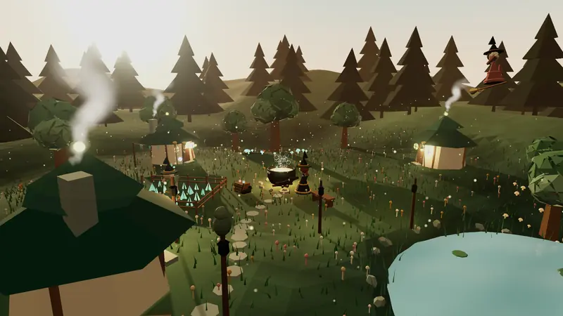

# Coven Hollow

Coven Hollow is the animation at the top of the README. Three witches brew at a cauldron in a woodland clearing at
dusk, beside crooked cottages, a glowing garden and a pond, while a fourth flies overhead on a broom. Code in one
HTML file draws all of it, with no models or textures: [coven-hollow.html](coven-hollow.html). On the
[docs site](https://avra-m3.github.io/c0ven/docs/showcase/coven-hollow.html) the link opens the scene itself. Drag
to look around and click to cast a spark.



## The slow tour

<video controls loop muted preload="none" src="coven-hollow-tour.webm"></video>

The same scene, taken slowly: one 64 s circuit that dips low over the pond, rises over the roofs and passes behind
the cottages. [coven-hollow-tour.webm](coven-hollow-tour.webm) is 960x540 at 25 fps.

## How to make this

You need a coding agent that can write files and run a browser, and a network connection: the page loads three.js
0.170.0 from a CDN. It needs no build step.

### 1. Ask for the scene

```text
Make a single self-contained HTML file with an impressive animated Three.js scene: a cozy, whimsical
coven of witches at work in their little corner of the world. Storybook, Ghibli-like, everything built
procedurally: geometry, materials, shaders, particles. No external models or textures. Three.js 0.170.0
from an import map, OrbitControls and post-processing from the examples' jsm folder. Deep forest teal
(#1F3B34) is the palette backbone: roofs, pines, robes, shadows; warm complements over it: creams,
honey, amber, muted golds, blush, sage. Golden hour or soft twilight, never murky. A woodland clearing
with crooked cottages, herb gardens, glowing mushrooms, lanterns, a pond, drying herbs, potion bottles,
familiars (cats, owls, frogs), broomsticks, distant hills and trees. The witches do cheerful visible
magic: brewing, tending plants, floating ingredients, flying, chatting. Soft light, glow, drifting
particles (pollen, sparkles, fireflies, bubbles), haze, a lovely sky, ambient motion: chimney smoke,
swaying grass and leaves, rippling water. The viewer looks around and interacts. Full-window canvas,
resize handling, 60 fps, instancing for repeated details, pivot groups at swinging joints.
```

Open the file in a browser and ask for changes until you like it.

### 2. Make it loop

```text
Make the scene loop exactly: every moving part repeats every 8 s, and the camera flies a closed path
once per period. Add a ?pump mode that stops the render loop and lets a script step the scene one
frame at a time and read each frame back.
```

A recording loops with no seam only if the scene repeats, so every moving part must finish a whole number of
cycles in one period. In [coven-hollow.html](coven-hollow.html) the period is 8 s:

- Shader and script frequencies are whole multiples of the period.
- Particles, such as smoke and bubbles, have cycle lengths that divide it.
- Things that would drift away, such as clouds, sway in place.
- The witch on the broom flies one full circuit in each period.
- Timed events, such as the spark between witches and the frog's hops, reset at the start of each period, and the
  scene's random number generator resets with them.
- The camera moves at one steady speed along a closed path, once each period.

With `?pump` in the address, `window.__PUMP(k, dt, shot)` advances the scene to frame `k` at `dt` seconds a frame
and, if `shot` is true, returns the frame as a PNG data URL. `?pump&tour` swaps the camera for the 64 s tour: a
taller path, with the point the camera looks at drifting along a third. A tour is eight periods, so it loops the
same way.

### 3. Record it

```text
Record one period as an animated WebP at 60 fps: open the page with ?pump in a headless browser at
twice the output size, step two periods to warm up, save the third period frame by frame, scale the
frames down, and encode them with a frame delay that keeps the loop exactly 8 s long.
```

The loop above was recorded this way. Playwright's Chromium opened the page in a 960x540 window at a device scale
factor of 2; the page caps its pixel ratio at 1.8, so frames came out at 1728x972. The script stepped 960 frames to
warm up and saved the next 480. Pillow scaled them to 800x450 with a Lanczos filter and saved them as a lossy
WebP. WebP frame delays are whole milliseconds, so they run 17, 17, 16 ms in turn: 60 fps, 8,000 ms a loop.

Use WebP, not GIF. A GIF frame holds at most 256 colours, which bands the sky and the glow, and its delays are
whole hundredths of a second, so it cannot play at 60 fps. GitHub and the browsers show an animated WebP wherever
they show a GIF. A long camera move changes nearly every pixel of every frame, which neither format stores well;
record those as video, as the tour is.
