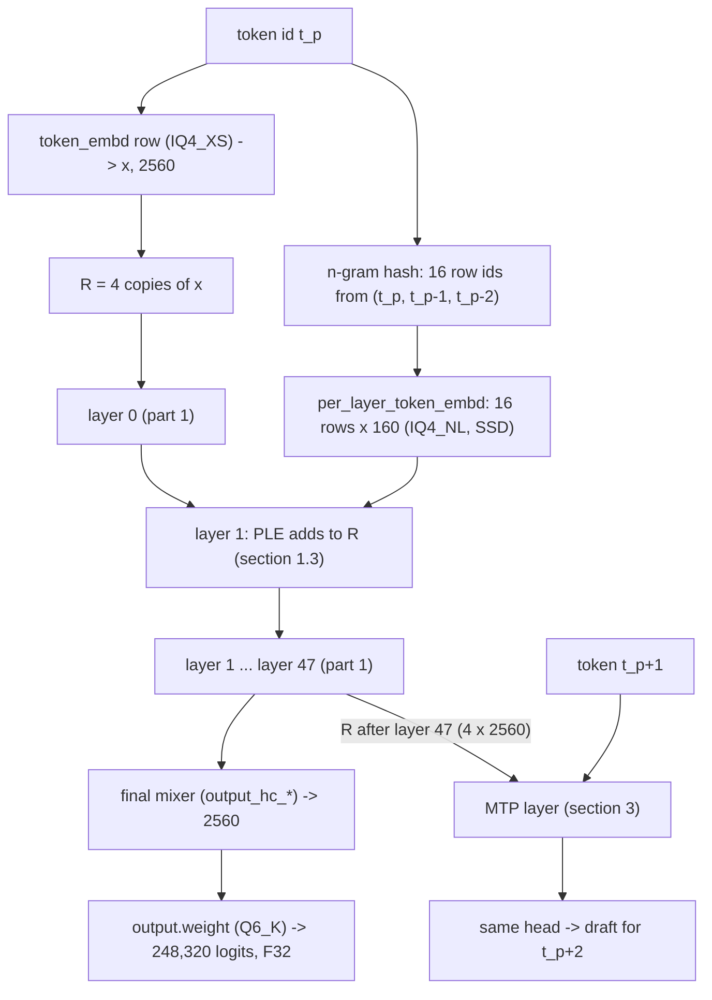

# Model spec, part 2: around the layers

**llama.cpp commit (pinned):** [`3cf03257f219afbe7334045ff7c6a06ac68c627d`](https://github.com/ggml-org/llama.cpp/tree/3cf03257f219afbe7334045ff7c6a06ac68c627d),
the same commit as [part 1](MODEL_LAYER.md) and [ADR-0012](../adr/0012-correctness-reference.md). Every `file:line`
below without another prefix is in that tree.

Part 1 ([MODEL_LAYER.md](MODEL_LAYER.md)) says what one decoder layer computes. This page says what happens around
the 48 layers, for the GSQ-RCO IQ3_S file ([MODEL_FILES.md](../MODEL_FILES.md)): the token embedding, the n-gram
(PLE) module on layer 1 and its 28.8 GB table, the final mixer and the head, the draft (MTP) layer, the tokenizer and
chat template, and positions. No code from llama.cpp, Strata, transformers or the chat template is copied: behaviour
is in prose, formulas and tables, with the source cited. The template's sentences are quoted where the exact text
decides the tokens.

**Sources.**

| Source | Version | Used for |
| --- | --- | --- |
| llama.cpp | `3cf03257f219afbe7334045ff7c6a06ac68c627d` | the reference: the graph (`src/models/qwen4exp.cpp`), the loader (`src/llama-model-loader.cpp`, `src/llama-model.cpp`), the converter (`conversion/qwen4exp.py`) |
| Strata | [`1678de3`](https://github.com/avra-m3/strata-intel/tree/1678de333d0e0711bc414ad992b640e1a37dd814) | the MTP layer (`include/strata/core/mtp.hpp`, `src/core/mtp.cpp`, `tools/mtp_fetch.py`, `tools/mtp_rt.py`), the hash constants (`src/kernels/ngram.cpp`), the rope-scaling rule (`setup.py`) |
| Hugging Face transformers | [`536ecc0`](https://github.com/huggingface/transformers/tree/536ecc007387a50e77603bb5d92100e9b07514cc), as in part 1 | a cross-check: `modeling_qwen4_exp.py` (cited `modeling:N`) and `configuration_qwen4_exp.py` (cited `configuration:N`) |
| The model's repository | [`Qwen/Qwen3.8-Flash-Next`](https://huggingface.co/Qwen/Qwen3.8-Flash-Next), `main`, read on 2026-10-11 | `config.json`, `generation_config.json`, `tokenizer_config.json`, `chat_template.jinja`, `README.md` (the licence). The revision Strata's MTP fetcher pins (`de4b8e4`, section 3) was not checked |
| The tensor census ("census" below) | [tensors-IQ3_S.tsv](../model/tensors-IQ3_S.tsv), [MODEL_FILES.md](../MODEL_FILES.md) | shapes, types, byte offsets, GGUF metadata |

## Conventions

As in [part 1](MODEL_LAYER.md#conventions): shapes in ggml order (`ne0` contiguous), a weight `IN x OUT` computes
`y = W x`, activations F32, `RMSNorm_eps` with eps 1e-6, folded gammas (`1 + w` already in the file). `R` is the
residual of 4 streams x 2,560 values. A bare `:line` is in the file named last before it.

## The whole model, in order



Source: `src/models/qwen4exp.cpp:362-457`; the same order in `modeling:1410-1484` and `modeling:1264-1302`.

## 1. Input

### 1.1 The token embedding

| | Value | Source |
| --- | --- | --- |
| Tensor | `token_embd.weight`, **IQ4_XS**, 2560 x 248,320, 337,715,200 B | census |
| Lookup | row `t` (2,560 values) for token id `t`, dequantized to F32 | `ggml_get_rows`, `src/llama-graph.cpp:2383` |
| Scale | none: the row is used as it is | `src/models/qwen4exp.cpp:362` (no scale op follows) |
| Residual start | `R_s = x` for each of the 4 streams | `src/models/qwen4exp.cpp:388-391`; `modeling:1471` |

IQ4_XS is in [QUANT_FORMATS.md](QUANT_FORMATS.md#iq4_xs). There is no tied head: the head is its own tensor
(`tie_word_embeddings` false in `config.json`; `src/models/qwen4exp.cpp:165-168` falls back to the embedding only if
`output.weight` is absent, and this file has it).

### 1.2 The n-gram embedding ("PLE")

**The n-gram table and the PLE are one mechanism.** The 28.8 GB table `per_layer_token_embd.weight` *is* the n-gram
embedding table, and the "PLE" (per-layer embedding) is the module on layer 1 that reads its rows. There is no
separate per-layer table: `ple.layers` = [1] (`config.json` `ple_layer_ids` [2], one-based,
`conversion/qwen4exp.py:70-72`), and llama.cpp accepts exactly one PLE layer
(`src/models/qwen4exp.cpp:73-76`).

**Constants** (GGUF `qwen4exp.ple.*`):

| Name | Value | Source |
| --- | --- | --- |
| n-gram size `n` | 3 (bigrams and trigrams; position `p` and the two before it) | `ple.ngram_size` |
| heads per n-gram | 8 | `ple.heads_per_ngram` |
| heads | 16 = (3 - 1) x 8: heads 0-7 hash the bigram, 8-15 the trigram | `src/models/qwen4exp.cpp:95` |
| row width | 160 values (`embedding_length_per_layer_input`); 16 x 160 = 2,560 | `src/models/qwen4exp.cpp:96` |
| reset token | 248,044 `<|endoftext|>` (`ple.eos_token_id`). **Not** `<|im_end|>` (248,046), the chat's end token | GGUF; `config.json` `eos_token_id` 248044 |
| multipliers `m` | `m0` = 23,703,573,157,769; `m1` = 20,109,073,645,365; `m2` = 8,052,911,324,071 | see below |
| head vocab sizes `V_h` | 20,000,003, 20,000,023, 20,000,033, 20,000,047, 20,000,059, 20,000,063, 20,000,069, 20,000,077, 20,000,081, 20,000,093, 20,000,107, 20,000,147, 20,000,153, 20,000,159, 20,000,161, 20,000,171 | see below |
| head offsets `O_h` | the running sum of `V_h`: 0, 20,000,003, 40,000,026, 60,000,059, 80,000,106, 100,000,165, 120,000,228, 140,000,297, 160,000,374, 180,000,455, 200,000,548, 220,000,655, 240,000,802, 260,000,955, 280,001,114, 300,001,275 | see below |
| table rows | 320,001,536: the sum of `V_h` (320,001,446) rounded up to a multiple of 128. The last 90 rows are padding and never read | `modeling:1102-1104`; census |

**Where the constants come from.** The GGUF stores them as arrays (`ple.layer_multipliers`, `ple.head_vocab_sizes`,
`ple.head_offsets`; written by `conversion/qwen4exp.py:88-93` from the checkpoint's buffers). The census lists the
arrays' lengths, not their values. The values above come from two independent sources, which agree exactly:

1. Strata's transcription of the GGUF dump (`src/kernels/ngram.cpp:37-56` at `1678de3`).
2. Transformers' construction, recomputed: the multipliers are `2 (splitmix64(s) mod B) + 1` with
   `s = 1234 + 0x9E3779B97F4A7C15 (j + 1)` (mod 2^64) for `j = 0, 1, 2`, seed 1,234 (`configuration:155`; no `seed`
   in `config.json`) and `B = floor(floor((2^63 - 1) / 248,320) / 2)` = 18,571,544,855,136 (`modeling:1032-1048`);
   the vocab sizes are the 1st to 16th primes above 19,999,999 (`modeling:1062-1068`, `:1090-1095`).

The engine reads the arrays from the file (`core/models/qwen4exp/ngram.cpp`), and `gguf_test` checks the first
multiplier.

The bound `B` keeps every product `t x m_j` below 2^63 for any token id below 248,320, so the XOR of products never
sets the sign bit. That is why transformers' signed 64-bit arithmetic (`torch.remainder` on int64) and llama.cpp's
unsigned arithmetic give the same row.

**The hash, per token at position `p`** (`src/models/qwen4exp.cpp:1066-1126`, host side; `modeling:1106-1166`):

1. **The context** `c = (c0, c1, c2)`: `c0 = t_p`, the token itself. Then for `s = 1, 2`, walking back: `c_s` is
   `t_{p-s}`, unless a reset happened at or after it. A **reset** is a predecessor that is the reset token 248,044, or
   that does not exist (before the start of the sequence, or no cached cell: `LLAMA_TOKEN_NULL`, any negative id).
   Once a reset is seen at step `s`, `c_s` and every older entry are 248,044 (`:1102-1110`). The token's own id is
   never tested: a 248,044 at `p` does not cut its own context (`:1101`). Token id 0 is a real token.
2. **Mix**, in unsigned 64-bit arithmetic, wrapping:
   `mixed_2 = (c0 m0) XOR (c1 m1)` for the bigram; `mixed_3 = mixed_2 XOR (c2 m2)` for the trigram (`:1112-1117`).
3. **Row ids:** `row_h = (mixed_n mod V_h) + O_h`, with `n = 2` for heads 0-7 and `n = 3` for heads 8-15
   (`:1118-1123`).

**The per-sequence history it needs:** the two previous token ids of the sequence, or "none". llama.cpp reads them
from the attention cache's cell metadata (`ext.tok`, `get_prev_tokens`, `src/llama-kv-cache.cpp:1836`, called at
`src/models/qwen4exp.cpp:1096`), so it needs no state of its own. Transformers keeps them as a third conv state
(`modeling:1122-1146`), filled with 248,044 at the start. llama.cpp refuses a token that belongs to several sequences
(`:1090-1093`): its predecessors would be ambiguous. An image position (no token id) hashes as the image token
248,056 (`ple.image_token_id`, `:1068-1077`).

**The gather** (`build_inp_ple`, `:1185-1204`): the 16 rows (160 values each, dequantized from IQ4_NL) are laid out
head-slowest into one vector `u` of 2,560 values: `u[160 h + i] = table[row_h][i]` (`:1199-1200`; `modeling:1166`
flattens the same way).

**Where llama.cpp keeps it.** Both `token_embd` and `per_layer_token_embd` are input-layer tensors
(`src/llama-arch.cpp:720`, `:913`), and the input layer's buffers are on the CPU (`src/llama-model.cpp:1537`). The
n-gram table is created `TENSOR_READ_LAZY` (`src/models/qwen4exp.cpp:188-189`): with the default lazy mode `auto`
(`src/llama-model.cpp:2794`) a tensor above 4 GiB is not loaded but read from the mapped file on demand, on the host
(`src/llama-model-loader.cpp:1080-1099`, `:1211-1212`). The engine reads it from the SSD instead
([ADR-0015](../adr/0015-ngram-table-on-the-ssd.md)): section 1.4.

### 1.3 The PLE module on layer 1

It runs before layer 1's attention HC mix and adds to the residual (`src/models/qwen4exp.cpp:397-399`,
`build_ple` at `:1206-1294`; `modeling:1275-1277`, `:1226-1246`). Layer 1 is a GDN layer. Input: the 4 streams `R`
and the gathered `u` (2,560).

| Tensor | Shape | Type | Role |
| --- | --- | --- | --- |
| `blk.1.ple_key.weight` | 2560 x 10240 | BF16 | `W_k`: one key per stream |
| `blk.1.ple_value.weight` | 2560 x 2560 | BF16 | `W_v`: one shared value |
| `blk.1.ple_norm_key.weight` | 10240 (2560 x 4) | F32 | `g_k` (folded) |
| `blk.1.ple_norm_query.weight` | 10240 | F32 | `g_q` (folded) |
| `blk.1.ple_norm_conv.weight` | 10240 | F32 | `g_c` (folded) |
| `blk.1.ple_conv1d.weight` | 4 x 10240 | **F16** | `w[k, ch]`, a depthwise conv; cast to F32 before use (`src/models/qwen4exp.cpp:1279-1283`) |

1. `k = W_k u` (10,240), split into 4 streams; `k_s <- RMSNorm(k_s) * g_k,s` per stream (`:1214`, `:1223`).
2. `v = W_v u` (2,560) (`:1215`).
3. `q_s = RMSNorm(R_s) * g_q,s` per stream (`:1224`).
4. Gate per stream: `a_s = (k_s . q_s) / sqrt(2560)`; `gate_s = sigma( sign(a_s) sqrt(max(|a_s|, 1e-6)) )`
   (`:1226-1231`; `modeling:1236-1239`).
5. `G_s = gate_s v`: the shared value scaled per stream, 4 x 2,560 (`:1234-1239`).
6. `N_s = RMSNorm(G_s) * g_c,s` per stream (`:1241-1244`).
7. A causal depthwise conv over the 10,240 channels of `N`, width 4, **dilation 3** (the n-gram size), then SiLU:
   `C_t[ch] = silu( sum_{k=0..3} w[k, ch] N_{t - 3(3-k)}[ch] )` (`:1246-1290`). So it reads positions `t`, `t-3`,
   `t-6`, `t-9`. Its history is the last 9 positions of `N` per sequence, 9 x 10,240 F32 = 368,640 B (part 1,
   [section 2.7](MODEL_LAYER.md#27-state-per-sequence)), zero at the start of a sequence.
8. `R_s <- R_s + G_s + C_s` (`:1293`).

The conv history has the same rollback problem as the GDN conv state ([part 1, section
2.8](MODEL_LAYER.md#28-what-must-be-saved-to-roll-back-rejected-draft-tokens)): llama.cpp keeps it in a recurrent row
with the same rollback slots (`build_conv_state_at`, `:1131-1183`).

### 1.4 Where row `r` lives in the file (for the `O_DIRECT` reader)

| | Value | Source |
| --- | --- | --- |
| File | shard 2, `Qwen3.8-Flash-Next-GSQ-RCO-IQ3_S-00002-of-00002.gguf` | census |
| Table data starts at | byte **192** of shard 2; ends at 28,800,138,432, the file's last byte | census |
| Row size | **90 B**: 160 values = 5 IQ4_NL blocks of 18 B ([QUANT_FORMATS.md](QUANT_FORMATS.md#iq4_nl)) | census |
| Row `r` | bytes `192 + 90 r` to `192 + 90 r + 89` | `ne0` = 160 is the contiguous axis |
| 4 KiB page | first page `floor((192 + 90 r) / 4096)`; it **straddles** into the next page when `(192 + 90 r) mod 4096 > 4006` | |
| How often a row straddles | 44 rows in every 2,048 (the pattern repeats every 2,048 rows, since 2,048 x 90 = 45 x 4096): **6,875,032 of 320,001,536 rows, 2.15%** | counted over all rows (below) |
| Alignment | the data start is 64-aligned (192 = 3 x 64), GGUF alignment is 32, and a row's start is only 2-aligned. No row starts on a page boundary unless `192 + 90 r` is a multiple of 4096 | |

So each token's 16 rows need 16 page reads, or 17 or more when a row straddles (2.15% chance per row: on average
16 x 1.0215 = 16.3 pages per token, an *estimate* that assumes the hash spreads rows uniformly). A read of one
4 KiB page at offset `4096 floor((192 + 90 r) / 4096)` meets `O_DIRECT`'s alignment for a 4,096-byte logical block;
a straddling row needs an 8 KiB read or two pages. The straddle count comes from enumerating `(192 + 90 i) mod 4096`
for `i` = 0-2,047 and scaling by the 156,250 full periods plus the 1,536 remaining rows.

### 1.5 Worked example: one row, its offset and its page, by hand

The first token of almost every chat is `<|im_start|>`, id 248,045, at position 0 (section 4). It has no
predecessors, so both read as resets: **`c = (248045, 248044, 248044)`**.

Head 0 (bigram):

| Step | Value |
| --- | --- |
| `c0 m0` = 248,045 x 23,703,573,157,769 | 5,879,552,803,918,811,605 (0x51985E1FBBBB91D5) |
| `c1 m1` = 248,044 x 20,109,073,645,365 | 4,987,935,063,290,916,060 (0x4538B4834A2BACDC) |
| `mixed_2` = XOR | 1,486,445,836,820,823,305 (0x14A0EA9CF1903D09) |
| `mixed_2 mod V_0` = mod 20,000,003 | 13,981,229 (quotient 74,322,280,692) |
| `row_0` = 13,981,229 + `O_0` (0) | **13,981,229** |
| byte offset in shard 2 = 192 + 90 x 13,981,229 | **1,258,310,802** |
| 4 KiB page = floor(1,258,310,802 / 4096) | **307,204** (page starts at 1,258,307,584; the row is at 3,218-3,307 in it: no straddle) |

Head 8 (trigram) continues: `c2 m2` = 248,044 x 8,052,911,324,071 = 1,997,476,336,467,867,124; `mixed_3` =
`mixed_2 XOR c2 m2` = 1,087,791,632,351,906,045; mod `V_8` (20,000,081) = 13,637,505; plus `O_8` (160,000,374) =
row **173,637,879**, offset 15,627,409,302, page 3,815,285.

All 16 rows for this token, computed by the steps above (with a scratch script, not committed):

| Head | Row | Byte offset | Page | Offset in page |
| ---: | ---: | ---: | ---: | ---: |
| 0 | 13,981,229 | 1,258,310,802 | 307,204 | 3,218 |
| 1 | 30,076,798 | 2,706,912,012 | 660,867 | 780 |
| 2 | 49,239,434 | 4,431,549,252 | 1,081,921 | 836 |
| 3 | 61,315,716 | 5,518,414,632 | 1,347,269 | 808 |
| 4 | 98,540,601 | 8,868,654,282 | 2,165,198 | 3,274 |
| 5 | 111,186,732 | 10,006,806,072 | 2,443,067 | 3,640 |
| 6 | 120,378,863 | 10,834,097,862 | 2,645,043 | 1,734 |
| 7 | 146,384,625 | 13,174,616,442 | 3,216,459 | 378 |
| 8 | 173,637,879 | 15,627,409,302 | 3,815,285 | 1,942 |
| 9 | 184,336,749 | 16,590,307,602 | 4,050,368 | 274 |
| 10 | 217,808,755 | 19,602,788,142 | 4,785,836 | 3,886 |
| 11 | 222,173,721 | 19,995,635,082 | 4,881,746 | 3,466 |
| 12 | 249,579,227 | 22,462,130,622 | 5,483,918 | 2,494 |
| 13 | 277,180,543 | 24,946,249,062 | 6,090,392 | 3,430 |
| 14 | 299,757,935 | 26,978,214,342 | 6,586,478 | 454 |
| 15 | 312,970,430 | 28,167,338,892 | 6,876,791 | 2,956 |

None of the 16 straddles. These 16 rows are the same for every request that starts with `<|im_start|>`, so a row
cache always holds them after the first request.

## 2. Output

### 2.1 The final mixer (there is no separate final norm)

After layer 47 the 4 streams are reduced to one vector by an HC mix with no injection (`src/models/qwen4exp.cpp:445-451`,
the comment at `:445`; `modeling:1384`, `:1484`). It is part 1's [section 1.1](MODEL_LAYER.md#11-mix-build_hc_mix-srcmodelsqwen4expcpp267-321)
steps 1-3 with these weights, and step 4 is skipped (`:315`):

| Tensor | Shape | Type | Role |
| --- | --- | --- | --- |
| `output_hc_norm.weight` | 10240 (2560 x 4) | F32 | per-stream gamma (folded) |
| `output_hc_down.weight` | 10240 x 320 | BF16 | `W_down` |
| `output_hc_up.weight` | 320 x 10240 | BF16 | `W_up` |

Output: `x_out`, 2,560 values (`result_norm`). With an output-row selection, llama.cpp drops the rows that produce
no logits before layer 47's last combine (`:417-425`).

### 2.2 The head

| | Value | Source |
| --- | --- | --- |
| Tensor | `output.weight`, **Q6_K**, 2560 x 248,320, 521,472,000 B | census; [QUANT_FORMATS.md](QUANT_FORMATS.md#q6_k) |
| Vocabulary | 248,320 rows (`tokenizer.ggml.tokens` has 248,320 entries; `config.json` `vocab_size` 248320) | |
| Logits | `z = W_out x_out`, 248,320 values, **F32** (`result_output`) | `src/models/qwen4exp.cpp:453-455` |
| CPU arithmetic | `x_out` quantized to Q8_K, block dot products summed in F32 | part 1, [section 6](MODEL_LAYER.md#6-numerics-on-llamacpps-cpu-backend) |

### 2.3 Default sampling

The model ships defaults in two places, and they agree: GGUF `general.sampling.temp` 1.0, `top_k` 20, `top_p` 0.95;
`generation_config.json`: `do_sample` true, temperature 1.0,
top_k 20, top_p 0.95, `eos_token_id` [248046, 248044] (generation stops at `<|im_end|>` or `<|endoftext|>`).
No min_p, repetition or presence penalty is given.

### 2.4 The sampler

llama.cpp's default chain applies, in order: the penalties, top-k, top-p, min-p, then the temperature, and draws from
what is left (`common/common.h:261-271`; DRY, top-n-sigma, typical-p and XTC sit between them and are off by
default). Each step works on the logits the step before left (`src/llama-sampler.cpp`):

| Step | Rule | Lines |
| --- | --- | --- |
| Penalties | For each candidate that occurs c > 0 times in the last `penalty_last_n` tokens: its logit l becomes l / r when l > 0 and l · r otherwise, for `penalty_repeat` r; then l − c · `penalty_freq` − `penalty_present`. Off when `penalty_last_n` is 0, or r is 1 and both others 0 | `:2885-2896`, `:2919-2980` |
| Top-k | the k largest logits | `:321` |
| Top-p | softmax of the logits left (at temperature 1), highest first; keep up to and including the first token at which the running sum reaches p | `:1549-1602` |
| Min-p | keep the tokens whose logit is at least the largest plus log(p), the top one always | `:1749-1801` |
| Temperature | logits divided by t; t <= 0 keeps only the largest | `:265-291` |

The penalties' tokens are the ones the sampler was given: llama.cpp's server gives it the whole prompt, except image
and other media positions, then each token it samples (`tools/server/server-context.cpp:409-427`). The model's
defaults (section 2.3) turn no penalty on and set the temperature to 1, so with them the order of top-p and the
temperature makes no difference.

## 3. The draft (MTP) layer

**Where its weights come from.** Not from the GGUF: llama.cpp's converter at the pinned commit drops the `mtp.*`
tensors (`conversion/qwen4exp.py:28-30`), and transformers ignores them on load (`modeling:1313`, `:1589`). Strata
takes them from Qwen's BF16 checkpoint by HTTP range reads (`tools/mtp_fetch.py:1-17`, `:28-35`):

| | Value |
| --- | --- |
| Repository | [`Qwen/Qwen3.8-Flash-Next`](https://huggingface.co/Qwen/Qwen3.8-Flash-Next), revision `de4b8e4d43b917e7706784d8bb445c9af86a3540` (`tools/mtp_fetch.py:32`) |
| Tensors | 31 `mtp.*` tensors over 28 of the 131 safetensors shards, all BF16 |
| Size | **5,214,301,696 B (5.21 GB)**, of which the 512 experts take 5.03 GB (measured on the fetched tensors; [MODEL_FILES.md](../MODEL_FILES.md#the-mtp-layer) says how they are fetched) |
| Licence | **`qwen-community-1.0`** (`license: other`, `license_name: qwen-community-1.0`, `license_link: LICENSE` in the repository's `README.md` front matter, read at `main` on 2026-10-11). The GGUF repository says Apache-2.0, but the MTP weights are not in it. The licence text itself was not read |

**What it computes.** Neither llama.cpp at the pinned commit nor transformers runs the MTP layer, so the reference
here is Strata's implementation, which its header says is transcribed from vLLM 0.30.0's `qwen4_exp` MTP and checked
by a probe (`include/strata/core/mtp.hpp:3-11`). This page does not check vLLM itself. `config.json`'s `mtp`
block: 1 layer, type `full_attention`, `rope_theta` 1e7, `mtp_use_dedicated_embeddings` false (the main embedding
and head are used).

**Inputs, for cell `i`:** the main model's residual `R^(i)` after layer 47 (all 4 streams, 10,240 values, *before*
the final mixer), and the token id at position `i + 1`. Its output predicts the token at `i + 2`. It runs at rope
position `i` (`mtp.hpp:4-7`).

1. `e = W_fe ( RMSNorm(embed(t_{i+1})) * g_e )`: the main `token_embd` row, normed over 2,560 with
   `pre_fc_norm_embedding`, through `fc_embedding` (2560 -> 2560) (`src/core/mtp.cpp:428-441`).
2. `h = RMSNorm(R^(i)) * g_h` over **all 10,240 values at once** (not per stream) with `pre_fc_norm_hidden`; then
   `h_s = W_fh h_s` per stream with `fc_hidden` (2560 -> 2560) (`:442-447`).
3. `R'_s = h_s + e` for each stream (`:448`).
4. One attention-type decoder layer on `R'`, as in part 1 sections 1, 3 and 4: HC mix, gated GQA attention with its
   own K/V cache, HC combine, HC mix, MoE (512 experts, top 10, gated shared expert), HC combine (`:449-552`).
5. The MTP's own final mixer (`mtp.hyper_connection_mixer.*`), then the **main** head `output.weight` (`:553-561`).
6. For the next draft step, its own output token and its own residual take the place of `t_{i+1}` and `R^(i)`
   (`mtp.hpp:6-7`).

Strata adds the Gemma `+1` to the MTP's F32 norm weights when it converts them (`tools/mtp_rt.py:11`, `:85-86`); the
checkpoint stores them raw.

**Its attention window.** The checkpoint's layer has indexer weights (`self_attn.indexer.*`), so the model's own
layer is sparse attention like the main ones. Strata does not run the indexer: it attends **densely over the last
32,768 cells** (`--mtp-window`, default 32,768, `src/program/generate.cpp:352`, `:1137`; `mtp.hpp:16-18`, `:46`;
`window_ids` at `src/core/mtp.cpp:502`). Below 2,051 cells this equals the sparse selection; above, it is a different
selection, which affects only draft quality, never the output, since the main model verifies every draft. The 32,768
is Strata's runtime choice, not the model's.

**Its K/V per cell:** 2 KV heads x 256 for K and for V, as one main attention layer (part 1,
[section 3.7](MODEL_LAYER.md#37-the-kv-layout-and-what-is-stored-per-token)): 2,048 B at F16, 1,088 B at Q8_0, so a
32,768-cell window is 67,108,864 B (F16) or 35,651,584 B (Q8_0) per sequence.

## 4. The tokenizer and the chat template

### 4.1 The tokenizer

| | Value | Source |
| --- | --- | --- |
| Type | byte-level BPE (`gpt2`), pre-tokenizer `qwen35` | `tokenizer.ggml.model`, `tokenizer.ggml.pre` |
| Vocabulary | 248,320 tokens, 247,587 merges | census |
| BOS | none added (`add_bos_token` false); `bos_token_id` 248,044 is never prepended | GGUF; `tokenizer_config.json` `bos_token` null |
| EOS (chat) | 248,046 `<|im_end|>` (`tokenizer.ggml.eos_token_id`) | GGUF |
| Padding | 248,044 `<|endoftext|>` | GGUF |
| Pre-tokenizer regex | contractions; letters with marks; **single digits**; punctuation runs with trailing newlines; newline runs; spaces | `tokenizer_config.json` `pretokenize_regex` |

Special and control tokens (`tokenizer_config.json` `added_tokens_decoder`):

| Id | Token | Special |
| ---: | --- | --- |
| 248,044 | `<|endoftext|>` | yes; also the n-gram reset |
| 248,045 | `<|im_start|>` | yes |
| 248,046 | `<|im_end|>` | yes |
| 248,047-248,052 | `<|object_ref_start|>`, `<|object_ref_end|>`, `<|box_start|>`, `<|box_end|>`, `<|quad_start|>`, `<|quad_end|>` | yes |
| 248,053-248,057 | `<|vision_start|>`, `<|vision_end|>`, `<|vision_pad|>`, `<|image_pad|>`, `<|video_pad|>` | yes |
| 248,058 / 248,059 | `<tool_call>` / `</tool_call>` | no |
| 248,060-248,065 | `<|fim_prefix|>`, `<|fim_middle|>`, `<|fim_suffix|>`, `<|fim_pad|>`, `<|repo_name|>`, `<|file_sep|>` | no |
| 248,066 / 248,067 | `<tool_response>` / `</tool_response>` | no |
| 248,068 / 248,069 | `<think>` / `</think>` | no |
| 248,070-248,076 | audio and TTS tokens | yes |

### 4.2 The chat template

The GGUF carries it as `tokenizer.chat_template`; the repository's `chat_template.jinja` (8,952 B, read at `main`) is
what is described here. That the GGUF's string is byte-identical was not checked (the GGUF's header is on the
machine).

**Reasoning effort.** Variables: `enable_thinking` (default: on) and `reasoning_effort`.

| Effort | Accepted | System-message sentence |
| --- | --- | --- |
| `xhigh` | yes, **the default** | "Reasoning effort is set to xhigh. Please think carefully through the task, validate key assumptions, consider plausible alternatives, and prioritize correctness, consistency, and clarity in the final answer." |
| `medium` | yes | **none** |
| `low` | yes | "Reasoning effort is set to low. Keep your thinking brief and focused, moving directly to the conclusion without unnecessary elaboration." |
| anything else | the template raises an error ("Supported types are xhigh (default), medium, and low") | |
| `enable_thinking` false | effort ignored; no sentence | |

**The system message, in order:**

- With no tools: `<|im_start|>system\n`, then the effort sentence, then `\n\n` and the system prompt's text (trimmed)
  if there is one, then `<|im_end|>\n`. With no system prompt and a sentence, the system message is the sentence
  alone. With neither (`medium`, or thinking off), **there is no system message at all**.
- With tools: `<|im_start|>system\n`, the effort sentence and `\n\n` (if any), then `# Tools ... <tools>`, each tool
  as JSON on its own line in the order given, `</tools>`, the fixed function-calling instructions, then `\n\n` and
  the system prompt's text (if any), then `<|im_end|>\n`. **The whole tool list comes before the system prompt.**

**Turns.** A user turn is `<|im_start|>user\n` + content (trimmed) + `<|im_end|>\n`. An assistant turn is
`<|im_start|>assistant\n`, then `<think>\n` + reasoning + `\n</think>\n\n` + content, then any tool calls as
`<tool_call>\n<function=NAME>\n<parameter=K>\nV\n</parameter>\n...</function>\n</tool_call>`, then `<|im_end|>\n`.
Tool results are grouped into one user turn of `<tool_response>` blocks. The generation prompt is
`<|im_start|>assistant\n<think>\n` (or `<think>\n\n</think>\n\n` with thinking off).

**Earlier turns' reasoning.** With `preserve_thinking` undefined or true, which is the default, **every** assistant turn
is rendered with its `<think>` block. If the client did not send `reasoning_content`, the block is still there,
empty: `<think>\n\n</think>\n\n`. With `preserve_thinking` false, turns before the last real user query are rendered
with no `<think>` block, and those after it keep theirs. So a client that drops `reasoning_content` changes the
rendered tokens of every earlier assistant turn (the reasoning text disappears from inside the block), and the cached
prefix stops matching at the first such turn's `<think>\n`.

### 4.3 Shared prefixes ([ADR-0017](../adr/0017-scheduling-several-requests.md))

Byte-level BPE works inside pre-tokens, and the pre-tokenizer splits at word and punctuation boundaries, so two
rendered strings that agree up to a word boundary tokenize to the same tokens up to that word. From the order above:

| Two requests that differ in... | Their rendered text diverges at | What they share |
| --- | --- | --- |
| effort, `xhigh` vs `low` | the word after "Reasoning effort is set to" | `<|im_start|>system\nReasoning effort is set to` |
| effort, `xhigh` or `low` vs `medium`, no system prompt, no tools | the second token: `system` vs `user` | `<|im_start|>` only |
| effort, `xhigh` or `low` vs `medium`, with a system prompt or tools | right after `<|im_start|>system\n`: the sentence vs the prompt or `# Tools` | 3 or so tokens |
| one tool (added, removed or changed) | that tool's JSON line | the effort sentence, the tool header, every tool before it |
| only the system prompt's text, same tools | after the fixed function-calling instructions | the effort sentence and the whole tool list |
| only the user's message | after the system message | the whole system message |

So a shared-prefix key holds per pair of effort and tool list, as ADR-0017 says, and any tool change invalidates
the system prompt's own text even when that text is identical. The n-gram rows follow the tokens: a token's 16 rows
depend on it and the two before it, so rows agree up to the divergence and differ from the first diverging token
through the two after it.

### 4.4 Worked example: two requests that differ only in effort

Request A: `{"messages": [{"role": "user", "content": "Hi"}]}` with `reasoning_effort` `xhigh` (the default).
Request B: the same with `low`. Both with the generation prompt.

```text
A: <|im_start|>system\nReasoning effort is set to xhigh. Please think carefully ...<|im_end|>\n<|im_start|>user\nHi<|im_end|>\n<|im_start|>assistant\n<think>\n
B: <|im_start|>system\nReasoning effort is set to low. Keep your thinking brief ...<|im_end|>\n<|im_start|>user\nHi<|im_end|>\n<|im_start|>assistant\n<think>\n
```

Pre-tokens, in order (the regex of section 4.1; special tokens are matched first):

| # | A | B | Same? |
| ---: | --- | --- | --- |
| 1 | `<|im_start|>` (248,045) | `<|im_start|>` (248,045) | yes |
| 2 | `system` | `system` | yes |
| 3 | `\n` | `\n` | yes |
| 4 | `Reasoning` | `Reasoning` | yes |
| 5 | ` effort` | ` effort` | yes |
| 6 | ` is` | ` is` | yes |
| 7 | ` set` | ` set` | yes |
| 8 | ` to` | ` to` | yes |
| 9 | ` xhigh` | ` low` | **no: the first diverging token is the first BPE token of ` xhigh` vs of ` low`** |

Every token before pre-token 9 is identical in A and B; the two sequences differ from the first token of pre-token
9 on, and never re-converge as one prefix (the rest is a different sentence). In token ids, `effort-xhigh` and
`effort-low` share their first 9 tokens and split at token 10 (830 against 3238): see
[REFERENCE_OUTPUTS.md](../measurements/REFERENCE_OUTPUTS.md) and `reference/prompts.jsonl`. Request C with `medium` would diverge from
A at token 2 (`user` instead of `system`). The rows of section 1.5 are the first token's rows in all three.

## 5. Positions

| Part | Positions | Source |
| --- | --- | --- |
| Token embedding, MoE, HC | none | |
| GDN layers (36) and the PLE conv | none: order only, through their recurrent state and conv history | part 1, section 2 |
| Attention layers (12): q, k | IMROPE with sections [11, 11, 10, 0], base 1e7, the first 64 of 256 dims, all four position axes equal to `p` for text | part 1, [section 3.3](MODEL_LAYER.md#33-rope-821-832) |
| The indexer (12 layers) | the same parameters; query at `p`, pooled block key at its block's first position `4b` | part 1, section 3.4; `src/models/qwen4exp.cpp:630-641` |
| MTP layer | the same base (`config.json` `mtp.rope_theta` 1e7) and rotated dims; cell `i` at position `i` | `mtp.hpp:4-7`; `src/core/mtp.cpp:464-473` |
| Trained context | 262,144 (`context_length`, `max_position_embeddings`) | GGUF; `config.json` |

**Past 262,144 tokens.** The GGUF has no rope-scaling keys, so llama.cpp scales nothing by default
(`src/llama-model.cpp:1349-1361`). Strata's `setup.py` resolves the method only for a context above 262,144: `yarn`
unless `linear` is chosen, `none` refused, factor `s = context / 262,144` (`setup.py:2493-2527` at `1678de3`). The
YaRN parameters that follow in llama.cpp (`freq_scale` 1/s, `ext_factor` 1, correction dims [14, 22], the
`1 + 0.1 ln s` magnitude scale on the 64 rotated dims) are derived in part 1,
[section 3.3](MODEL_LAYER.md#33-rope-821-832), and are not repeated here. The HF config's `rope_type` is `default`,
with no scaling.

## 6. The tensor map: everything that is not in a layer

The census has **6 non-layer tensors** and **1,218 layer tensors** (1,224 in all). Part 1's
[tensor map](MODEL_LAYER.md#5-the-tensor-map) covers all 41 `blk.N.*` patterns, which are the 1,218, including the 6
`blk.1.ple_*` tensors (specified in section 1.3 here). This table covers the other 6, so every tensor in the file is
covered.

| Tensor | Shape | Type | Bytes | Shard, offset | Read by | Checkpoint name |
| --- | --- | --- | ---: | --- | --- | --- |
| `token_embd.weight` | 2560 x 248320 | IQ4_XS | 337,715,200 | 1, 545,644,544 | 1.1; and the MTP (3, step 1) | `embed_tokens.weight` |
| `per_layer_token_embd.weight` | 160 x 320001536 | IQ4_NL | 28,800,138,240 | 2, 192 | 1.2, 1.4 | `layers.1.ple.ple_embedding.ngram_embedding` (the checkpoint's `split_ngram_parts` 128 shards, concatenated: `conversion/qwen4exp.py:145-172`) |
| `output_hc_norm.weight` | 10240 | F32 | 40,960 | 1, 539,049,984 | 2.1 | `hyper_connection_mixer.hc_norm.weight` (+1) |
| `output_hc_down.weight` | 10240 x 320 | BF16 | 6,553,600 | 1, 532,496,384 | 2.1 | `hyper_connection_mixer.input_mix_weight_down.weight` |
| `output_hc_up.weight` | 320 x 10240 | BF16 | 6,553,600 | 1, 539,090,944 | 2.1 | `hyper_connection_mixer.input_mix_weight_up.weight` |
| `output.weight` | 2560 x 248320 | Q6_K | 521,472,000 | 1, 11,024,384 | 2.2; and the MTP (3, step 5) | `lm_head.weight` |

The loader's expected shapes are at `src/models/qwen4exp.cpp:156-189`; all six match the census. The checkpoint
names are the module paths in `modeling_qwen4_exp.py` (`modeling:1379`, `:1384`, `:1595`, `:1189`, `:1104`),
under `model.language_model.` except `lm_head.weight`. The 31 MTP tensors are outside the GGUF: their names, shapes
and sources are in the checkpoint's index and shard headers, read as [MODEL_FILES.md](../MODEL_FILES.md#the-mtp-layer) says, and section 3 says which step reads each group.

## 7. Where the sources differ

1. **The MTP layer has no reference at the pinned commit.** Strata's dense 32,768-cell window differs from the
   checkpoint's sparse layer above 2,051 cells (section 3). It changes draft acceptance, never the output.
2. **The image token in the n-gram hash.** llama.cpp hashes an image position as 248,056 (`ple.image_token_id`);
   transformers recovers ids by reversing the embedding (`modeling:1414-1416`, `:1500`). Not relevant to text.
3. **Multipliers in signed vs unsigned arithmetic:** the same rows, because no product reaches 2^63 (section 1.2).

## Not checked

- **The GGUF's chat template.** Its `tokenizer.chat_template` was not compared with `chat_template.jinja`.
- **The MTP layer against vLLM.** Strata's description is used as is.
- **The licence text** `qwen-community-1.0`: only its name, from the model card's front matter.
- **The repository files at the pinned revision** `de4b8e4`. This page uses `main`.
