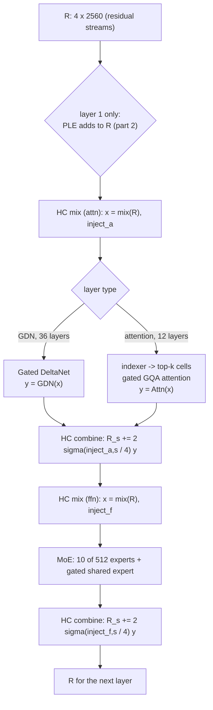

# Model spec, part 1: the decoder layer

**llama.cpp commit (pinned):** [`3cf03257f219afbe7334045ff7c6a06ac68c627d`](https://github.com/ggml-org/llama.cpp/tree/3cf03257f219afbe7334045ff7c6a06ac68c627d)
(2026-09-20, "CUDA: enable sparse fa for qwen4 (#28770)"). It is the commit Strata's `setup.py` pins
(`LLAMA_CPP_COMMIT`, `setup.py:83` at Strata `1678de3`) and the reference of
[ADR-0012](../adr/0012-correctness-reference.md). Every `file:line` below without another prefix is in that tree.

This page says what one layer of Qwen3.8-Flash-Next computes, for the GSQ-RCO IQ3_S file
([MODEL_FILES.md](../MODEL_FILES.md)), in execution order: the gated residual, then Gated DeltaNet or sparse attention,
then the gated residual again, then the MoE block. It covers one layer of each kind. The embeddings, the PLE (n-gram)
module on layer 1, the final mixer, the head and the MTP layer are in part 2 ([MODEL_IO.md](MODEL_IO.md)). No code from
llama.cpp, Strata or transformers is copied: the maths is in formulas and tables, with the source cited.

**Sources.**

| Source | Version | Used for |
| --- | --- | --- |
| llama.cpp | `3cf03257f219afbe7334045ff7c6a06ac68c627d` | the reference: the graph (`src/models/qwen4exp.cpp`), the shared builders (`src/llama-graph.cpp`), the memory (`src/llama-memory-*.cpp`), the converter (`conversion/qwen4exp.py`, `conversion/qwen.py`) and the CPU kernels (`ggml/src/ggml-cpu/`) |
| Strata | [`1678de3`](https://github.com/avra-m3/strata-intel/tree/1678de333d0e0711bc414ad992b640e1a37dd814) | the geometry (`include/strata/core/layout.hpp`), the rope-scaling rule (`setup.py`), the paper (`docs/paper/Strata-Paper.pdf`) |
| The tensor census | [tensors-IQ3_S.tsv](../model/tensors-IQ3_S.tsv), [MODEL_FILES.md](../MODEL_FILES.md) | shapes and types per tensor, GGUF metadata |
| Hugging Face transformers | [`536ecc007387a50e77603bb5d92100e9b07514cc`](https://github.com/huggingface/transformers/tree/536ecc007387a50e77603bb5d92100e9b07514cc) (`main` on 2026-10-11) | a cross-check only: `src/transformers/models/qwen4_exp/modeling_qwen4_exp.py` (cited as `modeling:N`) and `configuration_qwen4_exp.py` |
| The model's `config.json` | [`Qwen/Qwen3.8-Flash-Next`](https://huggingface.co/Qwen/Qwen3.8-Flash-Next), read on 2026-10-11 (`main`) | the hyper-parameters. The values this page uses equal the GGUF metadata. The revision Strata's MTP fetcher pins (`de4b8e4`, [MODEL_FILES.md](../MODEL_FILES.md#the-mtp-layer)) was not checked |

This page and the [reference outputs](../measurements/REFERENCE_OUTPUTS.md) follow the pinned commit.

## Conventions

- **Citations:** `file:line` is in the pinned llama.cpp tree. A bare `:line` is in the file named last before it, in
  the same section or heading. `modeling:line` is transformers' `modeling_qwen4_exp.py`.
- **Shapes** are in ggml order, `ne0 x ne1 x ne2`, as in [tensors-IQ3_S.tsv](../model/tensors-IQ3_S.tsv). `ne0` is the
  contiguous axis. A weight `W` of shape `IN x OUT` computes `y = W x` with `y[j] = sum_i W[i, j] x[i]`: row `j` of
  the matrix is the `IN` contiguous values `W[0..IN-1, j]`.
- **One token** is described. A batch repeats the formulas per token, except where a step reads earlier tokens (the
  convolution, the recurrence, attention); those steps say so.
- All activations between operations are **F32** in llama.cpp. Where a step rounds, it says so.
- `sigma(x) = 1 / (1 + e^-x)`, `silu(x) = x * sigma(x)`, `softplus(x) = ln(1 + e^x)`.
- `RMSNorm_eps(x) = x / sqrt(mean(x^2) + eps)` over the stated axis. **eps is 1e-6 everywhere in this layer**
  (`qwen4exp.attention.layer_norm_rms_epsilon`; `hparams.f_norm_rms_eps`, read at `src/models/qwen4exp.cpp:29`).
- **Folded gammas.** The checkpoint stores several norm weights as `w` with the scale `1 + w` (Gemma style,
  `modeling:143-166`). The converter writes `1 + w` into the GGUF, so the file's weight multiplies directly:
  every `*norm.weight` except the GDN output norm (`conversion/qwen.py:401-402`), and the indexer norms
  (`conversion/qwen4exp.py:133-136`). In this file that means `hc_*_norm`, `attn_q_norm`, `attn_k_norm`,
  `indexer.q_norm`, `indexer.k_norm` are already `1 + w`; `ssm_norm` is used as stored (`modeling:171-187`).

## The numbers

| Name | Value | GGUF key or derivation |
| --- | ---: | --- |
| `n_embd` | 2,560 | `embedding_length` |
| layers | 48 | `block_count` |
| hyper-connection streams `hc` | 4 | `hyper_connection.count` |
| low rank `hc_lr` | 320 | `hyper_connection.low_rank` |
| `hc_dim` = `hc * n_embd` | 10,240 | `src/models/qwen4exp.cpp:154` |
| GDN key heads / value heads | 16 / 48 | `ssm.group_count` / `ssm.time_step_rank` |
| GDN head size (key and value) | 128 | `ssm.state_size` |
| GDN key dim / value dim | 2,048 / 6,144 | 16 x 128 / 48 x 128 (`ssm.inner_size` 6,144) |
| GDN conv channels | 10,240 | 2 x 2,048 + 6,144 (`src/models/qwen4exp.cpp:198-204`) |
| GDN conv width | 4 | `ssm.conv_kernel` |
| attention heads / KV heads / head size | 24 / 2 / 256 | `attention.head_count`, `head_count_kv`, `key_length`, `value_length` |
| rotated dims per head | 64 | `rope.dimension_count` (= 256 x `partial_rotary_factor` 0.25) |
| RoPE base | 1e7 | `rope.freq_base` |
| trained context | 262,144 | `context_length` |
| indexer query heads / key heads / head size | 4 / 1 / 128 | `attention.indexer.head_count`, (`indexer_kv_heads` 1 in `config.json`), `attention.indexer.key_length` |
| indexer budget | 2,048 tokens | `attention.indexer.top_k` |
| indexer block size (compress ratio) | 4 | `attention.compress_ratios` (4 on attention layers, 0 elsewhere: `conversion/qwen4exp.py:64-68`) |
| routed experts / used | 512 / 10 | `expert_count`, `expert_used_count` |
| expert and shared-expert width | 640 | `expert_feed_forward_length`, `expert_shared_feed_forward_length` |

**Which layers are which** (`src/models/qwen4exp.cpp:127-135`): layer `i` is recurrent (Gated DeltaNet, "GDN") when
`(i + 1) mod 4 != 0`, and full attention otherwise. Attention: layers 3, 7, 11, ..., 47 (12 layers; Strata calls them
QSA). GDN: the other 36. The sparse path runs on an attention layer when the indexer cache exists and the layer's
compress ratio is above zero (`src/models/qwen4exp.cpp:786`); with this file that is all 12. The HF config's
`layer_types` gives the same list.

## One layer, in order

The residual is not one vector but **four streams** of 2,560 values, `R = [R_0, R_1, R_2, R_3]`, stored stream-major as
10,240 floats (element `(i, s)` at `s * 2560 + i`). There is no `attn_norm` or `ffn_norm`: the gated residual's own
grouped norm takes their place (`src/models/qwen4exp.cpp:265`).

Source: `src/models/qwen4exp.cpp:394-443`; the same order in `modeling:1264-1302`. Before layer 0 the four streams
are four copies of the token embedding (`src/models/qwen4exp.cpp:388-392`), and after layer 47 a final mixer reduces
them to one vector for the head (`:445-451`); both are part 2.

## 1. The gated residual (hyper-connections)

Two modules per layer, identical in form: one before the token mixer (`hc_attn_*`), one before the MoE (`hc_ffn_*`).
Each has a **mix** that turns the four streams into the block's input, and a **combine** that adds the block's output
back into each stream with its own weight.

### 1.1 Mix (`build_hc_mix`, `src/models/qwen4exp.cpp:267-321`)

| Input | Shape (file) | Type | Role |
| --- | --- | --- | --- |
| `R` | 2560 x 4 | F32 | the residual streams |
| `blk.N.hc_attn_norm.weight` | 10240, used as 2560 x 4 | F32 | per-stream gamma `g_s` (folded, `1 + w`) |
| `blk.N.hc_attn_down.weight` | 10240 x 320 | BF16 | `W_down` |
| `blk.N.hc_attn_up.weight` | 320 x 10240 | BF16 | `W_up` |
| `blk.N.hc_attn_inject.weight` | 10240 x 4 | BF16 | `W_inj` |

(The `hc_ffn_*` module has the same four tensors and shapes.)

1. **Grouped norm**, per stream: `n_s = RMSNorm_1e-6(R_s) * g_s` over the stream's 2,560 values (`:281`). Flatten
   `n = [n_0 | n_1 | n_2 | n_3]`, 10,240 values.
2. **Low-rank gate:** `l = silu((W_down n) / 4)`, 320 values (`:285-286`); `a = W_up l`, 10,240 values (`:287`).
   The gate is per element, not per stream.
3. **Mixed input:** `x[i] = (1/4) sum_s n_s[i] * sigma(a[s * 2560 + i])`, 2,560 values (`:298-311`; the fused CPU op
   `ggml_compute_forward_dsv4_hc_pre_f32`, `ggml/src/ggml-cpu/ops.cpp:11248-11307`, does the same sum in stream order
   then scales). This `x` is the block's input.
4. **Injection logits:** `inject = W_inj n`, 4 values (`:315-318`).

Output: `x` (2,560) and `inject` (4). The streams `R` themselves are not changed by the mix.

### 1.2 Combine (`build_hc_combine`, `src/models/qwen4exp.cpp:323-351`)

With the block output `y` (2,560 values):

`R_s <- R_s + w_s * y`, with `w_s = 2 * sigma(inject_s / 4)`, for each stream `s` (`:332-333`, `:346`; fused CPU op
`ggml_compute_forward_dsv4_hc_post_f32` with no comb matrix, `ggml/src/ggml-cpu/ops.cpp:11328-11401`).

`2 sigma(.)` is 1 when the injection logit is 0, so a zero injection is a plain residual add (comment at `:331`).
`modeling:994-1029` and `:1290-1302` agree on every step.

**Numerics.** The norm's sum of squares is accumulated in double, then `1/sqrtf(mean + eps)` in float
(`ggml/src/ggml-cpu/ops.cpp:3957-3964`). `W_down`, `W_up` and `W_inj` are BF16, so on the CPU the activation `n` (and
`l`) is rounded to BF16 before the dot products (section 6).

## 2. Gated DeltaNet (36 layers)

`build_layer_attn_linear`, `src/models/qwen4exp.cpp:861-986`. Input `x` (2,560) from the HC mix.

### 2.1 Tensors

| Tensor | Shape | Types in the file | Role |
| --- | --- | --- | --- |
| `blk.N.attn_qkv.weight` | 2560 x 10240 | Q6_K 22, Q5_K 10, Q4_K 2, IQ4_XS 2 | `W_qkv`: q, k, v before the conv |
| `blk.N.attn_gate.weight` | 2560 x 6144 | Q6_K 14, Q4_K 10, IQ4_XS 8, Q5_K 4 | `W_z`: the output gate |
| `blk.N.ssm_beta.weight` | 2560 x 48 | BF16 | `W_b` |
| `blk.N.ssm_alpha.weight` | 2560 x 48 | BF16 | `W_a` |
| `blk.N.ssm_dt.bias` | 48 | F32 | `dt_bias` |
| `blk.N.ssm_a` | 48 | F32 | `A = -exp(A_log)`, already negated and exponentiated by the converter (`conversion/qwen.py:395-396`) |
| `blk.N.ssm_conv1d.weight` | 4 x 10240 | F32 | `c[k, ch]`, the depthwise conv |
| `blk.N.ssm_norm.weight` | 128 | F32 | `g_o`, the per-head output-norm gamma (not folded) |
| `blk.N.ssm_out.weight` | 6144 x 2560 | Q6_K 29, Q5_K 4, Q4_K 3 | `W_o` |

**Value-head order.** In the checkpoint the 48 value heads are grouped by key head: value head `j` uses key head
`floor(j / 3)`. The converter reorders them to "tiled" order so that ggml's broadcast works: GGUF value head
`h = (j mod 3) * 16 + floor(j / 3)`, which uses **key head `h mod 16`** (`conversion/qwen.py:453-466`, `:577-618`). The
reorder applies to the value rows of `W_qkv`, the rows of `W_z`, `W_a`, `W_b`, the entries of `A` and `dt_bias`, the
value channels of the conv, and the input columns of `W_o`. Everything below uses GGUF order. The CPU kernel pairs
value head `h` with key head `h mod 16` (`ggml/src/ggml-cpu/ops.cpp:10971-10972`).

### 2.2 Projections (`:880-902`, `build_qkvz` at `:460-474`)

- `m = W_qkv x`, 10,240 values: `[q (16 heads x 128) | k (16 x 128) | v (48 x 128)]`.
- `z = W_z x`, 6,144 values (48 heads x 128).
- `beta = sigma(W_b x)`, 48 values (`:884-889`).
- `g = A * softplus(W_a x + dt_bias)`, 48 values, one per value head; `g <= 0` is a log decay (`:891-899`). The CPU
  softplus returns `x` itself above 20 (`ggml/src/ggml-cpu/unary-ops.cpp:80-82`).

### 2.3 The short convolution and its state (`:904-924`, `build_conv_state_at` at `:1131-1183`)

A causal depthwise convolution of width 4 over the 10,240 channels of `m`, then SiLU:

`u_t[ch] = silu( sum_{k=0..3} c[k, ch] * m_{t-3+k}[ch] )`

so `c[3, ch]` multiplies the current token. `m_{t-1}, m_{t-2}, m_{t-3}` (the raw projections, before the conv) are the
**conv state**: 3 x 10,240 F32 per sequence per layer. At the start of a sequence it is zero (the cache is cleared at
allocation, `src/llama-memory-recurrent.cpp:123`). After the step the last 3 columns of `(state, m_t)` are written
back (`:1159-1180`). CPU kernel: `ggml_compute_forward_ssm_conv_f32`, a float sum of the 4 products in tap order
(`ggml/src/ggml-cpu/ops.cpp:9703-9752`, the sum at `:9744-9750`).

Split `u` (`:930-947`): `q_h = u[128h .. 128h+127]` for `h < 16`; `k_h = u[2048 + 128h ..]`; `v_h = u[4096 + 128h ..]`
for `h < 48`.

### 2.4 L2 norm of q and k (`:954-957`)

`q_h <- q_h / sqrt(sum(q_h^2) + 1e-6)`, the same for `k_h`, per head of 128. llama.cpp computes it as an RMS norm with
`eps / 128`, times `1/sqrt(128)` (`src/models/models.h:13-18`), which is the same expression. `modeling:247-250` has
the eps inside the square root too.

### 2.5 The recurrence (`build_recurrent_attn`, `src/models/delta-net-base.cpp:527-606`)

Each of the 48 value heads `h` keeps a state matrix `S_h`, 128 x 128 F32, and reads key head `kh = h mod 16`. Per
token, with `S[i][j]` indexed by key dimension `i` and value dimension `j`:

1. decay: `S <- exp(g_h) * S`
2. delta: `d[j] = beta_h * (v_h[j] - sum_i S[i][j] * k_kh[i])`
3. update: `S[i][j] <- S[i][j] + k_kh[i] * d[j]`
4. output: `o_h[j] = (1/sqrt(128)) * sum_i S[i][j] * q_kh[i]`

CPU kernel: `ggml_compute_forward_gated_delta_net_one_chunk`, `ggml/src/ggml-cpu/ops.cpp:10895-11047` (the decay at
`:11012`, the delta at `:11014-11020`, the update at `:11022-11025`, the output at `:11027-11032`). It stores the state
transposed: element `S[i][j]` at offset `j * 128 + i`, so each value dimension's 128 key entries are contiguous. The
unfused autoregressive form in `src/models/delta-net-base.cpp:289-371` is the same maths with `q` scaled first.
The gated delta rule in `modeling:391-444` matches (`modeling:433-444`).

At the start of a sequence `S = 0`. The state is F32 (`src/llama-model.cpp:2623-2624`, `recurrent_type_k` and `recurrent_type_v`).

### 2.6 Gated output norm and projection (`:972-985`, `build_norm_gated` at `:476-486`)

Per value head: `r_h = RMSNorm_1e-6(o_h) * g_o * sigma(z_h)`, over 128 values. The gate is a **sigmoid**, not SiLU:
the one difference from Qwen3.5's GDN (`:481`; `config.json` `output_gate_type: "sigmoid"`; `modeling:178-187`).

`y = W_o [r_0 | ... | r_47]`, 6,144 -> 2,560. `y` goes to the HC combine.

### 2.7 State per sequence

The recurrent row sizes are `n_embd_r` (conv) and `n_embd_s` (recurrence) (`src/llama-hparams.cpp:229`, `:256`):

| Part | Elements | Bytes (F32) |
| --- | --- | ---: |
| conv state, per GDN layer | (4 - 1) x (6,144 + 2 x 16 x 128) = 3 x 10,240 = 30,720 | 122,880 |
| recurrent state, per GDN layer | 128 x 6,144 = 128 x 128 x 48 = 786,432 | 3,145,728 |
| **per GDN layer** | 817,152 | **3,268,608** |
| **36 GDN layers** | 29,417,472 | **117,669,888** (112.2 MiB) |
| PLE conv history, layer 1 only (part 2) | (4 - 1) x 3 x 4 x 2,560 = 92,160 (`src/llama-hparams.cpp:267-274`) | 368,640 |
| **all recurrent state of one sequence** | | **118,038,528** (112.6 MiB) |

STRATA_DECODE.md's "~113 MB" for the GDN state ([section 3](STRATA_DECODE.md#3-acceptance-and-rollback)) agrees with
this table in MiB (112.2 for the 36 layers, 112.6 with the PLE history).

### 2.8 What must be saved to roll back rejected draft tokens

The recurrent state and the conv state are overwritten by every token, so a rejected draft token cannot be undone
from the state alone. Two ways keep it exact:

| Way | What is kept per sequence | Bytes |
| --- | --- | --- |
| **Snapshots** (llama.cpp's `n_rs_seq`) | the full state after each of the last `n_rs_seq + 1` tokens; rolling back `r` tokens reads slot `r` (`src/llama-memory-recurrent.cpp:98-112`, `src/models/delta-net-base.cpp:563-603`, `ggml/src/ggml-cpu/ops.cpp:11035-11042`). Off by default (`n_rs_seq` 0, `src/llama-context.cpp:3652`) | (n_rs_seq + 1) x 118,038,528: 472,154,112 for a window of 4 |
| **Replay** (Strata's commit, [STRATA_DECODE.md section 8](STRATA_DECODE.md#8-the-commit)) | the state as it was before the window, untouched while the window is verified, plus each row's inputs; after acceptance, the accepted rows are replayed from those inputs | per row per GDN layer at least `m` (10,240 F32, which also rebuilds the conv state) + `g` and `beta` (2 x 48 F32) = 41,344 B; 1,488,384 B per row for 36 layers |

In both, the attention layers need nothing: their cells are positional and are overwritten (section 3.7). The PLE
history on layer 1 has the same problem as the conv state (part 2).

## 3. Sparse attention (12 layers)

`build_layer_attn`, `src/models/qwen4exp.cpp:775-859`. Input `x` (2,560) from the HC mix, and the token's position
`p`. The indexer runs first, on the same `x` (`:786-788`).

### 3.1 Tensors

| Tensor | Shape | Types in the file | Role |
| --- | --- | --- | --- |
| `blk.N.attn_q.weight` | 2560 x 12288 | Q6_K 5, IQ4_XS 3, Q5_K 3, Q4_K 1 | `W_q`: query and output gate, interleaved per head |
| `blk.N.attn_k.weight` | 2560 x 512 | Q6_K 11, IQ4_XS 1 | `W_k` |
| `blk.N.attn_v.weight` | 2560 x 512 | Q6_K 10, Q5_K 2 | `W_v` |
| `blk.N.attn_q_norm.weight` | 256 | F32 | `g_q` (folded) |
| `blk.N.attn_k_norm.weight` | 256 | F32 | `g_k` (folded) |
| `blk.N.attn_output.weight` | 6144 x 2560 | Q6_K 11, Q4_K 1 | `W_o` |
| `blk.N.indexer.q_proj.weight` | 2560 x 512 | BF16 | `W_iq`: 4 heads x 128 |
| `blk.N.indexer.k_proj.weight` | 2560 x 128 | BF16 | `W_ik`: one key head of 128 |
| `blk.N.indexer.q_norm.weight` | 128 | F32 | `g_iq` (folded) |
| `blk.N.indexer.k_norm.weight` | 128 | F32 | `g_ik` (folded) |

The checkpoint has one `index_qk_proj` (640 x 2560); the converter splits it into the query part (first 512 rows) and
the key part (last 128) (`conversion/qwen4exp.py:123-131`).

### 3.2 Projections and norms (`:791-819`)

- `Q = W_q x`, 12,288 values. For head `h` (0-23): `q_h = Q[512h .. 512h+255]`, `gate_h = Q[512h+256 .. 512h+511]`
  (`:794-796`, `:812-816`; `modeling:858-861` chunks each head's 512 the same way).
- `q_h <- RMSNorm_1e-6(q_h) * g_q`, per head of 256 (`:799`).
- `k_c = RMSNorm_1e-6((W_k x)_c) * g_k`, per KV head `c` (0-1) of 256 (`:802-811`).
- `v_c = (W_v x)_c`, no norm (`:805`, `:819`).

### 3.3 RoPE (`:821-832`)

**Type:** `LLAMA_ROPE_TYPE_IMROPE`, interleaved multi-section ("M-RoPE") as in Qwen3-VL (`src/llama-model.cpp:3065-3070`),
with sections `[11, 11, 10, 0]` (`rope.dimension_sections`). Each token carries four positions (time, height, width,
extra). **For text all four are the token's position `p`** (`src/llama-batch.cpp:781-787`), so the sections pick
between equal angles and the rotation is plain NeoX-style RoPE on part of the head.

**What is rotated:** the first 64 of each head's 256 dimensions (`n_rot` = `rope.dimension_count` 64). Dimension `i`
is paired with `i + 32`, for `i` in 0-31; dimensions 64-255 pass through unchanged
(`ggml/src/ggml-cpu/ops.cpp:6207-6229`, `rotate_pairs` with offset `n_dims/2` at `:6062-6079`). With
`theta_i = p * 1e7^(-2i/64)`:

`out[i] = in[i] cos(theta_i) - in[i+32] sin(theta_i)`, `out[i+32] = in[i] sin(theta_i) + in[i+32] cos(theta_i)`

(`ggml/src/ggml-cpu/ops.cpp:6076-6077`; the angles from `ggml_mrope_cache_init`, `:5991-6058`). The same on `q_h` and
`k_c`. `modeling:626-660` rotates the first `rotary_dim` dimensions with `rotate_half`, the same pairing.

**Past 262,144 tokens.** The GGUF has no rope-scaling keys, so llama.cpp's default is no scaling (type `linear` with
factor 1, `src/llama-model.cpp:1349-1361`). Strata's `setup.py` adds scaling only for a context above the trained
262,144: method `yarn` unless the user picks `linear`, factor `s = context / 262,144`, and it refuses `none` there
(`setup.py:2493-2527`, at Strata `1678de3`). With `--rope-scaling yarn --rope-scale s`, llama.cpp computes:

| Parameter | Value | Source |
| --- | --- | --- |
| `freq_scale` | `1 / s` | `src/llama-context.cpp:134` |
| `ext_factor` | 1 | `src/llama-context.cpp:172-174` |
| original context `n_ctx_orig` | 262,144 (no `rope.scaling.original_context_length` key, so `context_length`) | `src/llama-model.cpp:1342-1343`, `src/llama-context.cpp:136-138` |
| `beta_fast`, `beta_slow` | 32, 1 | `src/llama-hparams.h:161-162` |
| correction dims | `[floor(14.24), ceil(21.12)]` = `[14, 22]` | `ggml/src/ggml.c:4469-4481`: `64 ln(262144 / (beta 2 pi)) / (2 ln 1e7)` |
| `attn_factor` | `(1 + 0.1 ln s) / (1 + 0.1 ln s)` = 1 | `src/llama-context.cpp:202`, `:210` |

Per pair `i` (`ggml/src/ggml-cpu/ops.cpp:5951-5973`): `ramp_i = 1 - clamp((i - 14) / 8, 0, 1)`;
`theta_i' = (theta_i / s)(1 - ramp_i) + theta_i ramp_i`; and both `cos` and `sin` are multiplied by `1 + 0.1 ln s`.
So pairs 0-14 keep the trained angles, pairs 22-31 are interpolated by `s`, pairs 15-21 blend, and the 64 rotated
dimensions are scaled by `1 + 0.1 ln s` (1.0405 at `s` = 1.5, 1.0693 at `s` = 2) while dimensions 64-255 are not.
The indexer's query and keys are rotated with the same parameters (`src/models/qwen4exp.cpp:630-641`). The HF config gives `rope_type`
`default` and no scaling; past 262,144 the model is out of its trained range whatever the method.

### 3.4 The key indexer (`build_qsa_top_k`, `src/models/qwen4exp.cpp:542-691`)

The indexer picks which earlier positions the token attends to. It scores **blocks of 4 consecutive positions**
(`4b .. 4b+3`) with one pooled key per block.

1. **Key, stored raw:** `ik_t = W_ik x`, 128 values, written to the indexer cache at the token's cell with no norm and
   no rotation (`:598-603`).
2. **Pooled block keys, built at read time:** for each complete block `b`,
   `K_b = rope_{4b}( RMSNorm_1e-6( (1/4) sum_{t in block} ik_t ) * g_ik )` (`:609-634`). The mean comes first, then
   the norm, then RoPE at the block's **first** position `4b` (`blk_pos`, filled at
   `src/llama-memory-hybrid-idx.cpp:476-492`). A block is complete when all 4 of its positions are cached for the
   sequence (`:458-470`).
3. **Query:** `iq_h = rope_p( RMSNorm_1e-6((W_iq x)_h) * g_iq )` for the 4 heads `h` of 128 (`:636-642`).
4. **Score per block:** `score_b = sum_{h=0..3} relu(iq_h . K_b)` (`:646-660`). No per-head weight, no softmax.
   (`modeling:746` also divides by `sqrt(128)`, which does not change the order.)
5. **The tail:** the positions after the last complete block, `floor((p+1)/4) * 4 .. p` (0 to 3 positions), are
   always visible: they get a bias of 1e9 (`src/llama-memory-hybrid-idx.cpp:544`, `:558`, `:563-565`). Unused block
   slots and blocks of another sequence get -inf (`:550-555`). The causal mask is then added per cell
   (`src/models/qwen4exp.cpp:672-678`).
6. **Selection:** every cell takes its block's score (`:668-670`), and llama.cpp keeps the
   `min(n_kv, 2048 + 4 - 1)` = `min(n_kv, 2051)` best cells (`:682-684`), with `ggml_top_k`.

So with up to 2,051 cached positions every position is attended to, and the layer is dense. Beyond that, each token
attends to its tail plus the 512 best-scoring blocks: 2,048 + 0..3 positions, at any context length. llama.cpp's
width of 2,051 cells can also take up to 3 cells of the 513th block when the tail is shorter than 3; see
[differences](#7-where-the-sources-differ).

### 3.5 Attention over the selected keys (`build_attn_qsa`, `src/models/qwen4exp.cpp:695-773`, and `build_attn_mha`, `src/llama-graph.cpp:2591-2728`)

- The new `k_c` (after norm and RoPE) and `v_c` are stored in the cache first (`src/models/qwen4exp.cpp:724-730`), so the token sees itself.
- Mask: -inf everywhere, 0 at the selected cells, plus the causal mask (`src/models/qwen4exp.cpp:734-758`).
- Grouped-query attention: query head `h` reads KV head `c = floor(h / 12)` (heads 0-11 -> 0, 12-23 -> 1; ggml's
  `mul_mat` broadcast). `a_h = sum_t softmax_t( (q_h . k_{c,t}) / 16 + mask_t ) v_{c,t}`. The scale is
  `1/sqrt(256)` = 1/16 (`src/models/qwen4exp.cpp:838`, `f_attention_scale` is 0).
- KQ is accumulated in F32 (`ggml_prec_set_acc`, `src/llama-graph.cpp:2665`, or `:2639` with flash attention).

### 3.6 Output gate and projection (`:849-857`)

`y = W_o [a_0 * sigma(gate_0) | ... | a_23 * sigma(gate_23)]`, 6,144 -> 2,560, elementwise sigmoid per head
(`modeling:889` the same). `y` goes to the HC combine.

### 3.7 The KV layout, and what is stored per token

Per attention layer and cached token, llama.cpp stores:

| Cache | Per token | Content | Source |
| --- | --- | --- | --- |
| K | 2 heads x 256 = 512 values | `k_c` after the norm **and** RoPE | `src/models/qwen4exp.cpp:728` |
| V | 2 x 256 = 512 values | `v_c`, raw (transposed in memory when flash attention is off) | `src/models/qwen4exp.cpp:729`, `src/llama-model.cpp:2618` (`attn_v_trans = !flash_attn`) |
| indexer key | 128 values | `ik_t`, raw: before the mean, the norm and RoPE | `src/models/qwen4exp.cpp:598-603`; its own cache, one head, no V (`src/llama-memory-hybrid-idx.cpp:47-67`) |
| cell metadata | position, sequence set, the token id (`ext.tok`, read by the PLE hash) | host-side | `src/models/qwen4exp.cpp:1059-1060` |

K, V and the indexer key all take the KV cache type (`type_k` / `type_v`; the indexer cache is built with `type_k`,
`src/llama-memory-hybrid-idx.cpp:65`). llama.cpp's default is F16 (`common/common.h:341`). With a quantized cache it
also rotates q, k and v by a 256-point Hadamard transform before storing and undoes it on the output
(`src/llama-kv-cache.cpp:321-338`, `src/models/qwen4exp.cpp:705-712`, `:768-770`): the same maths, different rounding.
The engine's KV is 8-bit ([ADR-0008](../adr/0008-kv-cache.md)); Q8_0 stores 32 values in 34 B.

**Bytes per token per sequence, 12 attention layers:**

| | F16 (llama.cpp's default) | Q8_0 (8-bit) |
| --- | ---: | ---: |
| K + V: 12 x (512 + 512) values | 12 x 1,024 x 2 = **24,576** | 12 x (1,024 / 32) x 34 = **13,056** |
| indexer keys: 12 x 128 values | 12 x 128 x 2 = **3,072** | 12 x (128 / 32) x 34 = **1,632** |
| **total per token** | **27,648** | **14,688** |
| at 262,144 tokens | 7,247,757,312 (6.75 GiB) | 3,850,371,072 (3.59 GiB) |

ADR-0008's estimate of ~3.6 GB per sequence at 8 bits is the Q8_0 figure in GiB; the budget is in
[MEMORY_BUDGET.md](../measurements/MEMORY_BUDGET.md). Nothing is saved for a rollback: a cell past the accepted prefix is positional and is overwritten
before any query reads it, and llama.cpp pools the indexer keys at read time from the raw keys, so it has no pooled
state to restore.

## 4. The MoE block (every layer)

`build_layer_ffn`, `src/models/qwen4exp.cpp:988-1036`, calling `build_moe_ffn` (`src/llama-graph.cpp:1993-2355`) and
`build_ffn` (`src/llama-graph.cpp:1748-1947`). Input `x` (2,560) from the HC ffn mix.

### 4.1 Tensors

| Tensor | Shape | Types in the file | Role |
| --- | --- | --- | --- |
| `blk.N.ffn_gate_inp.weight` | 2560 x 512 | BF16 | `W_r`, the router |
| `blk.N.ffn_gate_exps.weight` | 2560 x 640 x 512 | IQ2_S 20, IQ3_XXS 17, IQ3_S 10, IQ4_XS 1 | `G_e`, per expert `e` |
| `blk.N.ffn_up_exps.weight` | 2560 x 640 x 512 | as gate (always the same type) | `U_e` |
| `blk.N.ffn_down_exps.weight` | 640 x 2560 x 512 | IQ4_NL 39, Q2_0 9 | `D_e` |
| `blk.N.ffn_gate_shexp.weight` | 2560 x 640 | Q4_K 16, IQ4_XS 15, Q6_K 13, Q5_K 4 | `G_s` |
| `blk.N.ffn_up_shexp.weight` | 2560 x 640 | Q4_K 14, IQ4_XS 13, Q6_K 13, Q5_K 8 | `U_s` |
| `blk.N.ffn_down_shexp.weight` | 640 x 2560 | IQ4_NL 47, Q8_0 1 | `D_s` |
| `blk.N.ffn_gate_inp_shexp.weight` | 2560 | BF16 | `w_sg`, the shared expert's gate |

Which layers have which expert types: [tensors-IQ3_S.tsv](../model/tensors-IQ3_S.tsv).

### 4.2 The router

1. Logits `r = W_r x`, 512 values (`src/llama-graph.cpp:2025`).
2. `P = softmax(r)` over all 512 (`src/llama-graph.cpp:2043`; gating `SOFTMAX` at `src/models/qwen4exp.cpp:1001`). The CPU softmax
   subtracts the max and sums the exponentials in double (`ggml/src/ggml-cpu/vec.cpp:531-533`).
3. Top 10 by `P` (`src/llama-graph.cpp:2109`). No selection bias (`exp_probs_b` is null, `src/models/qwen4exp.cpp:997`), no expert groups.
4. Weights: `w_k = P_{e_k} / max(sum_{k=1..10} P_{e_k}, 6.1035e-5)` (`norm_w` true at `src/models/qwen4exp.cpp:999`;
   `src/llama-graph.cpp:2132-2148`). No extra scale (`expert_weights_scale` 0, `src/llama-hparams.h:124`).

`modeling:960-969` does the same: softmax in float, top-k, divide by the sum (`norm_topk_prob` true,
`configuration_qwen4_exp.py:162`). Ties in `P` are ordered by `std::sort`/`std::partial_sort` (not stable,
`ggml/src/ggml-cpu/ops.cpp:8489-8612`).

### 4.3 The experts

For each selected expert `e_k` (`src/llama-graph.cpp:2185-2317`):

`h = silu(G_e x) * (U_e x)` (640 values; `ggml_swiglu_split` at `:2246`; no clamp: `swiglu_clamp_exp` starts at 0,
`src/llama-model.cpp:1324`, and the file has no `swiglu_clamp_exp` key), then `y_k = w_k * (D_e h)` (2,560 values, `:2317`).

`moe = y_1 + y_2 + ... + y_10`, summed in rank order (`:2334-2343`).

### 4.4 The shared expert and how it is combined (`src/models/qwen4exp.cpp:1009-1030`)

`s = D_s( silu(G_s x) * (U_s x) )` (`build_ffn` with SiLU and parallel gate, `src/llama-graph.cpp:1806-1810`,
`:1828-1920`); `gs = sigma(w_sg . x)`, one scalar per token (`src/models/qwen4exp.cpp:1020-1025`).

`y = moe + gs * s`, 2,560 values. `y` goes to the HC combine. `modeling:980-991` is the same.

## 5. The tensor map

Every per-layer tensor pattern in the census ([tensors-IQ3_S.tsv](../model/tensors-IQ3_S.tsv), 41 patterns, 1,218
tensors: 36 GDN layers x 25 + 12 attention layers x 26 + 6 PLE tensors on layer 1). Counts are layers. The checkpoint
name is the module path in `modeling_qwen4_exp.py`, under `layers.N.`.

| Pattern | Layers | Shape | Read by | Checkpoint name |
| --- | ---: | --- | --- | --- |
| `blk.N.hc_attn_norm.weight` | 48 | 10240 | 1.1 step 1 (attn mix) | `attn_hyper_connection.hc_norm.weight` (+1) |
| `blk.N.hc_attn_down.weight` | 48 | 10240 x 320 | 1.1 step 2 | `attn_hyper_connection.input_mix_weight_down.weight` |
| `blk.N.hc_attn_up.weight` | 48 | 320 x 10240 | 1.1 step 2 | `attn_hyper_connection.input_mix_weight_up.weight` |
| `blk.N.hc_attn_inject.weight` | 48 | 10240 x 4 | 1.1 step 4, used in 1.2 | `attn_hyper_connection.block_inject_weight.weight` |
| `blk.N.hc_ffn_norm.weight` | 48 | 10240 | 1.1 step 1 (ffn mix) | `mlp_hyper_connection.hc_norm.weight` (+1) |
| `blk.N.hc_ffn_down.weight` | 48 | 10240 x 320 | 1.1 step 2 | `mlp_hyper_connection.input_mix_weight_down.weight` |
| `blk.N.hc_ffn_up.weight` | 48 | 320 x 10240 | 1.1 step 2 | `mlp_hyper_connection.input_mix_weight_up.weight` |
| `blk.N.hc_ffn_inject.weight` | 48 | 10240 x 4 | 1.1 step 4, used in 1.2 | `mlp_hyper_connection.block_inject_weight.weight` |
| `blk.N.attn_qkv.weight` | 36 | 2560 x 10240 | 2.2 (`m`) | `linear_attn.in_proj_qkv.weight` (value rows reordered) |
| `blk.N.attn_gate.weight` | 36 | 2560 x 6144 | 2.2 (`z`), used in 2.6 | `linear_attn.in_proj_z.weight` (reordered) |
| `blk.N.ssm_beta.weight` | 36 | 2560 x 48 | 2.2 (`beta`) | `linear_attn.in_proj_b.weight` (reordered) |
| `blk.N.ssm_alpha.weight` | 36 | 2560 x 48 | 2.2 (`g`) | `linear_attn.in_proj_a.weight` (reordered) |
| `blk.N.ssm_dt.bias` | 36 | 48 | 2.2 (`g`) | `linear_attn.dt_bias` (reordered) |
| `blk.N.ssm_a` | 36 | 48 | 2.2 (`g`) | `linear_attn.A_log`, stored as `-exp(A_log)` (reordered) |
| `blk.N.ssm_conv1d.weight` | 36 | 4 x 10240 | 2.3 | `linear_attn.conv1d.weight` (squeezed; value channels reordered) |
| `blk.N.ssm_norm.weight` | 36 | 128 | 2.6 | `linear_attn.norm.weight` (not +1) |
| `blk.N.ssm_out.weight` | 36 | 6144 x 2560 | 2.6 | `linear_attn.out_proj.weight` (columns reordered) |
| `blk.N.attn_q.weight` | 12 | 2560 x 12288 | 3.2 (query and gate) | `self_attn.q_proj.weight` |
| `blk.N.attn_k.weight` | 12 | 2560 x 512 | 3.2 | `self_attn.k_proj.weight` |
| `blk.N.attn_v.weight` | 12 | 2560 x 512 | 3.2 | `self_attn.v_proj.weight` |
| `blk.N.attn_q_norm.weight` | 12 | 256 | 3.2 | `self_attn.q_norm.weight` (+1) |
| `blk.N.attn_k_norm.weight` | 12 | 256 | 3.2 | `self_attn.k_norm.weight` (+1) |
| `blk.N.attn_output.weight` | 12 | 6144 x 2560 | 3.6 | `self_attn.o_proj.weight` |
| `blk.N.indexer.q_proj.weight` | 12 | 2560 x 512 | 3.4 step 3 | `self_attn.indexer.index_qk_proj.weight`, rows 0-511 |
| `blk.N.indexer.k_proj.weight` | 12 | 2560 x 128 | 3.4 step 1 | `self_attn.indexer.index_qk_proj.weight`, rows 512-639 |
| `blk.N.indexer.q_norm.weight` | 12 | 128 | 3.4 step 3 | `self_attn.indexer.q_layernorm.weight` (+1) |
| `blk.N.indexer.k_norm.weight` | 12 | 128 | 3.4 step 2 | `self_attn.indexer.k_layernorm.weight` (+1) |
| `blk.N.ffn_gate_inp.weight` | 48 | 2560 x 512 | 4.2 | `mlp.gate.weight` |
| `blk.N.ffn_gate_exps.weight` | 48 | 2560 x 640 x 512 | 4.3 | `mlp.experts.gate_up_proj`, first 640 rows per expert |
| `blk.N.ffn_up_exps.weight` | 48 | 2560 x 640 x 512 | 4.3 | `mlp.experts.gate_up_proj`, last 640 rows per expert |
| `blk.N.ffn_down_exps.weight` | 48 | 640 x 2560 x 512 | 4.3 | `mlp.experts.down_proj` |
| `blk.N.ffn_gate_shexp.weight` | 48 | 2560 x 640 | 4.4 | `mlp.shared_expert.gate_proj.weight` |
| `blk.N.ffn_up_shexp.weight` | 48 | 2560 x 640 | 4.4 | `mlp.shared_expert.up_proj.weight` |
| `blk.N.ffn_down_shexp.weight` | 48 | 640 x 2560 | 4.4 | `mlp.shared_expert.down_proj.weight` |
| `blk.N.ffn_gate_inp_shexp.weight` | 48 | 2560 | 4.4 | `mlp.shared_expert_gate.weight` |
| `blk.N.ple_key.weight` | 1 (layer 1) | 2560 x 10240 | PLE, part 2 (before the attn mix, `src/models/qwen4exp.cpp:397-399`, `:1206-1294`) | `ple.*` |
| `blk.N.ple_value.weight` | 1 | 2560 x 2560 | PLE, part 2 | `ple.*` |
| `blk.N.ple_norm_key.weight` | 1 | 10240 | PLE, part 2 | `ple.norm_key.weight` (+1) |
| `blk.N.ple_norm_query.weight` | 1 | 10240 | PLE, part 2 | `ple.norm_query.weight` (+1) |
| `blk.N.ple_norm_conv.weight` | 1 | 10240 | PLE, part 2 | `ple.norm_conv.weight` (+1) |
| `blk.N.ple_conv1d.weight` | 1 | 4 x 10240 | PLE, part 2 | `ple.conv1d.weight` (squeezed) |

The split, reorder, `+1` and `-exp` transformations are in `conversion/qwen4exp.py:108-141` and
`conversion/qwen.py:91-114`, `:394-402`, `:577-618`. The loader's expected shapes are in
`src/models/qwen4exp.cpp:192-258`; every shape above matches the census.

## 6. Numerics on llama.cpp's CPU backend

The reference is the CPU backend ([ADR-0012](../adr/0012-correctness-reference.md)). Its arithmetic, where it rounds:

| Step | What the CPU does | Source |
| --- | --- | --- |
| Matrix-vector with a quantized weight | the F32 activation is first converted to the weight type's `vec_dot_type`, then integer block dot products are scaled and summed in F32 | `ggml/src/ggml-cpu/ggml-cpu.c:1273-1274`, `:1323` onward |
| `vec_dot_type` per weight type in this layer | Q4_K, Q5_K, Q6_K, IQ2_S, IQ3_XXS, IQ3_S, IQ4_XS: **Q8_K**. IQ4_NL, Q2_0, Q8_0: **Q8_0**. BF16: **BF16**. F32: F32 | `ggml/src/ggml-cpu/ggml-cpu.c:234-237`, `:272-275`, `:311-389`, `:395-398` |
| RMS norms (HC, q/k norms, indexer norms, GDN output norm) | sum of squares in double; mean and `1/sqrtf(mean + 1e-6)` in float | `ggml/src/ggml-cpu/ops.cpp:3957-3964` |
| L2 norm of GDN q and k | an RMS norm with eps 1e-6/128, times `1/sqrt(128)` | `src/models/models.h:13-18` |
| Softmax (router, attention) | max subtracted, sum in double | `ggml/src/ggml-cpu/vec.cpp:531-533` |
| GDN conv | F32, the 4 products summed in order | `ggml/src/ggml-cpu/ops.cpp:9744-9750` |
| GDN recurrence | F32 state and arithmetic (SIMD dot products) | `ggml/src/ggml-cpu/ops.cpp:11000-11032` |
| Attention KQ | accumulated in F32; K and V read from the cache type (F16 by default) | `src/llama-graph.cpp:2639`, `:2665` |
| Expert sum | F32, in rank order | `src/llama-graph.cpp:2334-2343` |

This page does not cover the CPU's repacked weight layouts (`ggml/src/ggml-cpu/repack.cpp`) or its flash-attention
kernel. [REFERENCE_OUTPUTS.md](../measurements/REFERENCE_OUTPUTS.md#the-known-cause) says which attention kernel the
reference runs.

## 7. Where the sources differ

1. **The indexer's selection width.** HF transformers keeps exactly `min(512, complete blocks)` blocks plus the tail
   (`modeling:722-756`, `block_topk` = 2,048 / 4). llama.cpp keeps the best `min(n_kv, 2051)` cells
   (`src/models/qwen4exp.cpp:682-684`). When there are more than 512 complete blocks and the tail has `t < 3`
   positions, llama.cpp also attends to `3 - t` cells of the 513th-best block. The difference is at most 3 extra keys
   out of 2,051, and only past 2,051 tokens. llama.cpp is the reference (ADR-0012), so an engine that matches it
   keeps the 2,051-cell width. Whether this counts as "found to be wrong" under ADR-0012's "Revisit when" is not
   decided.
2. **The indexer score's scale.** HF divides by `sqrt(128)`, llama.cpp does not. Only the order is used, so the
   selection is the same.
3. **The pooled key's precision.** HF averages the 4 keys in float and casts back to the model dtype before the norm
   (`modeling:734`); llama.cpp keeps F32 (or reads the keys back from an F16/Q8_0 cache).

Everything else in sections 1-4 matches between the two, step for step.

## Not checked

- **Whether this file was converted by this converter.** The GSQ-RCO GGUF comes from ISTA-DASLab, not from this
  commit's converter. Its shapes and metadata match what this converter writes and what the loader expects, but the
  value-head order (section 2.1) and the folded gammas cannot be seen in the census. llama.cpp at this commit
  loads the file and reads its value heads in tiled order, so a file in the checkpoint's order would give wrong
  output without an error. A direct check would compare one GDN layer of this file against the BF16 checkpoint.
- **The `attention.compress_ratios` values.** The census lists the key's length (48), not its values. The converter
  writes 4 on the attention layers and 0 on the others, and the HF config's `indexer_compress_ratio` is 4.
- **The HF config at the pinned revision** `de4b8e4`. This page uses `main` (see Sources).
