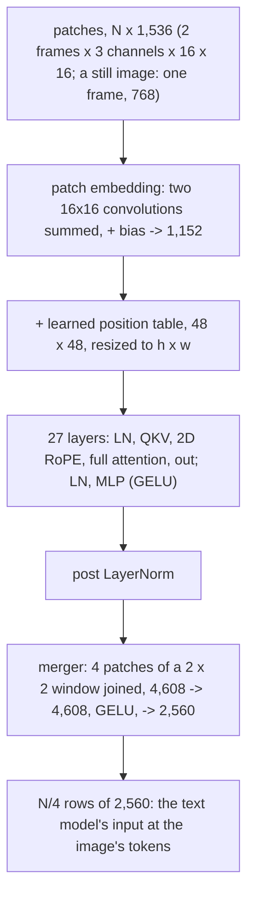

# Model spec, part 3: images and video

**llama.cpp commit (pinned):** [`3cf03257f219afbe7334045ff7c6a06ac68c627d`](https://github.com/ggml-org/llama.cpp/tree/3cf03257f219afbe7334045ff7c6a06ac68c627d),
as in [part 1](MODEL_LAYER.md) and [part 2](MODEL_IO.md). Every `file:line` without another prefix is in that tree.

What the image encoder computes, how an image becomes pixels, patches and then tokens, and what images change in the
text model's positions; then how a video becomes pairs of frames that the same encoder takes (section 6). The
decision to support images is [ADR-0031](../adr/0031-images-through-the-prompt-path.md), and video
[ADR-0034](../adr/0034-video-as-pairs-of-frames.md), both drafts. No code from llama.cpp or transformers is copied: behaviour is in prose, formulas and tables, with the
source cited.

**Sources.**

| Source | Version | Used for |
| --- | --- | --- |
| llama.cpp | `3cf03257f219afbe7334045ff7c6a06ac68c627d` | the reference: the encoder's graph (`tools/mtmd/models/qwen3vl.cpp`), the loader (`tools/mtmd/clip.cpp`), the image processing (`tools/mtmd/mtmd-image.cpp`), the positions (`tools/mtmd/mtmd.cpp`, `src/llama-memory-hybrid-idx.cpp`) |
| Hugging Face transformers | [`8498ed4`](https://github.com/huggingface/transformers/tree/8498ed425fa01bbee7d086efdf1a6634c2962aed) (`main` on 2026-10-17) | a cross-check: `models/qwen4_exp/modeling_qwen4_exp.py` (cited `modeling:N`), `models/qwen2_vl/image_processing_qwen2_vl.py` (cited `imgproc:N`); for video, `models/qwen3_vl/video_processing_qwen3_vl.py` (`vidproc:N`), `models/qwen3_vl/processing_qwen3_vl.py` (`proc:N`), `vision_utils.py` (`vutils:N`), `video_utils.py` (`vidutils:N`) |
| Hugging Face transformers | [`v4.57.0`](https://github.com/huggingface/transformers/tree/v4.57.0) | the video prompt's text: `models/qwen3_vl/processing_qwen3_vl.py` (cited `proc457:N`) |
| The model's repository | [`Qwen/Qwen3.8-Flash-Next`](https://huggingface.co/Qwen/Qwen3.8-Flash-Next), `main`, read on 2026-10-17 | `preprocessor_config.json`, `video_preprocessor_config.json`, `chat_template.jinja` |
| The mmproj file | `mmproj-Qwen3.8-Flash-Next-BF16.gguf`, ISTA commit `1c04b81` | the header, tensor names and types ([the reference record](../measurements/MEASUREMENTS.md#2026-10-17-encoder-reference)) |

## Conventions

As in part 1: shapes in ggml order (`ne0` contiguous), a weight `IN x OUT` computes `y = W x`. `N` is an image's
patch count, `h x w` its grid in patches (both even), `h/2 x w/2` its grid in tokens. `LayerNorm_eps(x) * g + b` is
`(x - mean) / sqrt(var + eps)` over the 1,152 values, then the gain and bias. A bare `:line` is in the file named last
before it.

## The encoder, in order

Source: `tools/mtmd/models/qwen3vl.cpp:3-185`; the same order in `modeling:1921-2005`.

## 1. The file

`mmproj-Qwen3.8-Flash-Next-BF16.gguf`, 907,543,008 B, sha256 `b1a82259702816a5330d7bd7607cd9676b11780e79ff7348c21103ff3ce49bd0`,
architecture `clip`, `clip.projector_type` `qwen3vl_merger`. 334 tensors, 448,931,056 parameters
([the reference record](../measurements/MEASUREMENTS.md#2026-10-17-encoder-reference)).

| Key | Value |
| --- | --- |
| `clip.vision.block_count` | 27 |
| `clip.vision.embedding_length` | 1,152 |
| `clip.vision.feed_forward_length` | 4,304 |
| `clip.vision.attention.head_count` | 16 (head 72) |
| `clip.vision.attention.layer_norm_epsilon` | 1e-6 |
| `clip.vision.patch_size` | 16 |
| `clip.vision.spatial_merge_size` | 2 |
| `clip.vision.projection_dim` | 2,560 |
| `clip.vision.image_mean`, `image_std` | 0.5, 0.5, 0.5 each |
| `clip.use_gelu` | true: the layers' MLP uses `ggml_gelu` (`tools/mtmd/clip.cpp:1371-1378`) |
| `clip.vision.is_deepstack_layers` | 27 entries; no deepstack tensors are in the file |
| `clip.vision.image_size` | 768: only the size of llama.cpp's warm-up image |

| Tensor | Shape (ggml order) | Type |
| --- | --- | --- |
| `v.patch_embd.weight`, `v.patch_embd.weight.1` | 16 x 16 x 3 x 1,152: frame 0's and frame 1's kernels | F32 |
| `v.patch_embd.bias` | 1,152 | F32 |
| `v.position_embd.weight` | 1,152 x 2,304 (48 x 48 positions) | F32 |
| `v.blk.L.ln1.weight`, `.bias`; `ln2` | 1,152 | F32 |
| `v.blk.L.attn_qkv.weight`, `.bias` | 1,152 x 3,456, 3,456 | BF16, F32 |
| `v.blk.L.attn_out.weight`, `.bias` | 1,152 x 1,152, 1,152 | BF16, F32 |
| `v.blk.L.ffn_up.weight`, `.bias` | 1,152 x 4,304, 4,304 | BF16, F32 |
| `v.blk.L.ffn_down.weight`, `.bias` | 4,304 x 1,152, 1,152 | BF16, F32 |
| `v.post_ln.weight`, `.bias` | 1,152 | F32 |
| `mm.0.weight`, `.bias` | 4,608 x 4,608, 4,608 | BF16, F32 |
| `mm.2.weight`, `.bias` | 4,608 x 2,560, 2,560 | BF16, F32 |

Per layer: 15,239,504 parameters, 30,508,352 B. The merger: 33,039,616 parameters, 66,126,848 B. The embeddings:
4,423,680 parameters, all F32, 17,694,720 B.

## 2. From an image to patches

### 2.1 The size

The model's processor (`Qwen2VLImageProcessorFast`, `preprocessor_config.json`: `shortest_edge` 65,536 and
`longest_edge` 16,777,216 pixels, `patch_size` 16, `merge_size` 2) picks the size by `smart_resize` (`imgproc:63-90`),
with factor `f = 32`:

1. `h' = round(H / f) f`, `w' = round(W / f) f`, each at least `f`.
2. If `h' w'` is above the maximum: `beta = sqrt(H W / max)`, `h' = floor(H / beta / f) f`, `w' = floor(W / beta / f) f`.
3. Else if below the minimum: `beta = sqrt(min / (H W))`, `h' = ceil(H beta / f) f`, `w' = ceil(W beta / f) f`.

The image is then resized to `w' x h'` with bicubic resampling, the RGB values divided by 255, and normalised as
`(x - 0.5) / 0.5`. An image gives `h = h' / 16` by `w = w' / 16` patches and `h w / 4` tokens: from 64 tokens up to
16,384 under the model's limits. The engine's own cap is lower, [section 4.3](#43-the-engines-limits).

### 2.2 Patches and their order

A patch is 16 x 16 pixels of 3 channels, over 2 frames; a still image is its own second frame
(`temporal_patch_size` 2). Its 1,536 values are ordered channel, frame, row, column, the layout the convolution
weights read (`modeling:1765-1774`).

Patches are ordered so that each 2 x 2 merge window's four patches are consecutive: windows in row-major order over
the `h/2 x w/2` token grid, and within a window `(0,0), (0,1), (1,0), (1,1)`. Patch `n` of window `(R, C)` is at patch
row `2R + n/2` and column `2C + n%2`. llama.cpp makes the same order from the image after its convolution
(`tools/mtmd/models/qwen3vl.cpp:18-31`), so its patches go in as a picture and come out in this order.

### 2.3 Patch embedding

`e = W0 p0 + W1 p1 + b`, where `p0` and `p1` are the patch's two frames (768 values each), `W0` and `W1` the two F32
kernels as 768 x 1,152 products, and `b` `v.patch_embd.bias`. llama.cpp computes it as two `ggml_conv_2d` summed
(`tools/mtmd/models/qwen2vl.cpp:12-16`, called from `qwen3vl.cpp:16`); transformers as one Conv3d over both frames
(`modeling:1757-1774`). For a still image `p0 = p1`, so `e = (W0 + W1) p0 + b`.

The engine takes a still image's patches as 768 bytes each, the 8-bit RGB values of one frame in the order above, and
normalises them on the card in f32 as llama.cpp does (`v / 255`, then `(v - 0.5) / 0.5`,
`tools/mtmd/clip-impl.h:726-735`). It sums `W0 + W1` in f32 once, at load, so only the order of the f32 sums
differs from the reference's two convolutions.

### 2.4 The position table

The table is 48 x 48 positions of 1,152 values. For an image of `h x w` patches it is resized to `h x w` by bilinear
interpolation with aligned corners (`tools/mtmd/clip.cpp:312-332`, `ggml/src/ggml-cpu/ops.cpp:7978-8003`, `:8083-8120`):
patch row `i` reads the table at `y = i (48 - 1) / (h - 1)` (0 when `h` is 1), column `j` at
`x = j (48 - 1) / (w - 1)`. With `y0 = floor(y)`, `y1 = min(y0 + 1, 47)`, `dy = y - y0`, and the same for `x`:

`pos(i, j) = (1-dy)(1-dx) T[y0][x0] + (1-dy) dx T[y0][x1] + dy (1-dx) T[y1][x0] + dy dx T[y1][x1]`

At `h = w = 48` the table is used as it is (`tools/mtmd/clip.cpp:320-322`). The rows are put into the patch order of
section 2.2 and added to `e` (`tools/mtmd/models/qwen3vl.cpp:40-53`). transformers computes four indices and four
weights per patch with the same rule (`modeling:1971-1985`).

## 3. The layers and the merger

### 3.1 One layer (`tools/mtmd/models/qwen3vl.cpp:72-142`)

For the residual `x` of each patch:

1. `a = LayerNorm_1e-6(x) * ln1.weight + ln1.bias`.
2. `qkv = W_qkv a + b_qkv`, 3,456 values: Q, then K, then V, each 16 heads of 72 (`:81-102`).
3. Q and K turn by the patch's 2D position (section 3.2).
4. Attention over every patch of the image, no mask: `softmax(q k^T / sqrt(72)) v` per head (`tools/mtmd/clip.cpp:264`,
   `:748-818`). Not causal.
5. `x = x + W_out o + b_out`.
6. `m = LayerNorm_1e-6(x) * ln2.weight + ln2.bias`; `x = x + W_down GELU(W_up m + b_up) + b_down`, with the tanh GELU
   (section 3.4).

### 3.2 The 2D rotation

Each patch carries four positions `(row, col, row, col)`, its patch row and column in the image
(`tools/mtmd/clip.cpp:4783-4806`). The rotation is ggml's `GGML_ROPE_TYPE_VISION` with 36 rotated dimensions out of 72
and sections `[18, 18, 18, 18]`, base 10,000 (`tools/mtmd/models/qwen3vl.cpp:14`, `:104-109`;
`ggml/src/ggml-cpu/ops.cpp:5991-6058`, `:6150-6215`):

- Pair `k`, for `k` in 0-35, is dimensions `k` and `k + 36`. The whole head turns.
- For `k < 18`, `theta = row * 10000^(-2k / 36)`. For `k >= 18`, `theta = col * 10000^(-2(k - 18) / 36)`: the
  frequencies restart in the second half.
- `out[k] = in[k] cos(theta) - in[k+36] sin(theta)`, `out[k+36] = in[k] sin(theta) + in[k+36] cos(theta)`.

transformers builds the same angles: 18 frequencies `10000^(-2j / 36)`, laid out `[row, col, row, col]` over the 72
dimensions with `rotate_half` (`modeling:1683-1741`, `:1792-1804`).

### 3.3 The merger (`tools/mtmd/models/qwen3vl.cpp:163-176`)

1. `x = LayerNorm_1e-6(x) * post_ln.weight + post_ln.bias` for each patch.
2. Each window's four consecutive patches are joined into 4,608 values, patch 0 first.
3. `y = W_mm2 GELU(W_mm0 x + b_mm0) + b_mm2`, 2,560 values: one row of the text model's input.

### 3.4 Which GELU

llama.cpp uses `ggml_gelu` in the layers (`clip.use_gelu`) and in the merger (`FFN_GELU`, `:172-176`):
`0.5 x (1 + tanh(sqrt(2/pi) (x + 0.044715 x^3)))`. On the CPU it is a table: `x` is rounded to fp16, looked up, and
the result is the fp16 value of the formula; `x <= -10` gives 0 and `x >= 10` gives `x`
(`ggml/src/ggml-cpu/vec.h:46`, `:987-1001`). transformers' layers use the config's `hidden_act`; its merger uses
`nn.GELU()`, the erf form (`modeling:1784`). The engine follows the reference: tanh in both
([section 9](#9-where-the-sources-differ), item 2).

The engine's encoder reads the same table, which the host fills as ggml does, with glibc's `tanhf`. The formula on
the card does not match it: for negative `x` the sum `1 + tanh` cancels, and the few ulps by which the card's `tanh`
differs then change the fp16 result (254 of the 37,890 fp16 values in [-12, 12] on the B60, by `vision_test`).

## 4. Images in the prompt

### 4.1 The tokens

The chat template renders an image item as `<|vision_start|><|image_pad|><|vision_end|>` (ids 248,053, 248,056,
248,054), after `Picture k: ` when `add_vision_id` is set (`chat_template.jinja`, `render_content`). The processor
repeats `<|image_pad|>` `h w / 4` times. The encoder's rows replace those tokens' embeddings in order: row `r` of the
`h/2 x w/2` grid, column `c`, is token `r (w/2) + c` of the run.

Everything else about them is a token. They take a KV cell each, they are causal in the text model (llama.cpp's
`mtmd_decode_use_non_causal` is false for this projector, `tools/mtmd/mtmd.cpp:2170-2186`), and the n-gram hash sees
248,056 at their positions (`ple.image_token_id`, `src/llama-kv-cache.cpp:1133-1149`; [part 2, section
1.2](MODEL_IO.md#12-the-n-gram-embedding-ple)).

### 4.2 Positions: three numbers per token

The text model's rotation is interleaved M-RoPE with sections `[11, 11, 10, 0]` (part 1,
[section 3.3](MODEL_LAYER.md#33-rope-821-832)). Its 32 rotated pairs are shared out by `ggml_mrope_cache_init`
(`ggml/src/ggml-cpu/ops.cpp:5991-6058`): pair `i` turns by the height position when `i mod 3 = 1`, by the width
position when `i mod 3 = 2` and `i < 30`, and by the time position otherwise. The angle is the position times
`1e7^(-2i/64)`, as for text.

A prompt is read in order, with a running position `p` from 0:

- A text token takes `(p, p, p)`, then `p = p + 1`.
- An image whose first `<|image_pad|>` comes when the count is `p` gives its token at row `r` and column `c` of the
  token grid `(p, p + r, p + c)` (`tools/mtmd/mtmd.cpp:2469-2475`; `modeling:2075-2165`). After the image,
  `p = p + max(h, w) / 2` (`tools/mtmd/mtmd.cpp:2525-2529`; `modeling:2158`).

So an image of `h w / 4` cells moves the count by only `max(h, w) / 2`. A token's position is its cell less an offset,
`delta`, which grows by `h w / 4 - max(h, w) / 2` with each image. Decode tokens are text: cell `c` turns by
`c - delta` on all three axes. transformers keeps the same offset per sequence as `rope_deltas`
(`modeling:2164`). The time axis of an image's tokens is `p` for all of them; the KV cell is still one per token.

### 4.3 The engine's limits

An image is at most 4,096 tokens (16,384 patches, 4,194,304 pixels), which is also llama.cpp's limit for this
projector (`tools/mtmd/clip.cpp:1660`), and at most `prompt_chunk - 2` tokens, so that a vision block fits in one
prompt chunk. The encoder's activations must also fit in the prompt path's buffers; the engine reports the limit
that results as `image_tokens_max`. The front end lowers the processor's maximum to match; the minimum stays 65,536
pixels.

## 5. The indexer with images

The attention layers' indexer pools blocks of 4 cells (part 1, [section 3.4](MODEL_LAYER.md#34-the-key-indexer-build_qsa_top_k-srcmodelsqwen4expcpp542-691)).
With images, llama.cpp groups and rotates as follows (`src/llama-memory-hybrid-idx.cpp:273-592`):

1. **Every batch of this model carries four positions per token** (`n_pos_per_embd` 4: `src/llama-batch.cpp:781-787`),
   so `is_pos_2d()` is true for text too (`src/llama-batch.h:25-28`). A text cell stores its position as `(p, p, p)`.
2. **The query** turns by the row's three positions, like attention's (`src/models/qwen4exp.cpp:636-642`).
3. **The blocks.** An image's cells share one time position, so grouping by position finds two cells for one slot of a
   block. With one sequence in the cache, the cells are then ranked by time, then row, then column (`:421-454`). That
   is cell order, since positions grow with cells. Blocks are four consecutive ranks, the tail is the cells after the
   last complete block, and the query's own rank decides what it sees (`:514-540`).
4. **The pooled key** of a block turns by the three positions of the block's first cell (`:476-492`). Without images
   that is `(4b, 4b, 4b)`, part 1's rule.

In the engine, blocks are four consecutive cells, as for text, and only the angles change: each pooled key turns by
its first cell's `(t, h, w)`, the query by its row's.

With several sequences in llama.cpp's cache the cells are not ranked (`:421`), and an image's cells fall into one
block by their shared position: [section 9](#9-where-the-sources-differ), item 3.

## 6. Video

The model's processor for video is `Qwen3VLVideoProcessor` with `video_preprocessor_config.json` (`shortest_edge`
4,096 and `longest_edge` 25,165,824 pixels, `patch_size` 16, `temporal_patch_size` 2, `merge_size` 2), and
`Qwen3VLProcessor` writes the prompt. A video becomes pairs of frames; each pair is encoded as an image of two
different frames and takes a block of tokens of its own.

### 6.1 The frames

- **The frame rate** is the stream's `average_rate`, as transformers' PyAV reader takes it (`vidutils:497`); 24 when
  the file has none (`vidproc:172`, `proc:94`).
- **The count.** Of `T` frames at `r` frames a second, `n = floor(T / r * 2)` are sampled, then clamped to at least 4,
  at most 768 and at most `T` (`vidproc:124-134`, `:139-183`).
- **Which.** Frame indices `round(linspace(0, T - 1, n))`, numpy's rounding (half to even) (`vidproc:183`).
- **The pairs.** Sampled frames `2k` and `2k + 1` make pair `k`; with an odd count the last frame is repeated
  (`vidproc:236-239`).
- **A pair's time** is the mean of its two frames' times `index / r`, the last index repeated for an odd count
  (`proc:178-189`).

### 6.2 The size

One size serves every frame of the video. It is `smart_resize` with factor 32 and temporal factor 2 over the `n`
sampled frames (`vidproc:75-108`):

1. A side under 32 pixels scales the frame up so that its shorter side is 32: `scale = max(32 / H, 32 / W)`,
   `H = int(H scale)`, `W = int(W scale)`.
2. `h' = round(H / 32) 32`, `w' = round(W / 32) 32`, `t' = round(n / 2) 2`.
3. If `t' h' w'` is above the maximum: `beta = sqrt(n H W / max)`, `h' = max(32, floor(H / beta / 32) 32)`, and `w'`
   likewise. Else if below the minimum, 4,096: `beta = sqrt(min / (n H W))`, `h' = ceil(H beta / 32) 32`, and `w'`
   likewise.

The maximum is the per-frame cap of the reference implementation, qwen-vl-utils, which transformers applies when
`cap_pixels_per_frame` is set (`vidproc:203-207`): each frame may take `max(min(768 x 32^2, 25,165,824 / n),
int(4,096 x 1.05))` pixels, and the maximum is that times `n`. So a frame has at most 768 tokens' worth of pixels, and
a long video spreads the 25,165,824 pixels over its frames. Frames are resized with bicubic resampling, divided by 255
and normalised as `(x - 0.5) / 0.5`, as images are. The engine then lowers the size until a pair has at most
`image_tokens_max` tokens, the longer side by 32 at a time, as it does for an image (section 4.3).

### 6.3 A pair's patches

A pair of `h' x w'` frames gives `h = h' / 16` by `w = w' / 16` patches in the order of section 2.2, each the 16 x 16
pixels of both frames. transformers lays a patch out channel, frame, row, column (`vidproc:225-262`) for a Conv3d
whose kernel spans both frames; the converter splits that kernel into `v.patch_embd.weight` for the first frame and
`v.patch_embd.weight.1` for the second (`conversion/qwen3vl.py:128-136`). llama.cpp takes a pair as a batch of two
images and convolves each with its own kernel (`tools/mtmd/models/qwen2vl.cpp:17-27`). Both compute

`e = W0 p0 + W1 p1 + b`

for the earlier frame's values `p0` and the later frame's `p1`. A still image is the case `p0 = p1` of section 2.3.

The engine takes a pair's patches as 1,536 bytes each: the earlier frame's 768 bytes in section 2.3's order, then
the later frame's. It keeps `W0` and `W1` apart for pairs, and their sum for still images.

### 6.4 Each pair alone

Everything after the patch embedding treats a pair as an image of `h x w` patches:

- attention spans one pair's patches: transformers splits the sequence at every `h w` patches of a video
  (`vutils:42-66`), and llama.cpp encodes each pair as an image chunk of its own
  (`tools/mtmd/mtmd.cpp:1245-1265`, `:1338`);
- the position table and the 2D rotation repeat the same `h x w` positions for every pair (`vutils:81-127`,
  `:275-283`);
- the merger's rows are the pair's `h w / 4` tokens.

So a video's cost is its pairs' costs, each by section 8 with its own `N`.

### 6.5 In the prompt

The template renders a video item as `<|vision_start|><|video_pad|><|vision_end|>`, after `Video k: ` when
`add_vision_id` is set (`chat_template.jinja`, `render_content`). Those three tokens are replaced, before the text is
tokenized, by one run per pair (`proc457:210-231`):

`<t seconds><|vision_start|><|video_pad|> ... <|video_pad|><|vision_end|>`

with `t` the pair's time to one decimal (Python's `f"{t:.1f}"`) and `h w / 4` pads (id 248,057), filled by the pair's
rows as section 4.1 fills an image's. Positions follow section 4.2 with each pair as an image: transformers splits a
video's grid into one grid per pair before counting (`modeling:2109-2112`), and the time text between pairs is text.
Each pair moves the running position by `max(h, w) / 2`, and `delta` grows by `h w / 4 - max(h, w) / 2` per pair.

The n-gram hash sees the prompt's own ids, as transformers' does (`modeling:1122-1171`): 248,057 at a pair's tokens.

## 7. Numerics on llama.cpp's CPU backend

| Step | What the CPU does | Source |
| --- | --- | --- |
| Pixels | bicubic resize of 8-bit RGB, then F32 | `tools/mtmd/mtmd-image.cpp:39-60`, `tools/mtmd/clip-impl.h:726-735` |
| Patch embedding | F32 convolutions (im2col, then a product), summed | `tools/mtmd/models/qwen2vl.cpp:12-16` |
| BF16 products | activations converted to BF16, products summed in F32 | part 1, [section 6](MODEL_LAYER.md#6-numerics-on-llamacpps-cpu-backend) |
| LayerNorm | mean and variance in F32 over 1,152 values | `ggml/src/ggml-cpu/ops.cpp:3827-3870` |
| GELU | the fp16 table, section 3.4 | `ggml/src/ggml-cpu/vec.h:987-1001` |
| Attention | without flash attention, F32 scores and products; with it, K and V cast to F16, and for this head size the one-row path, which sums the weighted values in F16 | `tools/mtmd/clip.cpp:773-809`, `ggml/src/ggml-cpu/ops.cpp:8712-8807`, `:9318-9340` |

Flash attention changes the output more than any other step. The one-row path is taken because a head's 72 values are
not a multiple of AVX-512's 16 floats, and its F16 sum moves rows of an image away from an exact computation: a least
cosine of 0.84 on a 252-token image against 0.990 without it, and half the rows of a 4,096-token image under 0.99.
The engine's reference is therefore llama.cpp with flash attention off
([the reference record](../measurements/MEASUREMENTS.md#2026-10-17-encoder-reference)).

## 8. What it costs

*Computed* from the shapes above, per image of `N` patches:

| Part | FLOP |
| --- | --- |
| Patch embedding | `2 x 1,536 x 1,152 x N` (3.5 M per patch) |
| The layers' products | `2 x 15.22 M x 27 x N` (822 M per patch) |
| Attention | `4 x N^2 x 1,152 x 27` |
| The merger | `2 x (4,608^2 + 4,608 x 2,560) x N / 4` (16.5 M per patch) |

At one megapixel (`N` = 4,096, 1,024 tokens): 3.45 TFLOP in products and 2.09 in attention, 5.5 TFLOP. At the
engine's largest image (`N` = 16,384, 4,096 tokens): 13.8 and 33.4, 47 TFLOP.

## 9. Where the sources differ

1. **The image processing.** llama.cpp caps an image at 8 to 4,096 tokens (`tools/mtmd/clip.cpp:1660`,
   `tools/mtmd/clip-model.h:190-195`), and when the size changes it fits the image inside the target and pads with
   black (`PAD_CEIL`, `tools/mtmd/clip-model.h:67`, `tools/mtmd/mtmd-image.cpp:39-90`, `:122-152`). transformers stretches it
   to the target. Both pick the target by `smart_resize`'s rule, and both keep an image whose sides are already
   multiples of 32 inside their limits as it is. The engine follows transformers, the model's own processor
   ([ADR-0031](../adr/0031-images-through-the-prompt-path.md), item 3); the reference images are sized so neither
   resizes them.
2. **The merger's GELU.** tanh in llama.cpp, erf in transformers. The largest difference between the two forms is
   4.7e-4 in absolute value, at `x` = -2.70 (*computed*, both formulas in double precision). The engine follows llama.cpp.
3. **Several sequences.** With one sequence, llama.cpp ranks the cells and its indexer blocks are cell order
   (section 5). With two or more sequences in one cache it does not rank, and an image's cells, which share a time
   position, collide in one block. The engine keeps a slot's blocks in cell order whatever the other slots hold, as
   the single-sequence reference does; [ADR-0016](../adr/0016-how-a-change-is-judged.md) needs a slot's tokens not
   to depend on its neighbours.

4. **The video prompt.** transformers at `8498ed4` replaces only the `<|video_pad|>` of the template's three tokens
   (`processing_utils.py:879-916`), so every video gains an outer `<|vision_start|>` and `<|vision_end|>` around its
   runs. At `v4.57.0` the processor replaced all three (`proc457:225-228`), and the engine does so. llama.cpp's video
   helper samples 4 frames a second and writes `[0m0.00s]`-style times every 5 seconds
   (`tools/mtmd/mtmd-helper.cpp:602-604`, `:831-841`, `:862-867`), not the model's format; the engine follows the
   model's processor, as for images.
5. **The n-gram token at a video's positions.** llama.cpp gives every embedding position the image token, 248,056
   (`src/llama-kv-cache.cpp:1141-1148`); transformers hashes the prompt's ids, 248,057 for video. The engine keeps
   248,057 in the prompt and hashes it, as transformers does.
6. **The per-frame cap.** transformers at `8498ed4` leaves it off by default, with a warning that it becomes the
   default (`vidproc:283-292`); qwen-vl-utils applies it. The engine applies it.

## Not checked

- **transformers at the model's own revision.** This page uses `main` as of 2026-10-17. `Qwen4ExpVisionConfig`'s
  defaults are not read, only the file's metadata.
- **transformers' indexer with images.** Section 5 is llama.cpp's behaviour only.
- **`llama-mtmd-cli`'s greedy tokens with an image.** The reference covers the encoder alone: the text model on
  llama.cpp's CPU maps the 83.6 GB file, more than the host's free memory
  ([the reference record](../measurements/MEASUREMENTS.md#2026-10-17-encoder-reference)). Whether it decodes an image's tokens in
  one batch per image is not checked either.
- **transformers v4.57.0's prompt text, run.** Section 6.5 is read from its source. The video processor at `8498ed4`
  was run on one file and agrees with the front end on the frames, the grid, the times and the pixels
  ([the video reference record](../measurements/MEASUREMENTS.md#2026-10-17-video-pair-reference)); the prompt it builds was not
  compared.
- **A video's tokens through the text model.** The reference for video covers a pair's rows from the encoder
  ([the video reference record](../measurements/MEASUREMENTS.md#2026-10-17-video-pair-reference)), as for images.
